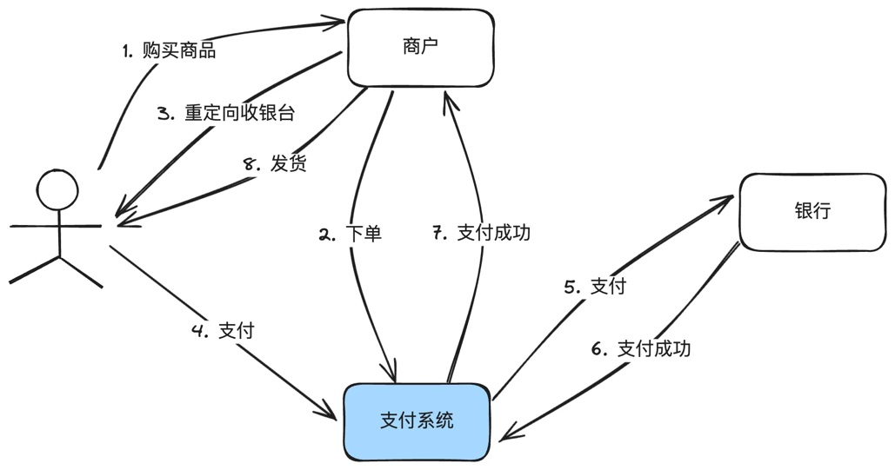
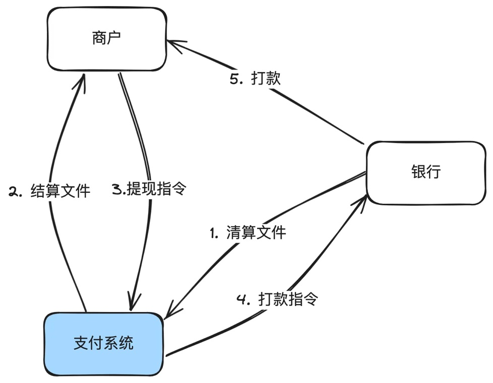
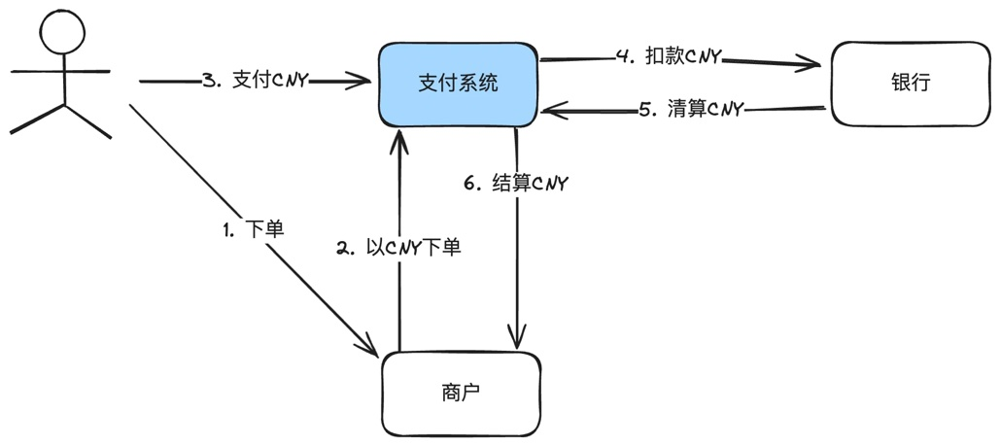
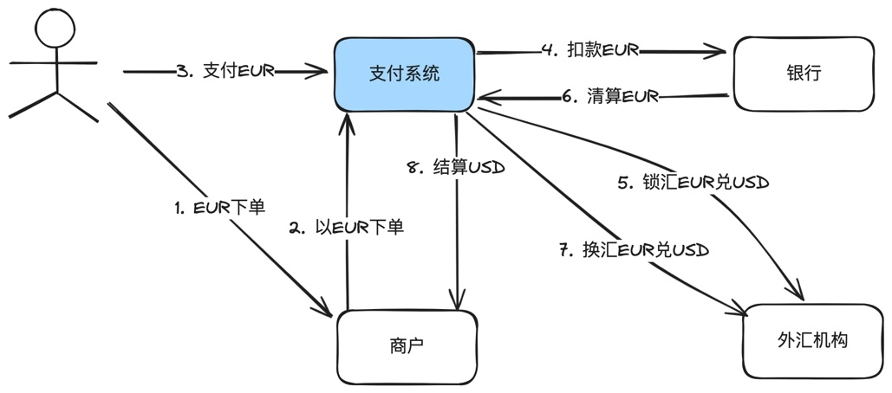
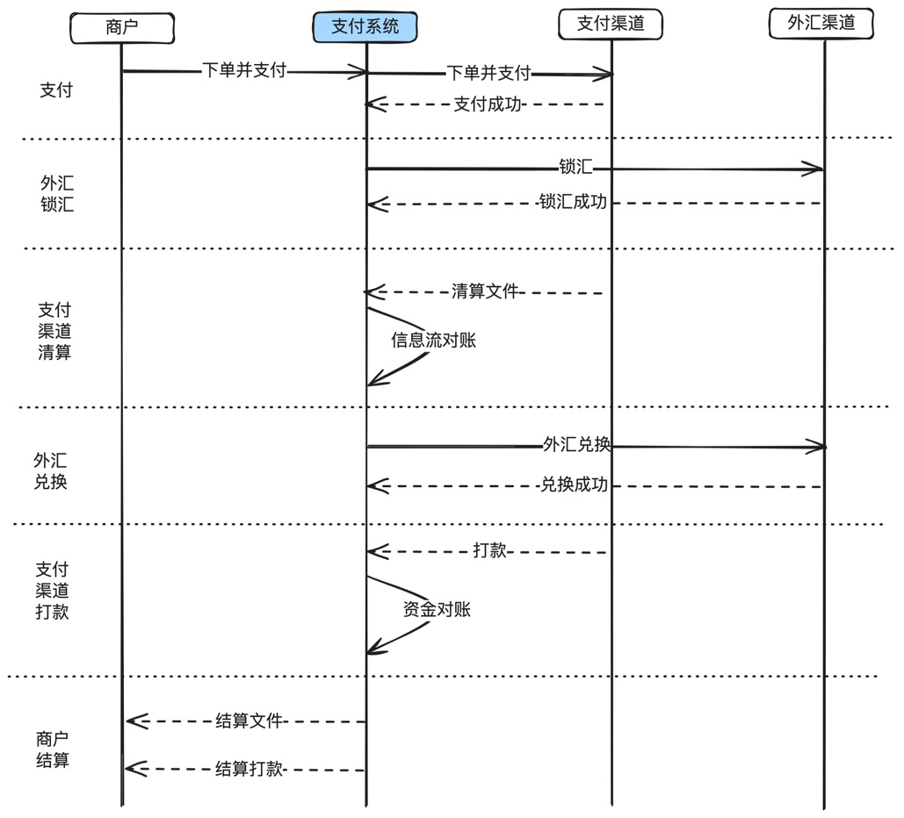
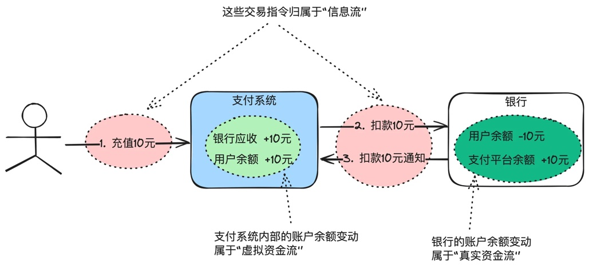
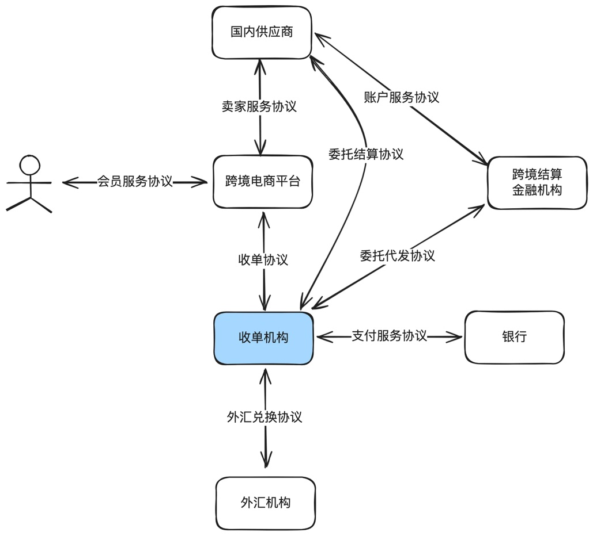
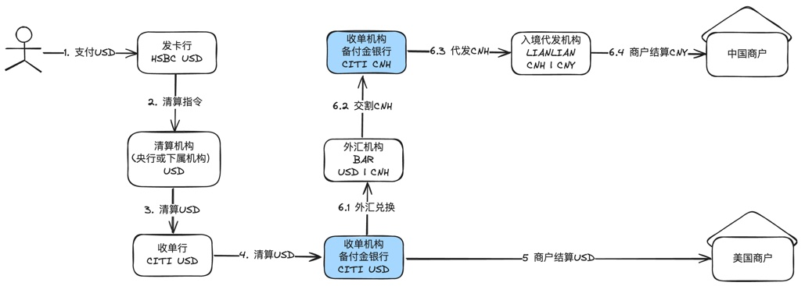

# 第1章 在线支付系统基本概念

> 来源：《图解支付系统设计与实现》V_0.1.0，隐墨星辰著。PDF 第 14–22 页。正文经 MinerU OCR 转换，原图保留。

<!-- PDF 第 14 页；原书第 11 页 -->

本书聚集于实战，只讲解最实用的知识点，至于支付起源、在线支付发展历程等科普知识，感兴趣的读者可参考其它优秀的支付类书籍或网络上其它优秀的文章。

本章内容对大部分专业概念进行了极致简化，以便更好地帮助读者入门。实际的实现会复杂得多，在后面的章节中我们将展开详细说明。

另外，在线支付系统涉及的专业术语比较多，理解这些术语对理解支付系统的设计至关重要，建议对基础术语理解不足的读者，结合附录中“支付相关必知术语”一起看。

注：后面的描述中，经常混着用“支付系统”、“支付平台”，本质是一个东西。在内部来说，就是一个支付系统，但从和外部机构交互来说，就是一个支付平台。

## 1.1 极简支付流程

### 说明：

1. 这是一个最简化的支付流程。真实的交互比这个复杂得多，单收银台渲染就可以写一整篇文章。但对于讲清楚支付系统的作用，已经足够。

<!-- PDF 第 15 页；原书第 12 页 -->

2. 从图中可以引申出支付系统最核心的作用：帮商户收钱。

3. 有支付当然就有退款、撤销等逆向操作，复杂的跨境支付还会有外汇交易，跨境结算等业务。这些全部在后面的系列文章中细讲。

## 1.2 极简清结算流程

### 说明：

1. 这里画的是信息流。

2. 银行和支付平台之间是机构对机构的关系，通常使用清算概念，因为金融机构之间大部分情况下会有独立的清算机构做清算服务。

3. 支付平台和商户之间，通常使用结算概念，由支付平台直接打款给商户。

4. 上面画的是结算到商户开在支付平台的内部账户余额，所以需要商户手动提现，支付平台通常也支持直接结算到卡，这样就不需要商户手动提现。

5. 清结算三个字还有另外一层含义：清分+结算。前者是把钱算清楚，后者是真实打款。

<!-- PDF 第 16 页；原书第 13 页 -->

## 1.3 极简本对本收单流程

说明：

1. 所谓本对本收单，就是指商户的商品标价币种、向支付系统的下单币种、用户支付币种、商户结算币种都是同一个币种。不涉及到外汇交易。

2. 一个中国人拿着中国招商银行信用卡在淘宝或京东买东西，就是标准的本对本收单。

## 1.4 极简跨境收单流程

### 说明：

1. 所谓跨境收单，就是结算给商户的币种和用户支付的币种不一样，需要经过外汇机构换汇。

<!-- PDF 第 17 页；原书第 14 页 -->

2. 在扣款EUR成功后，支付平台会调用外部的外汇机构进行锁汇。

3. 在银行清算后，支付平台再调用外部的外汇机构进行真正的换汇。

4. 最后支付平台结算给商户USD。

如果换成时序图，如下：

## 1.5 极简信息流与资金流

<!-- PDF 第 18 页；原书第 15 页 -->

### 说明：

1. 用户在支付平台充值10元，支付平台向银行发起扣款请求，这些指令操作归属于信息交互，属于信息流。

2. 实体资金流：银行账户余额的变动。比如：银行在内部把用户的余额减10元，给支付平台备付金账户加10元。

3. 虚拟资金流：支付平台内部账户余额的变动。比如：支付平台内部把银行应收账户加10元，给用户余额账户加10元。

4. 为什么会有实体资金流和虚拟资金流之分？因为我们真正能拿到钱的地方是银行，在支付系统内看到的只是一个数字，如果想变成真实世界的钱，还得发给银行提现。

## 1.6 极简跨境收单的协议关系

<!-- PDF 第 19 页；原书第 16 页 -->

### 说明：

1. 这只是跨境收单的一种协议关系，真实场景存在多种形态。

2. 上述的收单机构是持牌的，但是没有跨境结算的能力，所以需要委托有跨境结算牌照的金融机构代为处理跨境结算业务。

3. 跨境电商平台只是一个商户平台，没有收单资质，所以需要委托收单机构给它下面的供应商结算打款。

4. 剩下的协议关系都是一目了然的，只是我们日常没有注意。比如用户和电商平台之间在注册时就会有会员协议要签署。

5. 特殊的情况下，一些实力雄厚的机构，比如蚂蚁或财付通，下面会成立多个实体(不同的法律主体），然后用不同的实体去申请不同的牌照(收单、银行、外汇、跨境代发等），这样表面上全部是一家公司搞定，但是实际的协议关系仍然是上面这样的，在各实体之间仍然需要签署各种协议。

<!-- PDF 第 20 页；原书第 17 页 -->

6. 如果是本对本收单场景就简单很多，没有外汇和跨境结算这一层关系，如果跨境电商的货品全部是电商实体自营的，那就更简单，没有供应商委托结算的协议。

7. 一般电商平台在没有牌照情况下是不能开设余额账户的，如果电商想开通余额，可以委托第三方有牌照的公司托管（通常也是收单机构，收单机构一般会同时申请钱包PA（paymentaccount)、PG(payment gateway)牌照)，这种情况下，电商平台和收单机构还会签署账户委托协议。

## 1.7 极简跨境资金方案

### 说明：

1. 这是一个典型的跨境资金流案例。用户支付USD，收单机构收到的是USD，但是需要结算CNY给中国境内的商户。

2. 收单机构（也就是支付平台）需要先将USD兑换成CNH（离岸人民币），再由入境代发机构把CNY结算给中国境内商户。这是所谓的“结汇入境”。

3. 如果采用“入境结汇”的方式，则收单机构直接结算USD给商户在境外的银行账户中，由商户以USD汇入境内，再兑换成CNY。或者收单机构先把USD汇入境内备付金账户，再兑换成CNY，然后再结算CNY给中国境内商户。

4. 以上这些不同的资金处理方案，统称为资金方案。

## 1.8 简明复式记账

金融机构的记账一定是基于复式记账法。下面以用户通过支付平台使用银行支付500块为例做个简要说明。

<!-- PDF 第 21 页；原书第 18 页 -->

假设：支付平台使用CMB作为收单行，在CMB开设有备付金账户。

涉及的支付平台内部账户：

<table><tr><td rowspan=1 colspan=1>账户类型</td><td rowspan=1 colspan=1>账户</td><td rowspan=1 colspan=1>备注</td></tr><tr><td rowspan=1 colspan=1>借记账户</td><td rowspan=1 colspan=1>应收-渠道-CMB</td><td rowspan=1 colspan=1>应收归属借记账户</td></tr><tr><td rowspan=1 colspan=1>贷记账户</td><td rowspan=1 colspan=1>应付-过渡-网关过渡户应付-平台托管-商户待结算应付-平台托管-商户余额手续费收入-商户-消费</td><td rowspan=1 colspan=1>应付归属贷记账户手续费意味着所有者权益增加，归属贷记账户</td></tr></table>

### 记账步骤：

<table><tr><td rowspan=1 colspan=1>阶段</td><td rowspan=1 colspan=1>操作账户</td><td rowspan=1 colspan=1>金额</td></tr><tr><td rowspan=1 colspan=1>第一步资金从渠道到网关过渡户</td><td rowspan=1 colspan=1>借：应收-渠道-CMB贷：应付-过渡-网关过渡户</td><td rowspan=1 colspan=1>500</td></tr><tr><td rowspan=1 colspan=1>第二步扣除手续费</td><td rowspan=1 colspan=1>借：应付-过渡-网关过渡户贷：手续费收入-商户-消费</td><td rowspan=1 colspan=1>10</td></tr><tr><td rowspan=1 colspan=1>第三步网关过渡户到商户待结算账户</td><td rowspan=1 colspan=1>借：应付-过渡-网关过渡户贷：应付-平台托管-商户待结算</td><td rowspan=1 colspan=1>490</td></tr><tr><td rowspan=1 colspan=1>第四步结算给商户</td><td rowspan=1 colspan=1>借：应付-平台托管-商户待结算贷：应付-平台托管-商户余额</td><td rowspan=1 colspan=1>490</td></tr></table>

### 说明：

1. 支付系统的记账一定是复式记账法。内部开设了很多账户和科目。

【借记类】账户：资产，应收款等；

【贷记类】账户：负债，所有者权益，应付款等

2. 借贷简要公式（不太严谨，但是够用）：

【借记类】账户（如资产，应收款），【增加】为【借】，【减少】为【贷】；

【贷记类】账户（如负债和所有者权益，应付款），【增加】为【贷】，【减少】为【借】；

<!-- PDF 第 22 页；原书第 19 页 -->

3. 复式记账的专业书籍很多，这里只摘录几个重要的说明：

复式记账法定义：对每项经济业务按相等的金额在两个或两个以上有关账户中同时进行登记的方法。

记账原则：有借必有贷，借贷必相等。

记账依据：会计恒等式：1. 资产 = 负债 +所有者权益；2. 利润 = 收入－ 费用。

账户：具有一定格式和结构，能够用来连续、系统、全面的记录反映某种经济业务的增减变化及其结果。

科目：同类财务交易的分类，比如资产、负债、所有者权限、收入或费用等都属于科目。一般科目会分为多级。

账户和科目的区别：科目只有名字，账户包括结构和格式，每个账户对应一个特定的科目。
