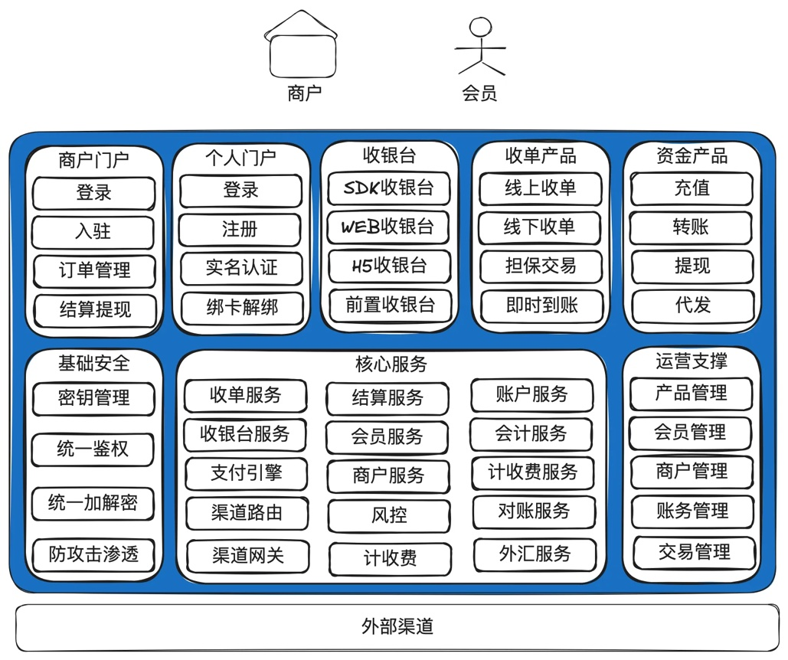
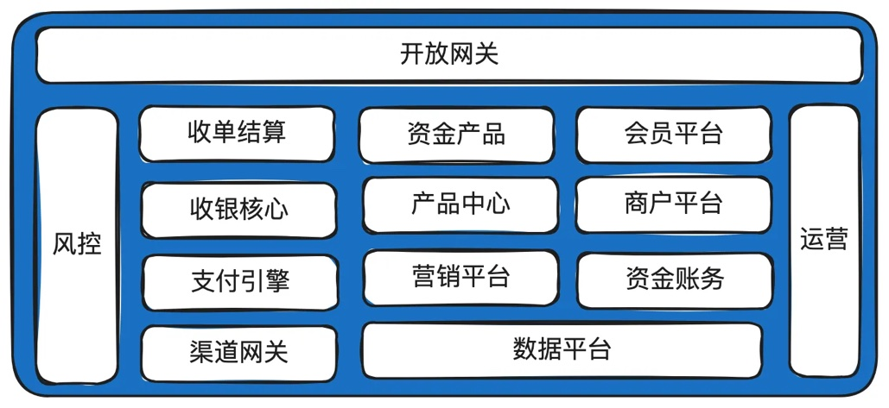
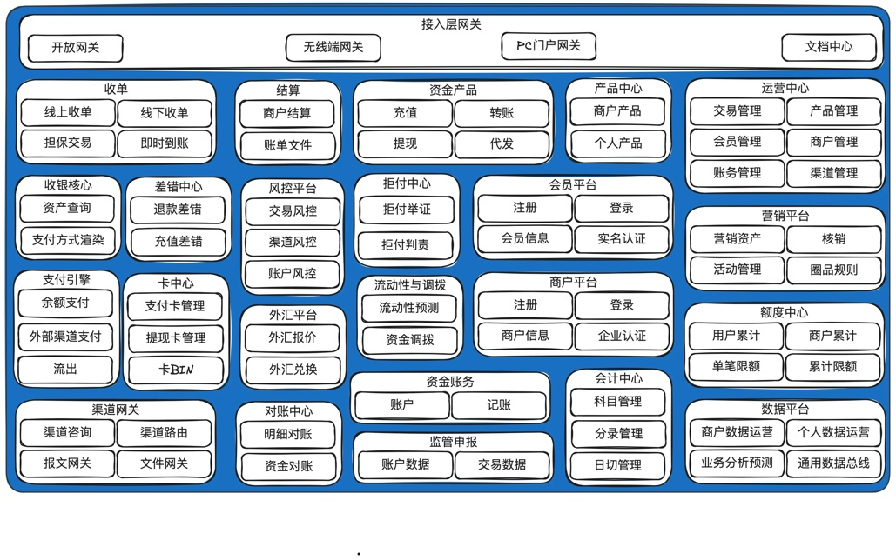
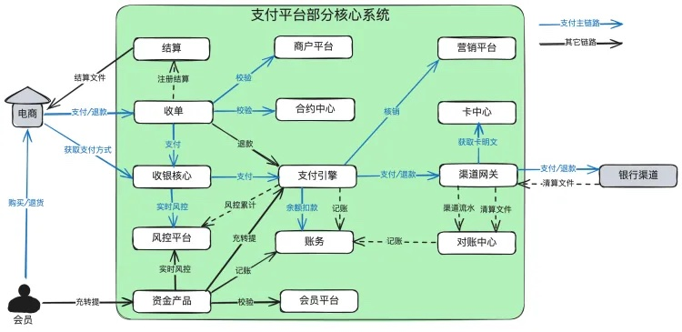

# 第2章 在线支付系统概要设计

> 来源：《图解支付系统设计与实现》V_0.1.0，隐墨星辰著。PDF 第 22–26 页。正文经 MinerU OCR 转换，原图保留。

<!-- PDF 第 22 页；原书第 19 页 -->

这章内容主要介绍支付系统全局性设计，先看完支付系统的全貌，在后面的“核心子域设计篇”会对里面涉及的各子域/子系统做详细说明。

## 2.1 简明产品架构图

<!-- PDF 第 23 页；原书第 20 页 -->

### 说明：

1. 这个图画得比较简单，但是已经涵盖一个支付系统最核心的产品能力。

2. 上面部分是会员或商户感知的产品能力，包括门户、收银台，收单产品，资金产品等。下面部分是支付系统最核心的服务，用于支撑对外的产品能力。

## 2.2 极简系统架构图

<!-- PDF 第 24 页；原书第 21 页 -->

### 说明：

1. 这个图很精简，但是基本已经够用，应付本对本交易这种简单的业务是完全没有问题的。

2. 一些复杂的支付系统可能还有外汇、额度中心、产品中心、卡中心等，甚至一个子系统可能会拆分为多个应用独立部署，比如收单结算就可以拆成收单和结算两个独立的应用。

## 2.3 完整系统架构图及各子系统简介

<!-- PDF 第 25 页；原书第 22 页 -->

### 说明：

1. 这是一比较完整的系统架构图，属于逻辑划分。在单体应用中就是一些模块，在分布式应用中就是一些子域、子应用或子系统。

2. 以下是各子系统简单介绍：

a. 开放网关：主要对接商户，比如下单、支付等接口入口。通常要求有比较高的安全性。部分公司可能会把移动端网关、PC门户网关、商户通知等能力集成在开放网关，也可能会单独拆出部署。

b. 收单结算：负责把商户的单收下来，并给商户发起结算。承担的收单产品包括有：线上收单，线下收单，担保交易、即时到账等，每个公司的商业策略不同，开出的收单产品会有差异。

c. 资金产品：承担无买卖标的的纯资金转移能力。典型的有：充值、转账、提现、代发。和支付的区分在于支付是有买卖标的，而资金产品没有。也就是在系统中没有买卖记录发生，但在线下可能有。

d. 收银核心：渲染可用支付方式。包括查询账户是否有余额，查询营销是否有营销券，查询渠道网关是否有可用的外部渠道，最后组合成可用支付方式，供前端渲染。

e. 支付引擎：负责真正的扣款或转账。有些公司叫支付核心，或资产交换。个人认为资产交换更合适，因为无论对于支付、退款、充值、转账等各种交易，本质都是把资产从一个账户交换到另外一个账户。

f.渠道网关：负责去外部渠道扣款。通常还会提供渠道路由、渠道咨询等能力，做得细的公司可能下面再细分为渠道产品，报文网关和文件网关。

g. 会员平台：管理会员的注册、登录、密码、实名认证等。

h商：管理商的入登管理

i. 产品中心：管理平台对外提供的产品能力。一般大的支付系统才会独立成一个子系统。

j. 资金账务：负责账户开立，记账等。

k. 会计中心：会计科目管理、分录管理、日切管理。

1. 对账中心：负责明细对账和资金对账。

m. 营销平台：提供满减、红包等营销工具。

n. 风控平台：针对账户和交易，提供实时、离线风控，控制平台的风险。

0. 运营平台：订单管理、渠道管理、产品管理等综合运营工具。

p. 数据平台：主要用于数据汇总和分析。分布式部署后，数据都在各子系统中，需要汇总到数据平台用于经营分析。

.管的息Cl

<!-- PDF 第 26 页；原书第 23 页 -->

r. 额度中心：累计用户、商户的额度，通常有日、月、年等各种分类。

s. 外汇平台：负责外汇报价和兑换。

t. 流动性与调拨中心：一些跨境支付公司，在多个国家多个银行有头寸，各头寸之间经常需要做流动性管理，提高资金利用率。

u. 差错中心：负责差错处理。比如渠道退款失败，需要通过其它的方式退给用户。

v. 拒付中心：处理用户的拒付和举证。在跨境支付场景下，信用卡用户联系发卡行说卡被盗刷或商品没有收到，或商品有问题等，拒绝支付给商户。

## 2.4 核心系统依赖图

### 说明：

1. 图中画得比较清楚了，没有太多需要补充的。

2. 其中蓝色线为支付主链路。

3. 真实的调用会是一张蜘蛛网，从简洁出发，有些依赖没有画出来，比如收银核心也会依赖卡中心进行绑卡信息的写入和读取。
