# 第3章 核心业务简介

> 来源：《图解支付系统设计与实现》V_0.1.0，隐墨星辰著。PDF 第 26–37 页。正文经 MinerU OCR 转换，原图保留。

<!-- PDF 第 26 页；原书第 23 页 -->

支付平台尤其是持牌的收单机构通过都会提供非常多的服务，除了常见的支付、退款、提现等业务外，还会提供个人账单查询，商户账单下载等，这里只介绍对客感知的最核心的几个服务。

<!-- PDF 第 27 页；原书第 24 页 -->

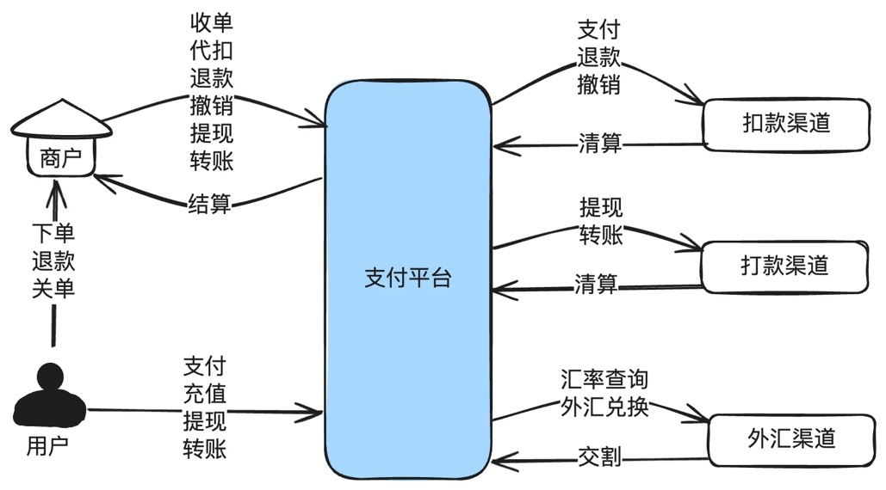

一个持牌支付机构的系统一般会提供以下几个核心的能力：

支付：帮商户把用户的钱从扣到支付平台的账户。

撤销：把用户已经支付成功的钱退回给用户，没有支付成功的直接关闭订单。

退款：把用户支付的钱退回给用户。

清算：外部渠道把钱给到支付平台。

结算：支付平台把钱结给商家。

充值：用户把钱充值到在平台开的余额账户。

转账：用户账户之间进行转账。

代发：帮商户把钱转到个人用户的账户。有代发到卡和代发到余额。

调拨：支付平台内部因为流动性管理的需要，在多个银行账户之间转账。

提现：用户把钱从平台的余额账户中提现到外部的银行卡。

一些跨境场景下，支付系统还需要提供外汇服务，比如中国商家在多多的海外品牌temu卖货，用户在美国支付的是美金，但是中国商家需要在中国拿到人民币。

除此之外，还会有很多辅助能力，比如商户入驻，商户自助服务，个人自助服务等。

因为任何一个业务在支付系统内部都是由多个子域经历很多操作才能完成。拿支付的下单子流程来说，先是入口网关的验签，解密，然后到商户平台的权限校验，风控校验等，我们这里只讲业

<!-- PDF 第 28 页；原书第 25 页 -->

务的本质，不涉及各子域内的操作或交互。各子域的功能和交互，在后面的“核心子域设计篇”会有详细介绍。

## 3.1 支付

给支付最简单的定义，就是帮商户把用户的钱扣到支付平台的账户。至于到了支付平台账户后怎么做，后面还有清分结算，对账等。

支付方式、支付渠道的抽象在每个公司都不一样，而且现在为了提高用户体验，创新了很多种支付方式，比如扫码付（还分正扫、反扫），三方钱包APP跳转支付，快捷支付，网银支付，代扣，先用后付（京东白条、花呗，国外的BNPL），VA、OTC、余额账户等。

而回归到本质，还是那句话：帮商户把用户的钱扣到支付平台的账户。剩下的所有工作都是围绕这个核心点展开。

### 支付的本质

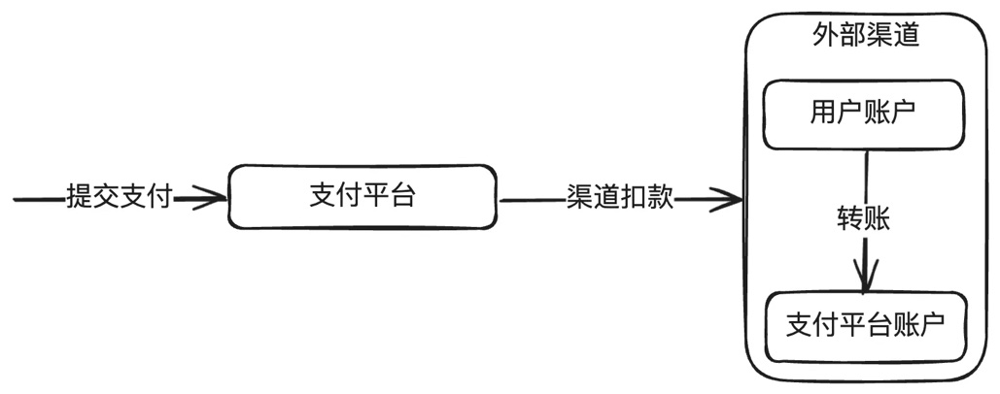

### 说明：

1. 支付的本质是帮商户把用户的钱扣到支付平台的账户。

2. 比较特殊是余额支付和营销，余额是平台内容开设的虚拟账户，不会调用外部渠道。营销往往也是调用内部的营销系统做核销，分有资和无资。

3. 涉及的记账，这里没有画出来。在后面的账务系统章节中有详细介绍。

### 支付信息流

<!-- PDF 第 29 页；原书第 26 页 -->

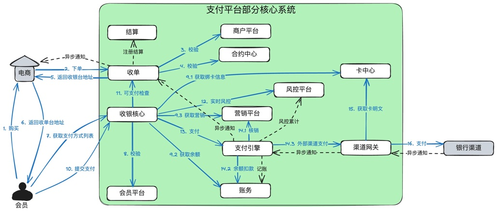

### 说明：

1. 只画了几个核心的域，部分域没有画出来，比如限额中心等。

2. 部分调用会有多次，为简化，也只画了一次，比如会员的校验。

3. 有些流程没有画出来，比如收单推进成功后，也会调用账务进行记账。

### 支付资金流

资金流在后面的账务章节会详细介绍，这里只做个简单说明。

首先是虚拟资流，也就是支付平台内部的资金流，以即时到账模式为例，如下：

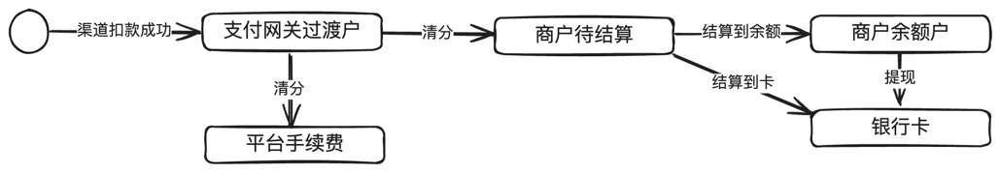

说明：

1. 支付平台记账都是复式记账法，渠道扣款成功后，会同时记“支付网关过渡户”和“渠道待清算”。此处为了简化，只写了支付网关过渡户。

2. 还有分账、分润模式。比如：商户A是通过一个大商户B入驻到了支付平台，商户A收98块，大商户B收手续费1块，平台直接结算给商户A和大商户B，就是典型的分润模式。

实体资金流就是外部银行之间的转账。

<!-- PDF 第 30 页；原书第 27 页 -->

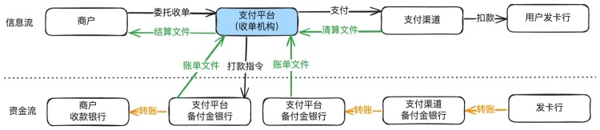

## 3.2 撤销与退款

撤销和退款都是支付的逆向操作。两者核心的区别：

撤销：没有支付成功的单据，也可以撤销。如果还没有支付成功，就直接关闭订单。如果已经支付成功，就把用户的钱退回去。

退款：支付成功后，才能进行退款。如果订单还没有支付成功，返回退款失败。如果支付成功，就把用户的钱退回去。

在以前还有一个冲正的概念，现在用得比较少。冲正的概念来源于以前信用卡POS机交易场景，当信号不好时，不知道上次支付是成功还是失败，就对支付交易发起一笔冲正，本质和撤销是一样的，

因不同的收单机构或外部渠道都有自己的业务方案，所以针对撤销和退款还会存在一些差异：

1. 有些收单机构和外部渠道，对于支付成功的交易，只有在日切前可以撤销，日切后只能退款。

2. 有些收单机构和外部渠道，撤销和退款已经合并。

3. 一般情况下撤销是退款退费，也就是收的支付手续费，会退回给商家。而退款通常是退款不退费的，也就是收的支付手续费，不会退回给商家。不过也有些收单机构或外部渠道，退款也会退费。

### 退款本质

<!-- PDF 第 31 页；原书第 28 页 -->

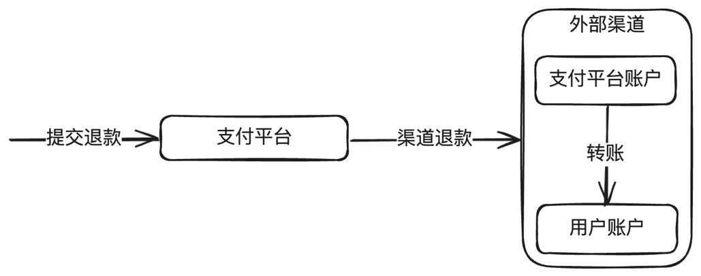

### 说明：

1. 退款的本质就是把钱先从商户那里扣除，然后转给用户。

2. 余额支付的退款不会调用外部渠道。

3.完整的流程很长，比如：收到商户的退款请求后，需要先查询历史合约，检查合约是否支持退款，是否过了退款有效期，是否满足最小退款金额，全部通过后，就创建退款单并保存。接下来会进入退款资金准备阶段，因为从资损防控的角度，除非另有合约约定，否则支付平台一般是不会做垫资退款的。在退款资金准备阶段，需要实时扣减商户待结算户的钱，这是与支付流程很大不同的点。当然，有些支付公司可能和商户约定从独立的退款账户进行扣款，那也需要保证这个退款账户余额充足。

### 退款资金流

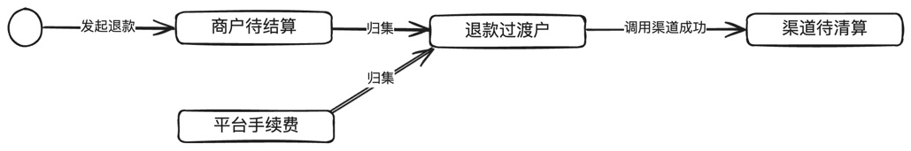

### 说明：

1.退款校验通过后，需要做资金准备，归集到退款过渡户。调用渠道成功后，到渠道待清算。

2. 为了简化，只画了单边账户，实际记账时是复式记账。

3. 还有一些流程没有画出来，比如清算文件过来会对账，推进到渠道应清算，与渠道对账后，还会推进到银行头寸。

<!-- PDF 第 32 页；原书第 29 页 -->

## 3.3 外部渠道清算

外部渠道支付成功、或退款成功，都会涉及清算流程，简单地说，就是外部渠道把当天的支付、退款交易数据先进行轧差，然后生成一个清算文件，支付平台拿到这个文件后，解析并与内部的交易进行对账，对账成功后，从待清算户到应清算户，在渠道真实打款后，查到账单，再从应清算到银行头寸。

更详细的可以参考后面的账务域内容。

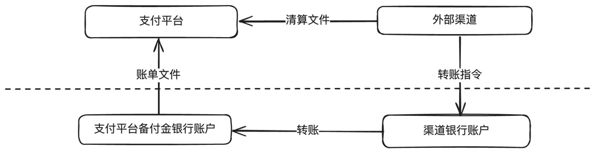

说明：

1. 图中画的外部渠道是三方钱包的场景，也就是支付平台和外部渠道全部都是在银行开的账户，那就会有跨行转账。

2. 特殊情况下，外部渠道是一个银行，支付平台直接在这个银行开了账户，那就是外部渠道内部转账。

## 3.4 商户结算

在收单机构(支付平台）里，结算就是把帮商户收进来的钱，按约定的结算规则、准确、及时地结算给商户。

<!-- PDF 第 33 页；原书第 30 页 -->

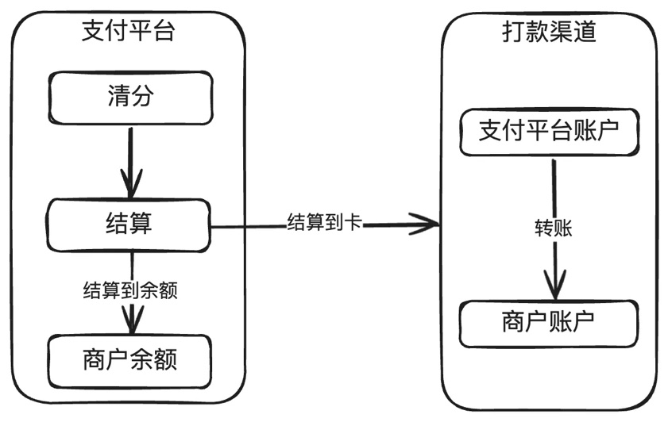

结算前需要先做清分，就是把一笔支付的钱，根据当初签订的合约分成若干份。比如支付100块，平台手续费1块，商户99块。

根据合约，可以结算到余额，也可以结算到卡，结算还有结算周期，也就是所谓的T+n，其中的T是指交易时间，n指第几天结算。比如T+0就是当天的交易当天结算，T+2就是当天的交易在第3天才结算。

## 3.5 充值

充值就是把用户的钱充到支付平台余额账户。余额因为涉及到资金安全，所以无论国内国外基本上都是需要持牌经营。

很多持牌机构都想让用户做充值，好处也很明显，比如：

1. 使用余额支付的成功率极高。

2. 因为有资金留存，用户打开的频率更高。

3. 在国外，如果利用好流动性管理，因为资金量足够大，利息或理财收益也很高。

<!-- PDF 第 34 页；原书第 31 页 -->

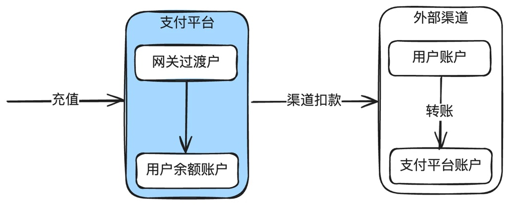

充值的核心只有2个点：

1. 支付平台调用渠道把用户账户的钱转到支付平台的账户。

2. 支付平台把用户的余额账户加上对应的金额。

## 3.6 转账/代发/调拨

转账、代发、调拨的本质就是把资金从一个账户转到另一个账户。三者之间有一些细微的区别：

1. 转账：一般是指个人到个人的转账。包括余额到余额，余额到卡。

2. 代发：一般是指商户到个人的转账。比如代发工资。

3. 调拨：一般是指支付平台内部多个银行账户之间做流动性管理时的转账。

还有两种比较特殊的转账，就是发红包和AA收款。一对一的红包，本质就是一对一的转账，一对多的红包，本质就是一对多转账。AA收款的本质就是多对一的转账。

以转账到银行卡为例，用户A把自己的余额100元转给B用户在招行的银行卡，如下：

<!-- PDF 第 35 页；原书第 32 页 -->

说明：

1. 支付平台先把A用户余额账户扣减。

2. 然后调用外部渠道转账，由银行把支付平台备付金的资金转到B用户的账户上。

## 3.7 提现

提现的本质也是转账，只是用户把支付平台余额账户的钱，转到自己在外部渠道的账户里。

与一般意义上的转账的区别在于，通常情况下说的转账是不同用户或商户之间的转账，而提现默认是自己余额账户的钱提到自己开设在外部银行的账户。比如支付宝或微信余额提现到自己在招行的账户里。

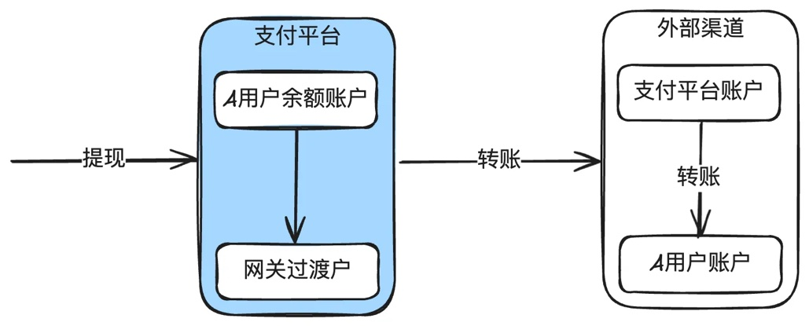

## 3.8 外汇

<!-- PDF 第 36 页；原书第 33 页 -->

外汇业务表面上只是把一种货币换成另外一种货币，但是实际情况下是非常复杂的。比如需要区分自由流动货币和管制货币，交易有即期、远期、掉期等，涉及跨境电商有结汇入境和入境结汇。另外，外汇市场是全球最大的金融市场。

在前面的“1.7极简跨境资金方案”讲了一个典型的跨境电商结汇入境的例子，这里不再赘述。
