# 第4章 收单结算

> 来源：《图解支付系统设计与实现》V_0.1.0，隐墨星辰著。PDF 第 37–62 页。正文经 MinerU OCR 转换，原图保留。

<!-- PDF 第 37 页；原书第 34 页 -->

收单结算是支付系统最重要的子域之一，行业内经常把有牌照的支付平台称为“收单机构”就可见一斑。

本章主要讲清楚支付系统中收单涉及的基本概念，产品架构、系统架构，以及一些核心的流程和相关领域模型、状态机设计。

## 4.1 收单结算概述

收单和结算结合很紧密，先讲一下收单结算的整体概念，再单独细讲收单平台，结算平台，拒付平台。

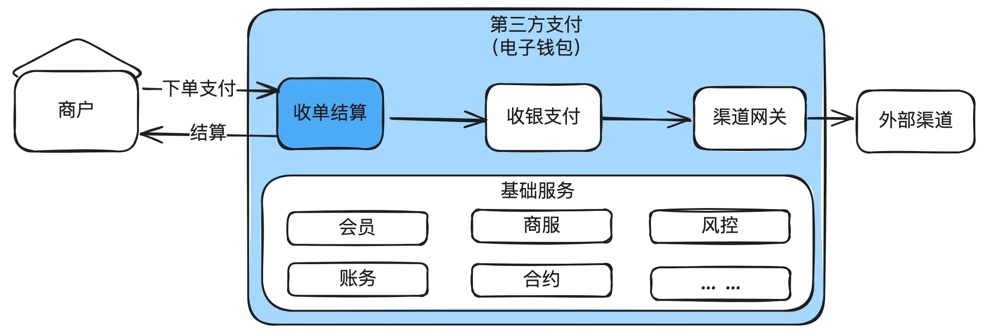

通常把收单、结算、拒付放在一起讲，主要是因为这三个都是面向商户的最核心的服务。简要如下：

收单：帮商户把钱从用户手里收进来。

结算：把从用户收进来的钱结转给商户。

拒付：在用户发起拒付后需要从商户待结算款里面扣除拒付的这部分钱(因为这部分钱需要退回给用户）。在国际收单场景比较常见。

这三者紧密联系却又彼此各有侧重点，下面分开讲述。

## 4.2 收单结算产品架构图

<!-- PDF 第 38 页；原书第 35 页 -->

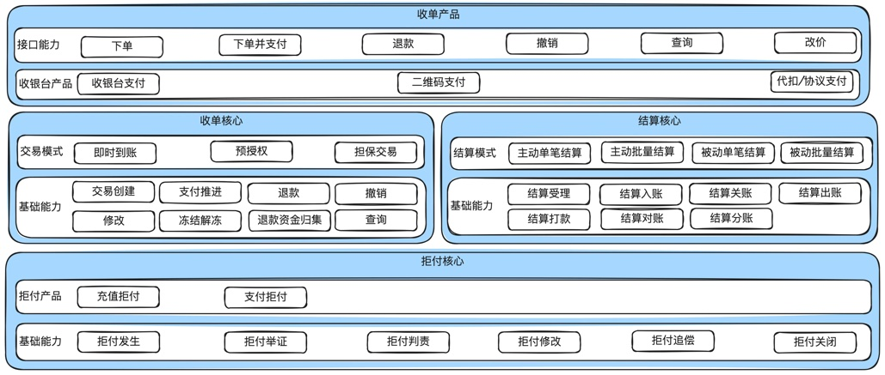

从图中可以看到，最上层是收单的产品层，负责对商户提供直接的服务，并且封装个性化的收银台产品。主要包括有：

收银台支付：需要跳转到收银台进行支付；

二维码支付：需要先调用码平台进行解码，解码后就和普通的支付流程是一样的；

代扣/协议支付：商户后台发起扣款，不需要跳转到收银台。

再下面是三个核心，分别为收单核心、结算核心、拒付核心。三者的职能如下：

收单核心：主要负责处理商户订单的全生命周期管理：订单创建、支付推进、退款、撤销等。

结算核心：主要负责把商户应收账款算清楚，把结算款按合同约定结转给商户。

拒付核心：主要负责处理用户的拒付和对应的抗辩以及最后的判责。

## 4.3 收单平台：打造商户收款的高效之道

### 4.3.1 收单演进形态

无收单机构模式

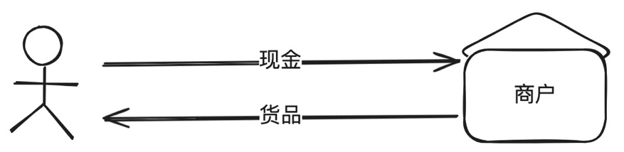

<!-- PDF 第 39 页；原书第 36 页 -->

这就是小时候去小卖部买糖的模式，一手交钱一手交货。

好处：足够简单。不足：无法完成线上交易。

#### 行内收单模式

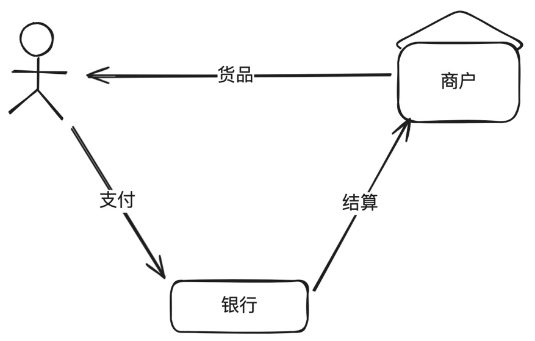

所谓行内收单，就是发行卡和收单是同一家银行。

好处：手续费低，成功率高。不足：业务比较受限，以线下收单为例，商户无法部署所有的银行POS机。

#### 发卡行与收单行分离模式

<!-- PDF 第 40 页；原书第 37 页 -->

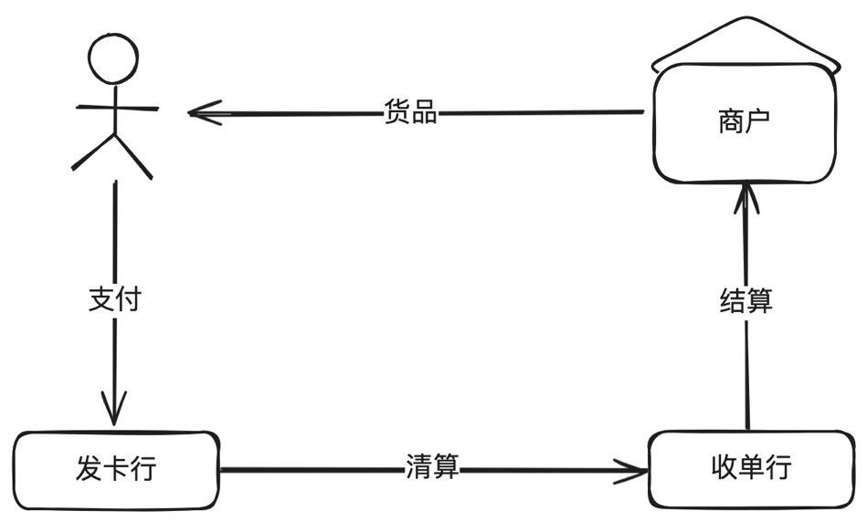

大部分情况下，用户的发卡行和商户的收单行是不同的银行。

不过，这种情况基本也已经灭绝，因为需要发卡行和收单行两两对接，形成一个巨大的网状结构，维护成本高昂。

#### 清算机构模式

<!-- PDF 第 41 页；原书第 38 页 -->

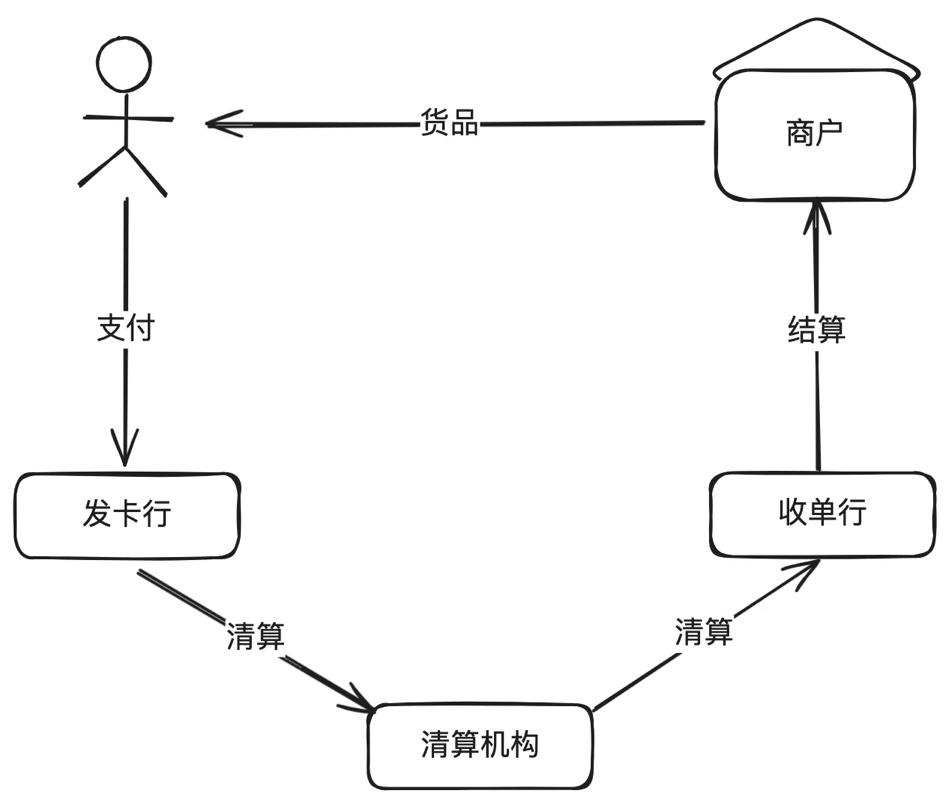

发卡行和收单行之间不再直连，而是通过清算机构。清算机构通常是央行下面的特许经营的金融机构。这样围绕清算机构形成一个星形架构，所有银行只需要和清算机构对接就行。

当前银行间的交易基本上是这种形态。比如中国的银联，国外的VISA，MASTERCARD等，是卡组，也是清算机构。

#### 第三方支付（电子钱包）形态

<!-- PDF 第 42 页；原书第 39 页 -->

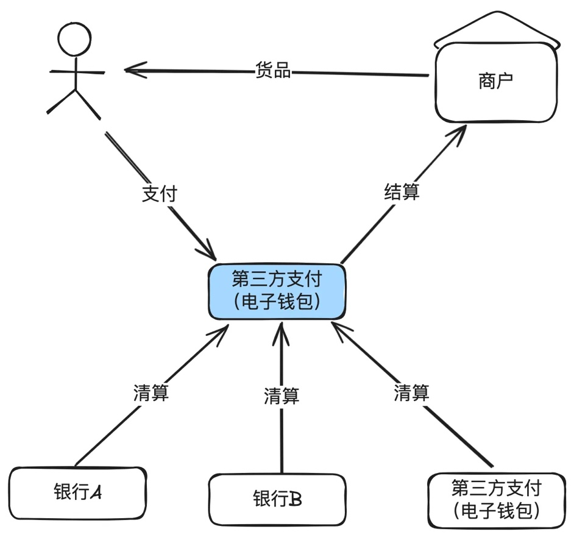

随着互联网支付的兴起，以第三方支付为中心形成另外一个星形结构。

上图做了很大的简化。在中国因为断直连的关系，支付宝、微信支付背后的财付通等这些第三方支付机构都是对接银联、网联，而不是直连银行。但是在国外仍然是允许直连银行的。

### 4.3.2 收单在支付系统中的位置

把收单和结算再细化分拆，收单的地位如下图所示：

<!-- PDF 第 43 页；原书第 40 页 -->

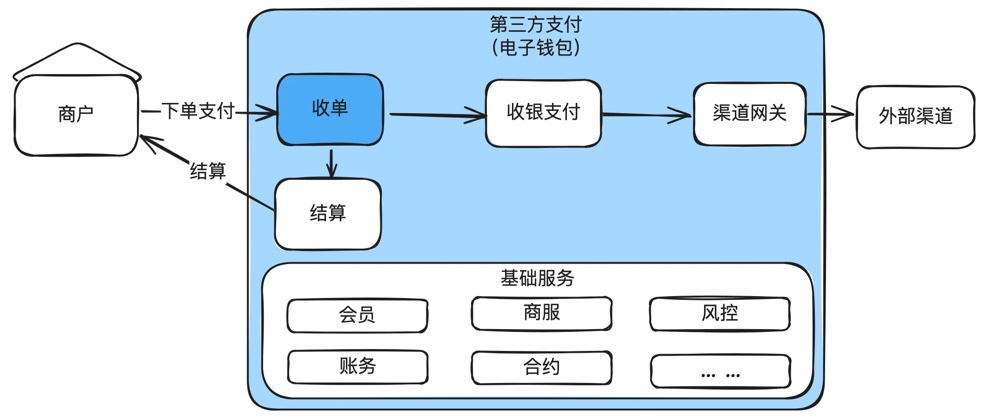

如果用一句话说明收单的核心能力和定位，那就是：负责商户收单业务的全生命周期管理。

### 4.3.3 收单产品架构图

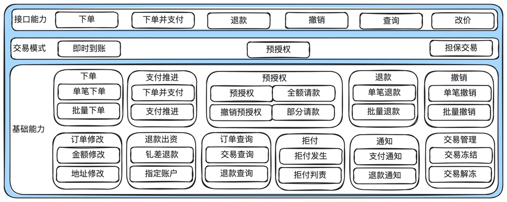

前面说过，收单核心负责商户业务单的全生命周期管理，对外提供下单、退款、撤销、查询等接口。

行业内对于交易模式基本有3种：

a. 即时到账模式：用户支付完成后，钱就到商户账户。注意：这个“即时”是相对概念。商户真正拿到钱还需要看结算协议及结算进度。去小卖部拿支付宝、微信支付买零食都是这种模式。

b. 预授权模式：先从用户账上预授权一笔钱，交易完成后再进行请款。最常见的就是酒店住宿场景，入住时先预授权一笔钱做押金，离店时根据消费情况做请款，并撤销（Void)多余的预授权款项。

<!-- PDF 第 44 页；原书第 41 页 -->

c. 担保交易模式：用户支付完成后，钱先扣在支付平台，用户确认收货后，再通知支付平台放款给商户。在淘宝买东西就是这种模式。

为支持对外的能力，收单需要建设很多基础服务，包括下单、支付推进、退款、撤销、通知、冻结解冻等。

### 4.3.4 收单系统架构图

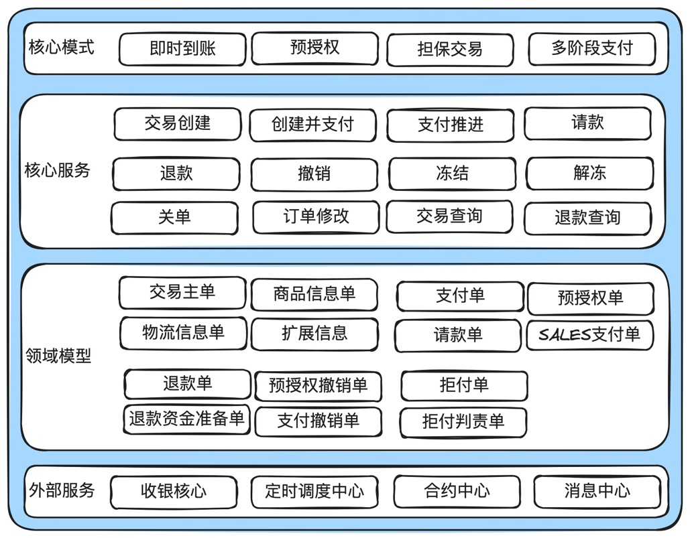

这个系统架构图中包含了收单最基本的能力。

收单在收到商户的请求后，需要调用会员、商户等域校验合法性，还会调用合约中心等校验商户的权限，全部通过后，就会创建收单单据。

如果只是预下单，收单单据创建完成后就直接返回给商户订单创建成功，并返回收银台地址，供用户跳转到收单台继续支付。

如果是下单并支付(比如代扣），收单单据创建完成后，调用收银支付域进行支付扣款流程。

<!-- PDF 第 45 页；原书第 42 页 -->

### 4.3.5 收单核心流程

极简支付流程

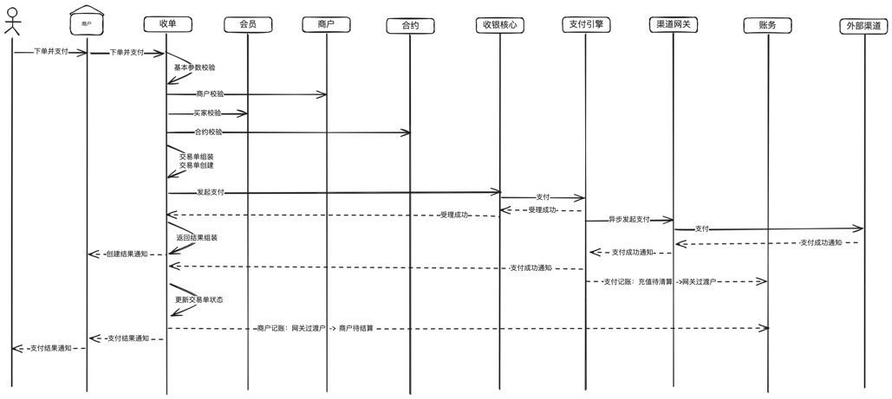

上面的时序图已经清楚说明支付整体的流程，以及各子域之间的交互。部分子域没有画出来比如支付过程中需要调用风控、卡中心、额度中心等，这些在后面讲收银支付域时重点说明，本次聚集在收单领域。

另外，这里只画了类似代扣场景的支付流程，现实中的预授权、请款，担保交易、预付款（多次支付）等模式会复杂很多。

#### 极简退款流程

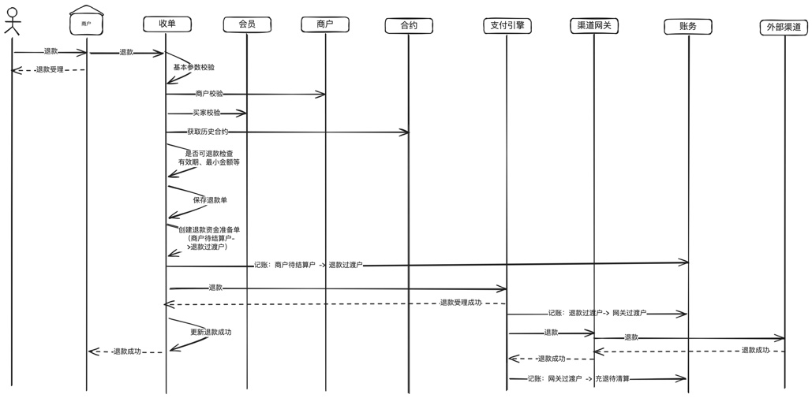

<!-- PDF 第 46 页；原书第 43 页 -->

用户发起退款后，在商户侧会进行校验，校验通过后就会给用户展示退款已提交之类的提示。

收单接收到商户的退款请求后，需要先查询历史合约，检查合约是否支持退款，是否过了退款有效期，是否满足最小退款金额，全部通过后，就创建退款单并保存。

接下来会进入退款资金准备阶段，因为从资损防控的角度，除非另有合约约定，否则支付平台一般是不会做垫资退款的。在退款资金准备阶段，需要实时扣减商户待结算户的钱，这是与支付流程很大不同的点。当然，有些支付公司可能和商户约定从独立的退款账户进行扣款，那也需要保证这个退款账户余额充足。

上面最后一步的记账只写到了充退待清算户，之后等到清算文件过来后，会再继续推进充退待清算户到渠道应收的记账。

### 4.3.6 收单领域模型设计

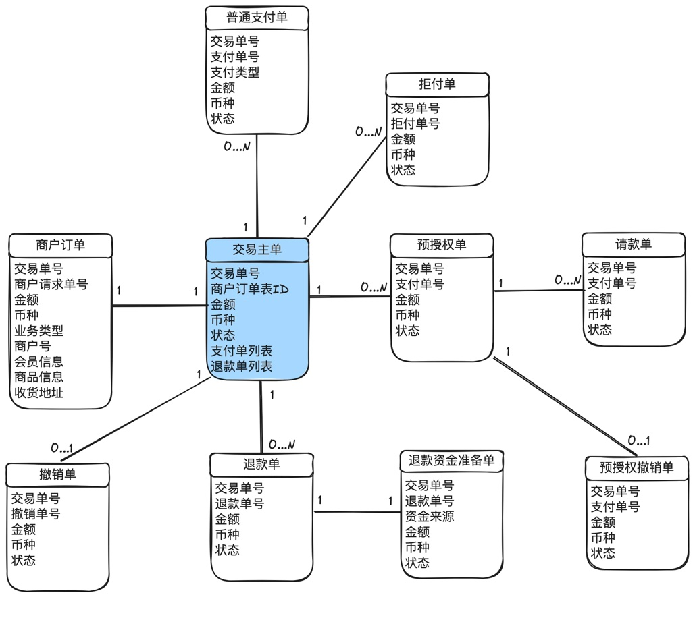

<!-- PDF 第 47 页；原书第 44 页 -->

这是精简后的模型，对于说清楚收单的核心能力建设已经足够。真实场景下还需要增加很多必要的字段，比如产品码，合约号，冻结标识等。在做详细设计时根据业务诉求去增加就行。

从图中也可以看出，最核心是交易主单，所有其它单据都与交易主单关联。

比较特别的是里面有普通支付单和预授权单。正常都是普通支付单，只有预授权产品才会有预授权单，对应的还有请款单和预授权撤销单。

### 4.3.7 收单状态机设计

下面以交易主单、普通支付单、退款单、预授权和请款单等常见的单据状态机做说明。

特别需要说明的是，状态机的推进一定要设计好，不能使用ifelse来写，要牢记“终态不可变更”的原则，否则容易出问题。具体怎么使用代码实现状态机，以及为什么“终态不可变更”，后面单独开章节来详细论述。

#### 交易主单状态机

交易主单创建初始入库就是INIT。

如果是下单并支付场景(比如代扣），就先推进到PAYING，然后调用收银支付进行扣款操作。如果是部分请款，也是支付中，全额请款完成或未请款部分撤销了预授权，就推进到SUCCESS。

如果是预下单，那停留在INIT，然后等支付域支付成功回执回来，推进到SUCCSSS。

<!-- PDF 第 48 页；原书第 45 页 -->

如果订单关闭，就推进到CLOSE。

需要特别说明一点的是，一些经验不足的同学在交易主单耦合了很多不应该放在交易主单的状态，比如退款成功，撤销成功等。这导致交易主单的状态机特别复杂，非常容易出错。比较好的经验就是，交易主单、支付单、退款单、撤销单等全部只管自己的状态机。

#### 支付单状态机

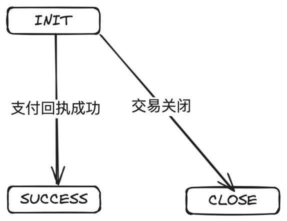

支付单创建初始状态就是INIT。

收到支付域的支付成功回执，更新为SUCCESS。

交易超时关闭，推进到CLOSE。

#### 退款单状态机

<!-- PDF 第 49 页；原书第 46 页 -->

然后推进退款资金准备，这个过程把要退款的钱从商户待结算户或指定账户扣到退款过渡户，如果收单合约中还要求退款退费，还需要从收费账户把手续费扣出来。

退款资金准备成功后，推进到PREPARE\_CUSS。

然后向支付域发起退款，支付受理成功后，推进到SUCCESS。

#### 预授权状态机

<!-- PDF 第 50 页；原书第 47 页 -->

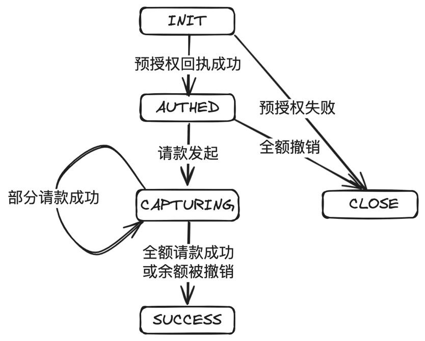

预授权单初始为INIT。

预授权失败回执推进到CLOSE。预授权成功后，用户全额撤销，也推进到CLOSE。

成功回执推进到AUTHED。

开始请款为CAPTURING，部分请款成功仍然为CAPTURING。

全额请款完成推进SUCCESS，或部分请款后，剩下额度被撤销，也推进到SUCCESS。

#### 请款状态机

<!-- PDF 第 51 页；原书第 48 页 -->

请款单初始为INIT。

请款失败回执推进到CLOSE。

请款成功回执推进到SUCCESS。

### 4.3.8 收单模式与资金流

所谓收单是给商户收单，也就是帮商户收钱。所谓的收单模式，就是收的钱在内部的流转模式。常见的有即时到账、担保交易、预授权。各公司的定义可能略有不同。

#### 即时到账

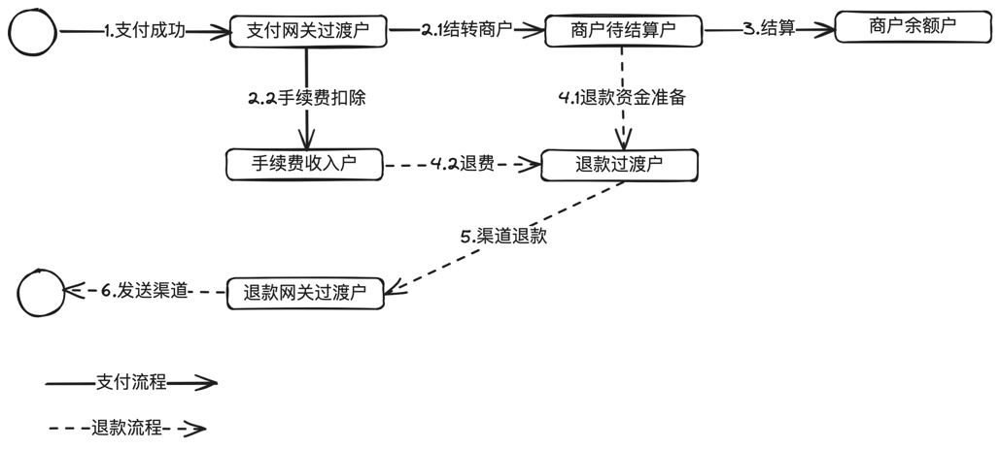

即时到账比较简单，支付过程，从支付网关过滤户到商户待结算户，再到商户余额。

<!-- PDF 第 52 页；原书第 49 页 -->

退款则相反，在退款资金准备阶段需要从商户待结算户到退款网关过渡户。

#### 担保交易

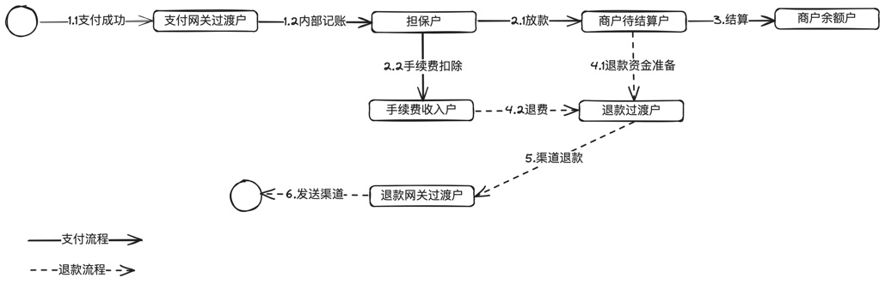

担保交易模式比即时到账多了一个担保户。

#### 预授权模式

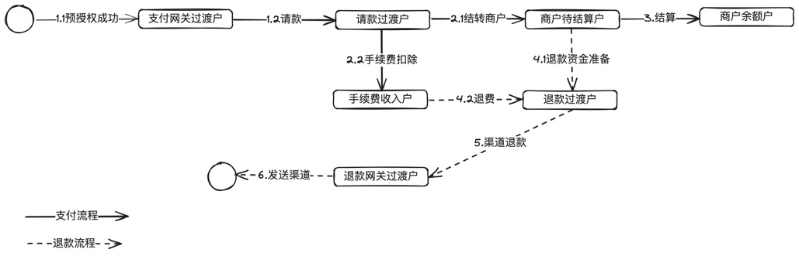

预授权模式比即时到账模式多了一个请款过渡户。

## 4.4 结算平台：准确高效给商户结款

我们在前面讲了收单平台如何帮忙商户收钱，收完钱还得转给商户，用户支付100块钱，那么到底给商户多少钱，什么时候给，这都是结算平台干的工作。谓之“结算”。

### 4.4.1 结算在支付系统中的位置

<!-- PDF 第 53 页；原书第 50 页 -->

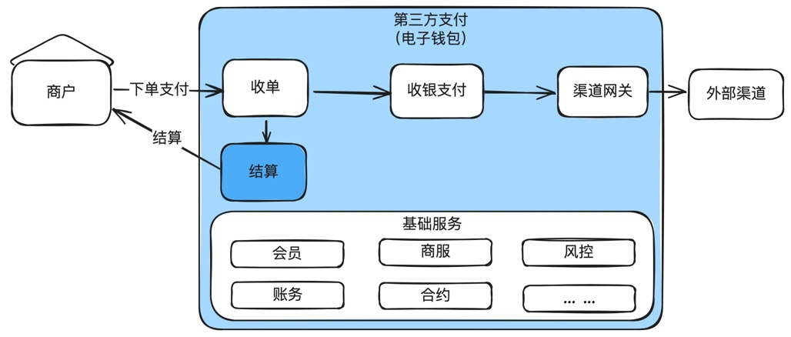

在收单机构（支付平台）里，结算就是把帮商户收进来的钱，按约定的结算规则、准确、及时地结算给商户。

### 4.4.2 结算模式

我们是按单笔给商户收钱的，如何把这些收单数据结算给商户，就是结算模式。常见的有：主动单笔结算，主动批量结算，被动单笔结算，被动批量结算。

所谓“主动”就是由支付平台来决策哪些订单可以做结算，“被动”就是由商户给支付平台发指令进行结算。一般都是“主动结算”，如果碰到非常强势的商户，才会有“被动结算”的场景，比如google，apple等超级商户。

### 4.4.3 结算产品架构图

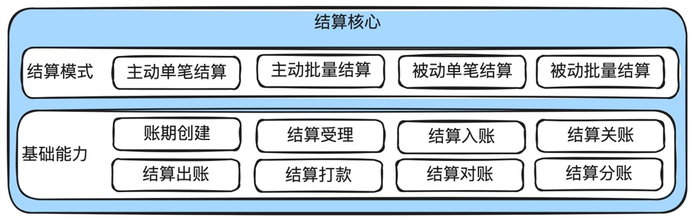

结算一定要设计账期，就像账务系统要有会计日是一样的道理，避免跨天的交易或零点附近的交易出现结算异常。对应就有账期创建、入账、关账、出账。

<!-- PDF 第 54 页；原书第 51 页 -->

### 4.4.4 结算系统架构图

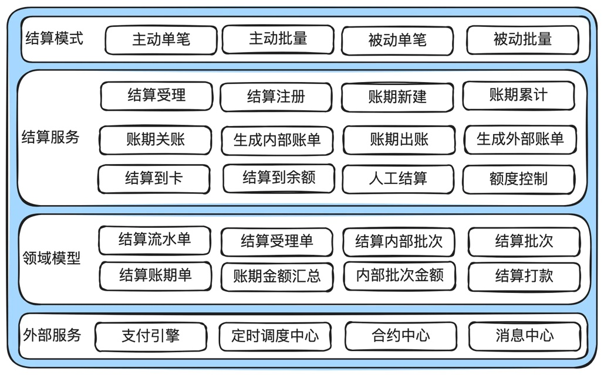

核心的服务包括：结算受理、注册，账期的新建、关账、出账，最后就是结算。

### 4.4.5 结算核心流程

下面以即时到账模式为例说明。担保交易模式和预授权模式稍有不同。

<!-- PDF 第 55 页；原书第 52 页 -->

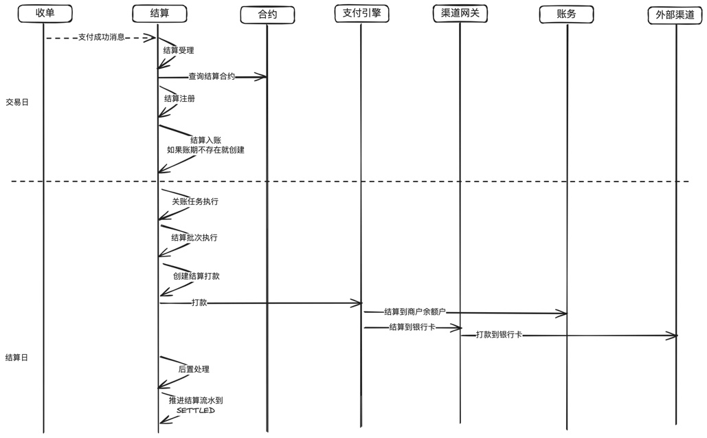

在交易日，收单收到支付成功回执后，就发消息给结算，结算收到消息去查结算合约，进入结算注册流程。

在结算注册时，如果存在打开的账期就直接挂过去，如果不存在就创建一个账期。

在结算日，先进行关账，避免在途任务受影响。关账成功后，进入结算批次，再进入打款流程。

打款有3种情况：1）结算到商户余额户。2）在线结算到提现卡。3）线下人工打款（人工结算）。

打款完成后，推进结算流水SETTLED。

### 4.4.6 结算领域模型设计

<!-- PDF 第 56 页；原书第 53 页 -->

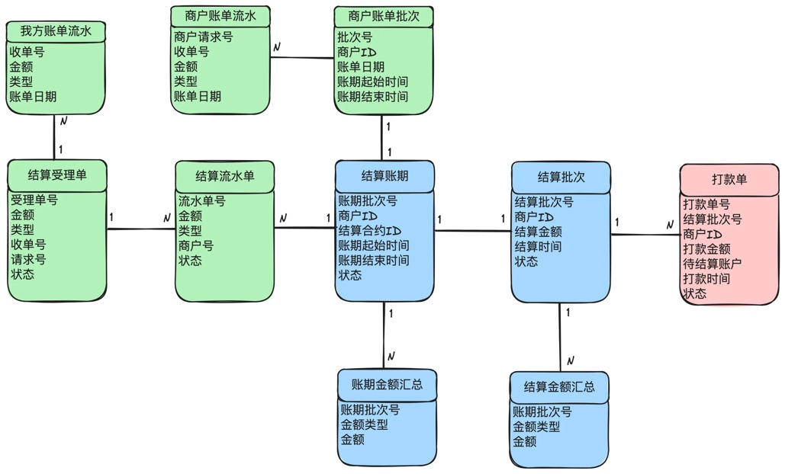

左边绿色部分是账单和流水相关信息，中间蓝色是账期和批次相关信息，右边是打款信息。

因为一个收单可能会有多种费用，所以会生成多条我方账单流水。同样的，一个收单可能结算给多个主体，对应有多笔结算流水。

结算账期有点类似会计日的概念，是为了控制零点左右的收单单据的结算能落到正确的结算账期里去。

关账后就会发起外部结算以及对应的打款。一个结算批次可能会分成多笔打款。

### 4.4.7 结算状态机设计

<!-- PDF 第 57 页；原书第 54 页 -->

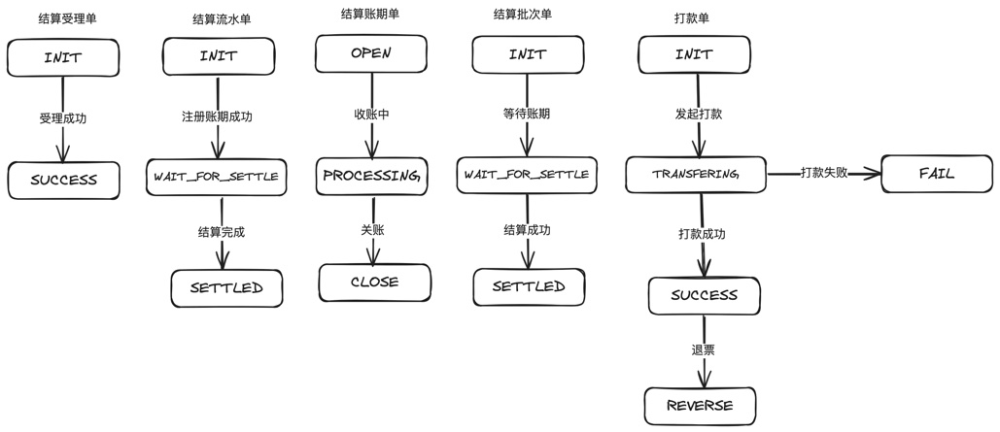

上面把结算涉及到的状态机都画出来了。

特殊的是打款单的状态机，因为打款有可能调用外部渠道打到商户的卡里去，外部渠道有一定概率先返回打款成功，过两天后又返回退票(实际打款失败，资金退回)，这个时候需要推进到REVERSE，然后重新更新信息后再进行打款。

退票的原因有多种，比如商户的卡被冻结等。

### 4.4.8 结算资金流

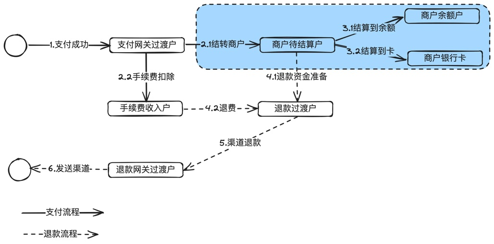

<!-- PDF 第 58 页；原书第 55 页 -->

结算一般只涉及到正向资金流，也就是支付成功后，一步步推进结算到商户余额户或者商户银行卡，如果是结算到商户余额户，就需要商户主动在商户门户发起提现到卡。

## 4.5 拒付平台：如何应对用户的拒付

拒付在中国比较少见，但是在海外非常普遍，只要做跨境收单支付系统，就无法绕开拒付。

拒付涉及到冻结收单单据，并扣减商户的结算款，所以拒付经常和收单、结算一起讲。

### 4.5.1 拒付基本概念

拒付在中国比较少见，但是在海外非常普遍，只要做跨境收单支付系统，就无法绕开拒付。

简单地说，拒付就是指用户在收到账单后，向发卡行申请对某笔交易拒绝付款。然后发卡行、卡组、收单行、第三方收单机构就开始正式进入拒付流程，中间会涉及到拒付举证、拒付判责等。

一旦拒付量大，卡组就会对收单机构的风控能力质疑，有一些惩罚措施，严重可能会影响收单资质，所以一般的收单机构对拒付率看得比较重，收单机构的风控能力也就显得尤为重要。

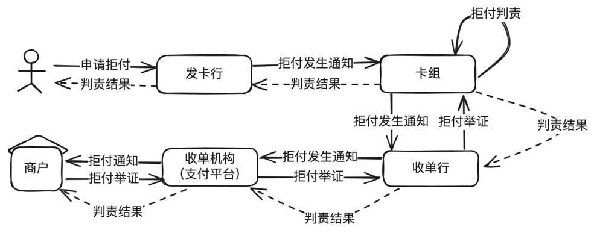

拒付的原因通常有以下3种：

1. 用户的卡被盗。

2. 对商品不满意并产生交易纠纷。

3. 恶意拒付。

### 4.5.2 拒付产品架构

拒付的业务相对比较简单，产品架构也比较简单。

<!-- PDF 第 59 页；原书第 56 页 -->

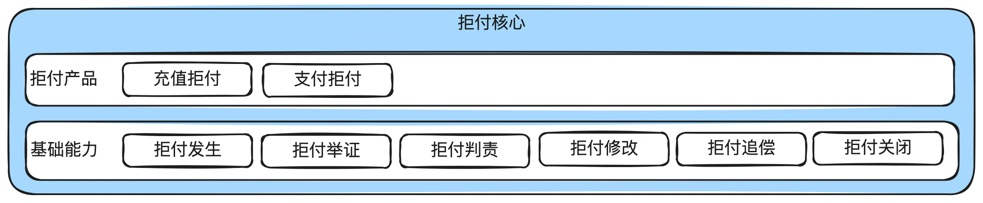

### 4.5.3 拒付核心流程

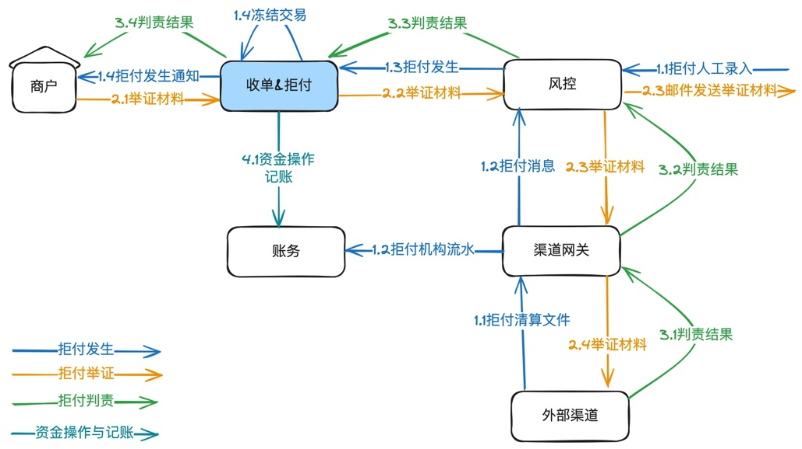

拒付发生一般有两种来源：1）外部渠道的清算文件，这种一般称为在线拒付。2）外部渠道通过邮件发送给收单机构，需要由收单机构人工录入到内部系统，这种一般称为离线拒付。

拒付发生后，需要通知商家，商家一般会举证。比如证明是用户亲自签收的，或者收货地址是用户常用地址等。

不过从实际情况看，大部分的拒付会判商家或收单机构的责任。所以对收单机构的风控能力要求比较高。

### 4.5.4 拒付领域模型设计

<!-- PDF 第 60 页；原书第 57 页 -->

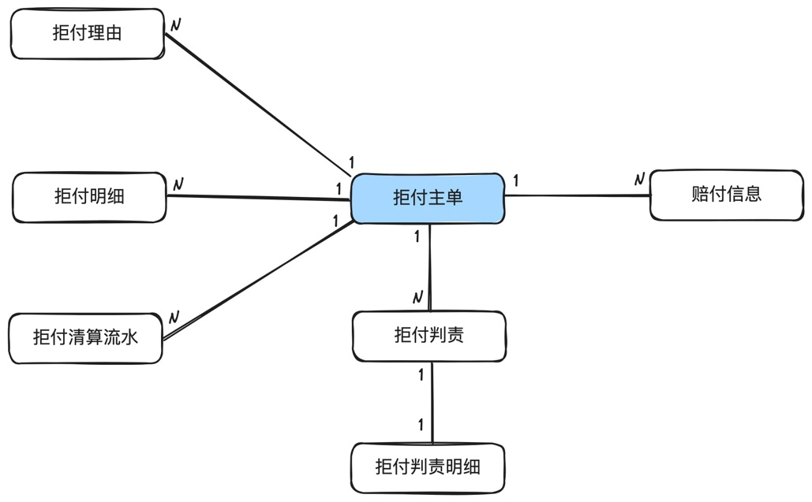

拒付的领域模型是根据拒付处理承载的信息来设计的。首先是拒付主单，关联拒付的理由、明细、清算流水，判责等。一旦判断是商家责任，还需要记录赔付信息。

### 4.5.5 拒付状态机设计

<!-- PDF 第 61 页；原书第 58 页 -->

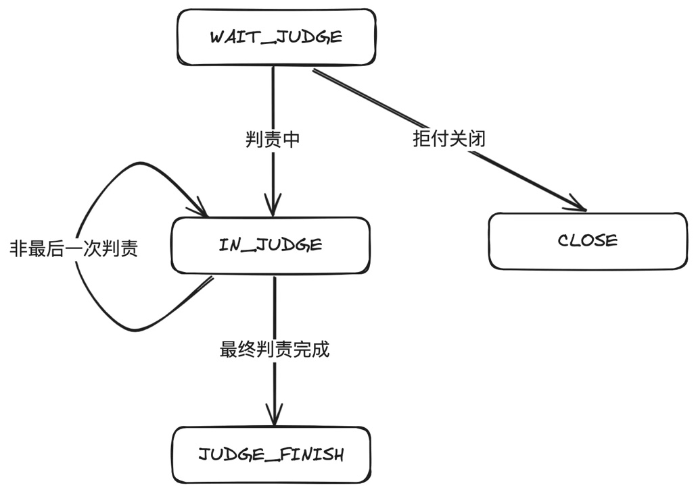

拒付初始化为等待拒付(WAIT\_JUDEG)，可以被关闭(CLOSE)，如果进入判责流程，就推进到IN\_JUDGE，最后判责完成后，推进到JUDGE\_FINISH。

### 4.5.6 拒付与风控的关系

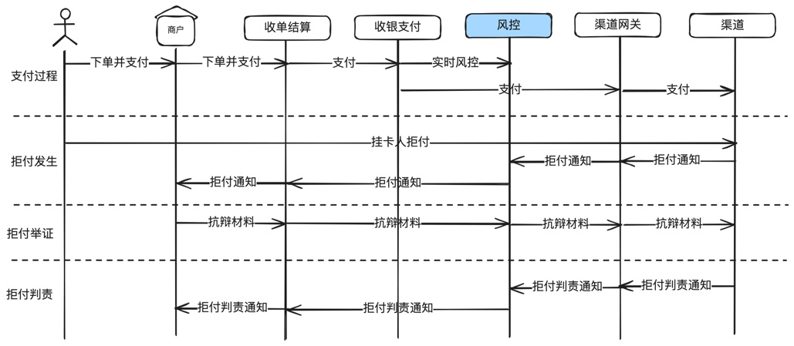

<!-- PDF 第 62 页；原书第 59 页 -->

拒付除了和收单结算紧密相关外，还和风控系统紧密相关，因为交易是由风控系统来判断风险的，如果这个用户的卡被盗刷，那风控系统的实时风控就不应该通过。如果是正常的购买，那风控系统就应该收集证据去抗辩。

## 4.6 小结

本章讲清楚了对于商户来说最重要的子域：收单结算。但在一些小的支付公司，可能没有独立的收单结算系统，而是把收单的能力放在支付域中，在支付域里通过创建一个商户订单表来解决；同时把结算的能力放在商户服务域中。这些只是实现上的差异，但是在架构边界上，读者要清楚这些。

拒付比较特殊，目前在国际收单支付才比较常见，国内基本没有看见过。
