# 第5章 收银支付

> 来源：《图解支付系统设计与实现》V_0.1.0，隐墨星辰著。范围：原书第 59–73 页（PDF 第 62–76 页）。正文由 MinerU 识别并对照原页校对；图示保留 PDF 内嵌原图。

<!-- 原书第 59 页；PDF 第 62 页 -->

如果说电子商务是现代经济的繁华都市，那么在线支付系统无疑就是最繁忙的交通大动脉。在这个每年数十万亿规模的在线支付交易世界中，有两个默契十足的队友密切配合，确保每一笔交易都像优雅的华尔兹舞步一样流畅，那就是：收银核心和支付引擎。

先给一个直观的协同作战的图，有一个整体的印象。

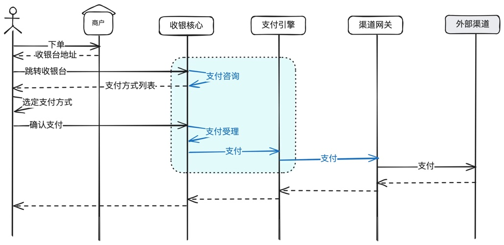

## 5.1 收银台核心：支付系统承上启下的关键应用

<!-- 原书第 60 页；PDF 第 63 页 -->

在线支付系统的收银台概念来源于线下商超的收银台。在技术实现上，收银台=收银台前端+收银台后端。其中收单台后端也常称为收银核心。

收银台前端有很多种形态，比如标准收银台，前置收银台，PC收银台，APP收银台，SDK收银台等，各公司定义可能略有差异。

本书聚集于收银台后端，也就是收银核心。

### 5.1.2 收银核心在支付系统中的位置

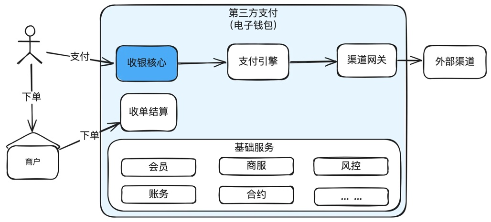

收银核心是支付系统的门面，负责处理用户的支付请求，核心能力就两个：1)支付方式咨询，告诉用户本次可以使用哪些支付方式。2)提交支付后的各种校验，比如订单是否有效，商户权限，用户身份，风控等。

### 5.1.3 支付咨询

<!-- 原书第 61 页；PDF 第 64 页 -->

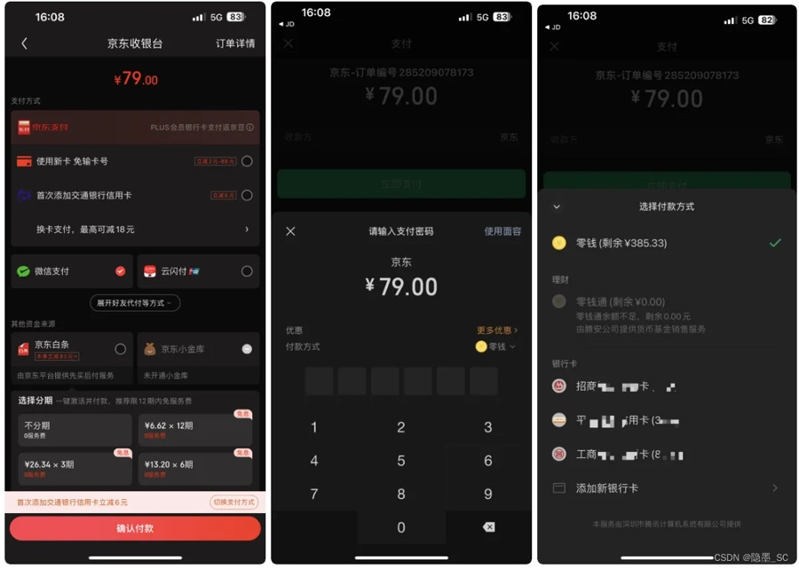

上面的图分别是电商（京东）的收银台，支付平台（微信支付）的收银台。

<!-- 原书第 62 页；PDF 第 65 页 -->

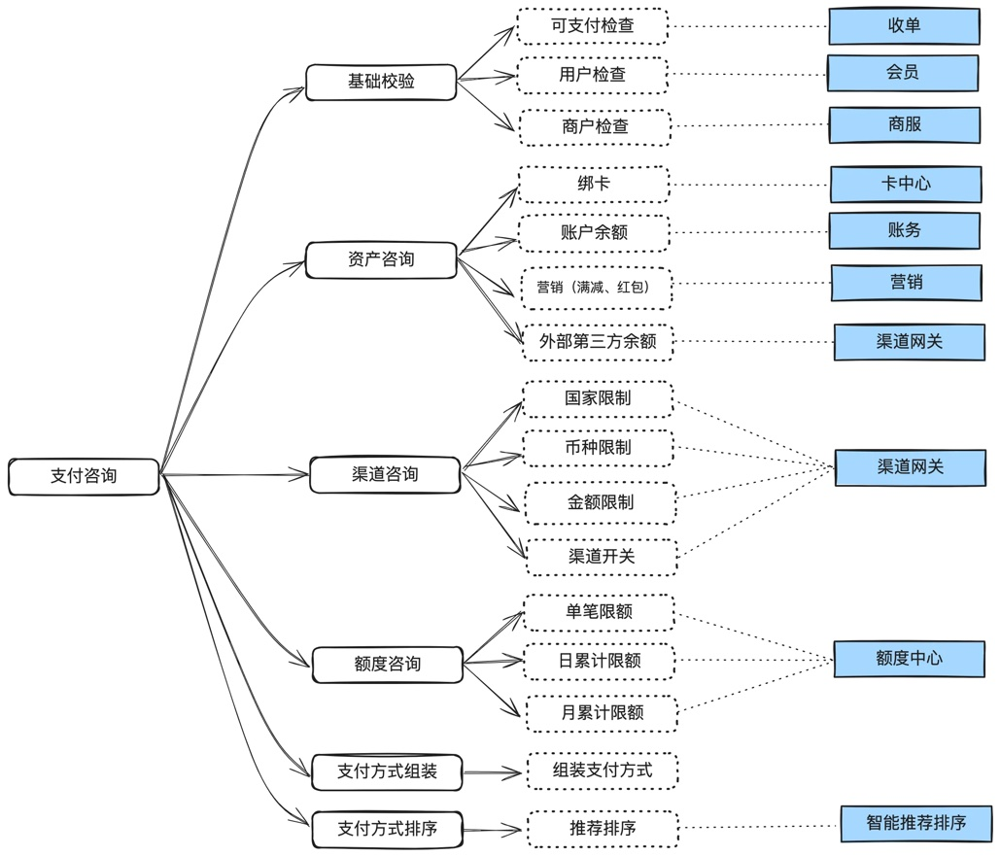

支付咨询阶段，需要做以下几个工作：

1. 基础检查：可支付检查（有可能订单已经已经被支付），用户检查，商户检查等。

2. 资产咨询：绑卡数据，账户余额，营销（比如满减、红包等）。

3. 渠道咨询：通过币种、金额、渠道开关等。

4. 额度咨询：单笔限额、日累计限额、月累计限额等。

5. 支付方式组装：把上面的资产、渠道等组装成用户方便理解的支付方式。

6. 支付方式排序：把用户可用支付方式做好推荐排序（既要考虑用户体验，又要考虑营销策略）。

最后把支付方式返回给用户，供用户在支付时选择。

<!-- 原书第 63 页；PDF 第 66 页 -->

### 5.1.4 支付受理

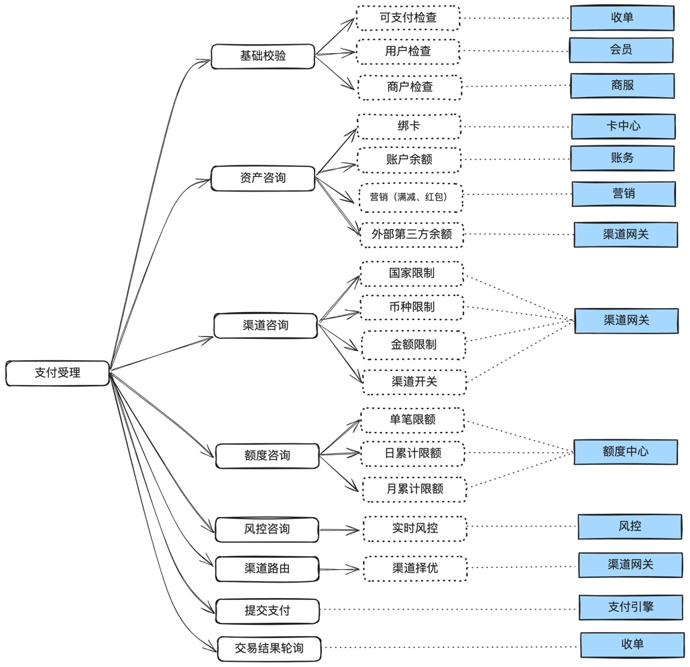

用户选择好支付方式，点击“确认支付”，就到了支付受理阶段。主要做以下几个工作：

1. **在支付咨询阶段的工作全部做一遍。** 因为用户在支付方式渲染后有可能过了很久才支付，很多数据在后台可能已经发生变化，比如余额变了，或者订单已经过期了等情况。

2. 全部通过后，调用风控进行风险判断。

3. 如果是外部渠道的卡支付，还需要调用渠道路由，选择出一条最优的渠道。

4. 然后是提交支付请求到支付引擎进行真实扣款。

5. 最后是从收单平台轮询交易结果。

<!-- 原书第 64 页；PDF 第 67 页 -->

特别说明一下：**为什么轮询结果是从收单平台而不是支付引擎？** 因为对用户而言，收单的结果代表最终的支付结果。比如用户支付回来后，支付引擎是成功的，但是收单平台因为已经订单过期关闭，就会发起资金退回操作，这样收单平台的订单实际是没有支付成功的。就会提示用户：“订单已关闭，如果已经扣款，支付款项预计在15个工作日内原路退回。”

### 5.1.5 收银核心系统架构

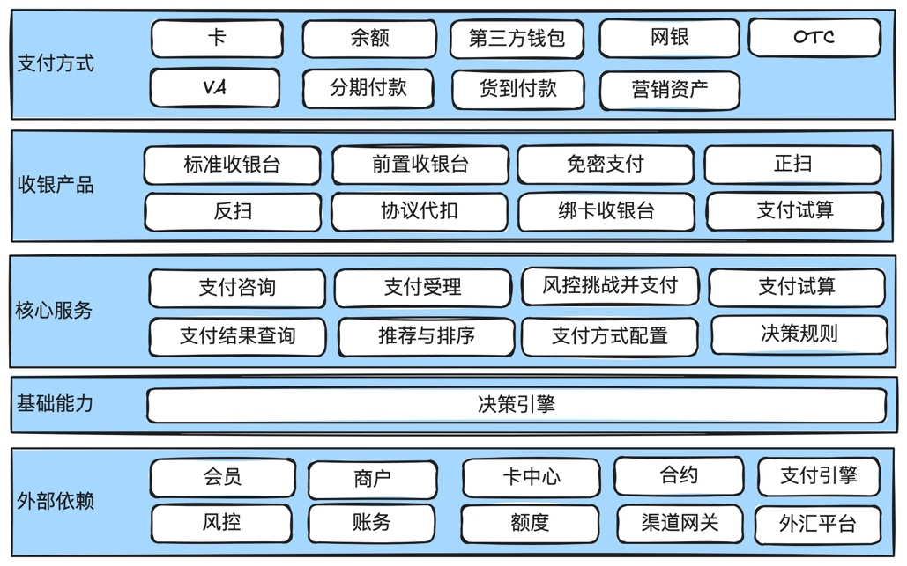

提供给用户有多种支付方式：卡、余额、网银等。

收单产品主要包括：标准收银台，前置收银台，扫码付等。其中标准收银是由支付平台提供，需要跳转到支付平台，而前置收银台是直接嵌入到商户收银台里面完成支付。

核心服务包括：支付咨询、支付受理、风控挑战并支付等。

外部依赖主要有：会员、商服、卡中心、风控、渠道网关、支付引擎等。

### 5.1.6 收银核心领域模型设计

<!-- 原书第 65 页；PDF 第 68 页 -->

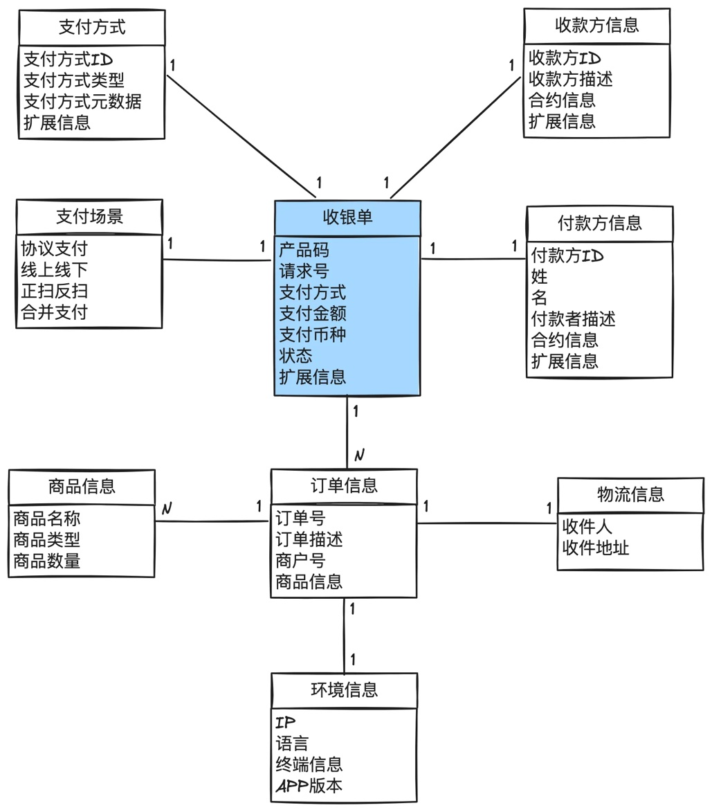

### 5.1.7 常见支付方式

#### 快捷支付

通过在支付系统中提前绑定银行卡信息，快速完成支付交易，不需要每次都填写完整的卡详情。

<!-- 原书第 66 页；PDF 第 69 页 -->

#### 代扣/协议支付

个人授权商户直接去支付平台或银行进行扣款，不需要用户参与支付过程。比如水电煤代扣，滴滴打车代扣。

#### 卡支付

使用信用卡或借记卡支付。

#### 网银支付

需要跳转到银行提供的支付页面，输入银行账户信息进行支付。

#### VA支付

Virtual Account。虚拟账户是银行临时生成的一个账户，与用户和订单临时关联。一般在东南亚的支付场景，或者国际收款场景下使用得比较多。

东南亚很多人没有银行卡，但又要在线买东西，就可以临时生成一个VA。以支付流程为例：用户选择某个银行的VA支付方式，支付系统调用银行接口，先为用户订单生成一个VA号，用户拿着VA去线下ATM机转账，银行收到钱后，通知支付系统，支付系统再通知商户，商户给用户发货。

#### OTC支付

Over-the-Counter。柜台支付。一般指大型连锁线下零售商提供的支付能力，比如7-11或肯德基提供的支付能力。整体流程和VA很像。区别在于VA通常指银行提供的。

同样以支付流程为例：用户选择某个OTC服务提供商的OTC支付方式，比如7-11，支付系统调用7-11接口，先为用户订单生成一个OTC码，用户拿着OTC码去线下7-11柜台拿现金充值，7-11收到钱后，通知支付系统，支付系统再通知商户，商户给用户发货。

#### 第三方钱包支付

非银行机构提供的在线支付服务。比如支付宝、微信支付，国外的PayPal等。

#### 余额支付

使用账户余额进行支付。

<!-- 原书第 67 页；PDF 第 70 页 -->

#### 正扫

商户生成二维码，用户扫商户二维码。

#### 反扫

消费者生成二维码，商户扫消费者的二维码。

## 5.2 支付引擎：资产流动的枢纽

一旦收银核心完成它的前期准备工作，支付引擎就像一位敏捷的忍者，悄无声息地完成了资金的转移。它的行动快速且精准，决不允许出现任何纰漏。

简单地说，支付引擎就是做资金账户的转移，所以有些公司也称为**资产交换**。同时支付引擎处在支付系统的核心位置，所以有些公司也称为**支付核心**。另一方面，支付引擎封装了多种支付能力，比如余额、外部渠道、营销等，所以有些公司也称为**统一支付**。

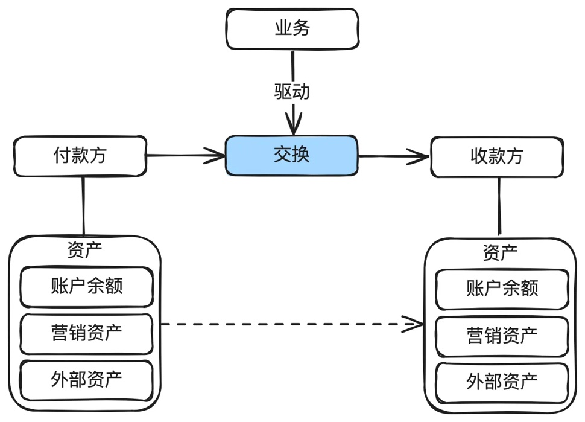

<!-- 原书第 68 页；PDF 第 71 页 -->

对于支付引擎来说，最核心的能力就是资产交换：**根据指令把资产从一个账户交换到另外一个账户。**

比如支付，那就是把用户账户的钱交换到商户账户。退款就是把商户账户的钱交换到用户账户。提现就是把用户或商户在支付平台账户余额的钱交换到用户或商户在外部银行账户。

### 5.2.1 支付引擎在支付系统中的位置

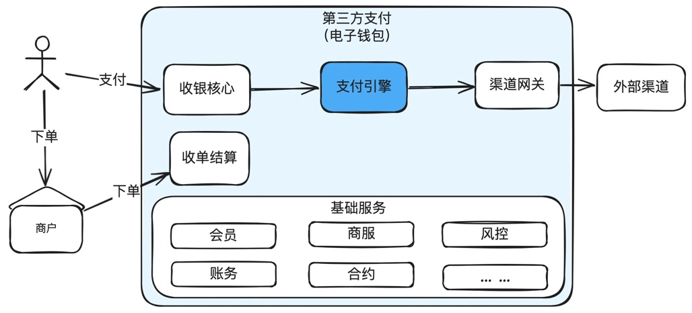

支付引擎在支付系统中处于核心地位，所有的资金操作的信息流都会经过支付引擎，包括支付、退款、撤销、提现等。

### 5.2.2 支付引擎系统架构

<!-- 原书第 69 页；PDF 第 72 页 -->

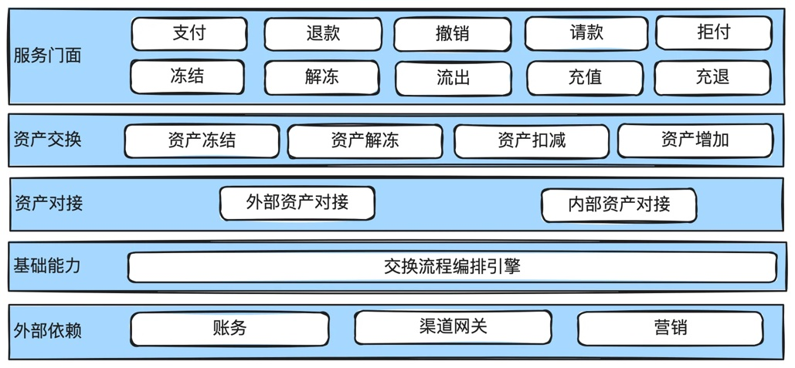

支付引擎对外提供：支付、退款、撤销等基础的服务。

在资金交换层面，只有资产的冻结、解冻、扣减、增加。把变化的部分和不变的部分抽取出来。

资产对接只有两在类：内部资产和外部资产。内部资产包括：余额，内部营销资产。外部资产包括：外部银行卡、外部第三方钱包等。

### 5.2.3 支付引擎领域模型设计

<!-- 原书第 70 页；PDF 第 73 页 -->

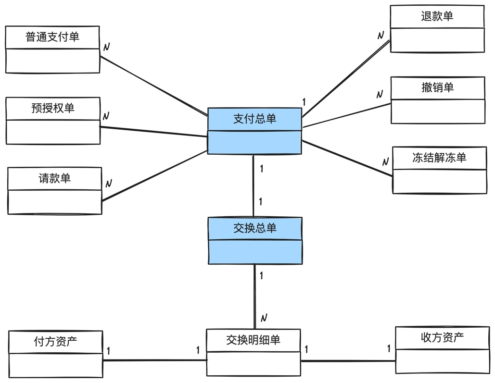

上面的是业务单据，包括：支付、退款、撤销等。

下面是交换单据，包括：交换明细，付方资产，收方资产等。

### 5.2.4 支付引擎状态机设计

#### 支付总单

<!-- 原书第 71 页；PDF 第 74 页 -->

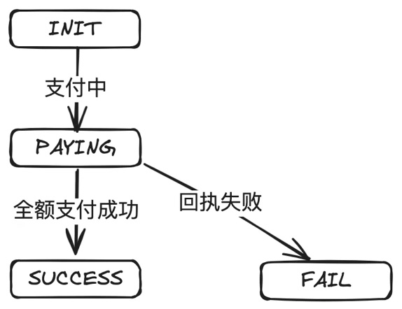

#### 普通支付单

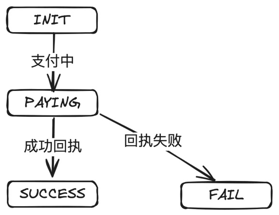

#### 预授权单

<!-- 原书第 72 页；PDF 第 75 页 -->

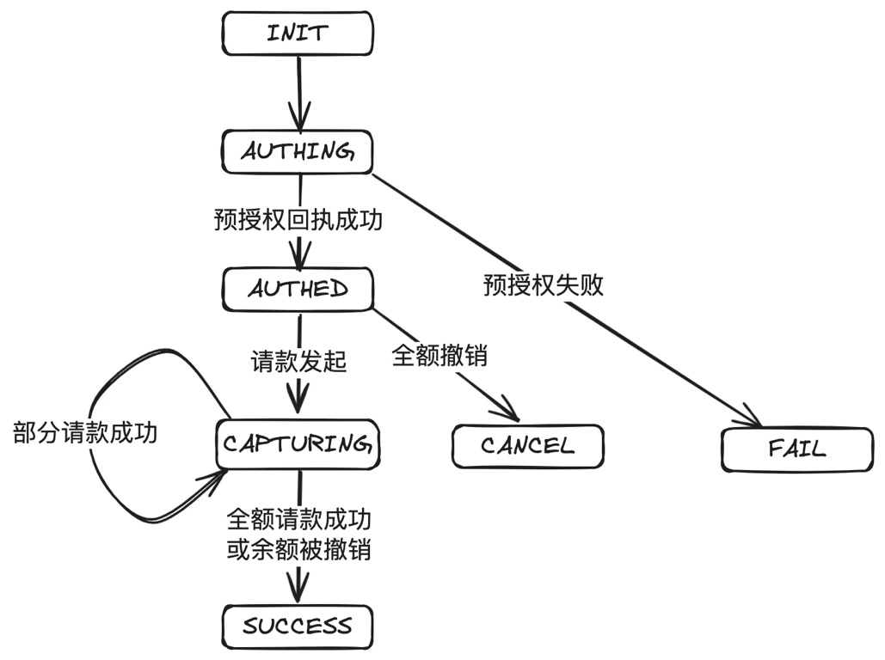

#### 请款单

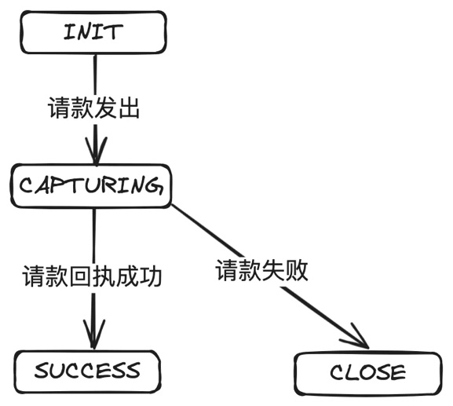

<!-- 原书第 73 页；PDF 第 76 页 -->

## 5.3 小结

每个公司对于收银核心和支付引擎的设计可能各有不同，但无外乎就是如何为用户计算出可用的支付方式，提交支付后做各种检查，然后把用户的资产交换到商户的资产（也就是支付过程），或者把商户的资产交换到用户的资产（也就是退款过程）。
