# 第6章 渠道网关

> 来源：《图解支付系统设计与实现》V_0.1.0，隐墨星辰著。PDF 第 76–121 页。正文经 MinerU OCR 转换，原图保留。

<!-- PDF 第 76 页；原书第 73 页 -->

支付系统每年数十万亿规模的交易额全部都需要和银行打交道，毕竟钱都在银行账户里。支付系统如何安全高效地和银行交互，准确无误地把钱从一个账户搬到另一个账户？答案就是渠道网

渠道网关是一个幕后英雄，终端用户是无法感知的，这个金融界的多面手，搭建起了用户、支付系统、银行、外汇机构间的桥梁。

## 6.1 常见渠道类型

渠道网关主要是对接外部的渠道，所以先理解一下渠道的概念。有些公司称为通道，有些公司称为渠道，都是一个意思。下面统一称为渠道。

渠道类型在各个公司的定义是不一样的，没有一个行业标准，且持续在发展。先讲几个当前仍然通用的分类。

从资金流转的角度，渠道分为四大类：支付渠道、流出渠道、外汇渠道、信息渠道。

### 支付渠道

<!-- PDF 第 77 页；原书第 74 页 -->

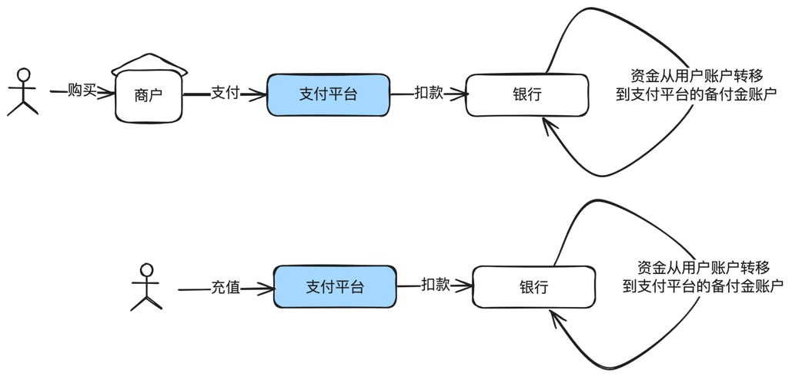

这类渠道的核心作用是实现用户资金的流入。具体来说，它们将用户在银行账户中的资金转移到支付平台在银行的备付金账户。这个过程在我们日常生活中极为常见，典型的场景包括用户的充值操作和在线支付。例如，当你使用手机应用进行购物支付时，资金从你的银行账户流向商家的账户，就是通过这类渠道完成的。

### 流出渠道

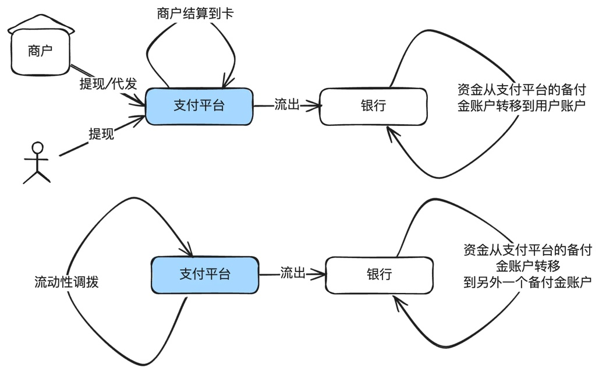

<!-- PDF 第 78 页；原书第 75 页 -->

相对干资金的流入，流出类渠道则处理资金的流出。这包括两种主要情形：一是将支付平台的备付金转移至用户个人或商户的银行账户，常见于用户提现或商户收款的场景；二是将资金从一个备付金账户转移到另一个，通常用于支付平台内部的资金流动性调配。这类渠道确保了资金在用户和商户之间的顺畅流动，是整个支付系统的重要支撑。

### 外汇渠道

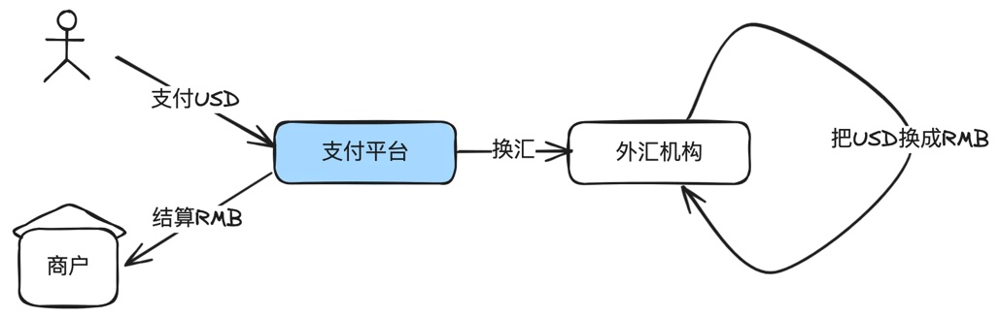

这类渠道涉及货币兑换和跨国资金转移，支持不同货币间的转换和结算。在跨境电商、国际旅游等场景中，外汇渠道提供了资金转换和结算的关键服务。随着全球化贸易的增长，跨境支付需求日益增加，外汇渠道的作用变得更加重要。

### 信息渠道

这类渠道不涉及资金流转，比如个人实名认证（KYC），商户认证（KYB），信贷类开户等。

### 6.1.1 支付类渠道

随着业务和技术的发展，支付类的渠道定义也是千奇百怪，或者说是与时俱进。下面是个人经验总结，仅供参考。

#### 卡

<!-- PDF 第 79 页；原书第 76 页 -->

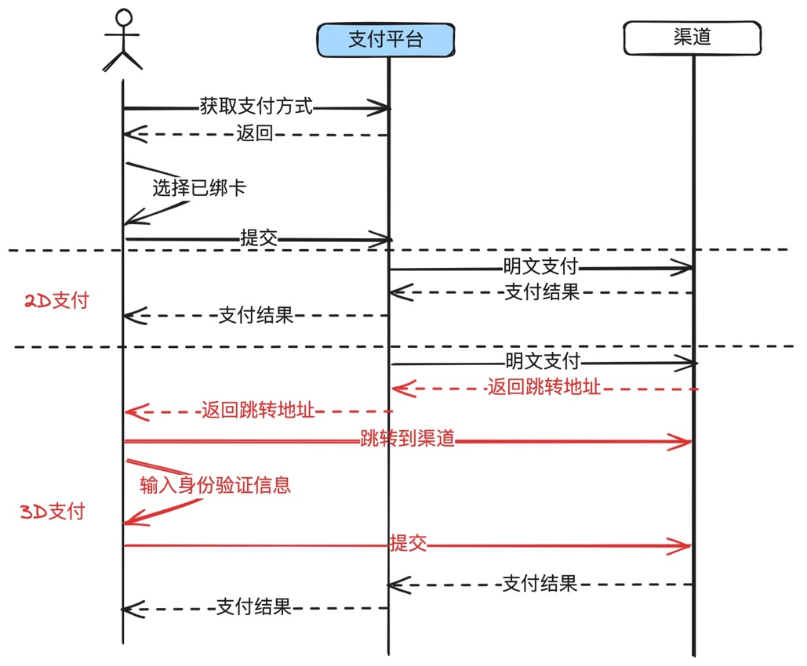

借记卡/信用卡支付：这是最传统且广泛使用的支付方式之一。用户通过输入卡信息进行支付，资金直接从其银行账户扣除。其中信用卡还有预授权、请款，2D、3D等场景。

还有所谓的预付卡，就是提前充值的支付卡，用户支付时，资金从预付卡余额中扣除。这个在支付平台一般不感知。

国外的信用卡普遍使用得比较多。

先绑定后使用token支付模式：

<!-- PDF 第 80 页；原书第 77 页 -->

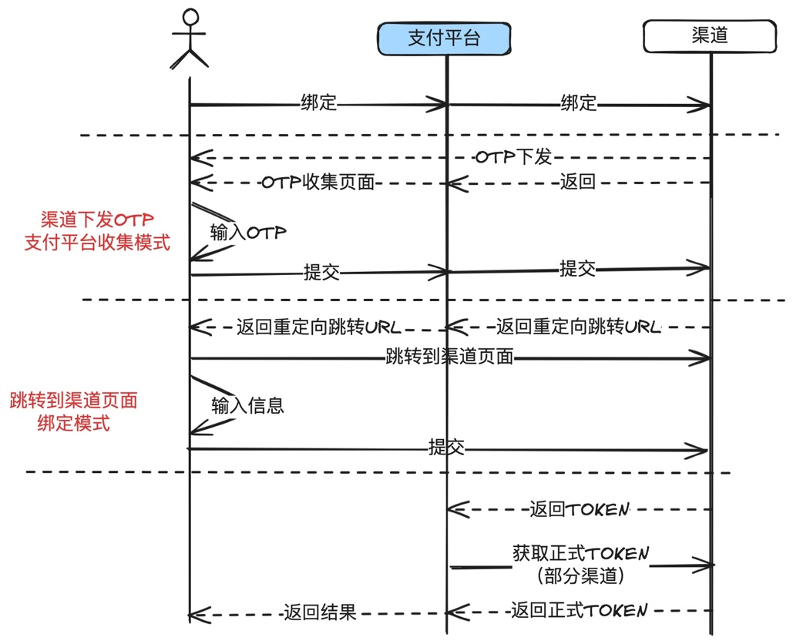

支付流程和明文支付差不多，只是发给渠道时发token，而不是卡明文。

卡的交易有所谓的四方模式：商户、收单行、卡组、发卡行。这里的四方指的是四种类型的机构。

<!-- PDF 第 81 页；原书第 78 页 -->

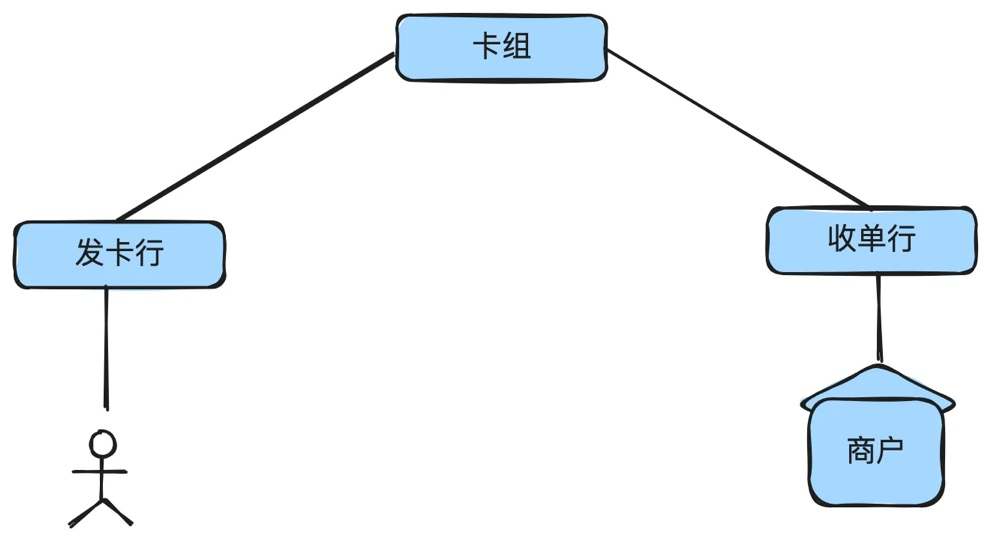

网银

<!-- PDF 第 82 页；原书第 79 页 -->

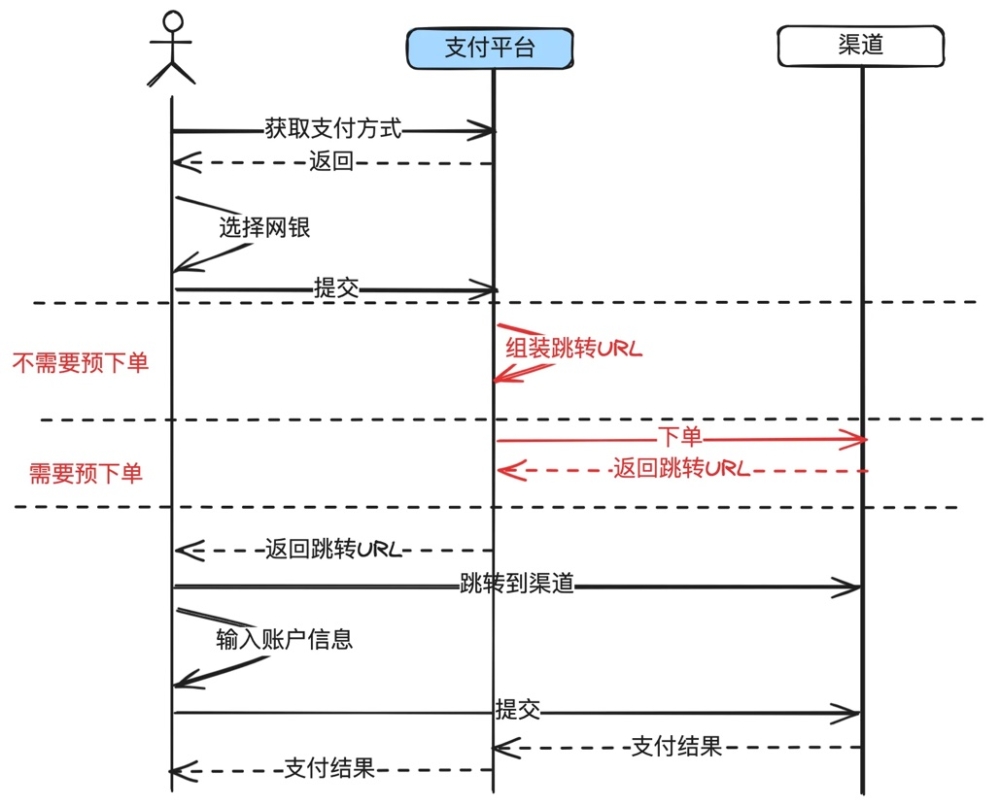

通过跳转到银行网站完成支付。这个操作麻烦，成功率不高，在中国已经很少使用。国外还有不少。

#### 快捷支付

<!-- PDF 第 83 页；原书第 80 页 -->

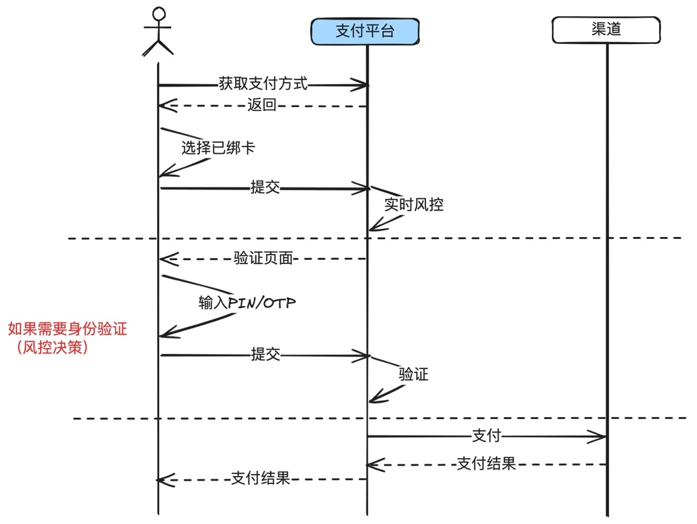

用户事先在支付平台绑定银行卡，支付时无需重复输入卡信息，便捷快速。在中国率先被支付宝发明出来并被推广，支付成功率从网银的60%左右提升到了96%以上。

国外有些叫“一键支付”，差不多一个意思。

#### 代扣

<!-- PDF 第 84 页；原书第 81 页 -->

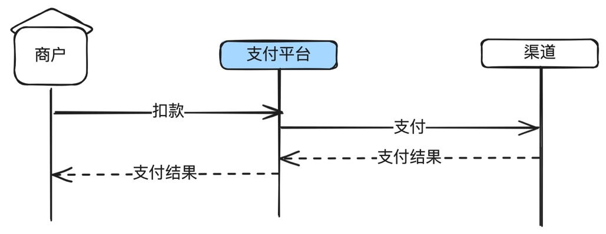

代扣支付是一种银行或第三方支付平台在用户授权的基础上，直接从用户的银行账户或关联的支付账户中自动扣除款项的支付方式。

这种方式和快捷支付最大的区别在于：快捷支付是用户实时参与交易过程，有可能出风控挑战，比如OTP(短信验证码），或者密码等。代扣是提前授权，交易过程用户不会实时参与，也就没办法出挑战，要不成功，要不失败。

代扣广泛用于定期支付场景，如水电费自动缴纳、会员服务费、订阅服务等，还有就是滴滴打车这种，下车就走。这种方式免去了用户每次手动支付的麻烦，特别适合固定周期的定期付款。

#### 第三方钱包

<!-- PDF 第 85 页；原书第 82 页 -->

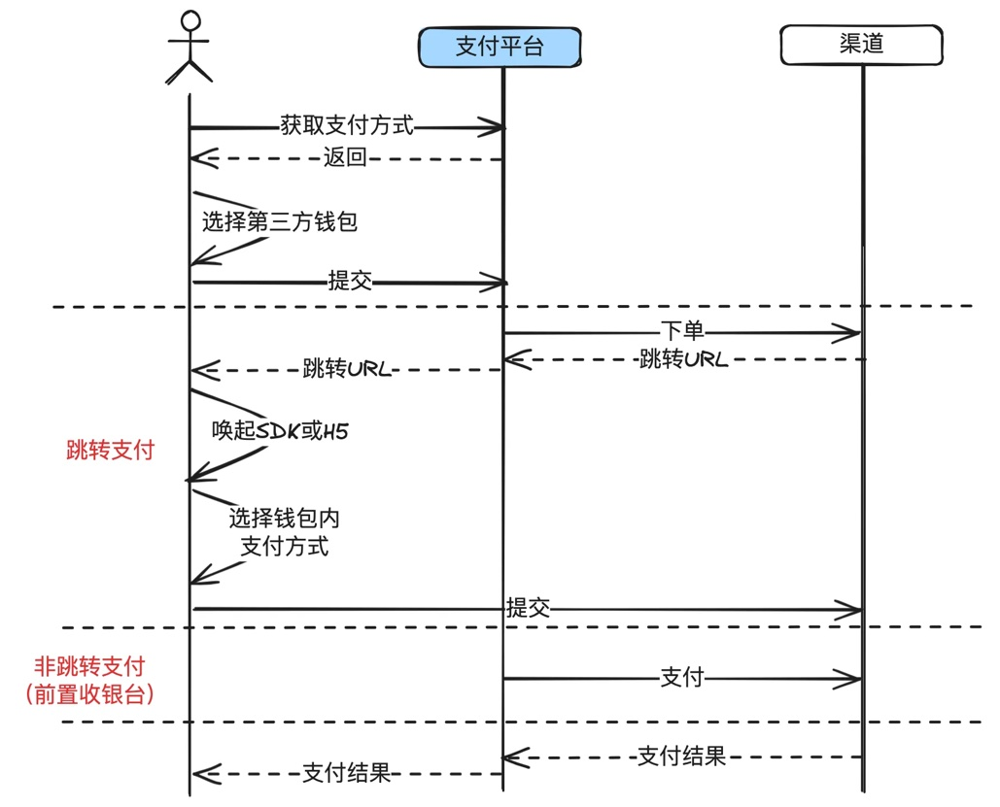

基于第三方钱包账户基础之上的支付。在中国有支付宝、微信支付等，在国外有paypal,gcash等。

第三方钱包通常是一个综合支付工具，比如有钱包余额，钱包里面可能还绑定了银行卡、网银等。

跳转类：比如在京东APP下单，选择使用微信支付，就会跳转到微信APP。

非跳转类：比如在淘宝APP下单，直接后台调用支付宝的免密支付。

#### VA

<!-- PDF 第 86 页；原书第 83 页 -->

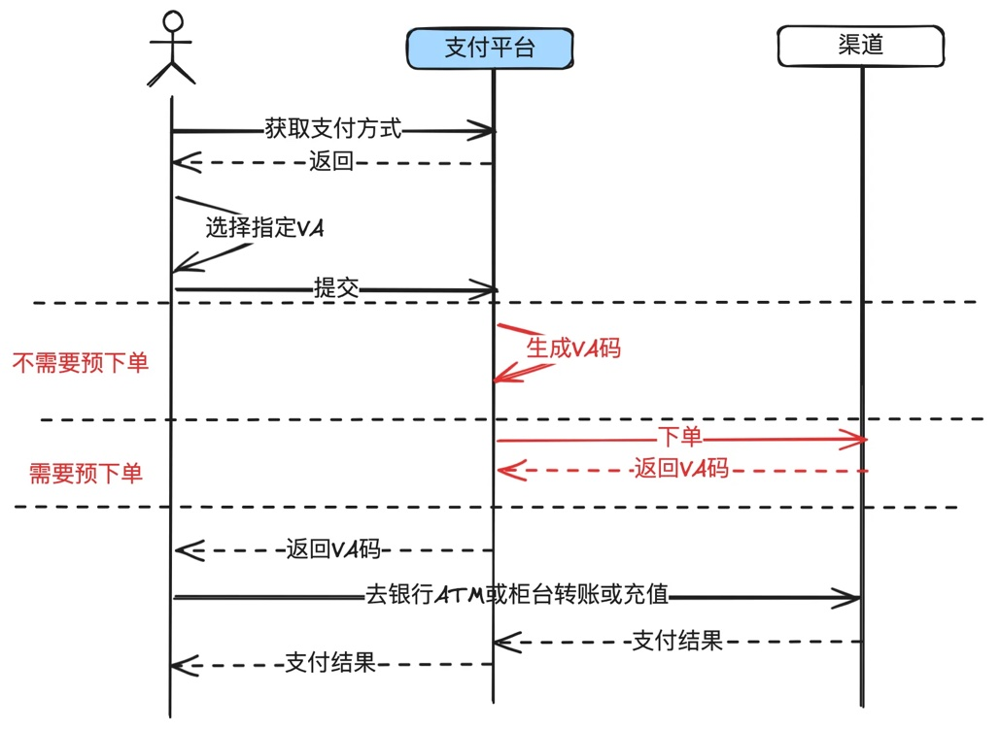

Virtual Account，虚拟账户。用户通过银行生成的虚拟账号进行支付，常用于无卡支付场景。在东南亚用得特别多。

简单地说，就是用户没有银行卡，但是又要在网上购物，那么支付平台调用银行生成一个VA，并把这个VA和订单绑定，再展示给用户，用户拿着这个VA，去银行的ATM把现金存进去，银行通知支付平台这个VA入账成功，支付平台通知商户发货。

#### OTC

<!-- PDF 第 87 页；原书第 84 页 -->

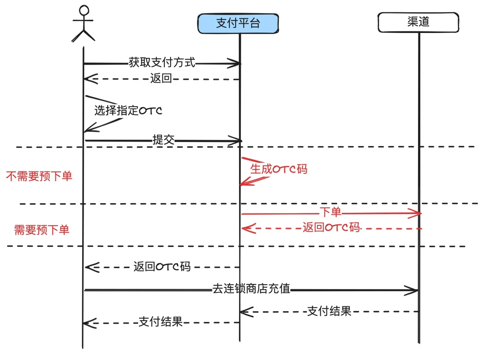

Over-The-Counter。在支付场景下，和VA很类似，也是生成一个支付码，只是这个支付码是由7-11，肯德基等这些连锁店生成的，而VA是真实的银行账户。用户拿着这个OTC码去线下连锁店，给店员现金，店员给这个OTC码充值，连锁店系统通知支付平台支付成功，支付平台通知商

#### 信用付

渠道根据用户的信用授予一定的额度，可以先消费，后还款。国外通常叫BNPL(BuyNowPay Later).

国内有支付宝的花呗，京东的白条。国外也有各种第三方金融机构，比如AKULAKU就是一个中国人在东南亚开的信贷平台。

支付流程和第三方钱包差不多，只是需要先做授权。

信用付与信用卡分期的区别：信用卡分期是以银行发行的信用卡为基础，信用付不是基于卡。在一些银行卡普及率不高的国家地区，信用付就很有优势。

<!-- PDF 第 88 页；原书第 85 页 -->

### 6.1.2 流出渠道

流出类渠道处理资金的流出。国际上通常是花旗、汇丰等这些全球性银行。在国内正各大银行都有。

在国际上，同一家银行，可以指定不同的清算网络，这些清算网络有不同的额度、到账时效、手续费要求。比如同样的花旗，走ACH和RTGS的额度、到账时效、手续费就不同，需要根据业务类型来选择清算网络。

下面只做一些简单的科普。

1.TT(电汇 Telegraphic Transfer)

●特点：通过电子方式进行的国际资金转账，常用于大额跨国交易。

● 优势：速度较快，可以跨不同国家和货币。

• 局限：手续费相对较高。

2. ACH (Automated Clearing House)

●特点：处理电子转账和直接借记业务，通常用于批量、小额、定期支付。

● 优势：成本低，适合定期账单支付。

● 局限：处理速度相对较慢。

3. RTGS (Real-Time Gross Settlement)

● 特点：即时大额支付系统，按交易逐笔即时结算。

• 优势：实时结算，安全性高。

● 局限：主要用于大额交易。

4. BOOK（银行内部转账）

● 特点：同一银行内部账户之间的转账。

● 优势：实时处理，无需外部清算。

● 局限：只限于同一银行的账户。

5. SWIFT（全球银行金融电讯协会）

●特点：提供安全、可靠的国际金融交易信息传输。

● 优势：广泛的国际接受度。

● 局限：不直接处理资金转移，只是信息传输。

6. SEPA (Single Euro Payments Area)

● 特点：简化欧洲国家之间的银行转账，统一欧元区支付市场。

<!-- PDF 第 89 页；原书第 86 页 -->

● 优势：提高跨境支付的效率和降低成本。

● 局限：只限于欧元支付。

7. FPS (Faster Payments Service)

● 特点：英国的即时支付系统，提供快速支付处理服务。

● 优势：适用于即时小额支付。

● 局限：主要服务于英国国内。

8. CHAPS (Clearing House Automated Payment System)

● 特点：英国的大额支付系统，提供当日结算。

● 优势：适用于高优先级、大额交易。

• 局限：成本较高。

9. TARGET2 (Trans-European Automated Real-time Gross Settlement Express Transfer System)

●特点：欧洲中央银行的跨境支付系统，提供实时大额支付。

● 优势：支持欧元区货币政策，安全稳定。

● 局限：主要用于大额欧元交易。

#### 中国央行清算网络：

1. 央行大额支付系统(High-value Payment System, HVPS)

● 特点：主要处理大额和紧急支付，提供实时清算服务。

●应用：用于处理银行间的大额转账，如跨行转账、证券交易结算等。

2. 央行小额支付系统(Bulk Electronic Payment System， BEPS)

● 特点：处理小额但批量的支付，通常是非实时的批量处理。

●应用：处理工资发放、社会保障金支付、公共事业缴费等小额批量业务。

3. 网上支付跨行清算系统(Online Payment Interbank Clearing System)

● 特点：支持网上支付业务的跨行清算。

●应用：处理线上购物、电子商务等互联网支付业务。

4. 同城清算系统(City Clearing System)

● 特点：在同一城市或地区内处理银行间的支付和清算。

●应用：适用于处理同城的支票、汇票等传统支付工具。

<!-- PDF 第 90 页；原书第 87 页 -->

5. 跨行实时支付系统 (Interbank Real-time Payment System)

●特点：支持银行间即时支付，提高资金流转效率。

●应用：常用于个人转账、即时支付需求等场景。

### 6.1.3 外汇渠道

外汇渠道就是用于交换货币。在全球外汇市场中，主要对接的有巴克莱（Barclays）、汇丰(HSBC)、摩根大通(JPMorgan Chase)等。

## 6.2 渠道网关：不只是对接渠道接口

很多人以为渠道网关只是对接渠道提供的接口，其实没有这么简单。报文对接只是最基础的能力，大致有以下能力：

渠道接口对接：包括报文映射，加密解密，签名验签，文件下载，文件解析等。

渠道开关：渠道可用性管理。

渠道路由：渠道择优能力。

渠道咨询：业务适配管理。

差异处理：退款重发管理。

### 6.2.1 渠道网关在支付系统中的位置

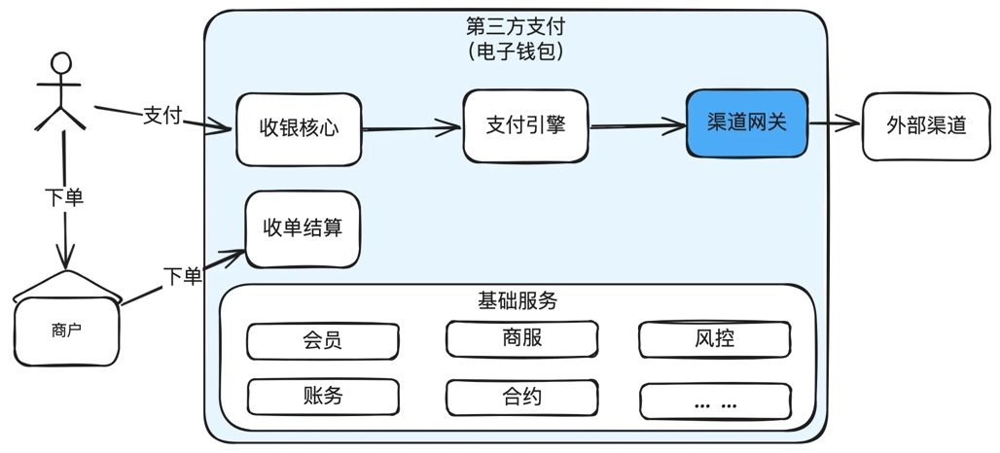

<!-- PDF 第 91 页；原书第 88 页 -->

从图中，我们可以看到，所有外部金融机构(渠道）打交道，全部都要通过渠道网关出去。不同的公司有不同的叫法，比如：渠道网关，金融网关等，本质就是一个意思。个人认为叫渠道网关更直白。

### 6.2.2 渠道网关的产品架构

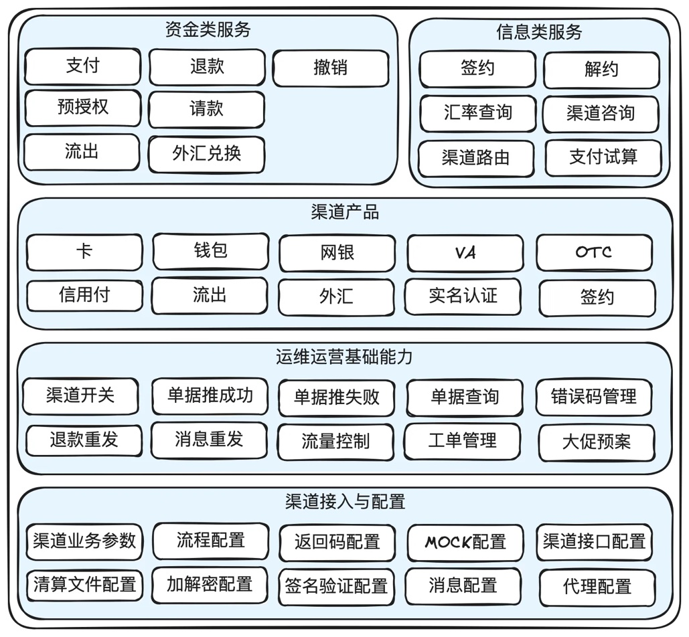

通过上图可以看出来，渠道网关核心能力包括：

1.对上提供资金类和信息类服务。资金类包括支付、退款、预授权、请款、流出、外汇等，信息类包括签约、解约、渠道咨询、渠道路由等。

2. 内部的运维运营能力。包括渠道开关、返回码管理、差错处理等。

3. 底层的渠道接入与配置。渠道接口映射、清算文件解析等。

<!-- PDF 第 92 页；原书第 89 页 -->

### 6.2.3 渠道网关的系统架构

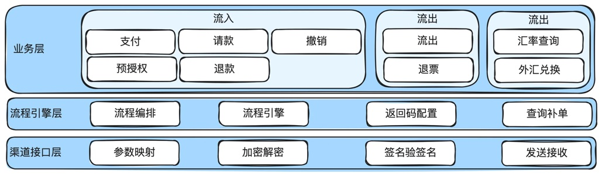

分层设计思想在软件架构设计中无处不在，已经到了日用而不自知的地步。在渠道网关的设计中，也需要用到这个最基础的架构设计思想。

整个渠道网关，通常可以分成三层：业务层，流程编排层，接口对接层。

首先是业务层，负责处理上游的业务，对上游来说，渠道网关承担的核心业务就三个：流入：通过渠道把用户的钱扣到平台的备付金账户。细分有：支付、预授权、请款、退款、撤销等。

流出：通过渠道渠道把平台的备付金账户的钱给到用户，或者平台内部各账户进行调拨。细分有：流出、退票。

外汇：查询汇率，再做货币兑换。

对于业务层来说，只需要把上游的请求收下来，再往下发流程引擎层，然后等待流程引擎处理结果的推进。

接下来是流程引擎层。为什么要有流程引擎层？因为大部分渠道的流程是不一样的，比如有些渠道，只需要请求渠道一次，就可以完成支付，但是有些渠道可能要请求3次才能完成支付：1)刷新TOKEN；2)换取支付TOKEN)；3)发起真正的支付。而且还可能请求超时，这时需要查询补单。这些操作如果和上面的业务层耦合在一起，将会变得非常复杂。

再往下，就是接口对接层，通常一个流入渠道有8到12个接口，比如签名、解约、支付、退款、支付查询、退款查询、支付通知、退款通知、撤销、刷新TOKEN、换取TOKEN、清算文件等。不同的渠道提供的接口不同，报文、签名签验、加密解密等也都不一样。

<!-- PDF 第 93 页；原书第 90 页 -->

把上面分层思想完整实现出来，得到下面的系统架构图。

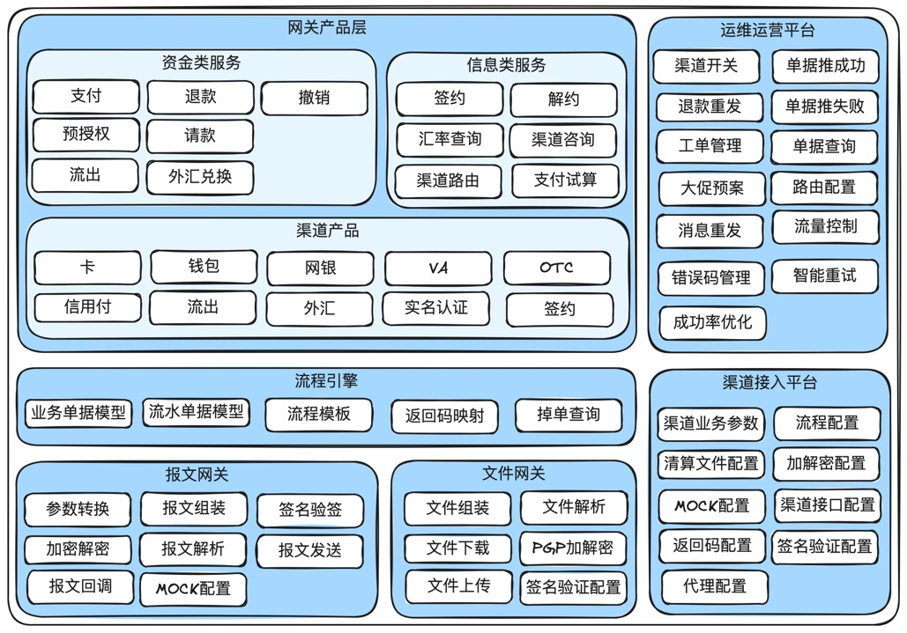

网关产品层：主要负责处理上游的业务，比如支付、退款、请款、签约解约等。

流程引擎：负责流程编排。有些渠道一次支付只需要和渠道做一次交互，有些渠道一次支付需要和渠道做2到3次交互，这个差异由流程引擎处理。

报文网关：负责实时API接口的处理。包括参数转换、报文组装解析、签名验签、加解密等。

文件网关：负责非实时类的文件交互处理。主要是清算文件、账单文件、流出文件等。包括下载、解析、组装、上传等。

运维运营平台:负责运维运营类操作，包括渠道开关、渠道路由配置、单据查询、异常推进等。

渠道接入平台：负责渠道的接入配置。

### 6.2.4 渠道网关的领域模型设计

从上面“业务、流程编排、接口分离原则”导出的分层模型，我们可以看到，每层都是自己的领域模型，但是需要有一根主线牵起来，那就是渠道模型。

<!-- PDF 第 94 页；原书第 91 页 -->

所谓渠道模型就是我们对渠道能力的抽象，比如我们可以抽象为：网银、第三方钱包、卡、VA、OTC等，也可抽象为代扣、快捷支付等，还需要把支付币种、限额、退款有效期等业务属性也抽象出来。

#### L0级别渠道网关领域模型

以流入（支付）渠道（通道）为例说明。流出、外汇的思路是差不多的。

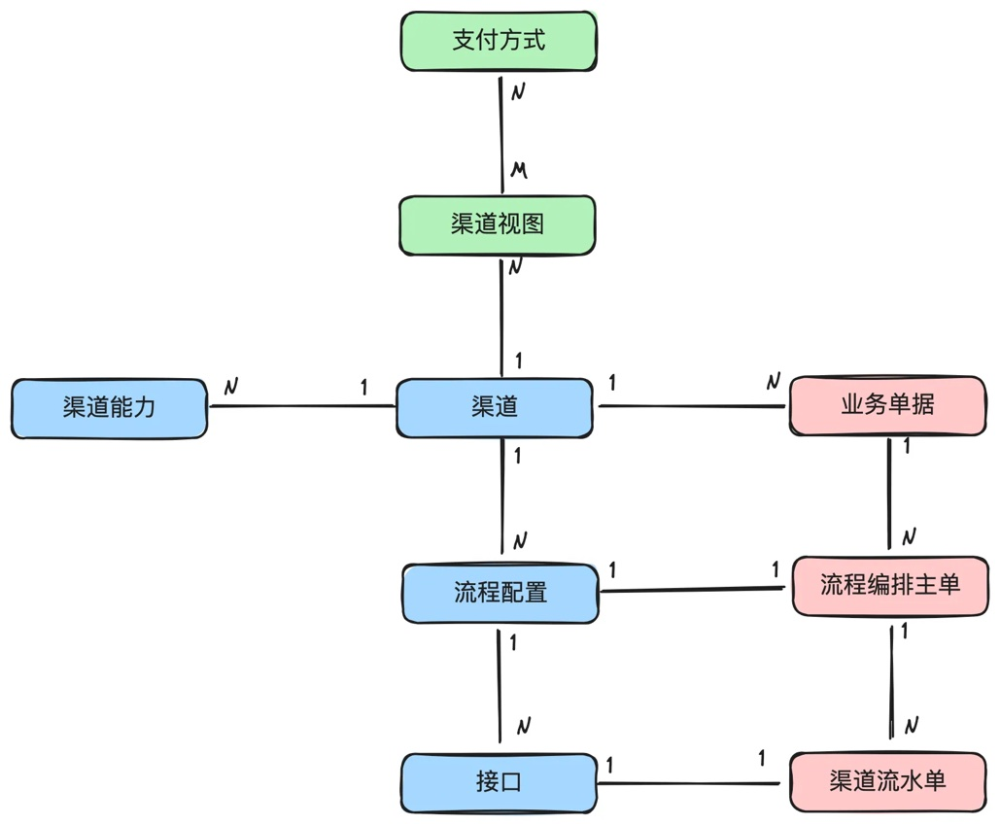

#### 补充说明：

渠道：对外部的支付渠道（或者也叫支付通道）进行逻辑抽象，比如支付宝、微信支付、银联，国外的WPG，MGPS等。

渠道能力：把外部渠道提供的基础能力进一步抽象出我们需要的能力，比如支付能力、退款能力等。

<!-- PDF 第 95 页；原书第 92 页 -->

流程配置：不同的渠道流程可能是不一样的，有些渠道支付只需要调用渠道一次，有些需要调用多次。

接口：渠道提供的原始接口能力。

渠道视图：我们对渠道配置了很多参数，但是有些参数对于渠道咨询或渠道决策不是必须的，所以再抽象出一个渠道视图，用于渠道咨询或渠道决策。

支付方式：对用户可见的支付方式，可以做各种个性化的定义，和渠道视图没有一对一的映射关系。

业务单据：比如支付、退款、请款等都是业务单据，依赖流程编排主单来推进状态。

流程编排主单：用于流程引擎的推进。每个业务单据需要对应一个流程编程编排主单。依赖渠道流水单的状态来推进状态。

渠道流水单：每次和渠道交互，都生成一个独立的流水单，比如一笔支付，需要调用渠道的支付接口，还可能有多次查询补单，也可能有渠道异步通知回来，每一次交互就会生成一笔流水单。多笔渠道流水单对应一笔流程编排主单。

#### L1级别渠道模型

外部渠道定义或提供的能力各有差异，我们需要做渠道提供的基础能力做一个适配于我们内部业务的抽象。

以支付渠道为例，可以抽象为：业务能力、资金能力、流程编排参数、接口能力等。业务能力包括支付、退款、撤销等能力。支付能力又可以拆分为支付币种、限额、是否支持幂等，退款能力又可以拆分为是否支持退款、退款有效期、退款限额等。

下面是一个经典的支付渠道抽象：

<!-- PDF 第 96 页；原书第 93 页 -->

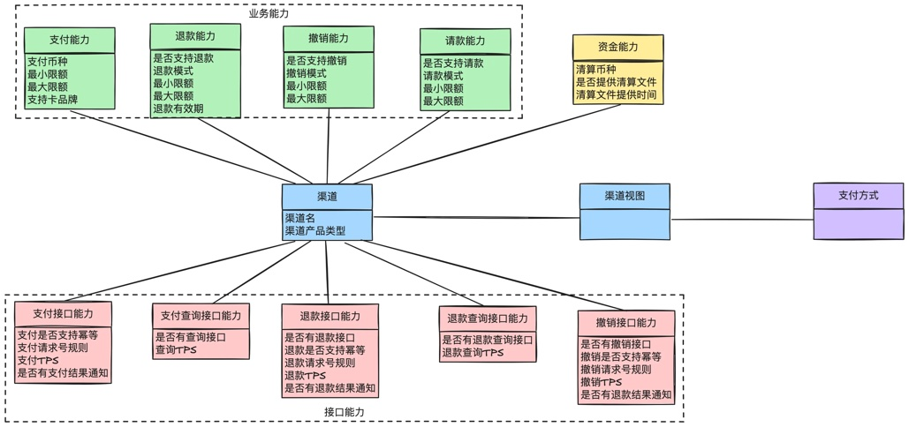

#### 说明：

渠道：对外部渠道做一个抽象，比如国内微信、支付宝、银联等，国外的WPG、MGPS等。

业务能力：支付、退款、撤销、请款等能力详细描述。比如退款有效期、最小限额等。

资金能力：清算币种等。

接口能力：描述接口本身的能力，比如渠道的请求号生成规则。特殊情况下可能有短号问题。

图中的渠道视图和支付方式在“L0级别渠道网关领域模型”章节中已经说明。

#### L1级别单据模型

因为使用了分层架构，上面的业务层只负责业务逻辑的推进，下面的流程引擎负责与渠道交互的流程推进。所以单据也分为2种类型：业务单与流程编排单。

<!-- PDF 第 97 页；原书第 94 页 -->

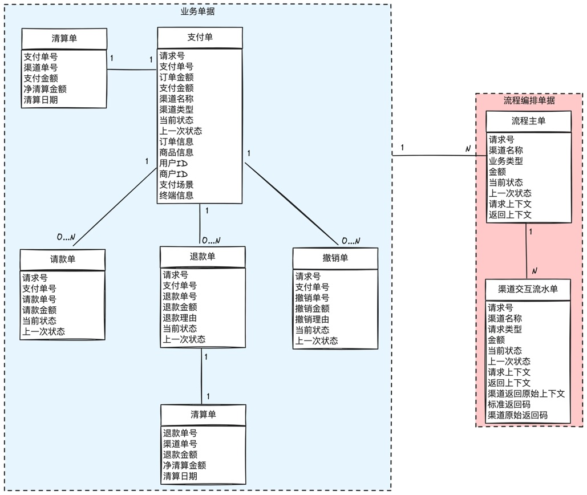

业务单：比如支付、请款、退款、撤销等，是直接承载业务属性的，比如退款时要检查当前的可退金额等。

流程编排单：只有主单和渠道交互流水单两种，承载流程编排。在流程编排单里面，不会做太多的业务校验，只是按预先的脚本配置推进流程，第一步调用什么，第二步调用什么，根据结果码推进状态等。在后面的“流程编排与流程引擎”有详细介绍。

### 6.2.5 渠道网关的状态机设计

#### 业务单

支付：只有卡支付的预授权模式，才会有预授权成功和请款中状态。其它的支付没有这两个状态。

<!-- PDF 第 98 页；原书第 95 页 -->

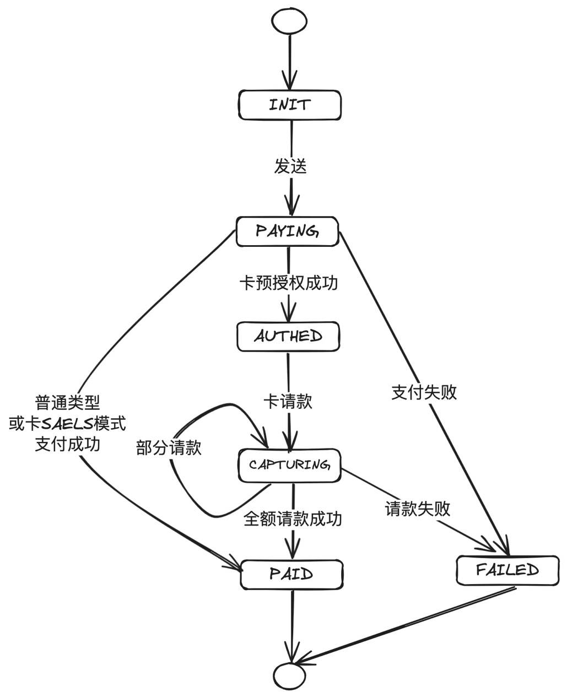

退款：如果超过退款有效期，直接置为“退款失败”，所以有INIT直接到FAILED的情况。

<!-- PDF 第 99 页；原书第 96 页 -->

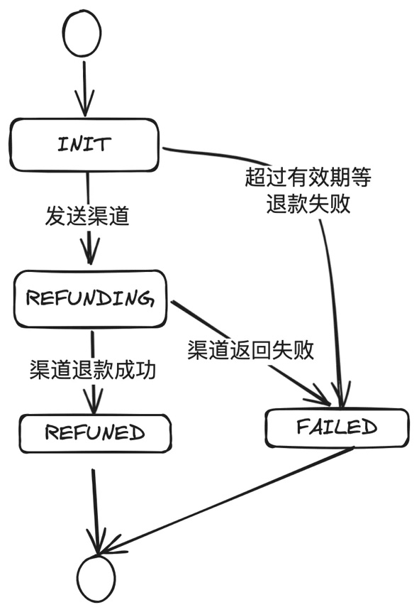

撤销单和退款单比较像，略。

#### 流程单

对于流程单来说，主单只有：初始，处理中，成功，失败，流水单则只有：未知、成功、失败。原因在于流程单并不需要感知业务状态。

流程编排主单：初始，处理中，成功，失败。

<!-- PDF 第 100 页；原书第 97 页 -->

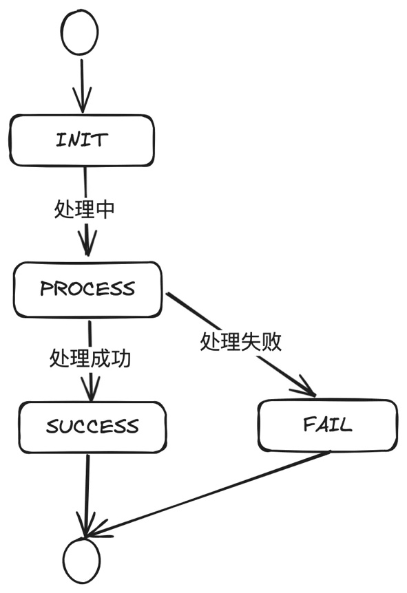

渠道交互流水单：未知，成功，失败。

<!-- PDF 第 101 页；原书第 98 页 -->

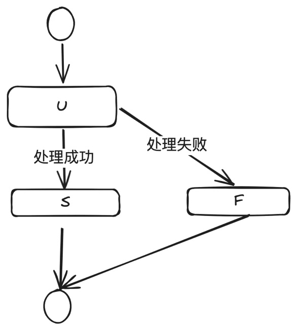

### 6.2.6 流程编排与流程引擎

前面有说到，对于渠道交互来说，有些渠道的支付只需要一次交互，有些渠道的支付需要三次交互，这些差异由流程编排层来吃掉。上层的业务层只负责业务状态的推进。

流程引擎有很多成熟的方案，而且很多都声称自己的是轻量级的，比如Activiti，JBMP，读者可以根据自己的需要来选择。

不过对支付流程来说，仍然太重，经历过的几家公司都是自己造的自己的流程引擎轮子。

先举个稍微复杂的例子：渠道需要3次交互(刷新token，获取paymentCode，最后支付），提供查询和异步通知接口。主单和流水单的推进大概如下：

<!-- PDF 第 102 页；原书第 99 页 -->

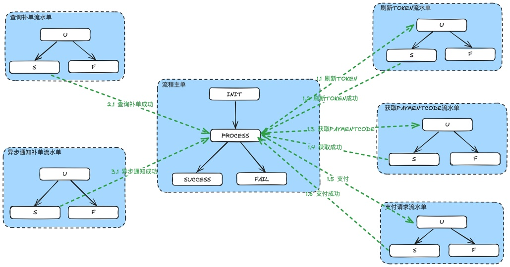

然后我们定义一种自己的语言来描述上面的流程，其实很简单，也很清晰，如下：

<!-- PDF 第 103 页；原书第 100 页 -->

```java
public PayNeedRefreshTokenAndGetPaymentCodeFlow implements SimpleFlow {

    /**
     * 支付流程，创建后，先推进到处理中，再刷新TOKEN，获取PAYMENTCODE，最后支付
     * 主单的状态为：INIT，PROCESS，SUCCESS，FAIL
     * 流水单的状态为：U，F，S
     */
    @Override
    public void config(FlowConfig config) {
        // 创建后，通过事件CREATE推进到处理中
        config.sourceStatus(INIT).on(CREATE, PROCESS)
        // 然后请求刷新TOKEN，如果失败，就推进流程主单到失败
        .request(refreshToken, subProcess().when(F).transTo(FAIL)
             // 刷新成功，就获取支付码，如果失败，就推进流程主单到失败
             .when(S).request(getPaymentCode, subProcess().when(F).transTo(FAIL)
                  // 获取支付码成功，就支付
                  when(S).request(pay, subProcess().when(S).transTo(SUCCESS).when(F).transTo(FAIL))));

        // 支付回调通知
        config.sourceStatus(PROCESS).callback(payNotify, subProcess().when(S).transTo(SUCCESS).when(F).transTo(FAIL));

        // 定时任务梯度查询补单
        config.suoreceStatus(PROCESS).query(payQuery, subProcess().when(S).transTo(SUCCESS).when(F).transTo(FAIL));
    }
}
```

如果上面的比较复杂，我们看一下简单的普通支付，如下：

<!-- PDF 第 104 页；原书第 101 页 -->

```java
public PayCommonFlow implements SimpleFlow {

    /**
     * 支付流程，创建后，先推进到处理中，然后支付
     * 主单的状态为：INIT，PROCESS，SUCCESS，FAIL
     * 流水单的状态为：U，F，S
     */
    @Override
    public void config(FlowConfig config) {
        // 创建后，先推进到处理中
        config.sourceStatus(INIT).on(CREATE, PROCESS)
        // 支付，如果失败，就推进流程主单到失败，如果成功，就推进主单到成功
        .request(pay, subProcess().when(S).transTo(SUCCESS).when(F).transTo(FAIL));

        // 支付回调通知
        config.sourceStatus(PROCESS).callback(payNotify, subProcess().when(S).transTo(SUCCESS).when(F).transTo(FAIL));

        // 定时任务梯度查询补单
        config.suoreceStatus(PROCESS).query(payQuery, subProcess().when(S).transTo(SUCCESS).when(F).transTo(FAIL));
    }
}
```

#### 简单说明：

config.sourceStatus(STAUTS)：起始状态。

on(EVENT,STATUS):通过事件推进到新的状态。

request(action, subProcess().when(status).transTo(STATUS)：请求动作，比如请求渠道支付，再根据结果推进主单的状态。

callback(action, subProcess().when(status).transTo(STATUS)：回调动作，根据渠道异步通知的结果推进主单的状态。

query(action, subProcess().when(status).transTo(STATUS)：查询动作，根据查询结果推进主单的状态。

接下来就是，如何构建一个流程引擎，能解析并执行上面的脚本，只需要写几个类就可以了。

<!-- PDF 第 105 页；原书第 102 页 -->

通过上面的分析，我们可以看到，和外部渠道（支付通道）再复杂的流程，只要分解一下，就很简单，就那么几个步骤组合，然后写一个好理解的脚本，加几个类就可以处理得相当妥当，既不需要引入Activiti那么复杂的流程引擎，也不用写一堆不好理解的XML配置文件。

再补充说一点，流水单怎么判断是推进到F(FIAL失败）还是S(SUCCESS成功），还是啥事不干的U（UNKNOW未知）呢？很简单，就是通过渠道返回码的映射。明确渠道明确场景明确返回码映射到指定的状态就行。

## 6.3 报文网关：一种低代码报文网关的设计思路与核心代码实现

作为支付系统与外部世界沟通的桥梁，报文网关承担着参数转换、报文组装与解析、安全加密、签名验签等多重重要任务。

一般来说，小型公司可能根本就没有报文网关这一说法，直接引入HttpClient包，手撸几个类，就把一个渠道对接搞定。稍大的公司，可能做一些模板方法的抽象，或者一些组件的抽象，也能实现一定的高效接入及复用。但对于更大型跨国公司，如果接入的渠道有几百条，这样手写接入渠道，往往伴随着代码高复杂性和高维护成本。因应这一挑战，"低代码报文网关"的概念应运而生。

在本章中，我们将一起探索这种低代码报文网关的创新设计。我们会从报文网关在支付系统中的角色和重要性入手，然后深入探讨低代码报文网关的工作原理、产品架构、系统架构以及核心代码实现。我们的目标不仅是理解其技术细节，更是领悟其背后的设计哲学如何在保证系统强大功能的同时，实现更高的接入效率和可维护性。

### 6.3.1 报文网关在支付系统中的位置

<!-- PDF 第 106 页；原书第 103 页 -->

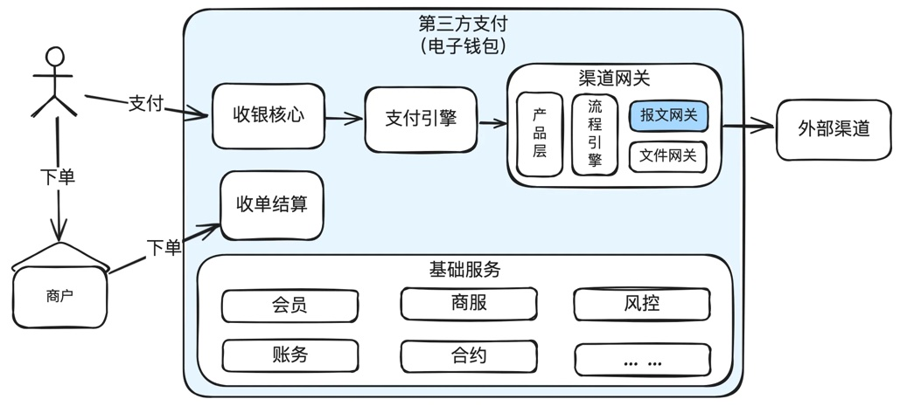

报文网关最核心的职责就是对接外部渠道的API接口，把内部的请求发出去，把渠道返回的数据转成内部的参数。

这里面还涉及到很多技术细节，比如参数转换、签名验签、加密解密、报文组装解析，发送接收等。

在前面的两篇文章中，我们介绍了渠道网关，两者的区别在于：

渠道网关：是一个更大范围的网关，还包括渠道路由、渠道开关、渠道咨询等能力。

报文网关：是渠道网关的一部分，只负责对接渠道的接口，小团队可能只是一个小模块，大团队可能会独立出应用。

### 6.3.2 报文网关的几种形态

一般来说，从简单到复杂、从固定到灵活，报文网关会存在四种形态：

#### 1. 纯手撸代码：

● 在这种最初级的形态中，每个外部渠道都需要单独的代码实现。这意味着为每个新接入的银行或支付服务，开发团队需要编写一套新的接口逻辑。

● 优点：针对性强，可以精确控制每个渠道的交互细节。

●缺点：随着接入渠道的增多，代码变得越来越复杂，维护和扩展的成本急剧上升。

2. 模板方法报文网关：

<!-- PDF 第 107 页；原书第 104 页 -->

● 这种形态通过引入模板方法模式，将报文处理流程的共通部分抽象出来，为各个渠道提供统一的处理框架，同时留有接口供具体渠道实现其特定逻辑。

●优点：提高了代码的重用性，降低了维护成本。

缺点：对于一些特殊需求，模板方法可能仍然不够灵活，需要额外的定制。

#### 3. 低代码报文网关：

低代码报文网关把所有核心的代码逻辑实现后，只需要写几个配置文件，就可以完成渠道的接入。

优点：极大地提高了灵活性和易用性，加快了新渠道的接入速度，核心代码由有经验的资深员工编写，减少出错可能性。

缺点：复杂场景下可能需要写一些内联函数，造成了一定复杂度。

#### 4. 产品化配置报文网关：

在低代码报文网关基础上，提供图形化配置界面，进一步降低使用难度。

优点：极大地提高了易用性，加快了新渠道的接入速度，以前写代码可能需要4、5天才接一个接口，变成可能0.5天就能接一个接口。

缺点：平台的初始研发成本很高，如果总体接入的渠道不多，ROI可能不高。

每种形态都反映了各公司在特定时期的技术水平和方案造型，但总体来说，对于中大型公司来说，低代码报文网关和产品化配置报文网关是一个比较不错的选择。一方面可以提高效率，另一方面也有足够的研发资源来建平台。

### 6.3.3 一种低代码报文网关设计思路

<!-- PDF 第 108 页；原书第 105 页 -->

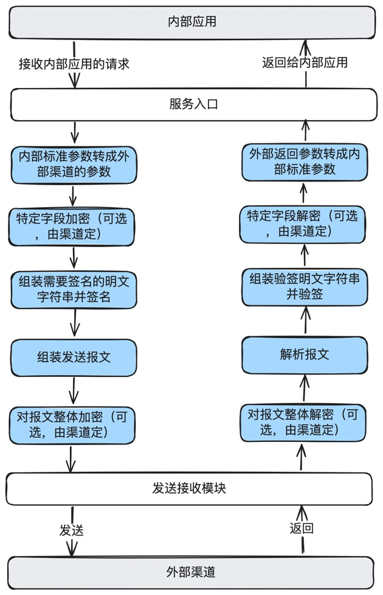

首先我们要知道报文网关核心只做这么几件事：

1. 接收内部应用的请求。

2. 内部标准参数转成外部渠道的参数。比如内部叫mobileNo，渠道可能叫：mobile\_id。

3. 特定字段加密（可选，由渠道定）。

4. 组装需要签名的明文字符串并签名。

5. 组装发送报文，比如有json，kv，xml等。

6. 对报文整体加密（可选，由渠道定）。

7. 发送请求，并接收请求。

8. 对报文整体解密（可选，由渠道定）。

<!-- PDF 第 109 页；原书第 106 页 -->

9. 解析报文。

10. 组装验签明文字符串并验签。

11. 特定字段解密（可选，由渠道定）。

12.外部返回参数转成内部标准参数。

13. 返回给内部应用。

通过上面的流程分析，我们很容易想到流程引擎或责任链处理，再加一个上下文，就可以实现全部的操作。

#### 具体包括：

1. 可视化配置：提供直观的用户界面，允许用户通过图形化方式配置报文的处理流程，无需编写复杂的代码。

2. 模块化处理逻辑：将报文处理的各个步骤模块化，如报文解析、加密/解密、数据映射等，用户可以根据需要组合这些模块来构建完整的处理流程。

3. 灵活的适配能力：支持灵活地适配不同的支付渠道，包括但不限于银行接口、电子钱包、第三方支付平台等。

4. 动态配置管理：所有配置信息动态管理，支持实时更新，无需重启系统或重新部署。

### 6.3.4 低代码报文网关系统架构

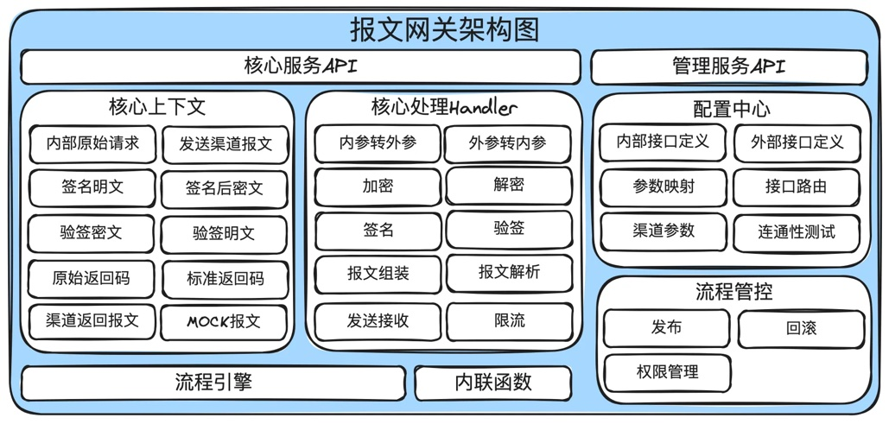

#### 说明：

<!-- PDF 第 110 页；原书第 107 页 -->

1. 最上层是API：核心服务和管理服务分离。

2. 核心上下文：主要是用于保存接口配置，原始请求，中间处理结果等。

3. 核心处理Handler：参数转换、加密、解密等全部基础功能全部组件化。

4. 流程引擎：负责串起所有的Handler依次运行。

5. 内联函数：解决特殊场景下的报文转换。

6. 配置中心：配置内部接口，外部接口，参数映射等。

7. 流程管控：发布、回滚、权限管理等能力。

通过这种系统架构，低代码报文网关不仅能够提供强大灵活的配置能力，还能确保处理流程的稳定执行，同时保持高度的可维护性。这样的架构使得报文网关能够适应不断变化的业务需求，同时降低了总体的维护成本和技术复杂性。

### 6.3.5 低代码报文网关的核心代码实现

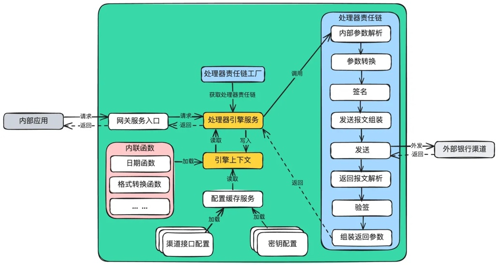

代码实现有很多种方式，这里给出上面系统架构图中的核心代码示例。读者可以扩展实现细节。

#### 整体思路如下：

1. 设计数据库表结构：用于存储内部接口定义，外部接口定义，接口映射关系，外部渠道参数等。这部分在这里略过。

2. 设计运行上下文：GatewayContext(保存处理的上下文信息，包括接口配置、内部请求参

<!-- PDF 第 111 页；原书第 108 页 -->

数、加解密临时数据、加验签临时数据、发送渠道报文、渠道返回原始报文、解析后报文等）。

3. 设计各种处理Handler：内部参数转外部参数Handler，加密Handler，签名Handler，报文组装Handler，发送Handler，报文解析Handler，验签Handler，解密Handler，外部参数转内部参数Handler等。

4. 设计Handler工厂类：GatewayHandlerFactory（通过getHandlers()获取处理的责任链）。

5. 设计内联函数：用于处理一些复杂操作。比如外部渠道返回的币种和金额两个字段转成内部的一个Money类。这部分在这里略过。

下面是核心代码组件包括GatewayContext、 GatewayHandlerFactory 和一系列的 GatewayHandler 基本实现：

GatewayContext 类用于保存处理过程中的上下文信息，包括临时参数、报文信息等。

```java
public class GatewayContext {
    // 接口配置信息
    private InterfaceInfo interfaceInfo;
    // 原始请求
    private Map<String, Object> originalRequestParam;
    // 转换后参数
    private String requestParam;
    // 签名明文
    private String signPlanContext;

    // 省略部分参数，以及getter和setter方法
    ... ...
}
```

GatewayHandlerFactory 是一个工厂类，用于构建处理责任链。

<!-- PDF 第 112 页；原书第 109 页 -->

```java
public class GatewayHandlerFactory {
    private static final List<GatewayHandler> handlers = new ArrayList<>();

    static {
        handlers.add(new ParameterTransformHandler());
        handlers.add(new EncryptionHandler());
        handlers.add(new SignatureHandler());
        // 添加其他handler
        ... ...
    }

    public List<GatewayHandler> getHandlers() {
        // 添加其他handler
        return handlers;
    }
}
```

GatewayHandler 接口定义了处理逻辑的执行方法。

```java
public interface GatewayHandler {
    void execute(GatewayContext context);
}
```

#### 具体的 Handler 实现：

内部参数转外部参数Handler

```java
public class ParameterTransformHandler implements GatewayHandler {
    @Override
    public void execute(GatewayContext context) {
        // 实现内部参数到外部参数的转换逻辑
    }
}
```

<!-- PDF 第 113 页；原书第 110 页 -->

#### 签名Handler

```java
public class SignatureHandler implements GatewayHandler {
    @Override
    public void execute(GatewayContext context) {
        // 不需要签名
        if (!context.isNeedSign()) {
            return;
        }

        context.setSignMessage(sign(context.getSignPlainContext(),
                                    context.getInterfaceInfo().getSignConfig()));
    }

    // 签名方法略
}
```

其它Handler的实现略。

执行Service

<!-- PDF 第 114 页；原书第 111 页 -->

```java
public class GatewayServiceImpl implements GatewayService {
    @Override
    public GatewayResponse execute(GatewayRequest request) {
        // 转成网关的上下文
        GatewayContext context = buildGatewayContext(request);

        // 获取责任链，依次执行
        List<GatewayHandler> handlers = GatewayHandlerFactory.getHandlers();
        for(GatewayHandler hander : handlers) {
            hander.execute(context);
        }

        // 转换返回
        return convertResponse(context.getResponseParam);
    }

    // 其它代码略
    ... ...
}
```

这些组件和处理器共同构成了低代码报文网关的核心功能，允许系统灵活地配置和处理支付系统与外部渠道之间的报文交换。通过这种设计，报文网关可以轻松适应不同支付渠道的接入和业务流程的变更，同时大大减少了传统编码方式所需的开发和维护工作。

## 6.4 文件网关：文件交互的底座

在支付系统中，和外部银行通道一般有两种信息交互模式：

1. 实时报文交互：组装指定的格式（JSON，KV等）报文实时发给外部银行通道，银行一般是实时返回结果，或异步通知返回结果。现在一般是通过https进行传输，以前还有直接通过socket传输，现在很少见到。

实时报文交互一般用于支付通道的支付、退款、签约、解约等。

2. 文件交互：组装文件，发给外部银行通道，或者外部银行通道生成文件，供我方下载处理。一般是通过SFTP进行传输，有些特殊的是通过邮件或https进行传输。文件交互一般用于支付通道的清算文件，流出转账渠道的流出指令等。

<!-- PDF 第 115 页；原书第 112 页 -->

有几个和文件网关强相关术语，需要理解。

### 1. 文件交互

文件交互是指支付平台与银行或其他金融机构之间通过文件形式进行数据交换的过程。与实时接口(如API调用）相比，文件交互通常用于处理批量指令，实时性要求不高。常见的场景包括银行提供的清算文件处理、流出转账的批量指令等。

### 2. 文件接口

文件接口是指支持文件格式数据交换的通信界面。在支付系统中，文件接口允许系统批量导入或导出数据，如转账指令、清算数据等，通常以CSV、XML或其他特定格式的文件进行数据传输。

### 3. 批处理

批处理是指将一组数据或指令作为一个批次进行处理的过程。在支付系统中，批处理常用于处理大量类似的交易或数据更新任务，如夜间批量处理银行清算文件或执行批量转账指令。

### 4. 批转单

批转单是将一批数据或指令分拆成单条进行处理的过程。比如外部银行的一个清算文件通常包含了几百万条数据，把这些文件的内容解析后，一条条发给内部系统进行处理，就是批转单的应用。

### 5. 单转批

单转批是指将多个单独的指令聚合成一个批次进行统一处理的过程。比如流出转账指令，上游发下来的是一条条单个转账指令，把这多个指令汇总成一个文件发给外部银行，就是单转批的应用。

### 6. PGP加解密

Pretty Good Privacy，是一种加密程序，用于信息传输的加密和解密，保证电子数据的安全性。它通过使用公钥加密和私钥解密的方法，实现了信息的机密性和完整性，同时也支持数字签名以确保信息来源的真实性。

有个形象的说法，PGP就像一个信封一样，不但加密保护里面的信息，还通过签名确定真实的来源。

### 6.4.1 文件网关在支付系统中的位置

<!-- PDF 第 116 页；原书第 113 页 -->

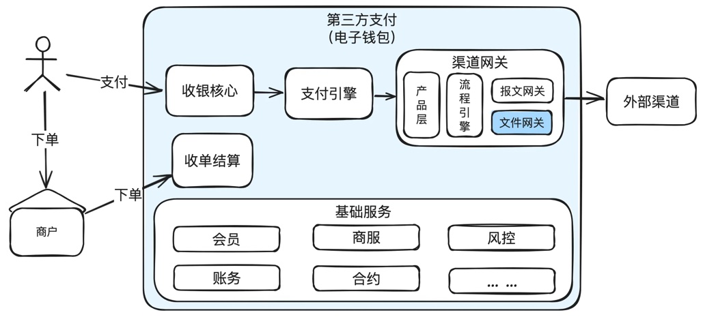

文件网关最核心的作用就是解决文件交互的问题。

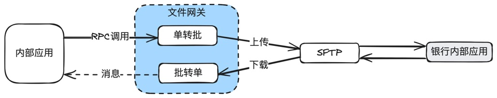

#### 再细化分为两种：

1. 单转批：把内部指令，打批成一个文件，然后上传到外部银行的SFTP上。

2. 批转单：把外部银行生成的文件，下载后并解析一条条内部需要的数据，然后发给内部应用处理。

### 6.4.2 文件网关的几种形态

在一些小型支付公司，一般没有独立的文件网关，可能只是一个小模块，正常也是能运行的。

但是对于大型支付公司来说，和外部银行通道一天的交易可能有几千万笔，一个清算文件有上百M，如果和实时交易系统共用应用，有可能会影响实时交易(比如支付业务），在这种情况，就需要把文件网关独立出去。也就是实时交易和非实时交易拆分开，互相不影响。

一般来说，从简单到复杂、从固定到灵活，文件网关和实时报文网关会一样，也存在四种形态：

#### 1. 纯手撸代码：

● 在这种最初级的形态中，每个外部文件都需要单独的代码实现。

<!-- PDF 第 117 页；原书第 114 页 -->

● 优点：针对性强，可以精确控制每个文件的交互细节。

●缺点：随着接入通道的增多，代码变得越来越复杂，维护和扩展的成本急剧上升。

#### 2. 模板方法文件网关：

● 这种形态通过引入模板方法模式，将文件处理流程的共通部分抽象出来，提供统一的处理框架，同时留有接口供具体文件实现其特定逻辑。

●优点：提高了代码的重用性，降低了维护成本。

缺点：对于一些特殊需求，模板方法可能仍然不够灵活，需要额外的定制。

#### 3. 低代码文件网关：

低代码文件网关把所有核心的代码逻辑抽象出来，每个文件只需要写一个配置文件，就可以完成文件的对接。

优点：极大地提高了灵活性和易用性，加快了新文件的接入速度，核心代码由有经验的资深工程师编写，减少出错可能性。

缺点：复杂场景下可能需要写一些内联函数，造成了一定复杂度。

#### 4. 产品化配置文件网关：

在低代码报文网关基础上，提供图形化配置界面，进一步降低使用难度。

优点：极大地提高了易用性，加快了新文件的接入速度，以前写代码可能需要4、5天才接一个文件，变成可能0.5天就能接入一个文件。

缺点：平台的初始研发成本很高，如果接入的文件不多，ROI就不够高。

每种形态都反映了各公司在特定时期的技术水平和方案选型，但总体来说，对于中大型公司来说，低代码报文网关和产品化配置报文网关是一个比较不错的选择。一方面可以提高效率，减少出错的可能，另一方面也有足够的研发资源来建平台。

### 6.4.3 一种低代码文件网关设计思路

在前面的报文网关一样，文件网关的处理流程也是固定的。下面以文件下载为例说明设计思路，文件上传逻辑也是差不多的。

<!-- PDF 第 118 页；原书第 115 页 -->

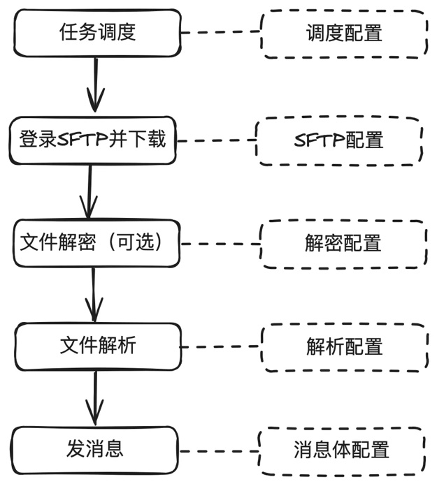

从上图可以看到，标准流程只有5个：

1. 任务调度：一天的什么时候执行，执行多少次等。一般使用CRON表达式来做。比如银行的清算文件每天凌晨5点生成，那么一般设计任务在5点到7点之间执行，每30分钟尝试一次。

2. 登录SFTP并下载：一般是SFTP，也有可能是邮件，设计成接口就行。如果是SFTP，一般SFTP的主机名，用户名，密码，目录，文件名规则等。其中文件名一般是每天变化，建议使用正式表达式来做。

3. 文件解密：这个一般是可选的，有些银行可能会使用PGP加密，这种情况下，就先进行解密需要用到银行公钥进行验签，我方私钥进行解密。

4. 文件解析：根据银行接口文档，可能有XML，CSV，EXCEL等多种格式，相关的代码在网上都有。最主要的是解析出我方需要的数据，比如银行可能叫：charge\_no，我们内部叫：pay\_no，那就把对方的数据解析后并映射到内部的数据。

5. 发消息：根据消息体配置，把一条数据按照消息体的配置，组装成消息，通过消息中间件发出去。

我们只需要把上面5个步骤所做的操作，全部抽象出单独的代码，然后通过配置文件来驱动即可。

<!-- PDF 第 119 页；原书第 116 页 -->

### 6.4.4 低代码文件网关系统架构

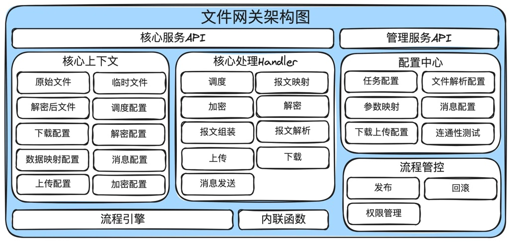

#### 几点说明：

1. 核心上下文：把解决配置、临时变量等保存在上下文中，供后面流程引擎驱动文件的解析或打批。

2. 核心处理Handler：把核心处理能力抽象成通用的Handler，比如上传下载，报文解析，报文映射，消息发送等。

3. 流程引擎：把各handler组成一个责任链，依次执行。

4. 配置中心：提供产品化配置的能力。

5. 流程管控：解决发布和回滚问题。

### 6.4.5 低代码文件网关的核心代码实现

核心的代码实现思路和报文网关基本是一致的，详见前面的“一种低代码报文网关的设计思路与核心代码实现”。

但是具体的代码实现和报文网关是不一样的，比如SFTP下载通常使用jsch来做，PGP加解密也有公开的组件，csv文件使用使用Apache Commons CSV库解析等。

另外的区别在于文件网关需要考虑任务调度，失败重试等，而报文网关是不需要考虑的，失败就由上游发起重试。

### 6.4.6 文件网关常见问题及应对方案

<!-- PDF 第 120 页；原书第 117 页 -->

文件网关主要处理批量文件，有几个特殊的地方需要重点考虑，否则在后续的运维过程中可能是一头的包：

#### 1. 任务分配不均

在分布式场景下，有多台服务器并发处理任务，如果调度系统设计不好，有可能部分服务器持续高负载处理，部分服务器持续在闲置，一些任务一直在排队，无法得到及时处理。

一般这种情况下，最简单的做法，就是随机调度一台服务器执行。另一种做法就是轮询法，先通过接口判断服务器当前状态是否空闲，如果正在执行任务，就找下一台，直到找到空闲的服务器。

#### 2. 任务踩踏与并发执行

所谓任务踩踏，就是一个任务执行的时间非常久，在还没有结束时，另外一台服务器（也可能是同一台服务器）也被调度起来执行相同的任务，导致一个任务被两个服务器并行处理。

常用的解决方案，就是给任务加锁，但是加锁时需要设计超时释放。因为有可能任务跑到一半服务器重启，如果锁不释放，这个任务就无法重新被捞取执行。

#### 3. 瞬时超大并发流量

文件网关解析文件是很快的，有可能几分钟解析出几百万条数据，如果不做任何保护措施，有可能瞬间对内部系统造成上万TPS的高并发压力，进而有可能影响在线实时业务的处理。

一般来说，文件网关不要通过RPC直接调用内部应用，而是通过消息的形式通知内部应用。主要考虑：文件网关短时间内解析出大批量的数据，如果直接调用内部应用，内部应用如果不限流，有可能把内部应用打到宕机，如果做了限流，文件网关还需要做调用失败重试。

如果通过消息中间件的形式通知内部应用，一方面可以由内部应用根据自己的能力来控制数据消费的速度，另一方面可以由消息中间件来缓存数据，无论是文件网关还是内部应用的实现都可以做得比较简单。

#### 4. 通过RPC还是消息交互

如果是内部应用调用文件网关，建议使用RPC调用，这样比较简单。比如流出打款的指令。

如果是文件网关调用内部应用，建议使用消息中间件。解决文件网关瞬时超大并发流量对内部应用的冲击问题。

<!-- PDF 第 121 页；原书第 118 页 -->

#### 5. 任务恢复与重试

对于大文件的执行，有可能执行一半服务器就被重启，这种情况下就需要做任务恢复，对应的，上下游都需要做好幂等设计，因为部分数据可能会被重复解析并发送。

#### 6. 异常单据处理

外部银行通道生成的文件，有可能因为系统BUG导致生成的部分数据的格式或内容有问题，无法正常解析。

常用的解决方案一般也是两种：1)记录有问题的数据，继续往下执行。2）任务终止，等外部银行修复文件后，重新执行。

一般是建议记录后，继续执行。主要是考虑外部银行修复会比较慢，有问题的数据放在差异里面去处理更好。

另外，对于部分数据缺失的场景，我们还可以主动补齐数据。比如正常情况下，外部银行通道需要给我方单号，银行单号，金额，币种等数据，假如一个包含几百万条数据的文件中有5条数据没有给我方单号，但是银行单号、金额、币种都能对上，那么我们就自行补全我方单号就行。没必要非得从几百万条数据中取出5条让银行补上。

#### 6. 顺序执行与并发执行

对于银行的清算文件来说，系统正常是按顺序执行的，比如先解析20240101的数据，再解析20240102的数据，如果在解析20240101数据出现问题，通常也有两种方式：一、卡住，等20240101处理完成，才处理20240102。二、不管20240101失败，继续处理20240102的数据。

这里体现的是两种思维方式：顺序执行与并发执行。一般来说，推荐使用并发执行，一个任务失败，不要影响另一个任务。

## 6.5 小结

本章主要介绍了常见的渠道类型、渠道网关职责和领域模型设计，并给出了低代码报文网关和文件网关的实现思路。
