# 第7章 账务系统

> 来源：《图解支付系统设计与实现》V_0.1.0，隐墨星辰著。PDF 第 121–142 页。正文经 MinerU OCR 转换，原图保留。

<!-- PDF 第 122 页；原书第 119 页 -->

我在支付行业呆了十年有余，一直从事研发相关工作，从个人以及身边同事的经验看，除了从事账务系统研发的工程师外，大部分支付研发工程师对账务都了解甚少，主要原因仍然是账务系统的业务门槛往往大于技术门槛，比如很多支付研发工程师甚至不了解复式记账。所以有必要从研发工程师的角度来介绍一些账务系统入门的知识以及账务系统核心的设计。

每个公司的账务系统设计思路、实现方式必然是不一样的，我个人经历过好几家支付公司，实现细节千差万别，但是整体思路都差不太多，比如账户设计一定有客户账户和内部账户，一定有中间户（过渡户），也一定使用复式记账，也都有实时记账和缓冲记账等。

而不一样的地方在于，有些是集团财务统一管理电商和支付平台的资金，有些则是分开两个团队管理，这种业务上的差异(或部门职责差异）就会体现到账务系统的实现细节。比如集团财务统管的话，就会要求会计科目的编制需要和集团财务系统保持一致，每天日切完成后要并账到集团的财务系统，一些差异处理也要受集团财务的流程制约。

本章内容尝试抛开那些随各公司业务部门定制的逻辑，回到账务系统的本质，聊聊一个通用的账务系统设计要点。

## 7.1 账务有关的一些核心概念

<table><tr><td colspan="1" rowspan="1">名词</td><td colspan="1" rowspan="1">简要说明</td></tr><tr><td colspan="1" rowspan="1">账务系统</td><td colspan="1" rowspan="1">账务系统是支付平台的核心子系统之一，负责记录和管理所有与资金相关的交易和活动。它通过一系列账务规则和会计准则，确保资金流动的准确性和完整性。</td></tr><tr><td colspan="1" rowspan="1">账户</td><td colspan="1" rowspan="1">账户是账务系统中用于记录资金收支和余额变化的基本单元。财务系统内部的账户一般包含两种账户：1. 客户账户：对客可见。包括：对私的个人客户账户，对公的商户账户。2. 内部账户：对客不可见。包括：头寸、手续费收入、过渡户(也称中间户)等。</td></tr><tr><td colspan="1" rowspan="1">复式记账</td><td colspan="1" rowspan="1">复式记账是一种记账方法，每笔交易都记录在两个或多个账户中，借方和贷方金额必须相等。这种方法确保了账务的平衡性和准确性，是现代会计系统的基础。</td></tr><tr><td colspan="1" rowspan="1">会计科目</td><td colspan="1" rowspan="1">会计科目是用于分类记录各类经济业务的项目，是会计核算的重要工具。会计科目按照经济业务的性质和内容分为资产、负债、权益、收入、费用等类别。每个会计科目都对应特定的账户，用于记录相关的交易。</td></tr><tr><td colspan="1" rowspan="1">会计分录</td><td colspan="1" rowspan="1">会计分录是根据复式记账原理，对经济业务进行记录的具体形式。每笔会计分录包括日期、摘要、会计科目、借方金额和贷方金额。通过会计分录，可以详细反映每笔交易的资金流动情况。</td></tr><tr><td>清结算</td><td>清结算是指通过账务系统对交易进行核对、清算和结算的过程。清算是指对交易 进行核对和确认，结算是指资金在账户之间的实际转移。清结算过程确保了各方 资金流动的准确性和及时性。 清算、结算、清分、清偿等概念在中国有点绕。行业内通常把央行、银行之间的 债权债务关系理清及完成资金转移称为清算，而把商业银行和商户之间的债权债 务关系理清及完成资金转移称为结算。清分就是把交易涉及的资金根据预先的规 则，计算好各参与各自应该分多少。清偿则实际完成资金转移。 对账是指账务系统中的交易记录与外部系统(如银行）的交易记录进行核对，确</td></tr><tr><td>对账</td><td>保两者一致的过程。对账通常包括明细对账、账单对账、账实（余额）对账三 种。通过对账，可以及时发现和纠正错误，确保账务的准确性和完整性。</td></tr></table>

<!-- PDF 第 123 页；原书第 120 页 -->

## 7.2 复式记账基本概念

账务系统的理论基础是复式记账法。如果对于复式记账没有任何了解，建议先找网上一些公开的优秀资料或购买会计核算的书籍先做初步的学习。

如果能看懂下面的场景描述，说明已经掌握了复式记账的初步知识。

以用户通过支付平台使用招商银行CMB支付500块为例做个简要说明。

假设：支付平台同样使用CMB做为收单行，在CMB开设有备付金账户。

涉及的支付平台内部账户：

<table><tr><td>账户类型</td><td>账户</td><td>备注</td><td></td></tr><tr><td>借记账户</td><td>应收-渠道-CMB 应付-过渡-网关过渡户</td><td rowspan="3">简单判断账户类型的方法： 恒等式一：资产=负债+所有者权益 恒等式二：利润=收入-费用 恒等式三：资产+费用=负债+所有者权益+收</td></tr><tr><td>贷记账户</td><td>应付-平台托管-商户待结算 应付-平台托管-商户余额 手续费收入-商户-消费</td><td>入 左边的【资产】、【费用】是借记类账户， 右边的【负债】、【所有者权益】、【收</td></tr></table>

<!-- PDF 第 124 页；原书第 121 页 -->

记账步骤（只以支付成功并结算到商户余额做示例，渠道清算相关记账后面讲）：

<table><tr><td rowspan=1 colspan=1>阶段</td><td rowspan=1 colspan=1>操作账户</td><td rowspan=1 colspan=1>金额</td></tr><tr><td rowspan=1 colspan=1>第一步资金从渠道到网关过渡户</td><td rowspan=1 colspan=1>借：应收-渠道-CMB贷：应付-过渡-网关过渡户</td><td rowspan=1 colspan=1>500</td></tr><tr><td rowspan=1 colspan=1>第二步扣除手续费</td><td rowspan=1 colspan=1>借：应付-过渡-网关过渡户贷：手续费收入-商户-消费</td><td rowspan=1 colspan=1>10</td></tr><tr><td rowspan=1 colspan=1>第三步网关过渡户到商户待结算账户</td><td rowspan=1 colspan=1>借：应付-过渡-网关过渡户贷：应付-平台托管-商户待结算</td><td rowspan=1 colspan=1>490</td></tr><tr><td rowspan=1 colspan=1>第四步结算给商户</td><td rowspan=1 colspan=1>借：应付-平台托管-商户待结算贷：应付-平台托管-商户余额</td><td rowspan=1 colspan=1>490</td></tr></table>

### 说明：

1. 支付系统的记账一定是复式记账法。内部开设了很多账户和科目。

【借记类】账户：资产，应收款等；

【贷记类】账户：负债，所有者权益，应付款等；

2. 借贷方向简要公式（不太严谨，但是够用）：

【借记类】账户（如资产，应收款），【增加】为【借】，【减少】为【贷】；  
【贷记类】账户（如负债和所有者权益，应付款），【增加】为【贷】，【减少】为【借】；

3. 复式记账的专业术语很多，这里只摘录几个重要的说明：

复式记账法定义：对每项经济业务按相等的金额在两个或两个以上有关账户中同时进行登记的方法。

记账原则：有借必有贷，借贷必相等。

记账依据：会计恒等式：1. 资产=负债+所有者权益；2.利润=收入-费用。

账户：具有一定格式和结构，能够用来连续、系统、全面的记录反映某种经济业务的增减变化及其结果。

科目：同类财务交易的分类，比如资产、负债、所有者权限、收入或费用等都属于科目。一般科目会分为多级。

账户和科目的区别：科目只有名字，账户包括结构和格式，每个账户对应一个特定的科目。

<!-- PDF 第 125 页；原书第 122 页 -->

## 7.3 账务系统在支付平台中的占位

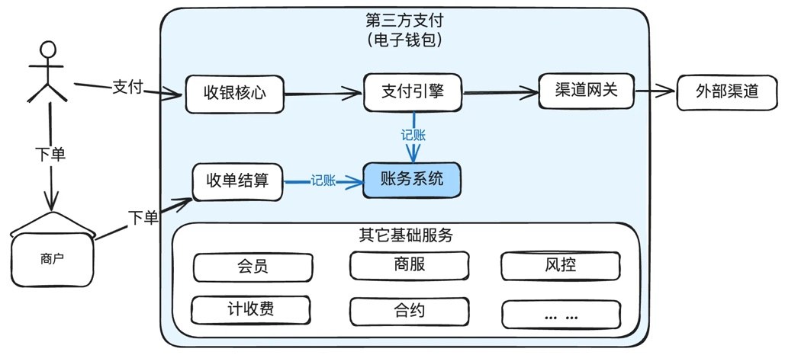

账务系统主要承担账户管理、记账、清结算及会计相关服务。

## 7.4 信息流与资金流全生命周期

支付系统的本质，就是准确无误地把钱从一个地方搬到另一个地方。就这涉及到所谓的信息流和资金流，资金流还可以细分虚拟资金流和实体资金流。

因为读者的钱一定要通过银行才能变现，所以读者在支付平台(比如支付宝或微信）账户看到的余额变动，就是虚拟资金流。真实的资金在银行体系流转，就是所谓实体资金流。不过大部分情况下，也不用刻意去区分虚拟资金流和实体资金流。

此外，像收单核心、支付引擎、渠道网关等处理的就是信息流，而账务系统处理的就是资金流。所以要想理解账务系统，一定要先理解资金流。

下面分别以最常见的支付来展开说明信息流和资金流。钱包账户余额充值和余额支付会有一些差别，但原理差不多，在此处略过。

### 7.4.1 支付与结算交互图极简版

在支付流程中，就是商户委托收单机构（支付平台）把用户的钱收回来，然后再把钱结算给商家。

下面以典型通过外部渠道的卡支付为例说明。

<!-- PDF 第 126 页；原书第 123 页 -->

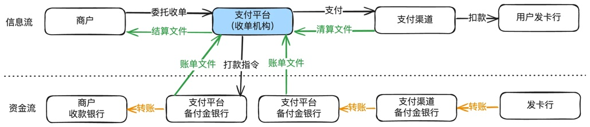

#### 说明：

1. 用户的钱最终会走到商户的收款银行账户。真实情况下用户的支付的钱会分成多份，包括通道收的费用，支付平台收的手续费，税费，营销分润，商户结算款等。通道费用还可以继续细分为发卡行手续费，收单行手续费，清算机构手续费等。

2. 跨行一般都需要通过清算机构，这里为简化也没有画出来。

3. 支付平台内部的资金流在详细版中给出。

### 7.4.2 支付记账详细版

<!-- PDF 第 127 页；原书第 124 页 -->

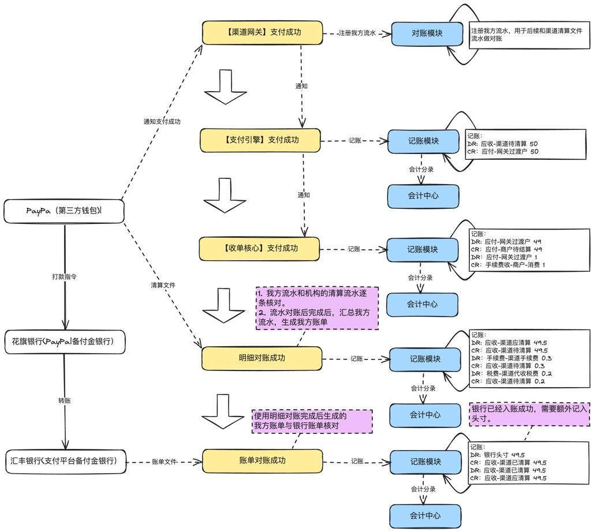

#### 说明：

1. 图中只画了正常场景，像明细对账出现差异(长短款）、账单对不平(渠道少打款或多打款)等场景没有画出来。

### 7.4.3 商户结算记账详细版

<!-- PDF 第 128 页；原书第 125 页 -->

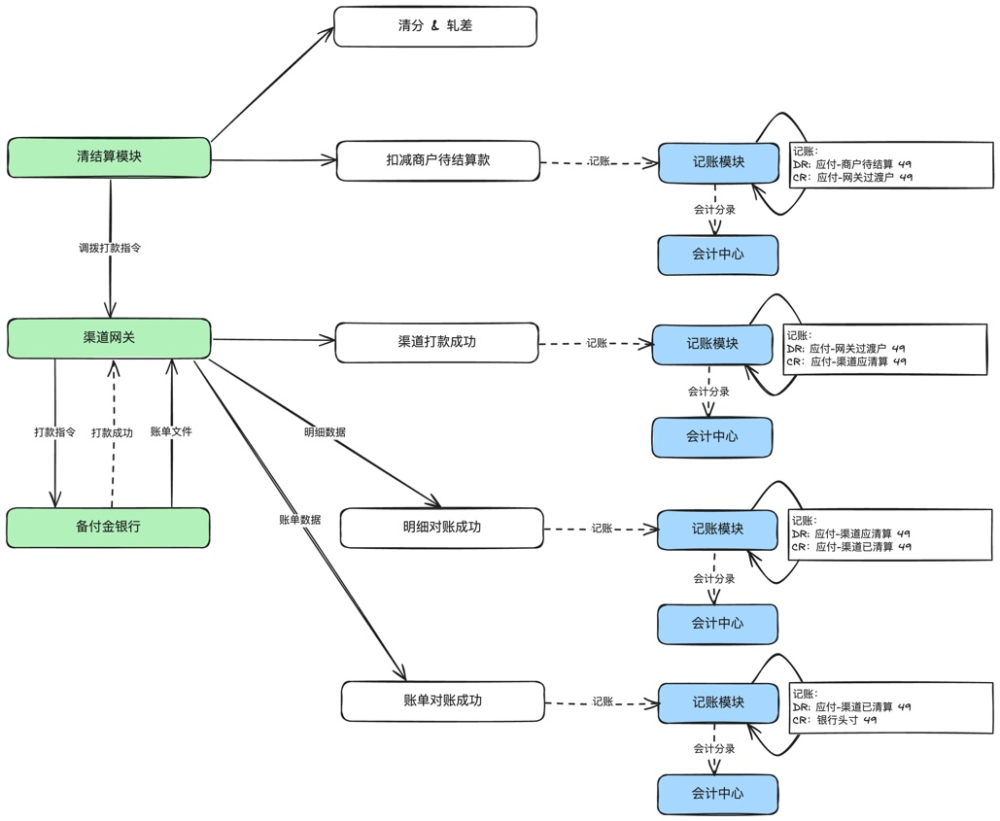

说明：

1. 上述是商户结算到卡场景。

2. 各公司的内部户编制可能有所不同。

## 7.5 账务系统核心诉求

<!-- PDF 第 129 页；原书第 126 页 -->

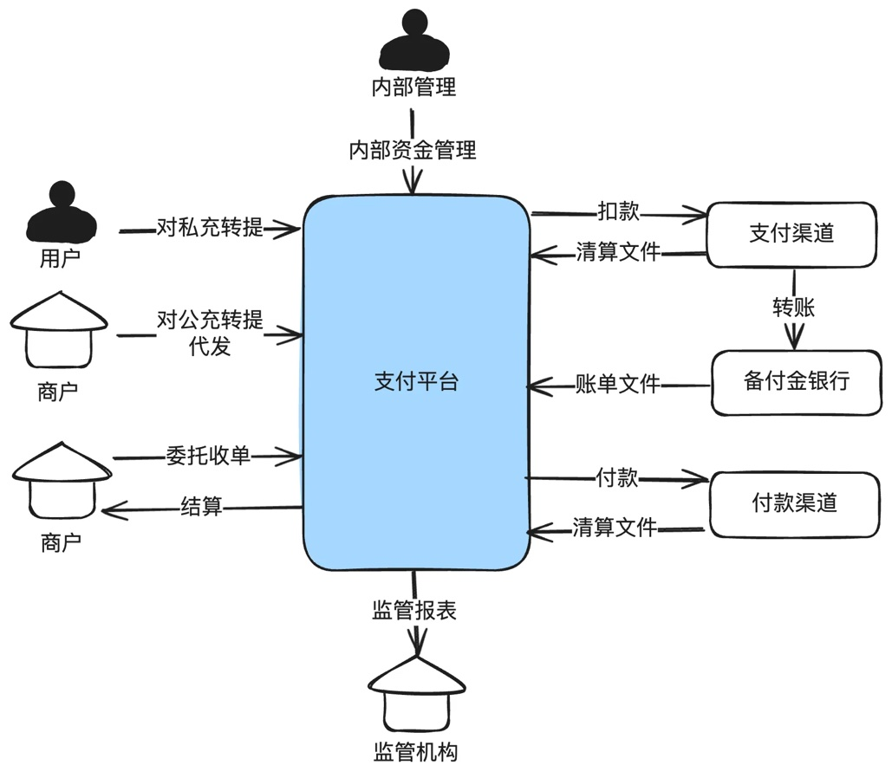

在第3节中提到，账务系统负责支付平台的资金流管理。根据上述图继续拆解，可以得出账务系统的核心诉求如下：

1. 账户管理：对私、对公账户的开户、销户等。

2. 余额管理：对私、对公账户的余额管理。

3. 记账处理：清楚知道每笔钱的来龙去脉。

4. 清结算与对账：把需要结算给商户的钱算清楚，把渠道和支付平台的账算清楚。

5. 银行头寸管理与流动性：支付平台在各备付金银行开立的头寸，以及头寸间流动性管理。

6. 内部会计报表与外部监管报表：根据会计准则出具各种要求的报表。

## 7.6 账务系统产品架构图

<!-- PDF 第 130 页；原书第 127 页 -->

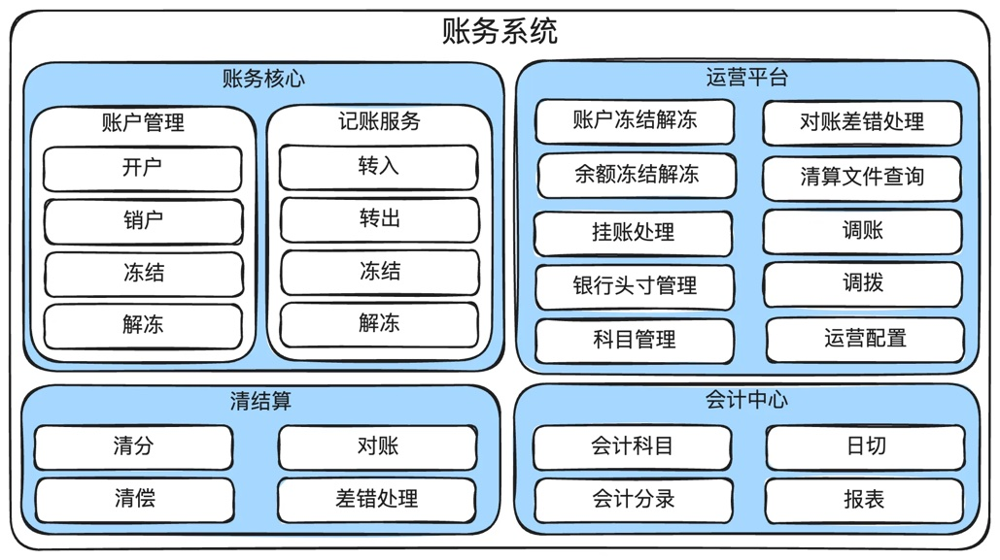

### 说明：

1.账务主要负责账户的管理，以及记账服务。比如开、销户，余额操作。

2. 清结算主要负责对商户的清分（算出应该给商户多少钱），清偿（实际打款给商户），对账以及差错处理。

3. 会计中心主要负责科目、分录、日切、报表等。

### 补充：

1. 各公司对账务系统子模块的拆分可能有差异，比如有些公司把账户和记账服务单独拆成两个模块，或者把对账从清结算模块中拆出成单独的一个对账核心。这些拆分不影响本质的东西。

2. 何时拆何时合？公司业务规模小，就合起来，反正是一批人搞定代码实现。公司交易量大，业务复杂，招的研发多，就拆，每个小团队负责一个或几个核心模块。

## 7.7 账务系统系统架构图

<!-- PDF 第 131 页；原书第 128 页 -->

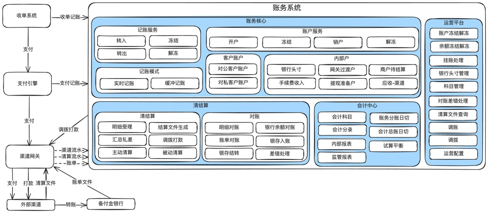

### 说明：

1. 各能力基本与产品架构图对应，但会多一些技术上的设计，比如实时记账和缓冲记账，业务上并不关心。

2. 上面只画出了核心模块的核心能力，实际实现时需要做删减。

3. 上面的业务系统只画了支付链路的示例，实际业务可能还有充、转、提等资金产品服务。

记账服务与会计中心简要关系

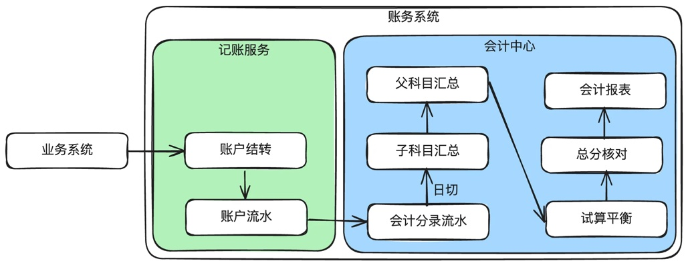

为便于理解，这里做了极简化处理。

记账服务负责记账，主要关注账户余额变动等；会计中心负责会计核算，主要关注点在于会计分录、科目汇总、会计报表等。实际情况会比这个复杂。

<!-- PDF 第 132 页；原书第 129 页 -->

## 7.8 账务系统整体模型

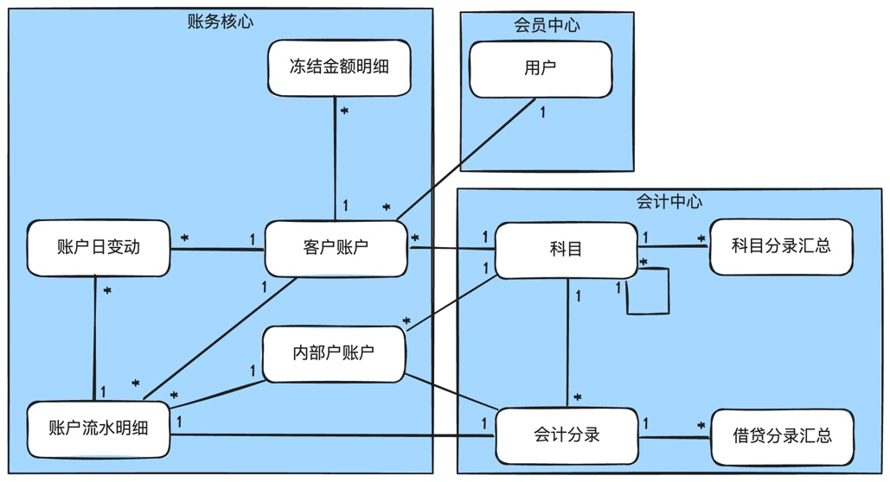

### 说明：

1. 科目有多级科目，所以有个自关联。

2. 账户分为客户账户和内部账户，二者的结构有一些小的区别，比如内部账户一般不会被冻结，但是客户账户可以被冻结。

3. 这是大的关系图。属性在下面会讲到。

4. 没有加入清结算和对账的模型，不然画出来比较乱。

## 7.9 账务核心

在前面产品架构图和系统架构图中，可以看到账务核心主要承接2个部分能力：

1. 记账服务：入账、出账、冻结、解冻等。

2. 账户服务：开户、销户、冻结、解冻账户等。账户还可以细分客户账户和内部账户，具体在下面会有说明。

### 7.9.1 账务模型

<!-- PDF 第 133 页；原书第 130 页 -->

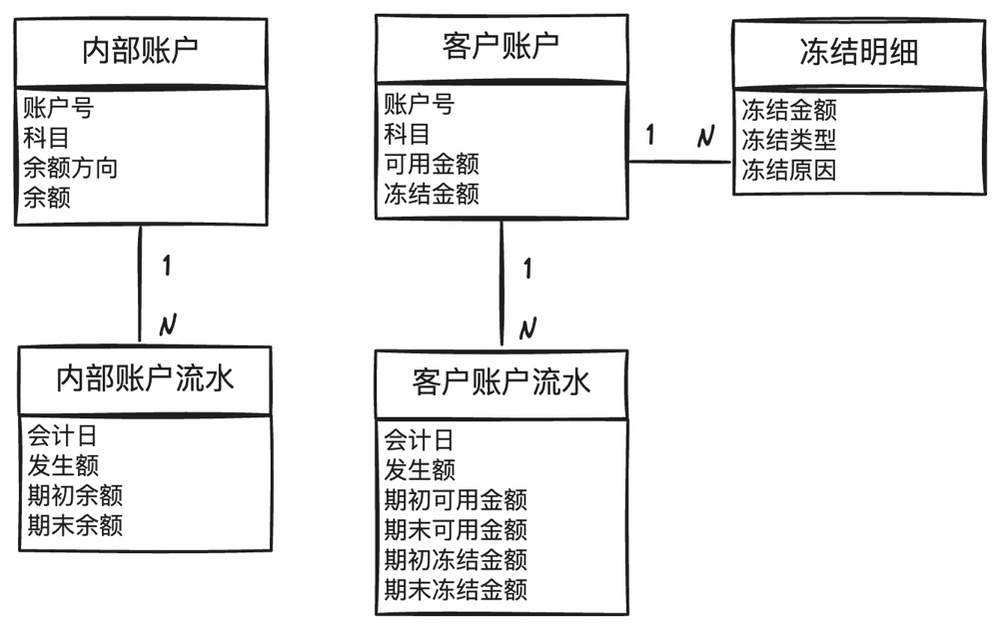

#### 说明：

1. 因为客户账户和内部户账户有区别，所以拆成两个模型更清晰。

2. 只列出了最核心的几个字段，其它字段根据业务诉求增加。

### 7.9.2 账户分类

<!-- PDF 第 134 页；原书第 131 页 -->

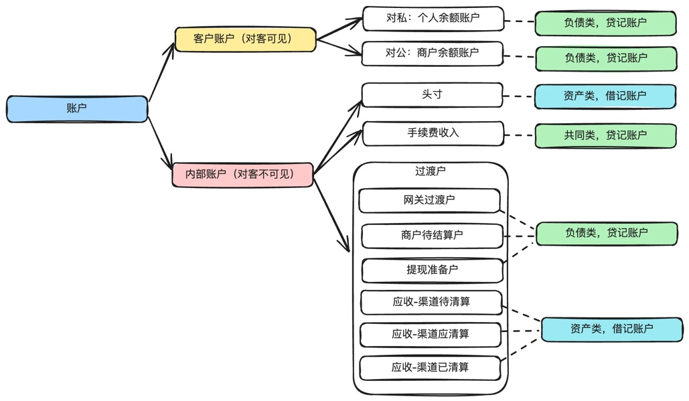

在账务系统中，通常包含以下几种账户类型：

1. 客户账户：对客可见。包括：对私的个人客户账户，对公的商户账户。

2. 内部账户：对客不可见。包括：头寸、手续费收入、过渡户（也称中间户）等。

### 7.9.3 记账方向

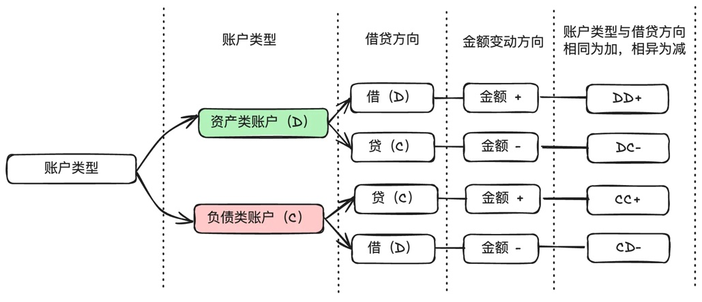

#### 说明：

<!-- PDF 第 135 页；原书第 132 页 -->

1. 账户类型与借贷方向，相同为加，相异为减，也就是所谓的：DD+，DC-，CC+，CD-。

2. 示例：用户提现100元，记账如下：

DR：用户余额（负债类账户）100

CR：提现过渡户（负债类账户）100

### 7.9.4 实时记账与缓冲记账

一般来说，客户账户的记账需要是实时的，比如用户充值、提现，商家提现，用户退款等。

这些账户如果不做实时记账，一来有损用户体验，二来有资损风险。比如用户充值100块，如果延时不到账，用户可能会投诉。如果提现不实时记账，用户有可能重复提现成功。如果退款不实时记账，有可能在退款场景下被透支。

假设记账需要几十毫秒(数据库性能决定的)，一个账户最高也就只支持30多TPS的记账请求，对于一些高并发的账户(也称为热点账户）一定是性能不足的。这个时间可以使用缓冲记账，以提高性能。开通缓冲记账的，通常是内部账户或允许商户透支的流出场景。

缓冲记账通常就是先记录流水，然后起定时任务去捞取流水，汇总后进行记账。前提是一定要做好资损防控。

除了缓冲记账外，还有拆分账户的方式来解决热点账户问题。

## 7.10 会计中心

会计中心主要是负责会计核算的工作。核心职责包括：

1. 会计科目管理。

2. 会计分录服务。

3. 日切与各种汇总、试算平衡。

4. 报表服务。

### 7.10.1 会计中心模型

<!-- PDF 第 136 页；原书第 133 页 -->

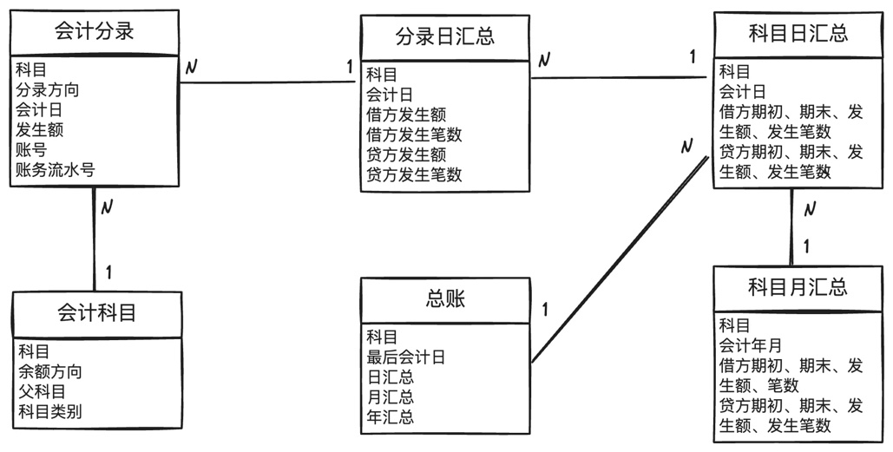

#### 说明：

1. 只列出了最核心的几个字段，其它字段根据业务诉求增加。

### 7.10.2 会计科目与会计分录

会计科目就是把会计要素进行分类，比如资产、负债等。通常都会有多级分类。

会计科目示例：

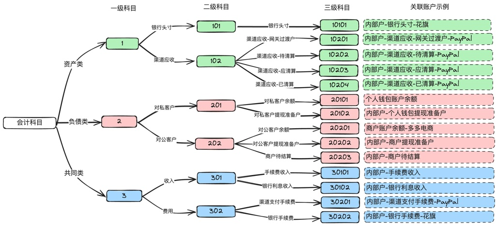

#### 说明：

1.一般支付系统使用三级科目就已经足够。部分特别复杂的系统，可能会用到五级科目。

<!-- PDF 第 137 页；原书第 134 页 -->

2. 为便于理解，上面的示例做了很大的精简，各公司内部对科目的编制差异可能会比较大。

下面是一个典型的支付系统会计科目的部分截图示例。

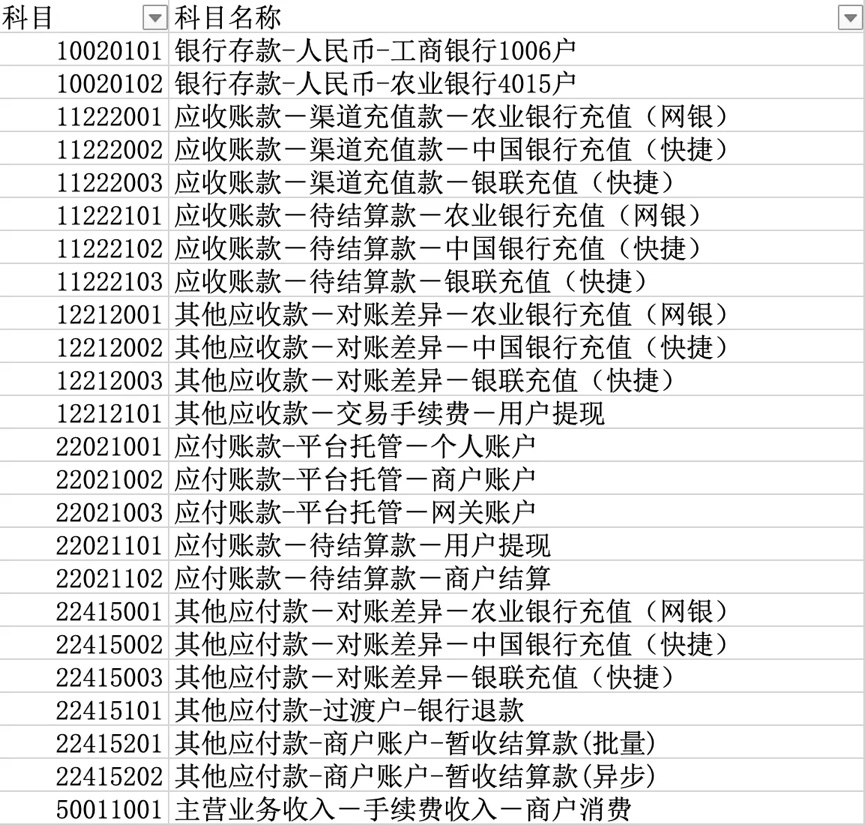

### 7.10.2 记账方案

有了账户和会计科目，发生一笔交易时，如何让系统自动去记账？这个是记账方案做的事。其中一个解决方案就是给不同的交易场景制定不同的交易码，通过交易码来驱动记账。

下面是一个典型的支付系统的记账方案示例（部分截图）。

<!-- PDF 第 138 页；原书第 135 页 -->

<table><tr><td rowspan=1 colspan=1>场景   D</td><td rowspan=1 colspan=1>借贷</td><td rowspan=1 colspan=1>平台科目                 ☐</td><td rowspan=1 colspan=1>交易码7</td><td rowspan=1 colspan=1>会计科目</td><td rowspan=1 colspan=1>EBS会计科目                  ☑</td></tr><tr><td rowspan=2 colspan=1>充值</td><td rowspan=1 colspan=1>DR-借</td><td rowspan=1 colspan=1>应收账款一渠道充值款一招商银行充值（快捷）</td><td rowspan=1 colspan=1>30303</td><td rowspan=1 colspan=1>11222004</td><td rowspan=1 colspan=1>应收账款一渠道充值款一招商银行充值（快捷）</td></tr><tr><td rowspan=1 colspan=1>CR-贷</td><td rowspan=1 colspan=1>应付账款-平台托管一个人账户</td><td rowspan=1 colspan=1>22003</td><td rowspan=1 colspan=1>22021001</td><td rowspan=1 colspan=1>应付账款-平台托管一个人账户</td></tr><tr><td rowspan=2 colspan=1>充值对账</td><td rowspan=1 colspan=1>DR-借</td><td rowspan=1 colspan=1>应收账款一待结算款一招商银行充值（快捷）</td><td rowspan=1 colspan=1>30236</td><td rowspan=1 colspan=1>11222104</td><td rowspan=1 colspan=1>应收账款一待结算款一招商银行充值（快捷）</td></tr><tr><td rowspan=1 colspan=1>CR-贷</td><td rowspan=1 colspan=1>应收账款一渠道充值款一招商银行充值（快捷）</td><td rowspan=1 colspan=1>30336</td><td rowspan=1 colspan=1>11222004</td><td rowspan=1 colspan=1>应收账款一渠道充值款一招商银行充值（快捷）</td></tr><tr><td rowspan=2 colspan=1>充值对账差异-长款</td><td rowspan=1 colspan=1>DR一借</td><td rowspan=1 colspan=1>应收账款一渠道充值款一招商银行充值（快捷）</td><td rowspan=1 colspan=1>30336</td><td rowspan=1 colspan=1>11222004</td><td rowspan=1 colspan=1>应收账款一渠道充值款一招商银行充值（快捷）</td></tr><tr><td rowspan=1 colspan=1>CR-贷</td><td rowspan=1 colspan=1>其他应付款一对账差异一招商银行充值（快捷）</td><td rowspan=1 colspan=1>40836</td><td rowspan=1 colspan=1>22415004</td><td rowspan=1 colspan=1>其他应付款一对账差异一招商银行充值（快捷）</td></tr><tr><td rowspan=2 colspan=1>充值对账差异-短款</td><td rowspan=1 colspan=1>DR-借</td><td rowspan=1 colspan=1>其他应收款一对账差异一招商银行充值（快捷）</td><td rowspan=1 colspan=1>31036</td><td rowspan=1 colspan=1>12212004</td><td rowspan=1 colspan=1>其他应收款一对账差异一招商银行充值（快捷）</td></tr><tr><td rowspan=1 colspan=1>CR-贷</td><td rowspan=1 colspan=1>应收账款一渠道充值款一招商银行充值（快捷）</td><td rowspan=1 colspan=1>30336</td><td rowspan=1 colspan=1>11222004</td><td rowspan=1 colspan=1>应收账款一渠道充值款一招商银行充值（快捷）</td></tr></table>

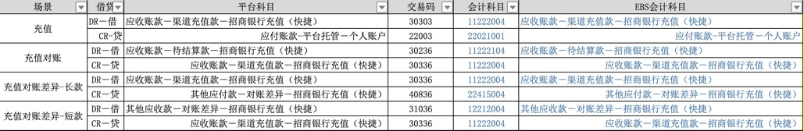

### 7.10.3 会计日与日切

会计日，也称为会计结算日或账务结算日，是支付平台在会计周期中进行账务处理和结算的特定日期。比如在分布式环境下，各机器可能存在时间差，一笔交易在零点时有可能跨天处理，如何判断一笔交易归属于哪天，就依据会计日来计算。

所谓日切，简单理解就是切换到下一个会计日。主要做的工作：

1. 借贷试算平衡。

2. 父子科目试算平衡。

3. 总账试算平衡。

4. 日、月、季度、年汇总。

5. 会计日变更。

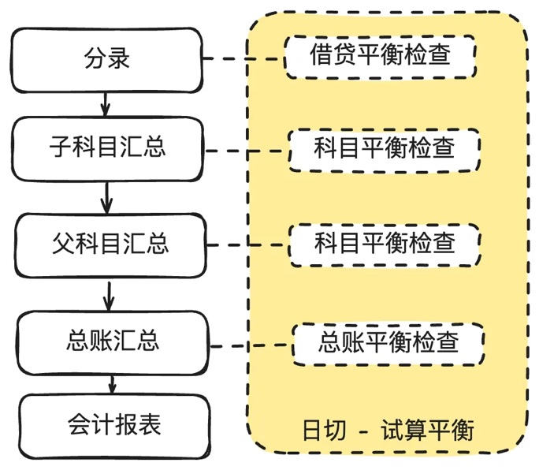

日切试算平衡核心逻辑：

<!-- PDF 第 139 页；原书第 136 页 -->

1. 借方发生额 = 贷方发生额

2. 借方余额 = 贷方余额

3. 期末余额 = 期初发生额 + 发生额

4. 父科目累积额 = 子科目累积额

## 7.11 清结算

清结算（有些公司也称清算）主要负责内部清算（清分）、清偿（结算），对账等服务。如下：

1. 主动清算（清分）：一般是根据我方规则把商户的钱、我方手续费收入等算清楚。还有一种叫被动清算，就是以外部商户的文件为依据进行清算。

2. 清偿(结算）：就是把欠商户的钱，通过渠道网关把调拨指令发给银行渠道打给商户。把债权债务关系完结掉。

3. 对账：包括明细对账，账单对账，余额(账实）对账。具体可参考后面写的三层对账体系。

### 7.11.1 主动清算

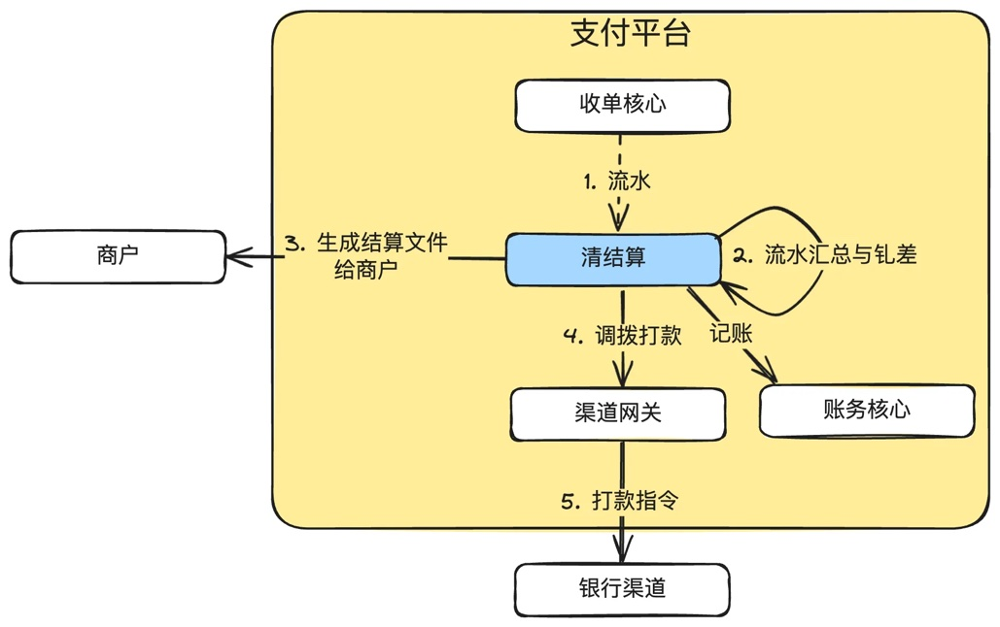

<!-- PDF 第 140 页；原书第 137 页 -->

#### 说明：

1. 所谓主动清算和被动清算，都是站在支付平台的角度。主动清算，就是以支付平台为准，被动清算，就是以外部机构为准。

2.一般来说，强势的一方是主动清算角色，弱势的一方是被动清算角色。大部分情况下，与商户对接时，支付平台是主动清算方，如果是特别大的商户，支付平台就是被动清算方。与外部渠道对接时，外部渠道一般是主动清算方。

### 7.11.2 渠道对账模型

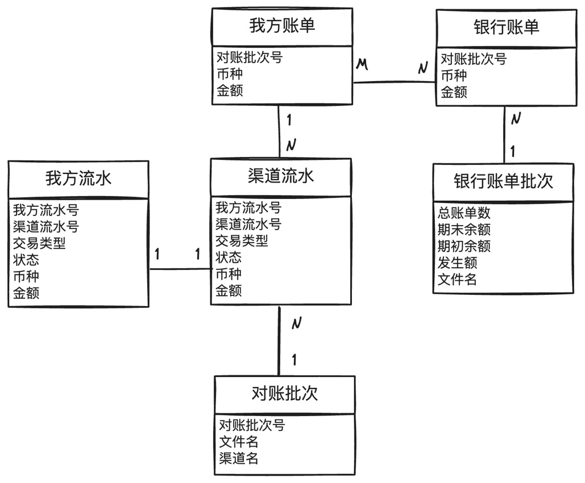

#### 说明：

1. 只列出了最核心的几个字段，其它字段根据业务诉求增加。

2. 我方流水和渠道流水单号、币种、金额、状态都对上，就是对平。双方如果有缺少，就会有长短款。

<!-- PDF 第 141 页；原书第 138 页 -->

3. 流水对账完成后，形成我方账单，再和银行账单对账，因为银行可能多次打款，所以二者是多对多的关系。

### 7.11.3 对账差异处理

对账一般有几种结果：

1.对平：双方交易类型、单号、状态、币种、金额都是一致的。

2. 长款：我方多钱。支付长款：支付90块，渠道清算100块，或我方失败，渠道成功。退款长款：退款100块，渠道清算90块。充值长款、提现长款类比。

3.短款：我方少钱。支付短款：支付00块，渠道清算90块。退款长款：退款90块，渠道清算100块。充值短款、提现短款类比。

因为我方和渠道之间有一定的时间差，所以长短款在T+1对账对不上时，往往先进入存疑清单里面，第T+2对账还是对不上，才会进入差异处理。

### 7.11.3 渠道三层对账体系

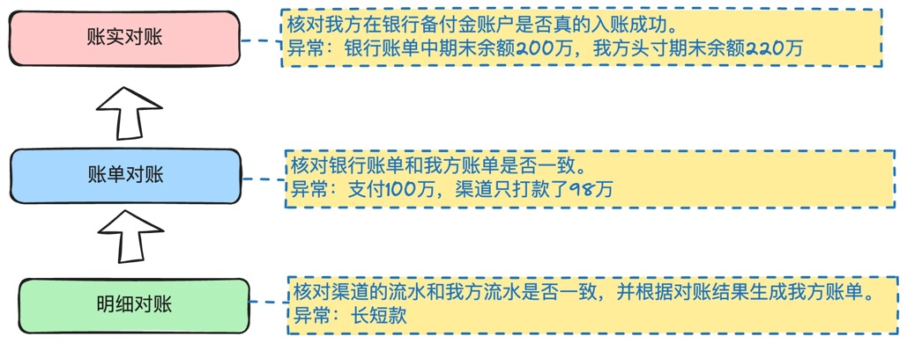

第一层是信息流对账。我方流水和银行清算文件的流水逐一核对。可能会存在长短款情况。

第二层是账单对账。就是把我方流水汇总生成我方账单，然后把银行流水汇总生成银行账单进行对账。可能会存在银行账单和我方账单不一致的情况，比如共支付100万，渠道分2次打款，一笔98万，一笔2万。

第三层是账实对账。就是我方内部记录的银行头寸和银行真实的余额是否一致。可能存在我方记录的头寸是220万，但是银行实际余额只有200万的情况。

<!-- PDF 第 142 页；原书第 139 页 -->

## 7.12 小结

账务系统负责为支付平台处理资金流，是支付平台最核心的子系统之一。相关会计报表是公司经营决策的依据，也是合规申报相关报表的基础。理解账务系统的核心设计概念，才能让我们构建出完整的支付系统设计与实现的理论基础。
