# 第8章 会员与卡中心

> 来源：《图解支付系统设计与实现》V_0.1.0，隐墨星辰著。PDF 第 142–153 页。正文经 MinerU OCR 转换，原图保留。

<!-- PDF 第 142 页；原书第 139 页 -->

所有提供余额支付能力的持牌第三方支付公司，一定有会员和卡中心的存在。纯网关支付系统，可能就没有，比如在楼下小卖部，商家挂个收钱吧的码，用户使用微信或支付宝扫码支付完成，卡信息不会经过收银吧的系统，也不会开收钱吧的会员。

和支付系统其它各个子系统/子模块一样，每个公司的会员系统设计思路、实现方式必然是不一样的，我个人经历过好几家支付公司，最核心的理念都差不多，但实现细节千差万别，尤其上层业务更是扩展地五彩斑斓，比如不同的会员等级，各等级有不同的权益等。

## 8.1 会员与卡中心在支付平台中的定位

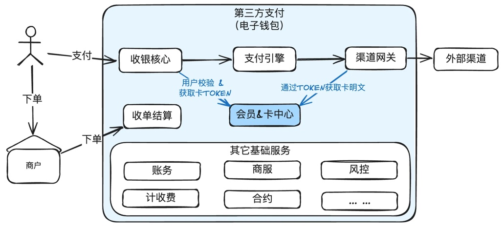

会员信息和卡中心强相关，所以通常是放在一起来设计。

会员核心职责就是管理会员的注册、销户、权限、合约、卡管理等。会员等级，权益等涉及篇幅过大，不在此文中讨论。

<!-- PDF 第 143 页；原书第 140 页 -->

卡中心是否独立，取决于技术规划，业务其实是不怎么关心的。简单的实现可能就一两张表就够了。

## 8.2 会员的一些基本的概念

有必要把几个概念理一下，比如什么是三户模型。会员和账户的关系，会员和商户的关系等。

### 三户模型

早先起源于电信运营商。有兴趣的可以去网上找公开资料了解一下。

支付行业的三户模型如下：

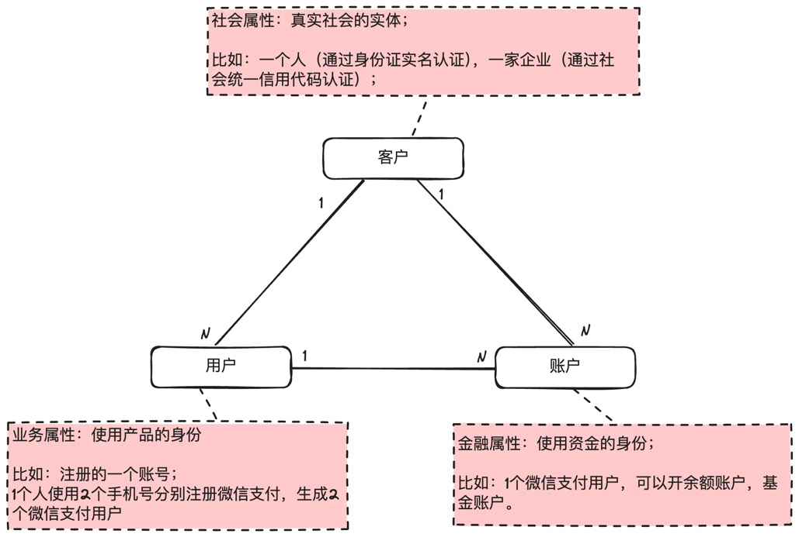

说明：

1. 客户是一种社会属性，代表真实社会的一个实体。比如张三分别使用1388888888和

1399999999两个手机号在微信支付进行注册，然后使用同一个身份证做了实名认证，那么这两个用户仍然被归属于同一个客户。

2. 用户是一种业务属性，就是使用产品的身份。比如张三分别使用1388888888和1399999999两个手机号在微信支付进行注册，那么就会存在2个用户，这2个用户的业务是独立的。

<!-- PDF 第 144 页；原书第 141 页 -->

3. 账户是一种金融属性，代表使用资金的身份。比如张三使用1388888888开通了微信支付，经过实名认证后，可以开通余额，也可以开通基金账户。

如果没有金融属性，一般就没有账户，比如注册博客园后，就只有用户没有账户。

### 会员与账户的关系

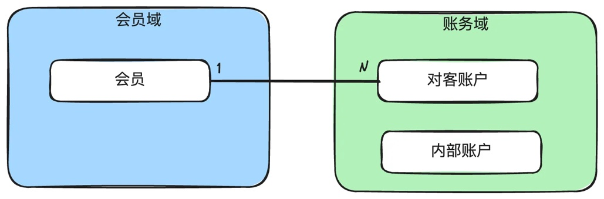

如前面的三户模型所述，会员通常是用户的概念，归会员域管理，而账户是处理资金的，归账务域管理。

会员与账户之间有一个映射关系。

### 会员与商户的关系

会员（个人用户）本质是一个ToC的会员，商户本质是一个ToB的会员，各有侧重。商户单独在商服章节中去论述。

一般来说，个人会员和商户可以聚合一个共同的根。

## 8.3 会员核心

如前面所说，这里只讲一些会员核心通用的概念，不包含会员等级权益等内容。会员核心只解决会员最基础的能力，比如注册注销、个人信息维护等，而像会员等级、不同等级不同对应不同权益都是在会员核心之上的产品层扩展。

### 8.3.1 会员核心的主要职责

<!-- PDF 第 145 页；原书第 142 页 -->

基本功能：注册、注销、冻结、解冻。

个人信息维护：手机号、邮箱、地址等。

实名认证：认证，实名信息维护。

核身能力：短信验证码、登录密码、支付密钥、刷脸信息等。

协议管理：开启余额账户，绑定银行卡，代扣协议等。

关于协议管理，不同的公司可能处理方式不太一样。对于小而美的系统，业务比较简单的话就把个人协议放在会员核心也是可以的。对于一些大型的专业支付机构，协议管理可能会独立在一个叫合约中心的地方，维护个人协议，商户协议（合约）。

### 8.3.2 产品架构图

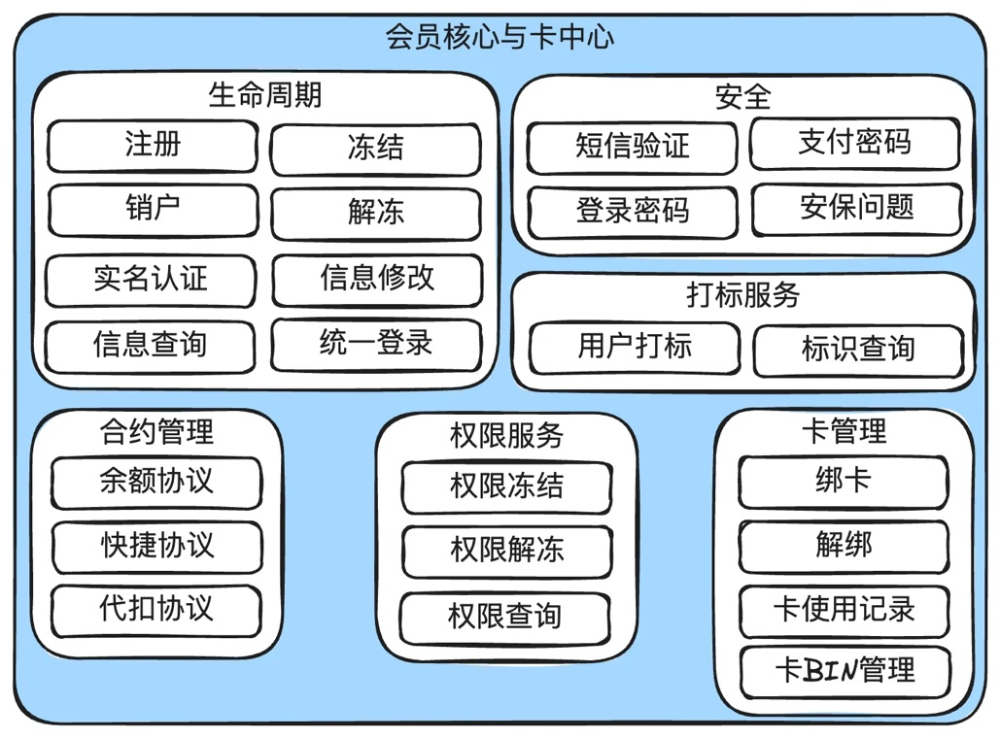

#### 说明：

1. 会员核心的功能其实是很单薄的，就是会员基础信息管理，实名认证，安全服务，合约服务，权限服务。

2. 很多扩展的能力，一般归属于产品层，比如会员等级，权益等。

<!-- PDF 第 146 页；原书第 143 页 -->

3. 用户绑卡信息因为和会员强相关，所以一般也会放在会员域。

### 8.3.3 系统架构图

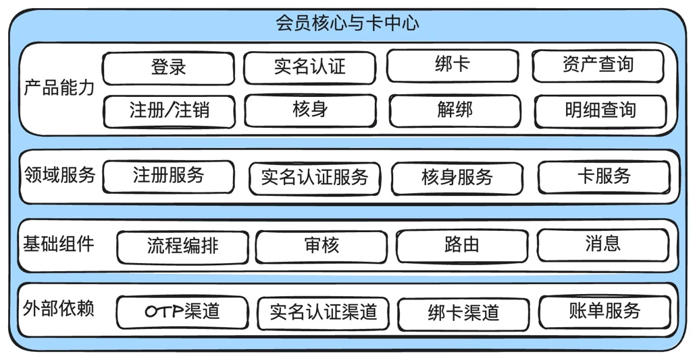

#### 说明：

1. 这里只列出了最关键的一些服务。

2.在简单业务场景下，技术实现也相对简单。如果对外做会员和账户托管，就比较复杂了。比如有个小的电商没有牌照又想有余额账户，委托一家有牌照的第三方支付机构进行账户托管，这个第三方机构的会员和账户体系就会比较复杂。

### 8.3.4 核心模型图

<!-- PDF 第 147 页；原书第 144 页 -->

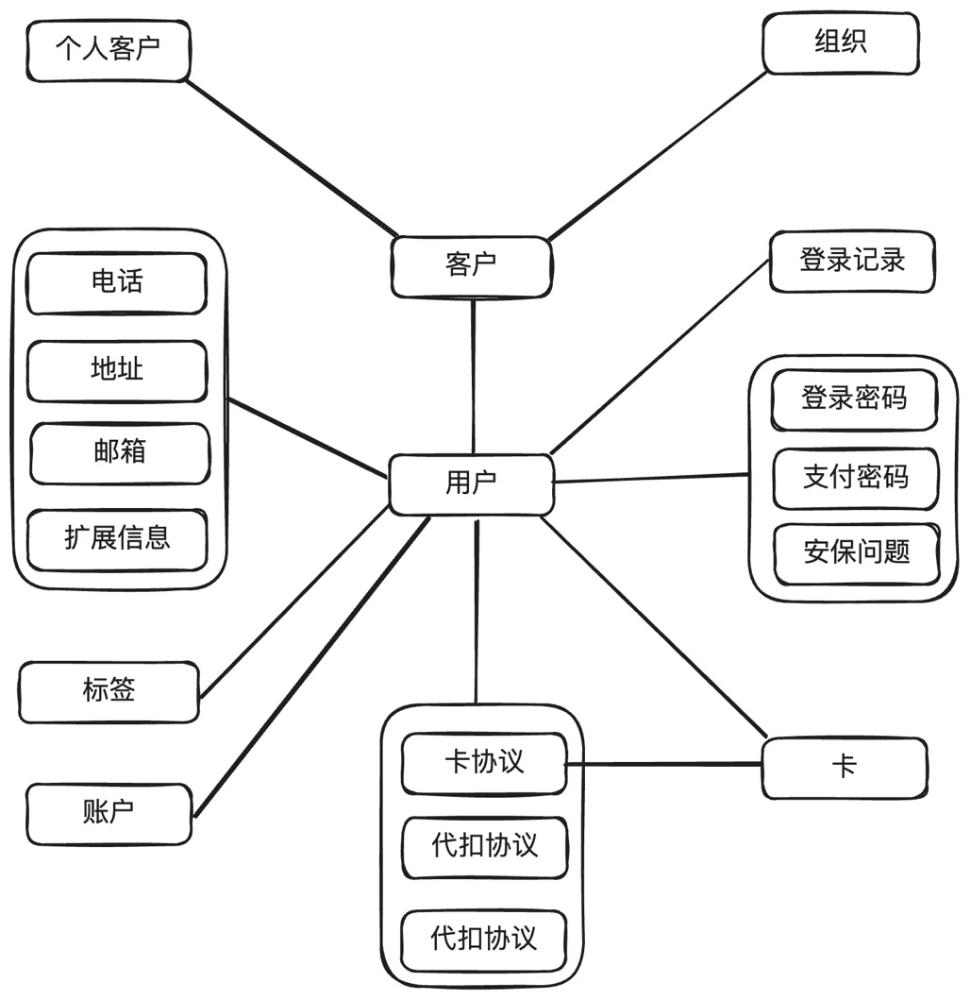

#### 说明：

1. 用户、客户、账户的关系，详见上面的三户模型说明。会员注册后，就会有一个用户(Userld)，完成实名认证，就会有一个客户(Customeld)，开通余额，就会有账户(AccountNo)。

2. 其它的关系，图中已经很清楚。

## 8.4 卡中心核心设计

<!-- PDF 第 148 页；原书第 145 页 -->

如果想保存卡信息，就需要完成PCI认证。这里对PCI做个简单的说明，以及如何实现一个符合PCI认证的最简化的卡中心核心设计思路。

### 8.4.1 关于卡的几个核心概念

信用卡基本信息：

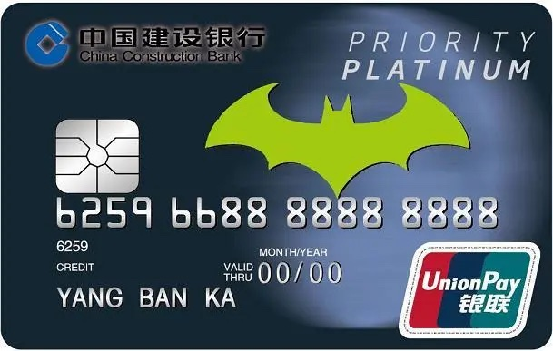

一张典型的信用卡包括：卡号，持卡人姓名，有效年月，卡组（卡品牌），发卡行，CVV等。  
其中卡号，持卡人姓名，有效年月，CVV等全部是敏感数据。

卡BIN：Bank Identification Number，BIN是用于识别发卡机构的一个重要标识码。通常情况下，卡BIN是银行卡号的前6位或前8位数字，它用于区分不同的银行卡发行机构、卡种类和卡级别。

卡组(卡品牌)：Card Brand，指的是由主要支付网络运营的信用卡和借记卡品牌，这些支付网络通常提供全球范围的支付处理和授权服务。每个卡品牌都有其独特的规则、费率、功能和支持的交易类型。通常有：UnionPay（银联），VISA，Mastercard，Amex，JCB等。

发卡行：Issuing Bank，是指发行信用卡、借记卡或预付卡的银行或金融机构。发卡行是负责为持卡人提供信用额度、借记账户管理以及相关服务的主体。

<!-- PDF 第 149 页；原书第 146 页 -->

### 8.4.2 PCI简介

PCI DSS(Payment Card Industry Data Security Standard，支付卡行业数据安全标准)是一套旨在保护支付卡信息安全的全球性信息安全标准。它由支付卡行业安全标准委员会(PClSSC)制定和维护，该委员会由Visa、Mastercard、American Express、Discover和JCB等五大信用卡品牌组成。

PCIDSS包含六大目标和12个具体要求，覆盖了从信息安全管理体系、网络安全、物理安全、数据加密等多个方面，以确保持卡人数据的安全。它适用于所有接受、处理、存储或传输信用卡数据的组织，无论其规模大小或交易量多少。

最新版本的PCIDSS是4.0，于2022年3月发布，并要求企业在2025年3月前实现完全合规。

如果不想或没有精力做PCl认证，又想保存用户的绑卡信息怎么样？那就找一个通过了认证的第三方供应商，让供应商帮忙保存。

如果取巧偷偷地存会怎么样？监管的铁拳不是吃素的。

PCIDSS的要求很多，但有部分是由网络安全去解决的，研发同学只需要关注下面几个就行：

1. 持卡人敏感数据需要加密存储。

2. 部分敏感字段比如CVV不允许存储。

3. 对持卡人数据在公开网络上的传输进行加密。

4. 能接触持卡人明文数据的应用需要加入审计认证。

### 8.4.2 基本设计原则

因为能接触持卡人明文数据的应用需要加入审计认证，供外部认证公司检查，所以很多公司就设计了一个PCI域的虚拟区域，把需要接触持卡人明文数据的应用部署在PCI域，供外部审计检查。

<!-- PDF 第 150 页；原书第 147 页 -->

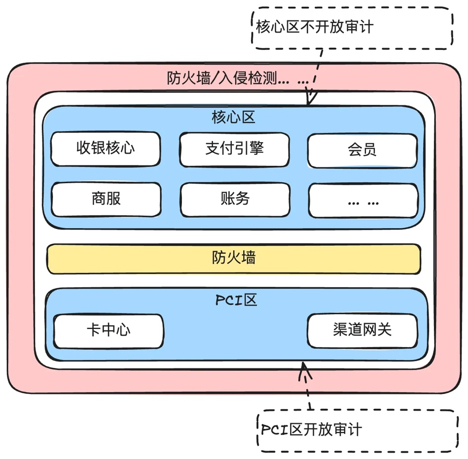

### 8.4.3 卡中心核心能力

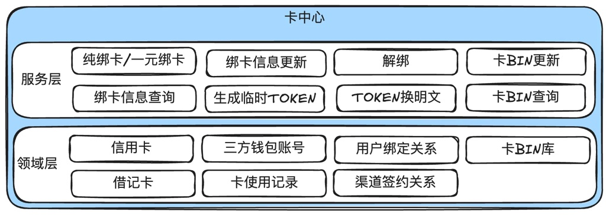

<!-- PDF 第 151 页；原书第 148 页 -->

绑卡相关：绑卡、解绑、卡信息更新。

卡使用：生成临时TOKEN，通过临时TOKEN换取卡明文。

卡BIN管理：新增/更新卡BIN信息，查询卡BIN信息。

### 8.4.4 核心模型图

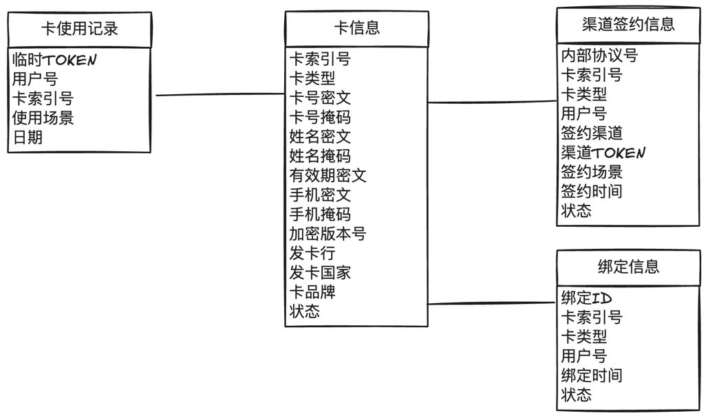

#### 说明：

1. 这里只以信用卡示例，借记卡也可以兼容。

2. 只列了一些基本字段，像账单地址等可自行扩展。

3. 卡使用记录单独抽出来，是因为每使用一次，就生成一个临时的TOKEN，从收银台传给支付引擎，再传给渠道网关，由渠道网关通过这个临时TOKEN去获取卡明文信息发给外部渠道。

4. 绑定信息是用户发起的绑定信息的记录。

5. 渠道签约信息是卡具体通过哪个渠道做的验证，部分外部渠道还可以做签约，返回一个渠道TOKEN，下次可以直接拿渠道的TOKEN做支付。

6. 国内大部分的绑卡可同时用于支付和提现，也有些机构是把支付卡和提现卡做独立管理。

<!-- PDF 第 152 页；原书第 149 页 -->

### 8.4.5 绑卡流程

用户的绑卡，除了在平台保存卡信息外，还需要验真，就是把绑卡信息发给外部的渠道，由渠道验证通过后，才会真正的绑定。

这个绑卡通常分为纯绑卡与一元绑卡。

纯绑卡就是只把绑卡信息发给渠道，验证通过，就绑定成功。

一元绑卡就是向外部渠道发起一笔一元的支付请求，扣款成功后，推进绑卡成功，然后马上发起退款或撤销，扣的一元钱原路返回给用户的卡里。

下面以较为复杂的一元绑卡做为示例说明。

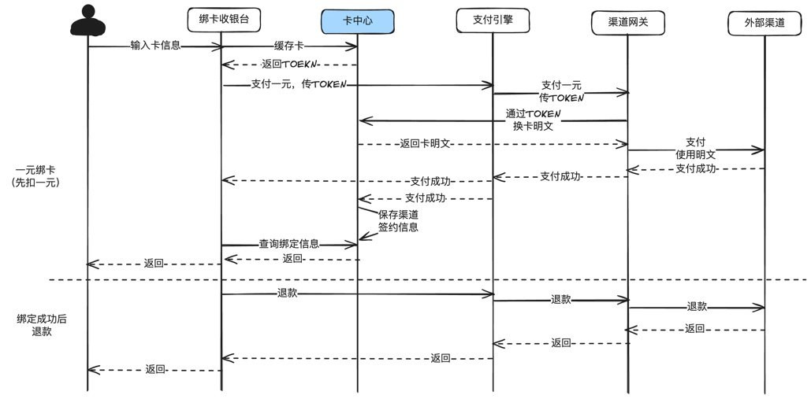

#### 说明：

1. 先调用卡中心缓存卡信息。

2. 支付成功后，更新卡中心的绑卡信息。

3. 发起退款。

### 8.4.6 支付流程

支付流程最核心的，就是需要先调用卡中心生成临时TOKEN，非PCI域全部使用这个临时TOKEN传递，需要使用明文发给外部渠道的渠道网关，先使用这个TOKEN向卡中心换取明文。

<!-- PDF 第 153 页；原书第 150 页 -->

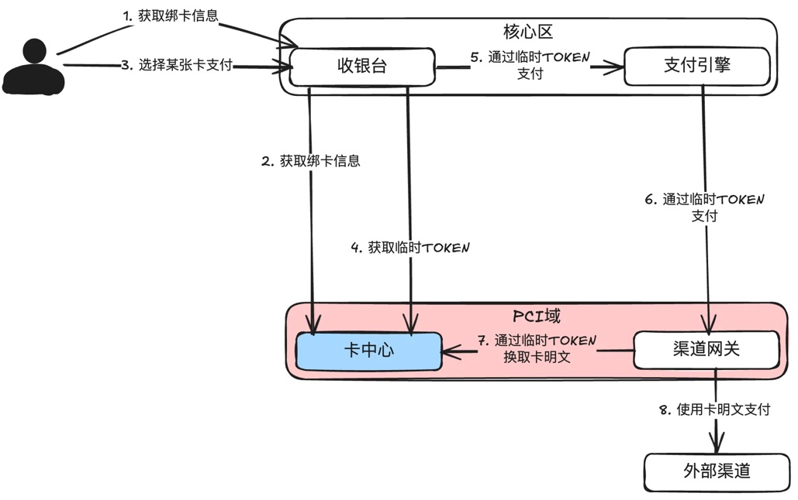

说明：

1. 这是一个典型的使用卡明文支付的场景，有些渠道提供TOKEN支付，流程也差不多。

2. 用户在支付前先通过收银台到卡中心获取绑卡列表。

3. 用户选择一张卡后，生成一个临时TOKEN，用于非PCI域应用传递支付的卡信息。

4. 渠道网关通过临时TOKEN，找卡中心换取明文，再把卡明文发给外部渠道。

## 8.5 小结

会员系统可以做得很大，不同等级设计不同的权益，还有各种积分，每个公司都各有特色。但是会员核心其实很单薄，就是会员基础知识，密码，实名信息等。

本章介绍了会员核心设计中经典的三户模型，卡中心绕不开的PCI入门知识，以及绑卡、支付过程中如何通过临时TOKEN来代替卡明文的传输。
