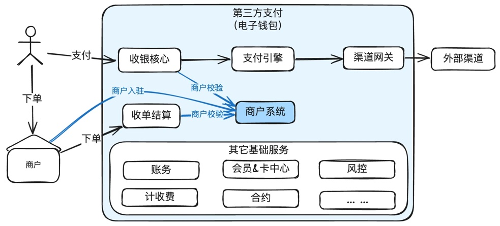
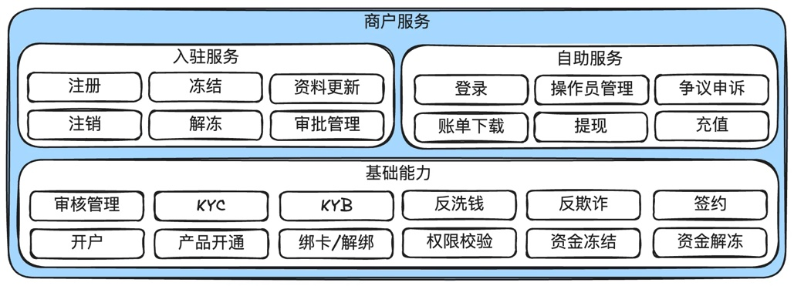
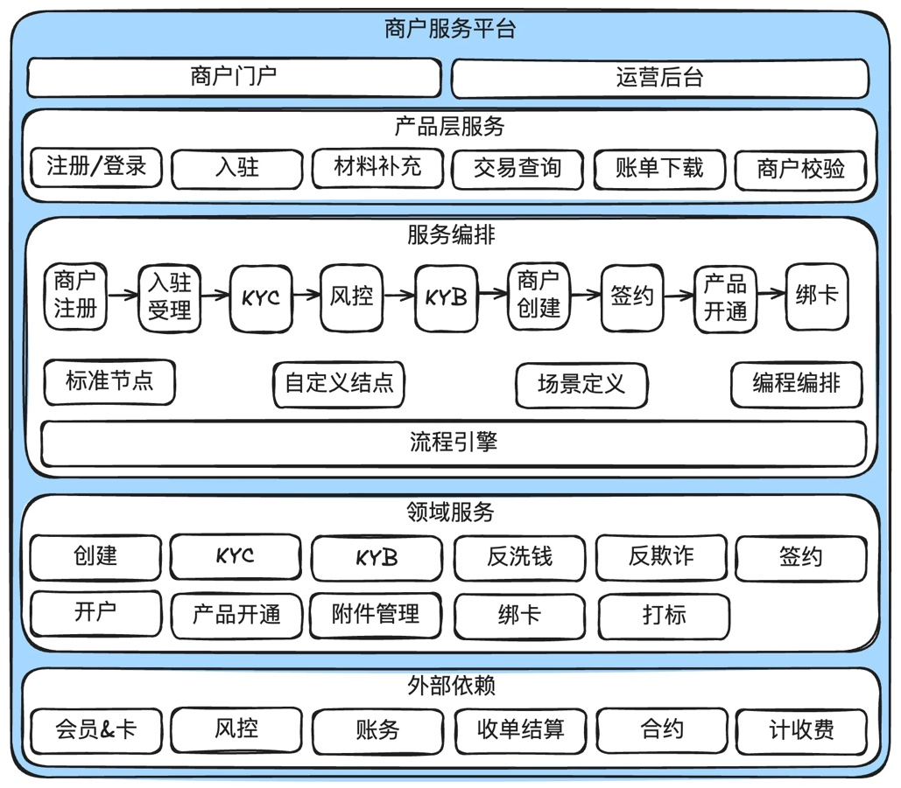
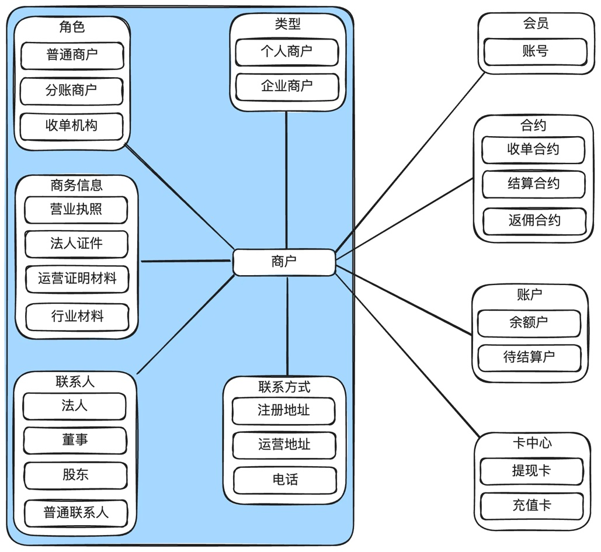

# 第9章 商户服务

> 来源：《图解支付系统设计与实现》V_0.1.0，隐墨星辰著。PDF 第 153–158 页。正文经 MinerU OCR 转换，原图保留。

<!-- PDF 第 153 页；原书第 150 页 -->

支付系统的最核心能力就是给商户收单，也就是帮商户收钱，所有第三方支付系统都会有商户子系统。这些商户子系统的设计根据业务的不同，复杂度也很不同，比如有些做线下收单的支付系统会有店铺的概念，而只做线上收单的支付系统可能就只有商户的概念。此外，大的商户可能会有

<!-- PDF 第 154 页；原书第 151 页 -->

多个操作员，不同的操作员有不同的权限，还需要查询交易，下载账单，提现余额到银行卡，有问题时还需要有工单管理等。

也就是说，一个完整的商户服务覆盖的范围是很广的，各公司实现差异也很大。

基于上面的原因，这里只讨论商户子系统最核心的一些能力和模型设计。

注：下面有些地方也会使用“商服”来指代商户系统，就是商户服务的意思。

## 9.1 商户服务在支付系统中的位置

商户系统最核心的职责其实比较简单：商户入驻，自助服务，支付过程中的商户校验等。

有些能力表面上看起来和商户系统有关，但是底层的能力其实是其它的子系统来完成，只是由商户系统做了一层简单的封装。比如：

● 商户账户和余额管理其实是由账务系统提供的。

● 商户结算及结算文件是由结算系统提供的。

● 商店的交易查询是由收单系统提供的。

● 商户合约是由合约系统提供的。

● 商户提现是由调拨或银企平台提供的。

## 9.2 商户服务产品架构

<!-- PDF 第 155 页；原书第 152 页 -->

完整的商户系统的内容非常多，比如有店铺管理、子商户管理、物料管理、多操作员管理等不同的公司业务不同，这些区别也很大。但是商户系统最核心的入驻流程基本都差不多，比如注册，提交资料，KYC，KYB，尽职调查等。

这里只介绍商户领域最核心且通用的一些概念。

基本功能：注册、注销、冻结、解冻。

信息维护：资料上传、更新等。

KYC：实名认证及信息维护，比如工商注册资料等。

KYB：商户业务范围审核，比如交易对手方，资金来源与去向，股东组成等。

尽职调查：商户的资质、经营情况等审核。

签约：签署收单合约，结算合约等。

自助服务：操作员管理，登录密码管理，交易查询，账单下载等。

## 9.3 商户服务系统架构

<!-- PDF 第 156 页；原书第 153 页 -->

### 说明：

1. 不同的商户级别，入驻流程是不一样的，所以需要服务编排和流程引擎来驱动。

2. 商户服务依赖很多外部服务，比如使用风控的反洗钱、反欺诈，使用收单结算的交易查询、账单下载等。

## 9.4 商户服务领域模型设计

<!-- PDF 第 157 页；原书第 154 页 -->

### 说明：

1. 商户核心领域模型包括：类型、角色、联系人、联系方式、商务信息等。

2. 还依赖其它域的服务，包括会员、合约、账户、卡中心等。

## 9.5 小结

商户服务是支付平台的基础域，因为支付平台最核心的能力就是帮商户收单，而只有商户入驻完成才能开展收单业务。

商户入驻进来并开通产品后，还有很多运营类的工作，如何提升销量，帮商家多挣钱，是商户运营的核心关注点，但因篇幅所限，不在此论述。
