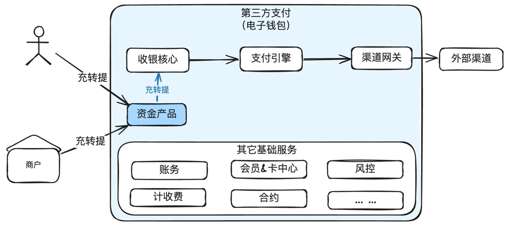
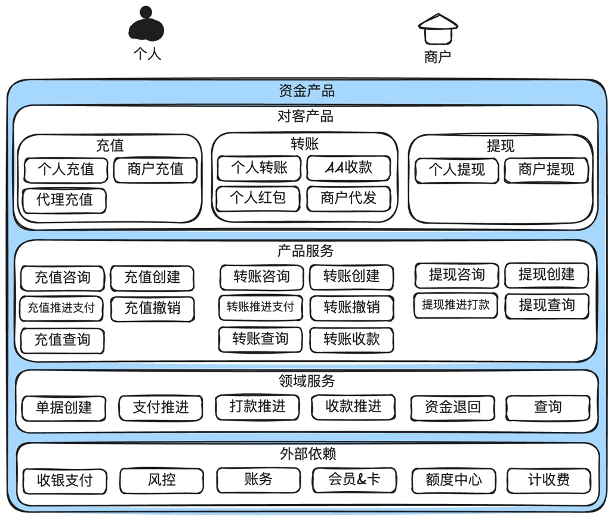
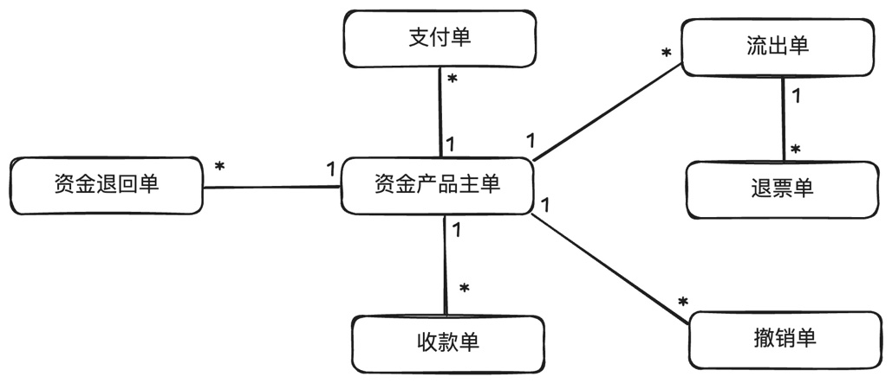

# 第10章 资金产品

> 来源：《图解支付系统设计与实现》V_0.1.0，隐墨星辰著。PDF 第 158–161 页。正文经 MinerU OCR 转换，原图保留。

<!-- PDF 第 158 页；原书第 155 页 -->

资金产品处理用户的资金流动，包括充值、转账和提现等操作，简称“充转提”。既有面向个人用户的，也有面向商户的。

资金产品与收单产品最大的区别在于，收单产品需要依托交易存在，比如买一杯咖啡，用户和商家存在交易标的“咖啡”。而资金产品是没有交易存在，比如充值100块，给别人转账100块，提现100块。当然特殊情况下可能有线下交易标的，但在系统中是没有反映的，比如在线下买份早点，直接给店主转了10块钱。

## 10.1 资金产品的几个关键概念

• 充值：用户将资金从银行账户或其他支付工具转入支付平台的账户中。

● 转账：用户将资金从自己的账户转移到另一个用户或商家的账户。

● 提现：用户将资金从支付平台的账户转回到自己的银行账户或其他支付工具。

有些特殊场景本质也是资金产品的一种，比如微信发红包，群收款，商户代发工资等，都是转账的一种。

## 10.2 资金产品定义及在支付系统中的位置

<!-- PDF 第 159 页；原书第 156 页 -->

### 说明：

1. 资金产品承担非商品交易的资金服务，包括充值、转账、提现、代发等。

2. 同时面向个人用户和商户提供服务。

## 10.3 系统架构图

### 说明：

1. 对客产品可以封装成多种形式，比如红包，AA收款都可以由转账来封装。

2. 资金产品和收单产品是并列的关系，前者为个人用户和商户提供纯资金流动的服务，后者是为商户收单提供服务。

3. 资金产品需要依赖收银支付提供的扣款和打款服务。

<!-- PDF 第 160 页；原书第 157 页 -->

## 10.4 领域模型设计

### 说明：

1. 资金产品都有一个主单。

2. 如果是充值，那就有一个支付单。

3. 如果是普通转账，那就有一个支付单，一个或多个收款单。如果是AA收款，就会有多个支付单和多个收款单。

4. 如果是提现，那就有一个流出单。但是流出有可能出现退票，所以可能存在退票单。

## 10.5 小结

本章介绍了资金产品的定义，以及对应的系统架构，核心领域模型。

最后想说明的是，资金产品因为在系统中没有交易标的存在，所以更有可能出现用户或商户资损风险，在大部分国家都是强监管的区域，需要谨慎对待。
