# 第11章 支付安全

> 来源：《图解支付系统设计与实现》V_0.1.0，隐墨星辰著。PDF 第 161–216 页。正文经 MinerU OCR 转换，原图保留。

<!-- PDF 第 161 页；原书第 158 页 -->

在电子支付的万亿级市场中，安全无疑是核心中的核心。这篇尝试从在线支付面临的主要安全问题，常见的技术手段如加密解密、签名验签、安全证书等入手，讲清楚支付安全体系。因篇幅所限，不会涉及背后复杂的数学知识。

## 11.1 在线支付面临的主要安全问题

在线支付面临的安全问题主要包括：

### 1. 账号或密码等敏感信息被盗用。

用户的账号和密码可能会被黑客获取，导致个人资金被盗用。这种情况是用户普遍感知较强的安全问题，常见于密码泄露导致资金损失的情况。

### 2. 交易信息被篡改。

这个对于一般用户感知较少，常见就是支付金额被篡改，比如实付金额小于应付金额，还就是转账时的收账账号或金额被篡改。

以前碰过到一个真实的案例，黑客首先攻击了银行系统，然后在支付平台发起充值2万元，再把银行扣款订单修改为扣款1元，银行扣款1元成功，通知支付平台扣款成功，支付只校验了状态，没有校验金额，导致支付平台为用户余额充值2万元，然后黑客在支付平台提现2万元。最终给支付平台造成巨大损失。

<!-- PDF 第 162 页；原书第 159 页 -->

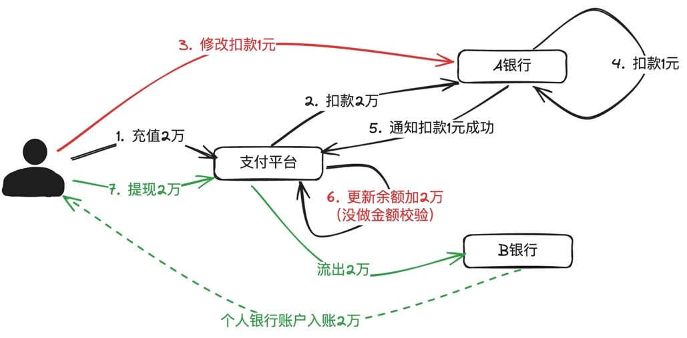

还有情况就是在转账场景下修改收款账号或金额，当转账请求被黑客截获，把原收款账号修改为另一个账号，再发给支付平台。如果支付平台安全措施不到位，就可能把钱转到一个错误的账号上。

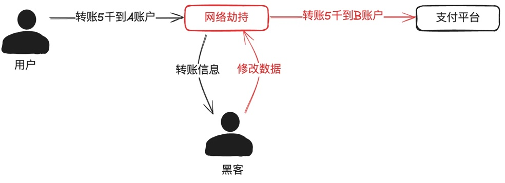

### 3. 交易信息被抵赖。

这个比较少见。举个场景，支付平台请求银行扣款200元，银行实际扣款失败，但是通知支付平台成功，支付平台也通知商户发货了。但是银行说他们返回给支付平台是扣款失败，扣款成功的信息不是银行发出来的。这种行为是抵赖。

<!-- PDF 第 163 页；原书第 160 页 -->

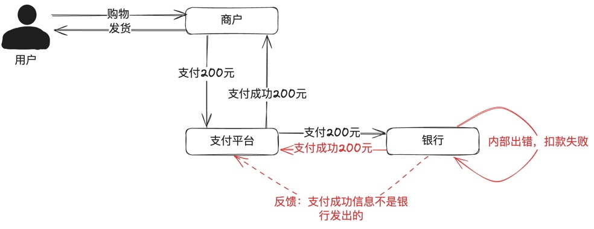

### 4. 欺诈交易

包括套现、洗钱等违规交易，以及因为用户信息泄露导致盗刷等。

瑪服可击。

这个出现的频次非常高，只是一般人感觉不到。有兴趣的同学可以搜索分布式拒绝服务DDoS(Distributed Denial of Service)，攻击者通过大量恶意流量占用支付系统的资源，使得合法用户无法正常访问支付平台，从而影响用户的交易体验甚至造成财务损失。

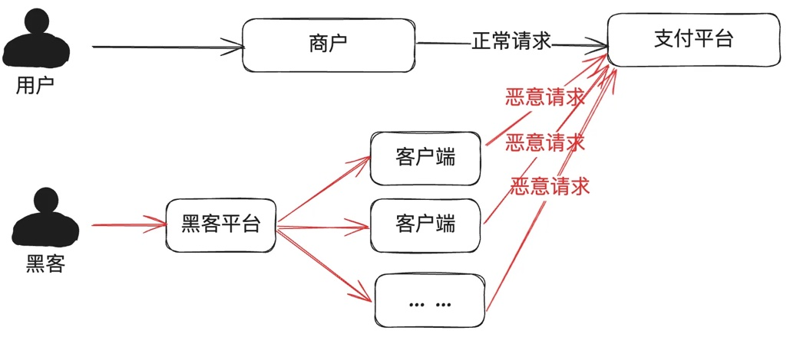

## 11.2 支付安全核心关注点

<!-- PDF 第 164 页；原书第 161 页 -->

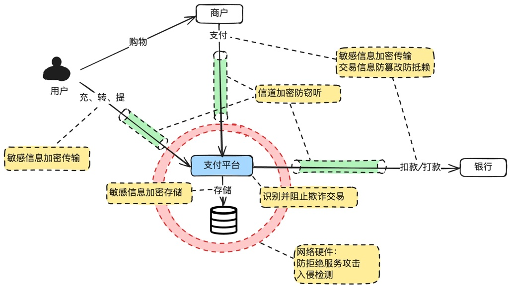

支付安全是一个很大的范畴，但我们一般只需要重点关注以下几个核心点就够：

### 1. 敏感信息安全存储。

对个人和商户/渠道的敏感信息进行安全存储。

个人敏感信息包括身份证信息、支付卡明文数据和密码等，而商户/渠道的敏感信息则涉及商户登录/操作密码、渠道证书密钥等。

### 2. 交易信息安全传输。

确保客户端与支付系统服务器之间、商户系统与支付系统之间、支付系统内部服务器与服务器之间、支付系统与银行之间的数据传输安全。这包括采用加密技术等措施来保障数据传输过程中的安全性。

### 3. 交易信息的防篡改与防抵赖。

确保交易信息的完整性和真实性，防止交易信息被篡改或者被抵赖。一笔典型的交易，通常涉及到用户、商户、支付机构、银行四方，确保各方发出的信息没有被篡改也无法被抵赖。

### 4. 欺诈交易防范。

识别并防止欺诈交易，包括套现、洗钱等违规操作，以及通过识别用户信息泄露和可疑交易来保护用户资产的安全。这一方面通常由支付风控系统负责。

### 5. 服务可用性。

<!-- PDF 第 165 页；原书第 162 页 -->

防范DDoS攻击，确保支付系统的稳定运行和服务可用性。通过部署防火墙、入侵检测系统等技术手段，及时发现并应对可能的DDoS攻击，保障支付服务的正常进行。

## 11.3 极简支付安全大图

支付安全是一个综合性的系统工程，除了技术手段外，还需要建立健全的安全制度和合规制度，而后两者通常被大部分人所忽略。

下图是一个极简版的支付安全大图，包含了支付安全需要考虑的核心要点。

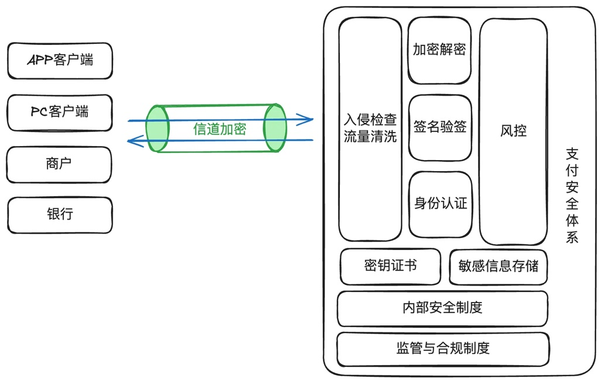

### 说明：

### 1. 制度是基础。

哪种场景下需要加密存储，加密需要使用什么算法，密钥长度最少需要多少位，哪些场景下需要做签名验签，这些都是制度就明确了的。制度通常分为行业制度和内部安全制度。行业制度通常是国家层面制定的法律法规，比如《网络安全法》、《支付业务管理办法》等。内部安全制度通常是公司根据自身的业务和能力建立的制度，小公司可能就没有。

### 2. 技术手段主要围绕四个目标：

<!-- PDF 第 166 页；原书第 163 页 -->

1)敏感数据安全存储。

2）交易安全传输。

3）交易的完整性和真实性。

4)交易的合法性（无欺诈）。

对应的技术手段有：

敏感信息安全存储：采用加密技术对个人和商户/渠道的敏感信息进行加密存储，限制敏感信息的访问权限，防止未授权的访问和泄露。

交易信息安全传输：使用安全套接字层（SSL）或传输层安全性协议（TLS）等加密技术，确保数据在传输过程中的机密性和完整性。

交易的完整性和真实性：采用数字签名技术和身份认证技术确保交易信息的完整性和真实性，对交易信息进行记录和审计，建立可追溯的交易日志，以应对可能出现的交易篡改或抵赖情况。ę

防范欺诈交易：通过支付风控系统，及时识别和阻止可疑交易行为。

服务可用性：部署流量清洗设备和入侵检测系统，及时发现并阻止恶意流量，确保支付系统的稳定运行和服务可用性，抵御DDoS攻击。

下面详细讲解各技术手段。

## 11.4 数据安全：加密与解密技术

加密和解密技术是数据安全的基础，在支付安全技术的核心技术之一，无论是支付平台与银行之间的通信，还是支付平台内部敏感数据的存储，都需要用到加解密技术。

我尽量避免加解密技术背后高深的数学知识。

### 11.4.1 什么是加密和解密

在数字通信中，加密是将明文通过一定的算法和密钥转换成无法识别的密文的过程。这样即使数据被截获，未经授权的第三方也无法理解其内容。比如把明文“123”转成“aexyeffidfdfwsd”。

解密则是加密的逆向过程，通过一定的算法和密钥将密文转换成明文的过程。比如把密文“aexyeffidfdfwsd”转成“123”。

<!-- PDF 第 167 页；原书第 164 页 -->

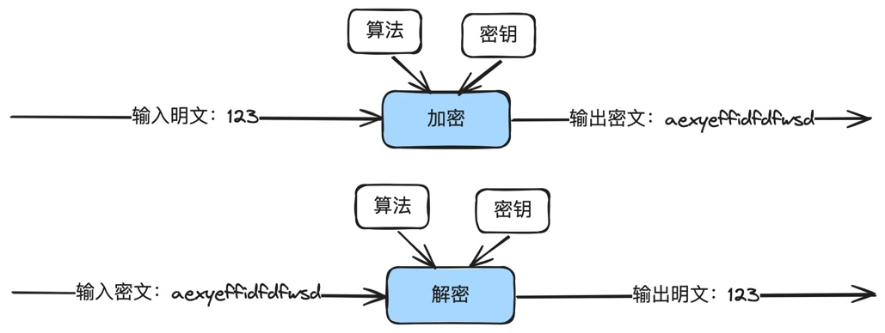

### 11.4.2 对称加密算法

对称加密是使用相同的密钥(称为对称密钥）进行加密和解密。这意味着发送方和接收方必须在通信之前共享相同的密钥。对称加密算法使用简单且高效，但密钥分发和管理是其主要挑战之一。

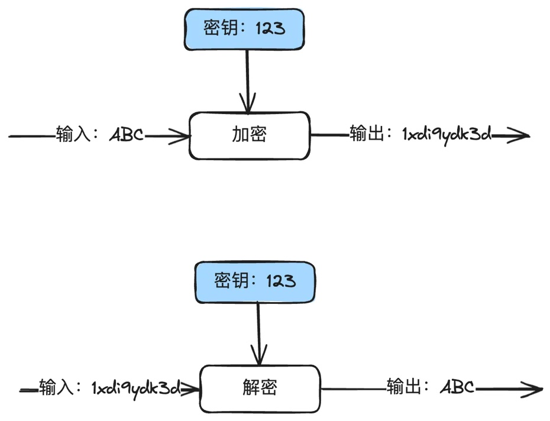

<!-- PDF 第 168 页；原书第 165 页 -->

以下是一些常见的对称加密算法、特点和应用场景：

1. AES(Advanced Encryption Standard，高级加密标准):

特点：安全性高，速度快，密钥长度可变。

应用场景：广泛应用于网络通信、文件加密、数据库加密等领域。也是支付行业使用的主流对称加密算法。

2. DES (Data Encryption Standard，数据加密标准):

特点：较为古老，密钥长度较短（56位），安全性相对较弱。

应用场景：曾经广泛应用于保护数据传输和存储，但由于密钥长度较短和安全性较弱，现已基本被AES取代。

3. 3DES(Triple DES，三重数据加密标准):

特点：通过对数据使用三次DES算法加密来增强安全性，但速度较慢。

应用场景：曾被广泛用于替代DES，但由于速度较慢，已经基本被AES取代。

4. RC4 (Rivest Cipher 4) :

特点：速度快，简单易用。

应用场景：曾经用于保护网络通信和SSL/TLS协议中的加密，但由于安全性存在问题，已经不推荐使用。

5. IDEA (International Data Encryption Algorithm):

特点：速度快，安全性高。

应用场景：曾经用于网络通信和文件加密，但由于专利限制和更先进的算法出现，应用逐渐減少。

AES目前被认为是最安全和最常用的对称加密算法，推荐在支付行业使用。密钥长度建议使用256比特或以上。

有些银行要求整个报文进行加密，这个时候一般都是使用AES256来加密。

### 11.4.3 非对称加密算法

非对称加密算法使用一对密钥（公钥和私钥）进行加密和解密。这两个密钥是相关联的，但不相同。公钥用于加密数据，私钥用于解密数据，一定不能反过来，因为公钥读者都有，如果使用私

<!-- PDF 第 169 页；原书第 166 页 -->

钥加密，公钥解密，读者都可以解密，就没有安全性可言。这种加密方式具有密钥分离的特点，即公钥可以公开分发，而私钥则保密保存。

另外，非对称加密算法也用于签名验签，拿私钥签名，公钥验签(不能反过来）。

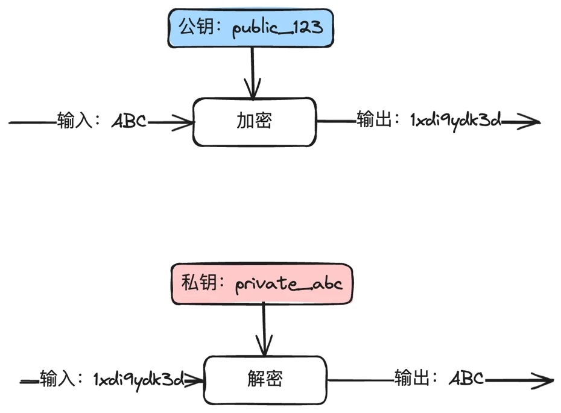

以下是一些常见的非对称加密算法、特点和应用场景：

1. RSA (Rivest-Shamir-Adleman):

特点：安全性高，可靠性强，广泛应用。

应用场景：用于加密通信、数字签名、密钥交换等各种安全领域。支付行业用得非常多。

2. DSA (Digital Signature Algorithm) :

○特点：用于数字签名，验证速度快。

应用场景：主要用于身份验证和数字签名，例如在SSL/TLS协议中用于网站认证。

3. ECC (Elliptic Curve Cryptography) :

特点：密钥长度短，安全性高，加密效率高。

应用场景：适用于移动设备和资源受限环境，例如智能手机、物联网设备等。

4. DH (Diffie-Hellman) :

<!-- PDF 第 170 页；原书第 167 页 -->

特点：用于密钥交换，实现安全的密钥协商。

应用场景：用于安全通信中的密钥协商，例如SSL/TLS协议中的密钥交换阶段。

RSA当前在支付行业应用最广泛，ECC则逐渐成为移动设备和物联网设备中的首选算法，因其在资源受限环境下的高效性能而备受青睐。RSA推荐密钥长度为2048比特或以上，ECC推荐密钥长度为256比特或以上。

### 11.4.5 数字信封加密算法

数字信封加密算法组合了对称加密、非对称加密、数字签名和验签等多种加密技术，用于在网络通信中保护数据的安全性和完整性。传输的数据就像放在信封里面，只有收件人才能打开信封查看明文，所以被形象称为数字信封加密。

它的原理是使用对称加密算法对要传输的数据进行加密，然后再使用接收方的公钥对对称密钥进行加密，再使用自己的私钥进行签名，最后将加密后的对称密钥和加密后的数据一起发送给接收方。接收方先使用对方的公钥进行验签，再使用私钥解密对称密钥，最后使用对称密钥解密数据。

不过读者日常听得更多的可能是PGP(Pretty Good Privacy)。PGP是一种加密软件套件，用于保护电子通信的安全性和隐私性。它由Philip Zimmermann于1991年创建，并成为了一种标准的加密工具，最开始用于保护电子邮件，后面被广泛用于保护文件传输，比如支付平台和银行之间的文件。

PGP通常推荐使用RSA 2048和AES 256，前者用于加密对称密钥和签名，后面用于加密大数据块。

下图是数字信封加解密算法的完整过程：

<!-- PDF 第 171 页；原书第 168 页 -->

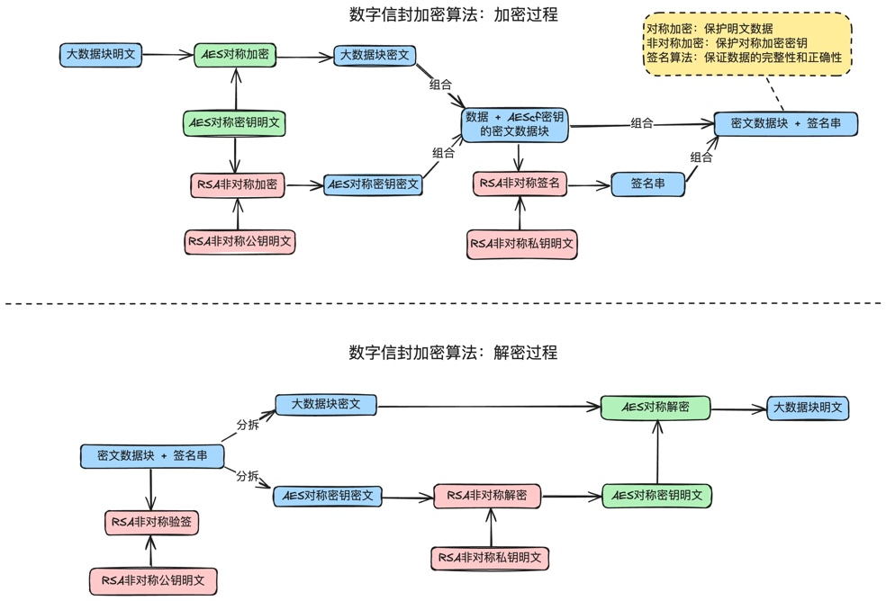

现在很多银行的打款文件要求使用PGP加密，因为文件里面有卡号等敏感数据。

### 11.4.6 加密算法和密钥长度选择

在加密应用中，算法和密钥长度对安全性（破解难度）和性能（运算快慢）都有重要影响：

#### 1. 安全性：

a. 非对称加密算法通常比对称加密算法更安全。比如RSA(非对称加密）好于AES(对称加

b. 同类算法，新算法通常比老算法更安全，或者针对一些特殊领域做了改进。比如AES和DES都是对称加密算法，但是AES的安全性优于DES。椭圆曲线算法和RSA在同等安全级别的情况下，椭圆曲线算法的密钥比RSA的密钥更短。

c. 相同算法，密钥越长，越安全，因为密钥越长，密钥空间越大，或计算步骤更多，破解的难度就越大。比如RSA 2048（密钥长度）的安全性优于RSA 1024（密钥长度）。

#### 2. 性能：

a. 对称加密算法通常比非对称加密算法运算更快。比如AES(对称加密）好于RSA(非对称

<!-- PDF 第 172 页；原书第 169 页 -->

加密）。

b. 相同算法，密钥越长，运算越慢，性能越差。比如RSA 2048（密钥长度）就比RSA 1024(密钥长度)要慢。因为密钥长度增加了加密操作的复杂度和计算量，需要更多的计算资源和时间来执行加密和解密操作。

因此，在选择加密算法和密钥长度时，需要综合考虑安全性和性能之间的平衡。一般来说，应选择安全性较高的加密算法，并根据应用场景和性能要求选择适当长度的密钥。

当前支付行业推荐的算法和密钥长度如下：

算法选择：对称加密算法(如AES)适用于对大量数据进行快速加密和解密，而非对称加密算法（如RSA)适用于密钥交换和数字签名等场景。

密钥长度选择：AES建议选择256比特或以上(当前128比特仍然是安全的)。RSA建议选择2048比特或以上。

### 11.4.7 常见加密解密算法推荐

前面我们介绍了对称加密和非对称加密算法，两者有不同的使用场景，在支付行业推荐的算法如下：

AES：当前最广泛使用的对称加密算法，速度快，适用于高速加密大量数据。密钥长度推荐256比特或以上(当前128比特仍然是安全的)。

RSA：广泛使用的非对称加密算法，安全性比AES更高，但是加密速度慢，适用于小量数据或作为数字签名使用。密钥长度推荐2048比特或以上。

在一些场景里面，需要同时组合使用AES和RSA，比如大数据加密使用AES，AES密钥通过RSA加密后传输，并通过RSA进行签名，这样既解决了安全性，又解决了加密速度的问题。

特别强调一点：千万千万不要自己去发明一种【私有的】，【自己认为很安全】的算法，并应用到生产环境。因为业界推荐的这些算法的安全性是经过大量数字家和计算机科学家论证过的，也经过工业界持续地验证。

<!-- PDF 第 173 页；原书第 170 页 -->

除了上面推荐的AES和RSA，各个国家基于特殊安全考虑，还有一些特别的加密算法，这些算法同样经过大量数字家和计算机科学家论证过，但是有一定的使用门槛，有兴趣的同学可以去找加密机厂家的资料了解。

### 11.4.8 典型应用场景

支付系统作为一个安全系数非常高的系统，加解密技术在里面起到了极其重要的作用。通常以下几个核心应用场景都会用到加解密技术：1）传输加密；2）存储加密。

1. 传输加密：保护交易数据在互联网上传输过程中的安全，防止数据被窃听或篡改。

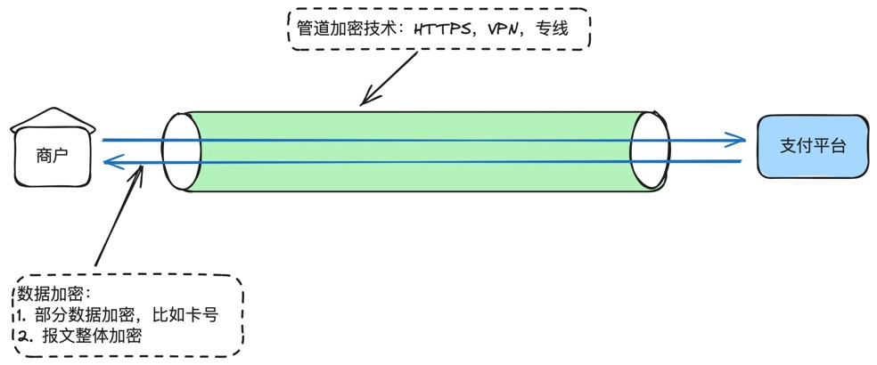

具体的实现通常有两种：

1)通道加密：比如使用HTTPS，或者VPN、专线等，实现数据传输端到端的加密。

2）报文数据加密：部分字段单独加密，比如把卡号等关键信息进行加密后再发出去。整体报文单独加密，先组装业务报文，然后对整个报文加密再发出去。

2. 存储加密：对敏感数据比如信用卡信息、用户身份证信息、密码等需要进行加密后存储到数据库中，以防止数据泄露。

<!-- PDF 第 174 页；原书第 171 页 -->

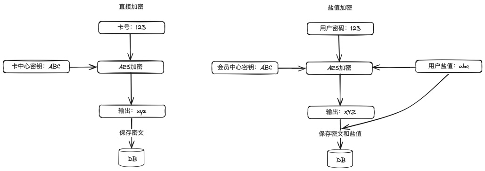

具体的实现通常也会分两种：

1)直接加密：原始信息直接加密。通常用于信用卡、身体证等常规数据的加密。

2）加盐值（SALT）后再加密：原始信息先加上盐值，然后再进行加密。通常用于密码管理。所谓盐值，就是一串随机生成的字符串，比如：329713kud3s，9ds9jd9sj3es。

### 11.4.9 登录与支付密码的特殊处理

登录和支付密码的传输和存储都比较特殊，值得单独说一说。

登录与支付密码传输的特殊处理

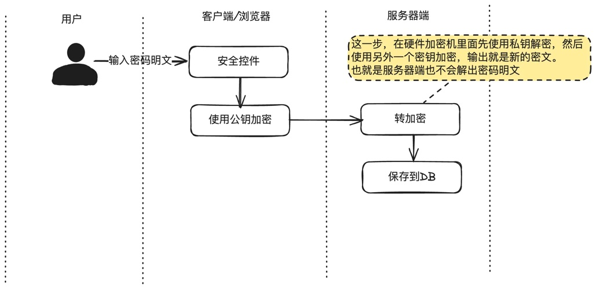

登录和支付密码都是用户输入，如何保证在输入时不被盗取？如何保证传输的安全性?

<!-- PDF 第 175 页；原书第 172 页 -->

输入时一般会有安全控件，直接获取输入，其它应用无法在输入盗取。然后使用公钥加密，传输到后端后，再使用私钥解密，再进行转加密，最后保存到数据库，或和数据库的密码对比判断。

#### 登录与支付密码存储的特殊处理

上一章节里，提到登录或支付密码需要加上盐值后，再进行加密存储。那为什么密码管理需要使用盐值？为了提高密码安全性。

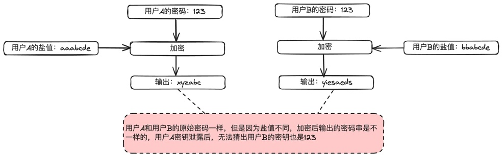

1. 防止彩虹表攻击。彩虹表是一种预先计算出来的哈希值数据集，攻击者可以使用它来查找和破译未加盐的密码。通过为每个用户加盐，即使是相同的密码，由于盐值不同，加密后的密文也是不一样的。

2. 保护相同密码的用户。如果多个用户使用了相同的密码，没有盐值情况下，一个被破解后，就能找到使用相同密码的其它用户。每个用户不同的盐值，确保生成的密文不同。

3. 增加破解难度。尤其是密码较弱时，显著增加攻击者难度。

在实现时，需要留意加盐策略：

1. 随机和唯一：每个用户都是随机和唯一的。

2. 存储盐值：每个用户的密码和盐值都需要配对存储。因为在加密密钥更新时，需要使用盐值一起先解密再重新加密。

3. 盐值足够长：增加复杂性，推荐至少128位。

### 11.4.10 PCI认证

<!-- PDF 第 176 页；原书第 173 页 -->

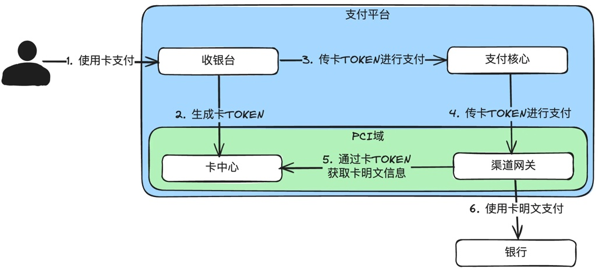

如果要保存用户的卡明文数据（比如用户名和卡号），就一定要经过PCI(Payment CardIndustry）认证，在PCl认证范围内的域叫PCI域。

PCI安全标准(PCI DSS)是由PCI安全标准委员会(PCI SSC）制定和管理的一组安全标准，旨在保护持卡人数据的安全性和机密性。

简单地说，PC规定了一个单独的区域（简称PCI域），可以处理用户的卡明文数据，包括加密后存储，或使用明文，这个区域的网络安全部署、数据访问控制、数据加密、日志打印、安全策略等全部都有由PCIDSS规定，并定期接受相关认证组织的审查。

特别注意的是，PCI标准要求所有的域都不能打印用户敏感信息，所有的域都不能存储明文用户敏感信息，比如卡只能打印前6后4，只有PCI域范围内的应用才能使用卡明文数据。

### 11.4.11 加解密在工程应用中的常见问题

密钥管理不规范：把密钥加密后保存在数据库，但是加密密钥用的密钥是123456。

算法选择不合适:大批量数据选择使用速度极慢的非对称的RSA算法。

兼容性算法不对：尤其是模式、填充方式是直接影响加解密结果的。比如AES下面仍然细分为：ECB，CBC，CFB，OFB，CTR，GCM等模式，以及PKCS7/PKCS5填充，零填充等填充方式。AES128和AES256也有区别，具体的可以找密码学相关资料参考。

异想天开地使用自己创造的私有算法：以为很安全，其实太傻太天真。

管理机制不完善：没有制定严格的规范，或有规范执行不严重，导致密钥能被轻易访问。

<!-- PDF 第 177 页；原书第 174 页 -->

### 11.4.12 常见加解密算法核心代码

以常用的AES加解密为例：

<!-- PDF 第 178 页；原书第 175 页 -->

```java
import javax.crypto.Cipher;
import javax.crypto.spec.IvParameterSpec;
import javax.crypto.spec.SecretKeySpec;
import javax.crypto.SecretKeyFactory;
import javax.crypto.spec.PBEKeySpec;
import java.security.spec.KeySpec;
import java.util.Base64;
import java.security.SecureRandom;
import javax.crypto.SecretKey;

public class AESWithPasswordExample {
    private static final String PASSWORD = "123456";
    private static final int ITERATION_COUNT = 65536;
    private static final int KEY_LENGTH = 256; // AES密钥长度可以是128、192或256比特
    private static final String ALGORITHM = "AES/CBC/PKCS5Padding";

    // 使用PBKDF2从密码派生AES密钥
    private static SecretKey getKeyFromPassword(String password) throws Exception {
        SecureRandom random = new SecureRandom();
        byte[] salt = new byte[16];
        random.nextBytes(salt); // 创建安全随机盐

        KeySpec spec = new PBEKeySpec(password.toCharArray(), salt, ITERATION_COUNT, KEY_LENGTH);
        SecretKeyFactory factory = SecretKeyFactory.getInstance("PBKDF2WithHmacSHA256");
        byte[] secretKey = factory.generateSecret(spec).getEncoded();
        return new SecretKeySpec(secretKey, "AES");
    }

    // 加密
    public static String encrypt(String data, SecretKey key, IvParameterSpec iv) throws Exception {
        Cipher cipher = Cipher.getInstance(ALGORITHM);
        cipher.init(Cipher.ENCRYPT_MODE, key, iv);
        byte[] encrypted = cipher.doFinal(data.getBytes("UTF-8"));
        return Base64.getEncoder().encodeToString(encrypted);
    }

    // 解密
    public static String decrypt(String encryptedData, SecretKey key, IvParameterSpec iv) throws Exception {
        Cipher cipher = Cipher.getInstance(ALGORITHM);
```

<!-- PDF 第 179 页；原书第 176 页 -->

```java
        cipher.init(Cipher.DECRYPT_MODE, key, iv);
        byte[] original = cipher.doFinal(Base64.getDecoder().decode(encryptedData));
        return new String(original, "UTF-8");
    }

    public static void main(String[] args) throws Exception {
        String originalData = "Confidential data that needs to be encrypted and decrypted";

        // 生成密钥和初始化向量(IV)
        SecretKey key = getKeyFromPassword(PASSWORD);
        byte[] ivBytes = new byte[16]; // AES使用16字节的IV
        SecureRandom random = new SecureRandom();
        random.nextBytes(ivBytes);
        IvParameterSpec iv = new IvParameterSpec(ivBytes);

        // 加密数据
        String encryptedData = encrypt(originalData, key, iv);
        System.out.println("Encrypted data: " + encryptedData);

        //
        String decryptedData = decrypt(encryptedData, key, iv);
        System.out.println("Decrypted data: " + decryptedData);
    }
}
```

请注意，这是一个简化的版本，实际应用中需要采取更多的安全措施，比如加密密钥的存储，盐值需要一起保存等。

## 11.5 防篡改与防抵赖：签名与验签技术

防篡改与防抵赖一般也称为数据的完整性和真实性验证问题，通常使用签名验签技术解决。

### 11.5.1 什么是签名与验签

签名验签是数字加密领域的两个基本概念。

签名：发送者将数据通过特定算法和密钥转换成一串唯一的密文串，也称之为数字签名，和报文信息一起发给接收方。

验签：接收者根据接收的数据、数字签名进行验证，确认数据的完整性，以证明数据未被篡改，且确实来自声称的发送方。如果验签成功，就可以确信数据是完好且合法的。

<!-- PDF 第 180 页；原书第 177 页 -->

下面是一个极简的签名验签数学公式。

假设被签名的数据(m)，签名串(Σ），散列函数(H)，私钥(Pr)，公钥(Pu)，加密算法（S)，解密算法（S^），判断相等（eq）。

简化后的数学公式如下：

签名：Σ=S[H(m)，Pr]。

验签：f(v)=[H(m) eq S^(Σ, Pu)]。

流程如下：

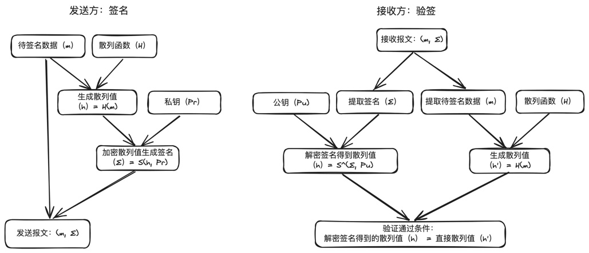

#### 签名流程：

1. 散列消息：对消息(m)应用散列函数(H)生成散列值(h)。

2. 加密散列值：使用发送方的私钥（Pr）对散列值（h）进行加密，生成签名（Σ)。Σ= S(h，Pr)

把数字签名（Σ）和原始消息(m）一起发给接收方。

#### 验签流程：

1. 散列收到的消息：使用同样的散列函数（H）对消息（m）生成散列值（h')。h' = H(m)

2. 解密签名：使用发送方的公钥（Pu）对签名(Σ）进行解密，得到散列值（h)。h = S^(Σ，Pu)

<!-- PDF 第 181 页；原书第 178 页 -->

3. 比较散列值：比较解密得到的散列值（h）与直接对消息（m）散列得到的（h'）是否一致。验证成功条件：h = h'。

如果两个散列值相等，那么验签成功，消息(m)被认为是完整的，且确实来自声称的发送方。如果不一致，就是验签失败，消息可能被篡改，或者签名是伪造的。

现实中的算法会复杂非常多，比如RSA，ECDSA等，还涉及到填充方案，随机数生成，数据编码等。

### 11.5.2 支付系统为什么一定要做签名验签

银行怎么判断扣款请求是从确定的支付平台发出来的，且数据没有被篡改？商户不承认发送过某笔交易怎么办？这都是签名验签技术的功劳。

签名验签主要解决3个问题：

1. 身份验证：确认支付信息是由真正的发送方发出，防止冒名顶替。

如果无法做身份验证，支付宝就无法知道针对你的账户扣款99块的请求是真实由你楼下小卖部发出去的，还是我冒充去扣的款。

2. 完整性校验：确认支付信息在传输过程中未被篡改，每一笔交易都是完整、准确的。

如果无法校验完整性，那么我在公共场景安装一个免费WIFI，然后截获你的微信转账请求，把接收者修改成我的账号，再转发给微信，微信就有可能会把钱转到我的账号里。

3. 防抵赖性：避免任何一方否则曾经进行过的交易，提供法律证据支持。

比如微信支付调用银行扣款100块，银行返回成功，商户也给用户发货了，几天后银行说这笔扣款成功的消息不是他们返回的，他们没有扣款。而签名验签就能让银行无法抵赖。

<!-- PDF 第 182 页；原书第 179 页 -->

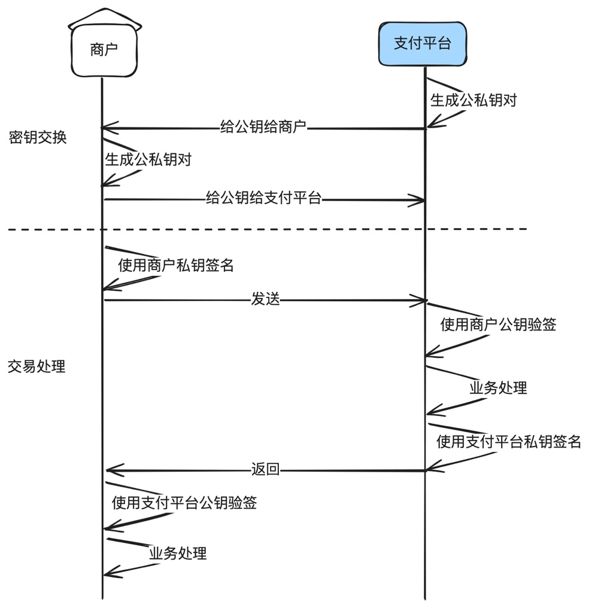

#### 流程：

1. 双方先交换密钥，可以通过线下邮件交换，也可以通过线上自助平台交换。

2. 请求方发出交易报文前使用自己的私钥进行签名，接收方接收报文后先进行验签，验签通过后再进行业务处理。

3. 接收方处理完业务，返回前使用自己的私钥进行签名，请求方接收返回报文后先进行验签，验签通过后再进行业务处理。

### 11.5.3 常见数字签名算法及推荐算法

<!-- PDF 第 183 页；原书第 180 页 -->

常见的数字签名算法包括：

1. RSA(Rivest-Shamir-Adleman)：RSA是一种基于大素数因子分解难题的非对称加密算法，被广泛应用于数字签名和密钥交换等领域。

2. DSA(Digital Signature Algorithm)：DSA是一种基于离散对数问题的数字签名算法，主要用于数字签名领域。

3. ECDSA(Elliptic Curve Digital Signature Algorithm)：ECDSA是一种基于椭圆曲线离散对数问题的数字签名算法，具有比RSA更短的密钥长度和更高的安全性。

4. EdDSA(Edwards-curve Digital Signature Algorithm)：EdDSA是一种基于扭曲爱德华斯曲线的数字签名算法，具有高效性和安全性，被广泛用于加密货币等领域。

目前主流的数字签名算法是RSA和ECDSA。RSA推出较早，且安全性足够，现在使用非常广泛。而ECDSA由于其较短的密钥长度和更高的安全性，逐渐成为新兴的数字签名算法，特别适用于资源受限环境和移动设备等场景。

在支付场景来说，RSA使用最为广泛，密钥长度推荐2048比特。RSA1024以前使用得多，但因为密钥长度较短，安全性不足，也已经不再推荐使用。

### 11.5.4 一些与防篡改有关的技术

#### 11.5.4.1 数字摘要

数据摘要是一种通过对数据进行计算(也称为哈希、摘要、散列计算），生成固定长度的唯一数据串（通常称为摘要或哈希值），用于验证数据的完整性和一致性的技术。数据摘要通常用于验证数据在传输或存储过程中是否发生了更改。

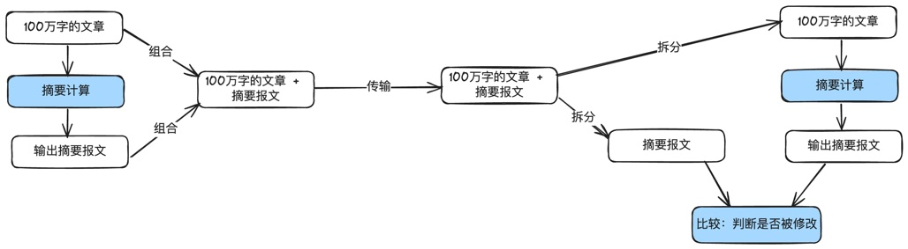

上面有个缺陷，就是在传输过程中，报文被黑客截获，然后把100万字的文章和摘要报文全部替换，服务端发现不了的。这个缺陷在下面的HMAC算法中会解决。

<!-- PDF 第 184 页；原书第 181 页 -->

常见的数据摘要算法包括：

1. MD5(Message Digest Algorithm 5)：MD5是一种常用的哈希算法，产生128位的哈希值。然而，由于MD5存在严重的安全性缺陷，已经不推荐用于安全性要求较高的场景。

2. SHA-1(Secure Hash Algorithm 1)：SHA-1是一种较为安全的哈希算法，产生160位的哈希值。然而，由于SHA-1也存在一些安全性问题，如碰撞攻击，因此在一些安全性要求较高的场景中也不推荐使用。

3. SHA-256、SHA-384、SHA-512：这些是SHA-1的后续版本，分别产生256位、384位和  
512位的哈希值。它们提供了更高的安全性，通常被用于对安全性要求较高的数据进行摘要。

4. RIPEMD (RACE Integrity Primitives Evaluation Message Digest) ： RIPEMD系列是一组与MD4和MD5相似的哈希算法，产生128位、160位、256位和320位的哈希值。虽然不如SHA系列算法流行，但在某些场景下仍然有用。

5. BLAKE、Keccak、Whirlpool等：这些是一些新兴的哈希算法，设计更加安全和高效，被广泛用于密码学和区块链等领域。

当前在支付行业推荐的摘要算法是SHA256。

需要说明的是，数字签名需要用到数字摘要算法，但是数字摘要算法不能替代数字签名。因为数字摘要只能证明数据是否完整，无法证明数据一定是某个人或某个机构发出来的。但是在国外很多支付机构，仍然使用MD5或SHA256这种摘要算法来代替验名验签。

#### 11.5.4.2 HMAC算法

HMAC(Hash-based Message Authentication Code) 是一种基于哈希函数（摘要)和密钥的消息认证码算法，通常用于验证消息的完整性和真实性。

HMAC算法结合了哈希函数和密钥，通过对消息进行哈希运算，并使用密钥进行加密，生成一个唯一的摘要。这个摘要就是消息的认证码，用于验证消息的完整性和真实性。

<!-- PDF 第 185 页；原书第 182 页 -->

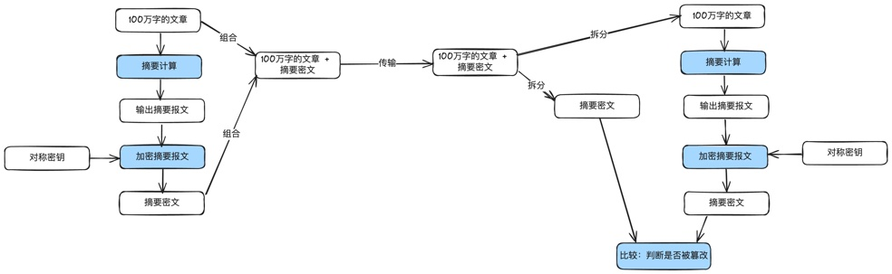

HMAC因为使用摘要算法和对称加密，运算简单而快速，所以许多场景下，HMAC是一种简单而有效的选择，也被用作消息的完整性保护和身份验证。所以在支付场景下，也经常用于签名验

但需要说明的是，HMAC解决了纯摘要算法的部分问题，但仍不是严格意义上的数字签名算法，因为HMAC使用的是双方都拥有的对称密钥，无法证明消息一定是对方发出的，因为也有可能是某方伪造的。

#### 11.5.4.3 数字时间戳

数字时间戳是一种用于确定特定事件发生时间的数字签名或哈希值，通常由数字时间戳服务(DTS：digital time-stamp service)颁发。数字时间戳将特定事件的时间信息与数字签名或哈希值绑定在一起，以确保该事件在特定时间之前已经存在，从而防止后续的篡改或伪造。

比如两个科学家都声称自己先于对方完成了某个证明或实验，如果双方把相关的材料通过数字时间戳服务进行了数字时间戳签名，那么就可以轻而易举解决这个问题。

<!-- PDF 第 186 页；原书第 183 页 -->

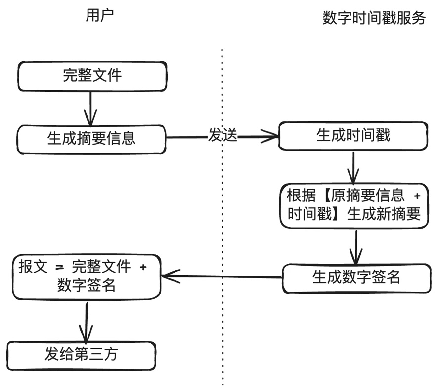

数字时间戳的应用场景主要在文件证明，电子邮件，数字证书等，比如法律文件、合同、知识产权、证书等，以证明在某个时间之前就存在了这份文件。

不过在支付系统中，目前比较少使用数字时间戳。

#### 11.5.4.4 双重数字签名

双重数字签名是安全电子交易协议(Secure Electronic Transaction,简称SET协议)中引入一个概念。因为SET协议过于复杂，且互联网出现了新的更简便的安全协议，比如SSL(SecureSockets Layer) /TLS (Transport Layer Security) /HTTPS (Hypertext Transfer ProtocolSecure），SET实际没有大规模应用。所在当代支付系统中，目前比较少见双重数字签名。

双重数字签名原理有点绕，我尝试讲清楚：

<!-- PDF 第 187 页；原书第 184 页 -->

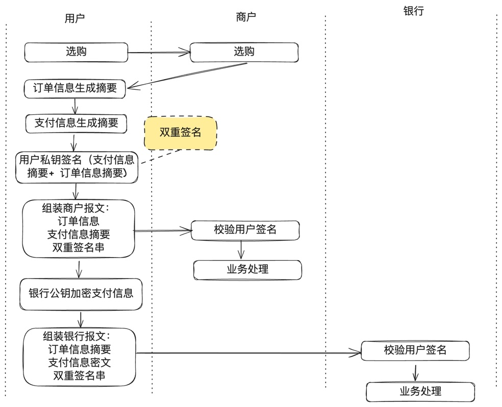

##### 说明：

1. 用户、商户、银行分别向CA机构申请证书，这个在图中已经省略。

2. 用户选购后，先把订单信息生成摘要，然后把支付信息也生成摘要，把两个摘要拼接起出新的摘要，最后使用自己私钥签名，也就是双重签名信息。

3. 用户把“订单信息+支付信息摘要+双重签名串”发给商户，商户根据订单信息生成摘要，并与支付信息摘要拼接后，拿用户的公钥进行验签。

4. 用户把“支付信息密文+商户信息摘要+双重签名串”发给银行(也可以通过商户发给银行），银行先使用自己的私钥解密出支付信息明文，生成摘要，再与订单信息摘要拼接后，拿用户的公钥进行验签。

5. 上述过程中，商户不知道用户的支付信息，比如卡号等，银行不知道用户的订单信息，比如买了什么，但是商户和银行能判断对方是真实的。

### 11.5.5 常见签名验签算法核心代码

<!-- PDF 第 188 页；原书第 185 页 -->

下面以RSA(SHA256withRSA)为例，示例代码如下：

```java
import java.security.KeyFactory;
import java.security.PrivateKey;
import java.security.PublicKey;
import java.security.Signature;
import java.security.spec.PKCS8EncodedKeySpec;
import java.security.spec.X509EncodedKeySpec;

public class RSASignatureUtil {

    // 使用私钥对数据进行签名
    public static byte[] sign(byte[] data, byte[] privateKey) throws Exception {
        PKCS8EncodedKeySpec pkcs8KeySpec = new PKCS8EncodedKeySpec(privateKey);
        KeyFactory keyFactory = KeyFactory.getInstance("RSA");
        PrivateKey priKey = keyFactory.generatePrivate(pkcs8KeySpec);
        Signature signature = Signature.getInstance("SHA256withRSA");
        signature.initSign(priKey);
        signature.update(data);
        return signature.sign();
    }

    // 使用公钥验证签名
    public static boolean verify(byte[] data, byte[] publicKey, byte[] signatureBytes) throws Exception {
        X509EncodedKeySpec keySpec = new X509EncodedKeySpec(publicKey);
        KeyFactory keyFactory = KeyFactory.getInstance("RSA");
        PublicKey pubKey = keyFactory.generatePublic(keySpec);
        Signature signature = Signature.getInstance("SHA256withRSA");
        signature.initVerify(pubKey);
        signature.update(data);
        return signature.verify(signatureBytes);
    }
}
```

签名输出是字节码，还需要编码，一般是base64。

如果使用SHA-256(很多公司仍在使用，但不推荐），如下：

<!-- PDF 第 189 页；原书第 186 页 -->

```java
import java.security.MessageDigest;

public class SHA256Util {

    // 使用SHA-256对数据进行散列
    public static byte[] hash(byte[] data) throws Exception {
        MessageDigest digest = MessageDigest.getInstance("SHA-256");
        return digest.digest(data);
    }
}
```

这里data已经是加了API密钥(也称为APIKEY)。所谓的API密钥，就是交易双方共享的一个密钥，这样双方生成的哈希值才会一致。

### 11.5.6 联调中常见的问题

不管是与商户的联调，还是与支付渠道(或银行）之间的联调，签名验签都是非常耗费精力的环节。验签不通过通常有以下几个情况：

1. 密钥不匹配：双方以为自己都配置了正确的密钥，但实际没有。

2. 数据编码不一致：比如一方使用GBK，一方使用UTF-8。

3. 原始数据选择不一致：比如接口文档要求拼接10个字段，但是代码实现却只拼接了9个字段。或者一方没有把空值放入计算，另一方把空值也放入计算。

4. 原始数据排序方式不一致：比如接口要求按key的升序排列，调用方却忘记排序就进行签名。

5. 字符转义不一致：特殊字段的转义必须保持一致。

解决上述问题的最好办法，就是让服务提供方提供一段示例代码，以及示例报文+示例签名，然后在本地使用main方法先跑成功，再移植到项目代码中。

## 11.6 身份合法性判断：身份认证技术

在互联网支付中，怎么证明你是你？这就是身份认证技术。下面讲的证书、CA、PKI等都相对比较专业的概念，这里只做入门介绍，有兴趣的同学可以找专业的文章深入学习，基本每个模块都

<!-- PDF 第 190 页；原书第 187 页 -->

可以写一本书。

### 11.6.1 什么是身份认证

在支付安全领域，身份认证就是确认支付交易的参与者是否是其声称的身份。简单地说，就是证明你是你。这个功能最重要的当然是保护用户账户安全，减少欺诈交易或盗刷，以及遵守合规要求。

### 11.6.2 常见的身份认证方法

身份认证通常分为个人身份认证和企业/机构身份认证。

常见的个人身份认证方法包括以下几种：

1. 用户名和密码认证。这没什么好说的，最常见的身份认证方式，但安全性相对较低，容易受到密码猜测、密码泄露等攻击。

2. 多因素认证(MFA）。就是要求用户同时使用2种方式验证身份，包括密码、短信验证码、指纹识别、人脸识别、硬件令牌等。一般是后台风控识别有风险时，才会这样。也经常叫风控挑战。

3.生物特征认证。使用个体的生物特征（如指纹、虹膜、声纹、人脸等）来进行身份验证。这种认证方式通常需要专门的硬件设备来捕获生物特征，并使用算法进行比对。

4. 单点登录(SSO）与Oauth。用户只需在一个系统登录，就可以授权访问其它系统。比如读者可以使用微信或支付宝来登录微博、小红书等。

5. 数字证书。由CA机构颁发个人数字证书，这个比较少见。

当涉及到企业或机构之间的身份认证时，常见的方法包括使用数字证书和双向TLS认证(也称为客户端证书认证)。数字证书可参考下一章节“数字证书”的说明，双向TLS认证可参考“TLS”章节的说明。

### 11.6.3 数字证书

数字证书(Digital Certificate)是一种用于在网络通信中进行身份验证和数据加密的安全技术。它是由一家被称为证书颁发机构(Certificate Authority，CA)的可信任实体颁发的电子文档，用于证明某个实体（如网站、个人或组织）的身份和公钥。

<!-- PDF 第 191 页；原书第 188 页 -->

数字证书包含以下主要信息：

1. 公钥：数字证书中包含了一个实体的公钥，用于加密和解密通信数据。

2. 持有者信息：数字证书中包含了证书持有者的身份信息，如姓名、电子邮件地址等。

3. 颁发者信息：数字证书中包含了颁发该证书的证书颁发机构的信息，包括机构名称、联系方式等。

4. 有效期限：数字证书中包含了证书的有效期限，即证书的生效日期和失效日期。

5. 数字签名：数字证书中包含了颁发者对证书内容的数字签名，用于验证证书的真实性和完整性。

在网络通信中，当客户端与服务器建立安全连接时，服务器会向客户端发送自己的数字证书。客户端收到服务器的数字证书后，会使用证书中的公钥来验证服务器的身份和证书的真实性。如果验证通过，客户端就可以使用服务器的公钥加密通信数据，并将加密后的数据发送给服务器。

比如你访问以https开头的网站，浏览器就会验证网站服务商的证书。

在支付系统中，某些银行在对接时会要求双向证书认证。

### 11.6.4 数字证书颁发机构CA

我们凭什么相信一个证书是可信的呢？那就是由CA来证明。那我们凭什么相信一个CA机构？通常由政府或大型组织联盟来做信用背书。

在数字证书领域，CA指的是Certificate Authority(证书颁发机构)。CA是一种可信的第三方机构，负责颁发、管理和验证数字证书，以确保数字证书的合法性和可信度。

CA的主要职责包括：

1. 颁发数字证书：CA颁发数字证书给证书申请者，并确保证书的有效性和真实性。在颁发数字证书之前，CA会对证书申请者进行身份验证，以确保其身份的合法性。

2. 证书管理：CA负责管理已颁发的数字证书，包括证书的更新、吊销和查找等操作。CA会定期检查数字证书的有效性，并对已过期或失效的证书进行吊销操作。

3. 证书验证：CA提供数字证书的验证服务，用于验证数字证书的真实性和完整性。通过验证数字证书的签名和证书链，可以确保数字证书的合法性，并确认证书持有者的身份。

4.信任链管理：CA维护一个信任链，用于建立数字证书的信任关系。信任链包括根证书、中间证书和终端证书，每个证书都由上级证书签名，直至根证书，确保数字证书的信任可靠性。

<!-- PDF 第 192 页；原书第 189 页 -->

常见的CA包括全球性的CA，如VeriSign、GeoTrust、DigiCert等，以及国家或地区性的CA，如中国电子认证服务（CFCA）、中国互联网络信息中心（CNNIC）等。这些CA都遵循国际标准和行业规范，提供可信赖的数字证书服务，用于保障网络通信的安全和可信度。

上面有提到一个信任链管理，这是一个很重要的概念。顶级的证书机构不可能为所有用户提供服务，但是它可以为下级机构签发证书，然后由下级机构再给终端用户签发证书。如果验证证书有效性，只需要依次验证签发的CA机构即可。

### 11.6.5 PKI

上面提到的数字证书的理论基础就是公钥基础设施(Public KeyInfrastructure，简称PKI)，是一种用于管理和验证公钥的框架和体系结构。PKI提供了一套标准化的方法，用于生成、存储、分发和撤销公钥，以确保安全的网络通信和身份验证。

#### PKI体系结构包括以下主要组件：

1. 数字证书：PKI使用数字证书来证明实体的身份，其中包含了实体的公钥以及其他相关信息，如证书的颁发者、有效期等。数字证书由证书颁发机构（CA）颁发，并通过数字签名保证其真实性和完整性。

2. 证书颁发机构(CA）：CA是负责颁发、管理和验证数字证书的可信机构。CA通过数字签名对数字证书进行签名，以证明证书的真实性，并提供证书撤销服务(CRL或OCSP）来吊销已失效的证书。

3. 注册机构(RA)：RA是CA的辅助机构，负责用户身份验证和数字证书的申请处理。RA通常收集用户的身份信息，并将其提交给CA进行审批和颁发数字证书。

4. 证书存储库：证书存储库用于存储和管理已颁发的数字证书，以便用户和应用程序检索和验

5. 密钥管理：PKI提供了密钥生成、分发和管理的功能，包括公钥和私钥的生成、存储和交换。

PKI通过数字证书和公钥加密技术，实现了安全的身份验证、数据加密和数字签名等功能，是保障网络通信安全的重要基础设施。也是支付安全体系的重要基础设施。

证书、CA、PKI等都是基于公私钥理论之上，有兴趣的同学可以去深入了解一下公私钥理论及背后的数字知识。

<!-- PDF 第 193 页；原书第 190 页 -->

## 11.7 数据传输安全：常见的传输安全协议

在互联网上，所有的数据都通过网络传输，在线支付的安全也绕不开数据传输安全。这里简单介绍一下各种常见的安全协议。

所有数据全部经过加密后再传输比较麻烦，能不能简单一点，我们直接把传输的管道进行加密，然后传输明文数据？答案当然没有问题，比如SSL，TLS，HTTPS，VPN，专线等都是这个范畴。

这部分内容大部分都是安全工程师关注的范围，读者只需要了解即可。

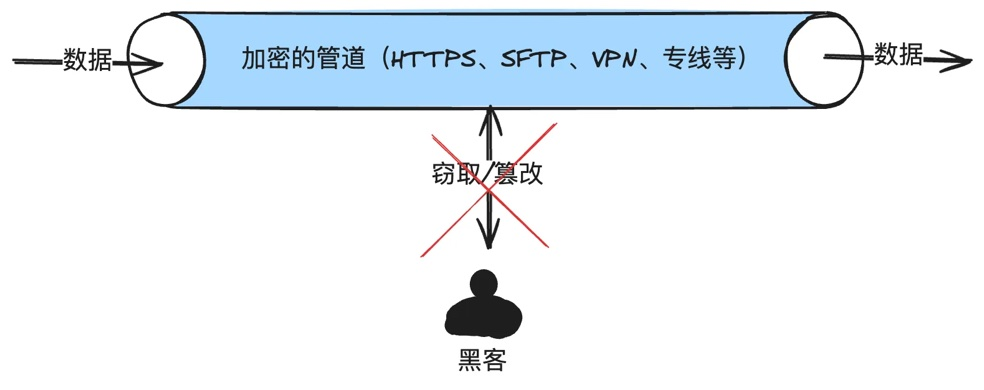

### 11.7.1 SSL

SSL(Secure Sockets Layer，安全套接层)是一种用于保护网络通信安全的协议。它最初由网景公司(Netscape)开发，并于1994年首次发布。SSL协议通过在应用层和传输层之间建立安全通道，提供了加密、完整性验证和身份认证等功能，用于保护网络通信的安全性。

#### SSL协议的主要功能包括：

1. 加密通信：SSL协议使用加密算法对通信数据进行加密，以防止被窃听者窃取敏感信息。它支持多种加密算法，包括对称加密算法（如DES、3DES、AES）和非对称加密算法（如RSA、Diffie-Hellman)等。

2. 完整性验证：SSL协议使用消息认证码(MAC）或数字签名来验证通信数据的完整性，以防止数据被篡改。接收方可以通过验证MAC或数字签名来确保收到的数据未被篡改。

3. 身份认证：SSL协议支持服务器和客户端之间的身份认证，以确保通信双方的身份是合法

<!-- PDF 第 194 页；原书第 191 页 -->

的。服务器通常会提供数字证书来证明其身份，客户端可以使用证书来验证服务器的身份。  
SSL还支持双向身份认证，即客户端和服务器都可以进行身份认证。

4. 会话管理：SSL协议支持会话复用，以减少握手过程的开销和提高通信效率。

SSL协议最初广泛应用于Web浏览器和Web服务器之间的安全通信，用于保护网页传输的敏感信息，如用户名、密码和信用卡信息等。随着SSL协议的发展和演进，它逐渐被TLS协议所取代，但人们通常仍将TLS协议统称为SSL。

### 11.7.2 TSL

TLS(Transport Layer Security，传输层安全）协议是一种用于保护网络通信安全的协议。它建立在SSL(Secure Sockets Layer，安全套接层）协议的基础上，并在SSL的基础上进行了改进和扩展。TLS协议提供了数据的加密、完整性验证和身份认证等功能，用于保护网络通信的安全性。

TLS协议的主要功能和SSL一致，这里不重复说明。另外，随着网络安全威胁的不断增加，TLS协议也在不断发展和完善，以提供更强大的安全保护机制。

### 11.7.3 HTTPS

HTTPS(Hypertext Transfer Protocol Secure)是一种用于安全传输超文本的通信协议。它是在HTTP协议的基础上加入了SSL/TLS协议进行数据加密和身份验证，用于保护网络通信的安全性。

HTTPS协议的工作原理如下：

1. 建立安全连接：客户端向服务器发送连接请求时，服务器会返回自己的数字证书，证明自己的身份和公钥。客户端收到服务器的数字证书后，会验证证书的真实性和有效性。

2. 协商加密算法：客户端和服务器在建立连接时会协商使用的加密算法和密钥长度，以确保通信数据的机密性和安全性。

3. 数据加密传输：客户端使用服务器的公钥加密通信数据，并将加密后的数据发送给服务器。服务器收到加密数据后，使用自己的私钥解密数据。

<!-- PDF 第 195 页；原书第 192 页 -->

4. 身份验证：在建立连接时，服务器发送的数字证书可以用于验证服务器的身份。如果证书验证通过，客户端就可以信任服务器，并继续进行安全通信。

简单地理解，就是HTTP全部是明文传输，HTTPS构建在SSL/TSL之上，所有传输的数据是经过加密的。

除了HTTPS之外，还有其它一些传输协议是构建在SSL/TSL之上的，比如文件传输协议FTP是明文传输，SFTP也是基于SSL/TSL之上的加密传输。

### 11.7.4 VPN与专线

VPN(Virtual Private Network)和专线(Dedicated Line)都是用于建立安全、可靠的网络连接的技术，但它们之间存在一些区别。

#### 1. VPN:

VPN是通过公共网络（如互联网）建立的虚拟私有网络，用于安全地连接远程地点或用户到企业内部网络。

VPN使用加密和隧道技术，将数据在公共网络上进行加密和传输，以确保通信的安全性和隐私性。

VPN通常依赖于软件或硬件设备（如VPN服务器、VPN客户端和VPN路由器）来建立和管理安全连接。

#### 2. 专线：

。专线是一种物理连接，通常由电信提供商提供，用于在两个或多个地点之间建立私有的、专用的网络连接。

专线可以是光纤、电缆或其他物理媒介，通常具有固定的带宽和可靠的连接质量。

专线不依赖于公共网络，因此通常具有更高的安全性和稳定性，适用于需要高可靠性和低延迟的应用场景。

简单地说，VPN更灵活和成本更低，适用于远程访问、移动办公和跨地域连接等场景。专线则很贵，更适用于需要高带宽、低延迟和高安全性的应用，如数据中心互连、企业网络内部连接等。

像支付宝与银联、网联就是通过专线连接。以前一些大支付公司和大银行直连时，一般也是通过专线连接，而一些小银行因为成本考虑就会选择VPN，甚至直接公网走https解决。

<!-- PDF 第 196 页；原书第 193 页 -->

## 11.8 SET协议：过于复杂的设计

需要终端用户参与的产品，一定是越简单越好，否则一定会被时代淘汰，比如SET协议。

SET(Secure Electronic Transaction) 协议是由Visa和MasterCard等信用卡组织于1996年提出，并得到了IBM、Microsoft等大公司支持，旨在提供更安全、更可信的在线支付体验。

SET协议的设计目标是解决传统网络上的信用卡交易存在的安全隐患，如信用卡号被窃取、篡改、重放攻击等问题。为了实现这一目标，SET协议引入了许多安全机制和加密技术，包括数字证书、数字签名、对称加密和公钥加密等。

### SET协议的主要特点包括：

1. 双重身份认证：SET协议要求商家和消费者之间进行双重身份认证，以确保双方的身份是合法的。商家需要向信用卡机构提供数字证书以证明其身份，而消费者需要使用数字证书和PIN码来验证其身份。

2. 加密通信：SET协议使用加密算法对通信数据进行加密，以防止被窃听者窃取敏感信息。它采用了对称加密和公钥加密相结合的方式，保护交易数据的安全性。

3. 数字签名：SET协议使用数字签名来验证交易的完整性和真实性，防止交易数据被篡改。商家在向消费者发送订单信息时使用自己的私钥进行签名，消费者在确认订单时可以验证商家的签名以确保订单的真实性。

4. 安全证书管理：SET协议使用数字证书来验证交易参与者的身份，确保其合法性和可信度。商家和消费者都需要持有有效的数字证书，并通过信任的证书颁发机构(CA）进行验证。

如前面所说，尽管SET协议的起点很高，不但有Visa和MasterCard两大卡组联手推出，还得到IBM、微软等巨头支持，在安全性方面具有较高水平，但由于其复杂性和高成本，仍然败走麦城，并没有得到广泛采用，而是被后来出现的其他安全支付解决方案(如SSL/TLS协议和3DSecure)所取代。当然，它在在线支付安全技术的发展过程中仍起到了重要的推动作用，为后续安全支付标准的制定和实现奠定了基础。

## 11.9 网络流量安全：防火墙与入侵检测

<!-- PDF 第 197 页；原书第 194 页 -->

网络安全和入侵检测是保护计算机网络和系统安全的重要组成部分，它们涉及各种技术和工具，包括防火墙、入侵检测系统(IDS)、入侵防御系统(IPS)、漏洞扫描器等。

这些内容通常归属于网络工程师、系统工程师、及安全工程师的工作范围，下面只做一个简单介绍：

1.防火墙(FirewalI）：防火墙是一种网络安全设备，用于监控和控制网络流量，阻止未经授权的访问和恶意流量进入网络。它可以根据预先定义的安全策略过滤和阻止来自Internet或内部网络的流量，从而保护网络免受攻击和入侵。

2. 入侵检测系统(IDS）：入侵检测系统是一种监视网络流量和系统活动的安全设备，用于检测和警报可能的安全威胁和入侵行为。IDS可以根据事先定义的规则或行为模式检测异常活动，并生成警报或采取措施来应对潜在的威胁。

3. 入侵防御系统(IPS）：入侵防御系统是一种进一步加强网络安全的设备，它不仅能够检测和警报安全威胁，还可以主动阻止和防御入侵行为。IPS可以根据IDS的警报自动采取措施，如阻止恶意流量、更新防火墙规则等，以加强网络的安全性。

4. 漏洞扫描器(Vulnerability Scanner）：漏洞扫描器是一种用于检测计算机系统和网络中存在的安全漏洞和弱点的工具。它可以自动扫描系统和网络，发现潜在的漏洞，并提供建议和修复措施，以减少系统受到攻击的风险。

这些工具更多的是从数据包的维度来处理安全问题。数据包处理完成之后，才会组装成业务数据，才能被用于加解密、签名验签等。

## 11.10 防欺诈交易：支付风控

支付风控是针对支付系统中的风险进行管理和控制的一种措施，旨在降低欺诈交易和财务损失的风险。

风控系统最核心最宝贵的资源是风控策略，因为如果知道一家支付公司的风控策略，就意味着可以想办法绕过支付系统的风控系统，进行欺诈交易。所以一般来说，研发风控系统的研发工程师往往不知道风控策略是怎么配置的。

下图是一个极简的风控系统架构图。

<!-- PDF 第 198 页；原书第 195 页 -->

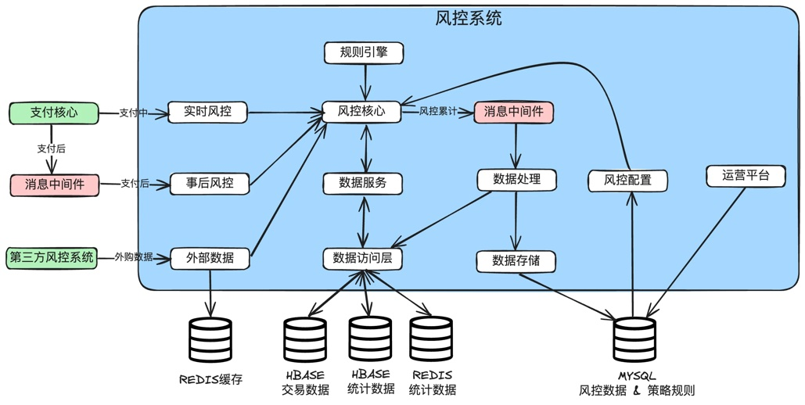

虽然风控的策略是高度机密，但是有些公开的策略，读者可以了解一下，比如说下面这些就属于行为异常，大概率会被风控：

1. 你一直在中国小额支付，突然在国外支付2万。

2. 平时一直使用IPHONE（风控会保存你的设备详细信息），突然使用Android机器支付2000块。

3. 一般都是10天买件商品，实然10分钟内支付50笔。

现代的风控系统不仅仅是策略，还有很多机器学习算法。但总的来说，仍然围绕：当次支付行为，历史交易数据，配置的规则策略，规则引擎，机器学习等展开。

## 11.11 拓展：金融级密钥管理与统一加解密系统设计与实现

经常在网上看到某某公司几千万的个人敏感信息被泄露，这要是放在持牌的支付公司，可能就是一个非常大的麻烦，不但会失去用户的信任，而且可能会被吊销牌照。而现实情况是很多公司的技术研发人员并没有足够深的安全架构经验来设计一套高度安全的密钥管理系统。

本章解构金融级别的密钥管理系统设计与实现，讲清楚如何设计密钥分级体系，密钥轮换机制，如何兼顾存储安全与运算速度，跨机房容灾方案等技术细节。

安全行业有句俗话：“密钥的价值等于数据的价值”，如果你对数据安全感兴趣，或想加固自己公司的数据安全级别，或好奇金融级别的安全体系相关知识，有必要深入了解本章内容。

<!-- PDF 第 199 页；原书第 196 页 -->

### 11.11.1 必要的术语

在深入探讨密钥管理系统(KMS)之前，理解以下核心术语对于把握整个系统的设计和功能至关重要，它们构成了加密和密钥管理领域的基本词汇，是进一步讨论的基础。

#### 1. 密钥(Key):

密钥是一串用于加密和解密数据的信息，是保护数据不被未授权访问的基础。根据用途和级别，密钥可分为主密钥、工作密钥等。

#### 2. 主密钥/本地主密钥(Master Key / Local Master Key):

作为密钥管理体系中最高级别的密钥，主密钥用于加密和保护其他密钥(如工作密钥）。由于其重要性，通常由硬件加密机（也称为：硬件安全模块（HSM)）生成和存储，确保其安全性，所以也经常称为本地主密钥。

#### 3. 区域主密钥(Zone Master Key):

区域主密钥，用于密钥传输前的加密。比如要把工作密钥传输到各安全服务中心，就需要使用ZMK先加密工作密钥。一般使用公私钥来做，后面有详细说明。

#### 4. 工作密钥(Working Key）:

直接用于业务数据的加解密操作。工作密钥由主密钥加密保护，以保障其安全。

#### 5. 数据加密密钥(Data Encryption Key，DEK):

专门用于加密和解密业务数据的密钥。在某些文献中，工作密钥和数据加密密钥可以是同一概念。

#### 6. 密钥加密密钥(Key Encryption Key，KEK):

专门用于加密和解密工作密钥的密钥。在分布式环境下，我们需要把一些工作密钥缓存在各机房的安全服务中心，就使用KEK加密后缓存，而不是缓存明文。

#### 7. 硬件安全模块(Hardware Security Module，HSM):

一种物理设备，专门用于生成、存储和管理数字密钥。就是我们俗称的硬件加密机。HSM提供了物理隔离和高级安全功能，确保密钥的安全。一般只能由特定授权的公司才能生产。在银行业，执牌金融机构基本都需要使用硬件加密机。

#### 8. 密钥生命周期(Key Lifecycle）：

描述了密钥从生成到销毁整个过程中的各个阶段，包括生成、分发、激活、使用、轮换、废弃和销毁等。

#### 9. 密钥轮换(Key Rotation):

定期更换密钥的过程。通过轮换密钥，可以减少密钥被破解的风险，增强系统的安全性。

#### 10. 双因素认证(Two-Factor Authentication，2FA):

一种安全措施，要求用户提供两种不同形式的身份验证，通常是密码和物理令牌或手机接收到

<!-- PDF 第 200 页；原书第 197 页 -->

的一次性密码(OTP)，用于增强安全性。比如在硬件加密机维护时，需要用户插入管理卡，并输入密码。

#### 11. 数字签名(Digital Signature）：

使用私钥签名，公钥验签。用于验证消息或文档的完整性和来源的真实性。

#### 12. 加密（Encryption）:

数据保护手段，将明文数据通过特定的算法和密钥转换成密文数据，需要解密后才能再次读取明文数据。常见的加密算法包括AES、RSA等。

这些术语部分不好理解，补充几个图如下：

主密钥生成与保存：硬件运算生成，保存到安全芯片。

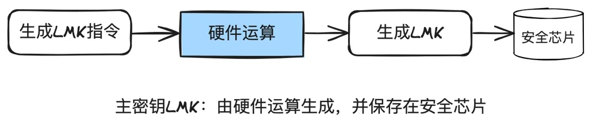

主密钥作用：加密工作密钥，用于保存数据库.

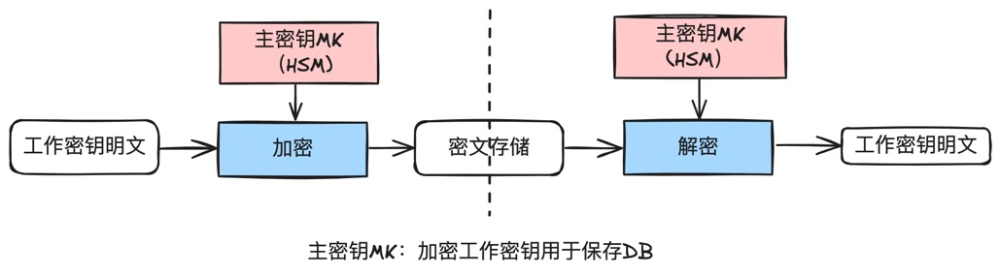

工作密钥：用于加密业务明文数据。

<!-- PDF 第 201 页；原书第 198 页 -->

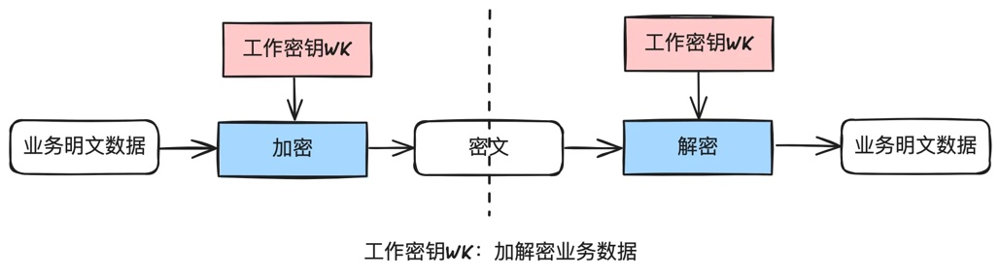

区域主密钥：加密工作密钥用于传输。

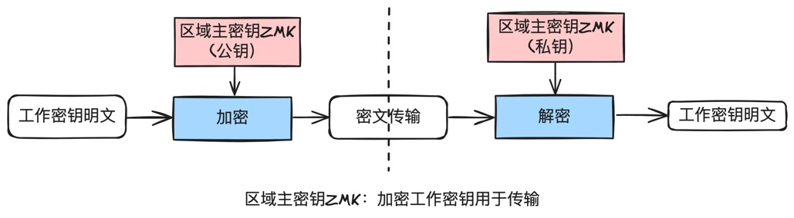

密钥加密密钥：加密工作密钥用于缓存，加速本地运算。

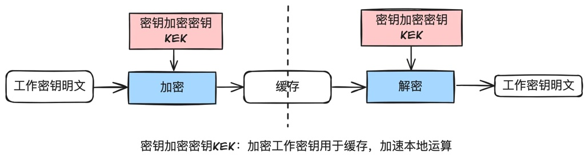

### 11.11.2 密钥管理与统一加解密系统架构

简化版本系统架构：

<!-- PDF 第 202 页；原书第 199 页 -->

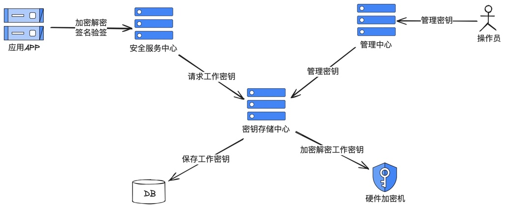

在密钥管理系统中，因为考虑分布式与安全网络隔离的问题，所以需要分开设置三个子系统：

1. 安全服务中心：提供加密、解密、签名、验签、访问控制等基础能力。可水平扩展。

2. 密钥存储中心：负责密钥的存储、轮换等基础能力。独立网络隔离区。

3. 管理中心：提供后台管理能力，比如配置密钥、授权密钥给应用，对接硬件加密机(HSM)等。

4. 硬件加密机(HSM)：负责保存主密钥，并对工作密钥进行加密。

在下面的部署架构中，我们回看这个图，就明白为什么要切成三个。

另外，里面的子功能设计，可以参考后面的“设计细节”章节。

详细功能的系统架构：

<!-- PDF 第 203 页；原书第 200 页 -->

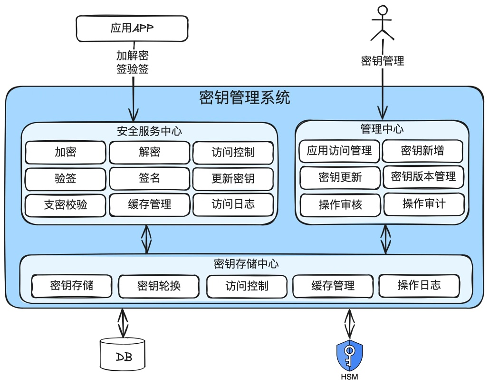

#### 部署架构

在构建密钥管理系统(KMS)时，部署架构的设计直接影响到系统的可用性、扩展性和安全性。对于支付系统而言，必须考虑到业务的高可用性和灵活性需求，采用分布式部署架构是一种必然的选择。

#### 核心设计原则

1. 高可用性：通过在多个数据中心分布式部署密钥管理系统的实例，即使某个数据中心发生故障，其他实例仍然可以提供服务，从而保证系统的高可用性。

2. 灵活扩展性：随着业务量的增长，系统可以通过增加节点的方式横向扩展，灵活应对业务需求的变化。

3. 数据一致性：采用先进的数据同步技术，确保各节点间密钥信息的一致性，避免数据不一致导致的安全问题。

<!-- PDF 第 204 页；原书第 201 页 -->

4. 安全隔离：在不同的物理位置部署密钥管理服务，可实现安全隔离，降低单点攻击的风险。

5. 灾难恢复：通过地理上分散的部署，结合有效的备份和恢复策略，确保在发生灾难时可以快速恢复服务。

#### 分布式部署架构

1. 中心管理节点：负责整个密钥管理系统的中心控制，包括策略制定、访问控制、审计日志等核心管理功能。

2. 区域管理节点：在各个地理区域部署，负责处理该区域内的密钥请求，实现数据处理的地理近邻性，优化响应时间。

3. 数据同步机制：确保所有区域管理节点间的数据一致性和实时性，采用可靠的数据同步技术，如同步复制或异步复制。

4. 安全网络：所有节点通过安全的网络连接，确保数据传输的安全性和加密，防止数据在传输过程中被截获或篡改。

下面是一个部署简图：

<!-- PDF 第 205 页；原书第 202 页 -->

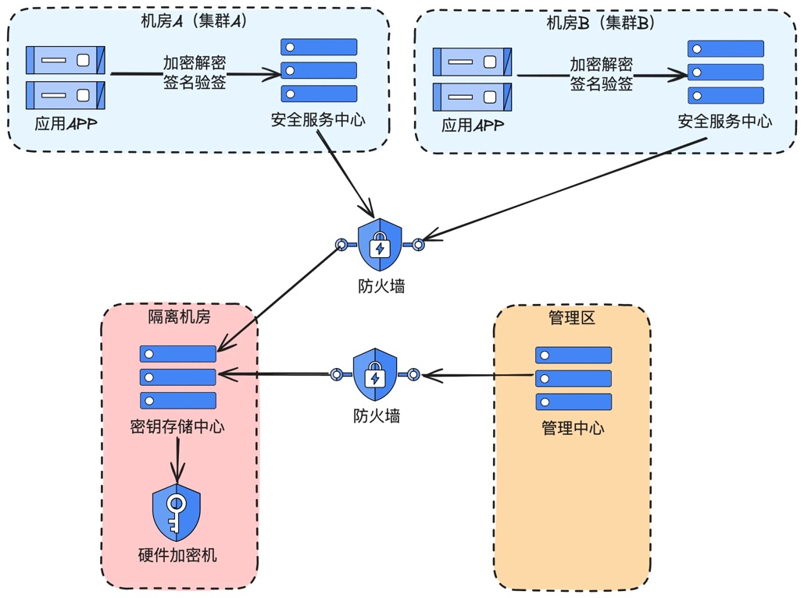

#### 核心要点：

1. 密钥存储中心和硬件加密机部署在隔离区。

2. 管理中心部署在管理区或者隔离机房，建议参考安全团队的建议。

3. 安全服务中心部署在各应该APP所在机房，就近提供加解密、签验签等运算服务。可水平扩展。

4. 安全服务中心有本地缓存，在隔离机房短时间内无法连接时，仍然可以正常提供服务。

### 11.11.3 密钥管理与统一加解密系统详细设计

数据流图

<!-- PDF 第 206 页；原书第 203 页 -->

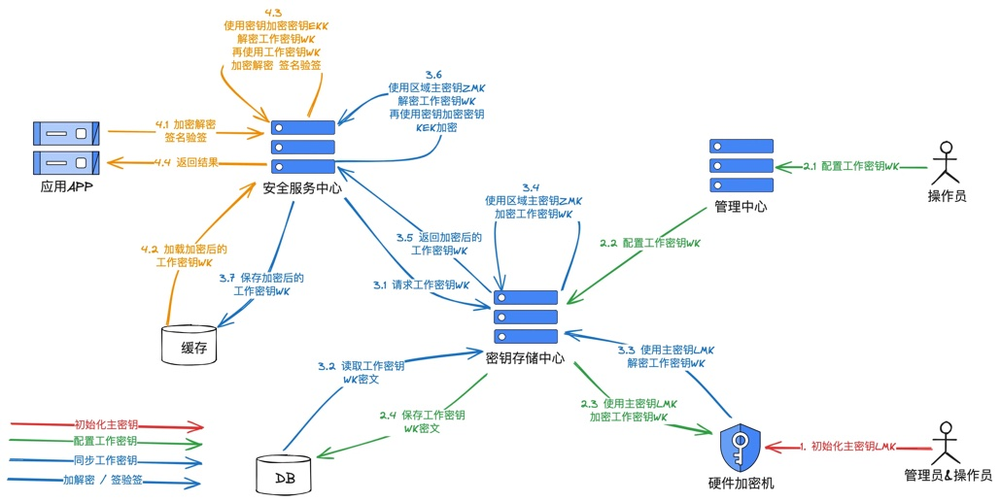

核心有4个步骤：

1. 初始化主密钥。

2. 配置工作密钥。

3. 同步工作密钥到各节点的安全服务中心。

4. 实际执行加密解密、签名验签服务。

#### 密钥分级设计

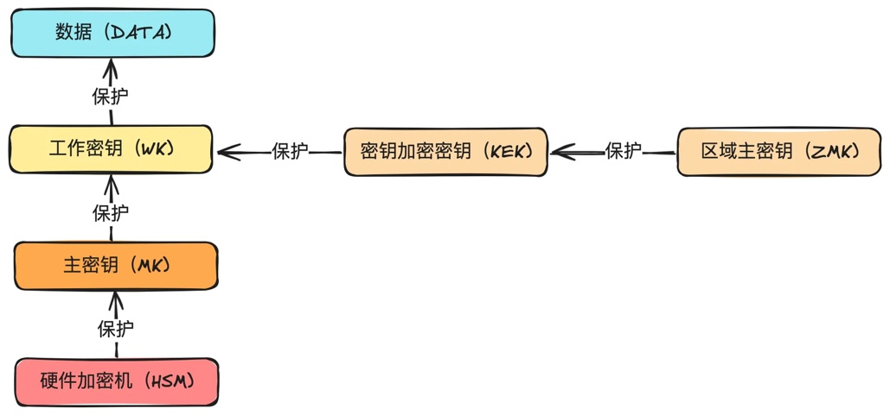

<!-- PDF 第 207 页；原书第 204 页 -->

在构建支付系统的密钥管理系统(KMS)时，密钥分级设计是确保密钥安全性的基础。通过将密钥分为不同的级别并应用不同的管理和保护策略，可以有效地降低密钥泄露的风险，提升系统的安全性。以下是密钥分级设计的核心要素：

#### 1. 主密钥/本地主密钥(Master Key / Local Master Key):

级别：最高级别，作为其他密钥的根密钥。

保护：存储于硬件安全模块(HSM)中，采用物理和逻辑双重保护机制，确保其安全性。

用途：用于加密和解密工作密钥，不直接参与业务数据的加解密。

管理：由最高权限的安全管理员进行管理，严格控制访问和操作。维护时一般需要3名管理员+1名操作员同时在场，管理员和操作员都有自己的物理管理卡和独立操作密码，全部验证通过后才能操作。

#### 2. 工作密钥(Working Key)：

级别：次级别，用于实际的业务数据加解密操作。

保护：由主密钥加密保护，存储在加密数据库或安全配置文件中。

用途：直接用于加密和解密业务数据，例如用户信息、交易数据等。

管理：支持自动轮换和更新，减少手动干预，提高管理效率和安全性。

需要说明的是，严格意义上说，区域主密钥也是保存在硬件加密机中的。但在实现时，如果在区域节点不想部署硬件加密机，就可以生成公私钥对，把私钥放在区域节点，公钥放在密钥存储中

#### 密钥分级设计的优势：

● 分层保护：通过对密钥进行分级管理，构建了多层防御体系，即便低级别密钥被泄露，也不会直接威胁到系统的根本安全。

● 灵活管理：主密钥和工作密钥的分离，使得密钥轮换和更新更加灵活高效，同时减少了主密钥的使用频率，降低了安全风险。

●性能与安全的平衡：通过在不同层级应用不同的密钥，可以在保证安全的前提下，优化系统性能，特别是对于高频率的业务数据加解密操作。因为硬件加密机的运算效率有限，且采购及运维成本高昂，不便于水平扩展。

密钥分级设计是构建高安全性支付系统不可或缺的一环，它为密钥的安全管理提供了一套完整的框架。

<!-- PDF 第 208 页；原书第 205 页 -->

#### 访问控制

在构建支付系统的密钥管理系统(KMS)中，实现严格的访问控制机制是保障系统安全的关键。访问控制的主要目的是确保只有授权用户或应用才能访问和操作密钥，同时保护密钥不被非法导出或滥用。以下是访问控制的三个核心部分：

#### 1. 用户分级管理

●用户角色和权限：系统应定义不同的用户角色，每种角色具有不同的权限级别。例如，系统管理员拥有最高权限，可以管理用户和密钥策略；安全管理员负责主密钥的管理，包括生成、备份和恢复等操作；普通用户只能使用工作密钥进行日常的加解密操作。

●主密钥操作的物理安全：主密钥的操作，如生成、备份和恢复，只能由特定的安全管理员在物理安全的环境下通过硬件安全模块(HSM)直接操作。这样的操作需记录详细的审计日志，并且在执行关键操作时需要多人同时在场。

●工作密钥的审批流程：导出工作密钥或进行敏感操作时，需要通过多层审批流程。审批流程中涉及的每一步都应有清晰的操作记录和日志，以便于事后审计和追踪。

#### 2. 密钥与应用的绑定

●应用级访问控制：每个密钥应指定可访问的应用列表。只有列表中的应用才能使用对应的密钥进行加解密或签名验签操作。这样可以有效防止密钥被非授权应用使用，增强密钥的安全性。

●密钥使用策略：对于每个密钥，可以定义详细的使用策略，包括使用的时间窗口、IP地址范围、访问频率等。这些策略可以在KMS中配置，并由系统强制执行。但因为主要提供内网应用使用，一般很少这么限制。

#### 3. 加密解密和签名验签的集中处理

●密钥的集中处理：所有的加密解密和签名验签操作都应通过密钥管理系统集中完成。通过API调用或服务接口的形式提供给外部应用，避免直接暴露密钥。

●工作密钥的保护：工作密钥应始终存储在加密形式，且不能被导出或直接读取。所有密钥操作都在KMS内部完成，确保密钥的安全。

通过这种分层的访问控制机制，结合用户分级管理、密钥与应用的绑定以及加密解密和签名验签的集中管理，可以有效地保护密钥不被未授权访问和使用，从而为支付系统提供坚实的安全保障。

<!-- PDF 第 209 页；原书第 206 页 -->

#### 工作密钥版本管理

在密钥管理系统(KMS）中，工作密钥版本管理是一个关键的安全措施，主要通过定时轮换机制来增强系统的安全性。此机制确保即使旧密钥被泄露，攻击者也无法利用它来破解过去或未来的加密数据。以下是工作密钥版本管理的主要方面：

#### 定义密钥版本

● 版本命名：为每个工作密钥定义唯一的版本标识符，通常包括密钥ID和版本号。

●版本属性：记录每个版本的关键属性，如创建时间、启用时间、过期时间和状态（激活、过期、废弃）。

#### 定时轮换机制

●自动轮换：通过预设的策略自动轮换工作密钥。例如，根据最佳实践或合规要求，可以设置每三个月自动生成新的工作密钥版本并切换至新版本。

● 轮换通知：在轮换发生前，系统应发送通知给相关的系统管理员和应用，确保它们准备好迁移到新的密钥版本。

●平滑过渡：在新旧版本切换期间，保持旧版本的可用性一段时间，以便完成未处理的加密操作，然后逐步淘汰旧版本。

#### 版本回滚

● 应急回滚：在发现新版本密钥存在问题时，系统应支持快速回滚至前一个稳定版本，以保障业务连续性。

#### 密钥版本跟踪与审计

●版本历史记录：维护每个工作密钥的版本历史记录，包括每个版本的使用情况和更换原因。

●审计日志：记录所有密钥版本操作的详细审计日志，包括版本创建、启用、废弃和删除等，以支持安全审计和合规性检查。

#### 一个简单的实现方案

对于内部数据，直接在密文的前面加上5位数的版本号。这样数据和密钥版本就形成一个绑定关系。

<!-- PDF 第 210 页；原书第 207 页 -->

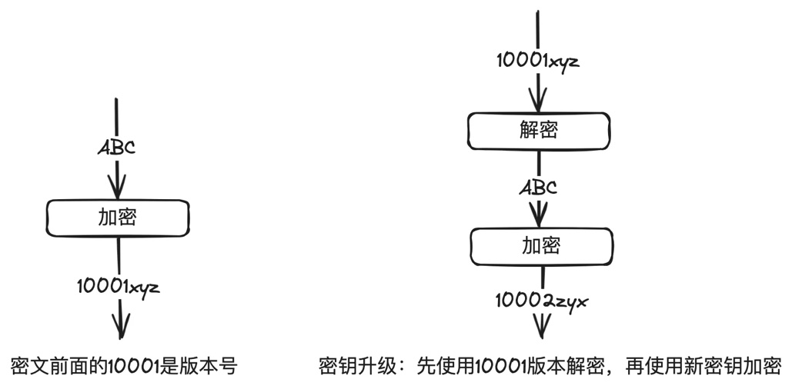

通过实施工作密钥版本管理和定时轮换机制，KMS能够有效降低密钥泄露的风险，提升支付系统的整体安全性。此外，该机制还有助于满足行业安全标准和合规要求，如PCI-DSS等，进一步保护敏感数据的安全。

#### 隔离部署

隔离部署是加强支付系统密钥管理系统(KMS)安全性的一个重要策略，它通过物理或逻辑手段，将敏感组件和操作环境与其他系统部分分离，从而减少潜在的安全威胁和风险。以下是实施隔离部署的关键考虑因素：

#### 物理隔离

●硬件安全模块(HSM)部署：将存储和管理主密钥的硬件安全模块(HSM)物理隔离在受控的安全环境中，例如专用的安全机房。这样做不仅提高了主密钥的安全性，而且防止了未经授权的物理访问。

●独立的密钥管理网络：建立一个独立的网络环境专门用于密钥管理操作，与生产网络和办公网络隔离，避免潜在的跨网络攻击。

#### 网络隔离

●防火墙和网络分段：使用防火墙和网络分段技术，将密钥管理系统与外部网络及其他内部系统分离，防止潜在的网络攻击和数据泄露。

<!-- PDF 第 211 页；原书第 208 页 -->

● 加密通信：确保所有进出密钥管理系统的网络通信都采用加密协议，如TLS，保护数据传输的安全性。

#### 数据隔离

● 敏感数据加密：确保存储和传输的所有敏感数据（包括密钥和加密的业务数据）都经过加密，即使数据被非法访问，也无法被解读。

●备份与恢复策略：对密钥和关键配置数据实施定期备份，并将备份数据存储在与生产环境隔离的安全位置，同时确保快速恢复能力以应对可能的灾难事件。

通过实施隔离部署策略，KMS能够有效地降低安全威胁，提高支付系统的整体安全性和稳定性。隔离部署不仅有助于防御外部攻击，也能减轻内部错误或滥用所带来的风险。

#### 性能设计

在密钥管理系统(KMS）的设计中，性能是一个不可忽视的关键要素。一个高性能的KMS能够保证在密钥生成、存取、更新以及加密服务的过程中，响应迅速，满足支付系统等高并发环境下的需求。以下是构成KMS性能设计的主要策略：

#### 缓存机制

● 密钥缓存：对频繁访问的工作密钥和会话密钥实施缓存，减少对密钥存储库的直接访问，也减少对硬件加密机的访问，提高响应速度。使用合适的缓存策略(如LRU算法）来管理缓存密钥的生命周期，确保密钥的即时更新和过期密钥的清除。同时

#### 负载均衡与水平扩展

● 请求分发：采用负载均衡技术在多个KMS节点之间分发请求，平衡系统负载，提高处理能力。一般的分布式部署架构都支持。

● 水平扩展：因为工作密钥被缓存在本地运算节点，所以安全服务中心可以水平扩展，而不受限于硬件加密机。

#### 并行处理

● 多线程操作：加解密等这些操作是运算优先型业务，应减少线程数，以减少CPU的切换损耗。

<!-- PDF 第 212 页；原书第 209 页 -->

通过上述性能设计策略，KMS能够满足高并发、低延迟的性能要求。以前实测下来，单机AES加解密能到2万左右的QPS。

#### 容灾设计

在构建密钥管理系统(KMS）时，容灾设计是确保系统在面对硬件故障、软件错误、人为操作失误或自然灾害等情况下仍能保持业务连续性和数据完整性的关键。以下是容灾设计的核心要素：

#### 数据复制与同步

●跨地域复制：为了保证数据的高可用性和持久性，重要数据（包括密钥材料、配置信息等）应跨多个地域进行复制。使用实时数据复制技术确保各地域数据的一致性。

●异地备份：定期将关键数据异地备份，以防单点故障导致的数据丢失。备份数据应加密存储，以保护其安全性。

#### 自动故障转移

● 故障检测与自动转移：实现系统的自动故障检测机制，一旦检测到服务异常或系统故障，能够自动将请求转移到备用系统或节点，确保服务不间断。

● 负载均衡：通过负载均衡技术分配请求到健康的服务节点，提高系统整体的稳定性和可用性。

#### 系统冗余设计

● 冗余硬件：在关键组件上采用冗余设计，比如同一机房需要部署多台硬件加密机(HSM)，以减少单点故障的风险。

●服务冗余：部署冗余的服务实例，包括数据库、应用服务器等，确保任何单一实例的故障都不会影响到整个系统的运行。这也是在线服务部署的常规动作。

#### 容灾演练

●定期演练：定期进行容灾演练，验证和改进容灾计划的有效性，确保在真正的灾难发生时能够快速、有效地恢复服务。

● 演练反馈：对容灾演练的结果进行分析，并根据反馈优化容灾计划和技术方案。

<!-- PDF 第 213 页；原书第 210 页 -->

通过上述容灾设计措施，KMS能够在面对各种不可预测的故障和灾害时，保证密钥服务的持续可用性和数据的完整性，为支付系统等关键业务提供坚实的安全基础。

### 11.11.4 密钥管理常见误区

在工作和同事的交流中，发现对于密钥的保存和使用有几个常见误区：

1. 硬编码密钥：在代码中硬编码密钥，或者将密钥以明文形式存储在配置文件中。这使得密钥容易被未授权的人访问，尤其是在源代码公开或配置文件被泄露的情况下。

2. 密钥复用：为了简化管理，使用同一个密钥进行多种不同的加密任务。这种做法大大增加了密钥被破解的风险，一旦密钥被破解，所有使用该密钥加密的数据都会受到威胁。

3. 忽视密钥的生命周期管理：一旦生成密钥，就不再更换或更新。不定期轮换密钥会增加密钥被破解的风险，且一旦密钥泄露，长期内的数据都将不再安全。

4. 不适当的密钥存储：将密钥存储在不安全的环境中，例如普通的数据库或文件系统。未经加密保护的密钥容易被窃取，尤其是在遭受数据泄露或系统入侵时。

5. 缺乏合适的访问控制：对密钥访问权限控制不严，未实施基于角色的访问控制(RBAC)。这可能导致未授权用户访问和使用密钥，增加内部威胁的风险。

这里面部分原因是安全的专业知识不够，或者图一时方便，或者条件不具备(比如无法采购硬件加密机，或研发资源不足），但不无论如何，密钥的保存和使用是一整套完整的策略和落地，需要公司中高层重视才有完整落地的可能性。

### 11.11.5 密钥管理最佳实践

#### 实施步骤

总体而言，文中所描述方案设计涉及的知识储备及研发资源都是比较高的，对于一些中小公司来，建议分步骤实施：

1. 明确密钥管理和使用的规范。

2. 建设一个基础的密钥管理系统，统一管理和使用密钥。

3. 对密钥管理系统进行网络和安全加固，比如独立网段，访问控制，硬件加密机等。

#### 用户密码管理

所有互联网公司都有用户密码管理，比如登录密码，支付类公司还有独立的支付密码。经常有新闻报道说一些公司的用户密码被泄露造成安全事故，那我们应该如何进行用户密码的传输和存储

<!-- PDF 第 214 页；原书第 211 页 -->

设计呢?

用户密码设计需要遵守以下几个准则：

1. 前端需要非对称加密后传给后端。

2. 后端需要解密后，再加上盐值重新对称加密后保存到数据库。

为什么使用用户盐值？因为每个用户的盐值都不一样，这样即使两个用户原始密码是一样的，加密出来的密文也是不一样的。

为什么前端需要非对称加密？因为公钥是可以公开的。

为什么后端需要对称加密用户的密码，而不是使用散列？因为可以做密钥轮换。如果不考虑密钥轮换，可以使用SHA256散列算法。

为什么使用硬件加密机？因为更安全，没有条件的情况下，那就使用SHA256散列算法更安全。

这里给一个简单的实现参考。

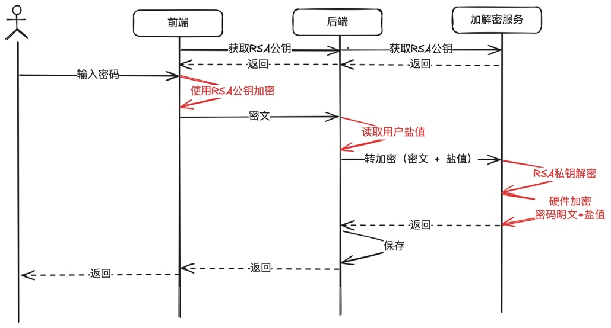

#### 说明：

1. 首先由加解密服务生成RSA公钥，给到前端。

<!-- PDF 第 215 页；原书第 212 页 -->

2. 用户输入的密码，经RSA公钥加密后转到后端，后端读取用户盐值，一起传给加解密服务进行转加密。

3. 加解密服务先使用RSA私钥解密，然后重新把密码明文和盐值对称加密返回(或使用SHA256散列）。

4. 后端保存密码密文到数据库。

### 11.11.6 密钥管理平台小结

正如前面说的“密钥的价值等于数据的价值”，如果你的数据价值无可估量，那么你的密钥价值也是无可估量的。无论对于支付系统还是非支付类系统，密钥管理是同样重要的。构建一个高效、安全且可靠的密钥管理系统(KMS)不但是支付系统设计中的核心任务，也是每家互联网公司开展业务的核心任务，只是有很多公司没有意识到这点。

我们深入探讨了金融级密钥管理系统的基本概念、设计原则、以及核心的架构方案，旨在为读者提供一个全面、深入的视角来理解KMS在支付系统中的关键作用及如何设计与实现。

此外，我们还讨论了如何通过密钥的分级管理、访问控制、工作密钥版本管理、隔离部署、性能设计和容灾设计等细节设计，确保密钥的安全性和系统的稳定性。

整个设计虽然有点复杂，尤其是对没有安全经验的研发同学来说，但是在支付的世界里，安全是最基础的要求。

## 11.4 小结

在数字支付世界里，需要众多安全措施一起保护用户和平台的资产。因篇幅关系，没有深入介绍背后的数学知识，有兴趣的读者可参考专业文献。且对于我们大部分人来说，不需要掌握密码学专家或专业安全工程师那么多知识，文章中介绍的知识点已经足以应对日常的研发工作。

如果一定要浓缩一下精华，只需要记住下面6点：

1. 大数据块加解密：使用对称加密算法AES，密钥长度256比特，简称AES256。

2. 小数据块及签名验签：使用非对称加密算法RSA，密钥长度2048，简称RSA2048。

3. 摘要算法：使用SHA256。且摘要算法不推荐用于需要签名验签的场景。

4. 个人登录/支付密码：一定要加盐值进行混淆。

5. 网络传输和文件传输：需要使用HTTPS和SFP提高数据传输安全性，文件额外考虑使用PGP加密。

<!-- PDF 第 216 页；原书第 213 页 -->

6. 整体的安全性，需要同时用到对称加密、非对称加密，数字签名，数字证书等多种技术手段。
