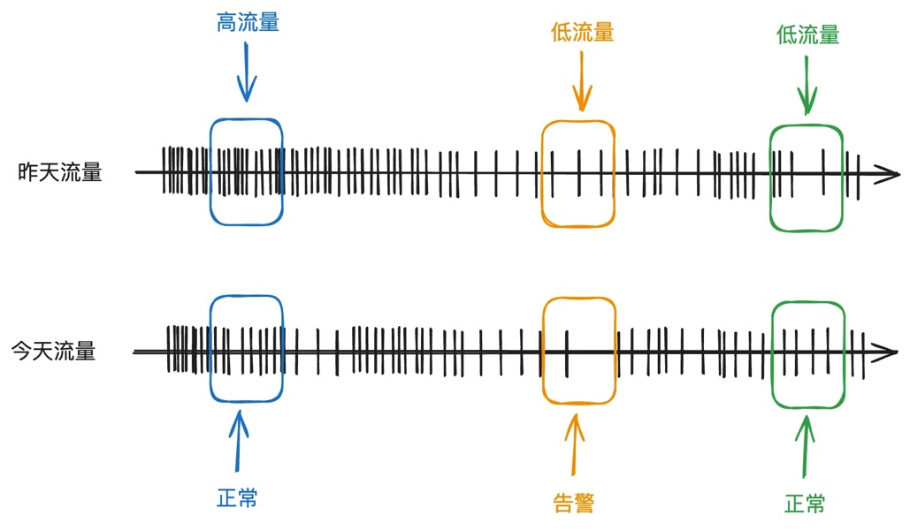
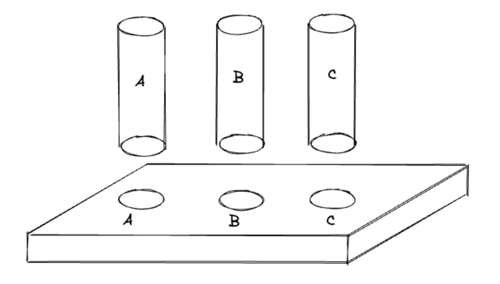
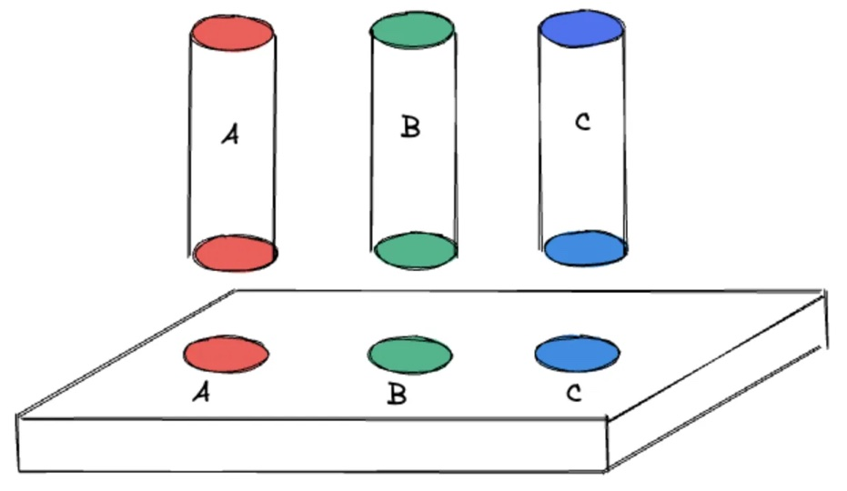
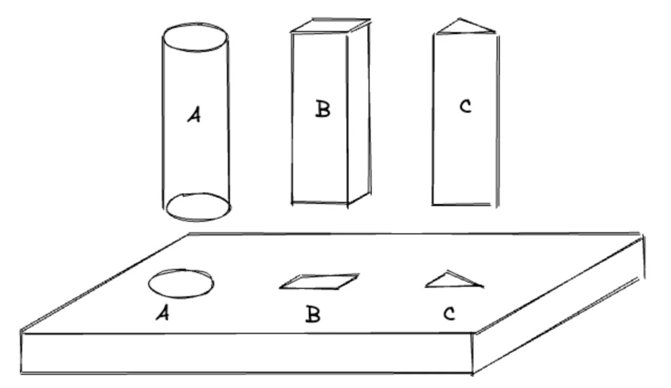
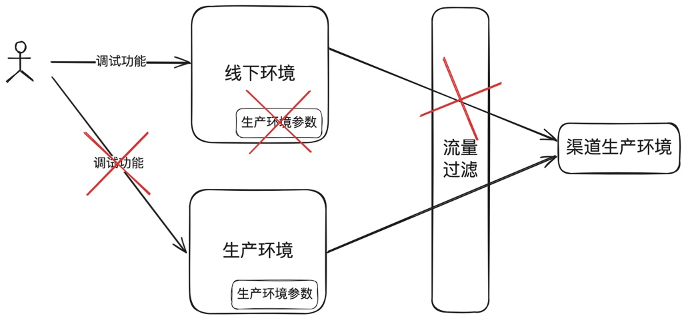
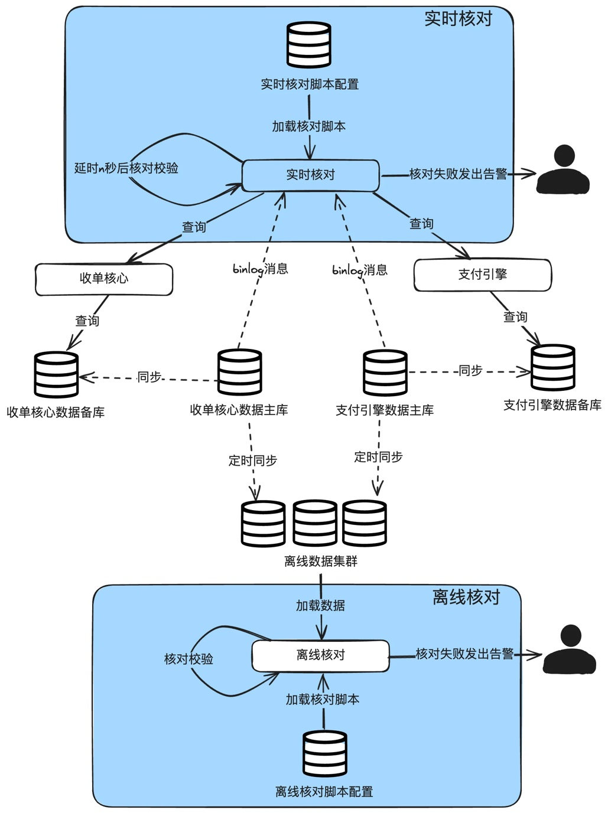
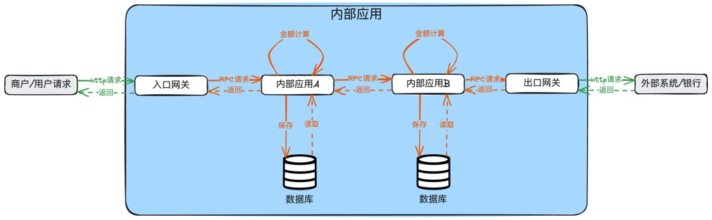
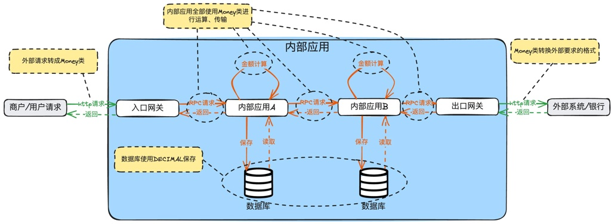

# 第12章 技术风险与资损防控

> 来源：《图解支付系统设计与实现》V_0.1.0，隐墨星辰著。PDF 第 216–237 页。正文经 MinerU OCR 转换，原图保留。

<!-- PDF 第 216 页；原书第 213 页 -->

做支付如果还没有碰到过资损，那就是做得时间还不够久。

当交易量足够大时，一个微小的问题如果不扼杀在摇篮里，可能会迅速扩大，进而影响大批量的用户，很容易引起投诉甚至通过网络舆论效应，引起监管部门介入。

本章主要介绍金融级支付系统的技术风险和资损防控的一些核心概念，场景、应对手段，以及一些最佳实践，请清楚如何识别风险，快速发现风险，以及处置。

资损也是技术风险的一种，只是对于支付行业而言，资损是一种非常高的风险，所以经常单独拿出来说。

此外，风险有很多种，比如流动性风险是财务或客资的范围，政策风险是经营的范围，合规风险是法务的范围，而技术团队则重点关注的是技术风险。

那什么是技术风险呢？不同的公司都有不同的定义，但回到事物的本质，技术风险是可以简单地认为是由于技术实施不当或技术故障等原因导致的损失或影响的风险。比如大促会有突发流量，不做扩容也不做限流，或者扩容限流不足，导致系统被打挂，那就是技术实施不当；新发布的功能引入了一个BUG导致用户资损，就是技术故障。

## 12.1 识别风险来源

要想防风险，首先就是先识别风险来源，识别出风险的源头，我们才能想出应对措施。

一般有静态分析和动态分析两种思路。

静态分析：也就是全链路分析。分析出所有的强依赖和弱依赖，并做不同的运维保障措施。

所谓强依赖就是依赖的这个系统挂了，业务就无法往下处理，也就是经常说的主链路。比如收单域挂了，支付业务肯定就挂。弱依赖就是非主链路上的系统或应用，可以临时降级掉，调用报错也不会影响主链路的运行，同时尽量做到异步化。比如高峰期间的风控，为了保交易量，允许一定的风控容错，也就是调用风控抛异常后，当成正常往下执行。

动态分析：分析各种变更可能导致的风险。一般分为主动变更和被动变更。

主动变更包括：新业务开量，新增或修改代码逻辑，新增或修改配置等。

<!-- PDF 第 217 页；原书第 214 页 -->

被动变更包括：大促导致的流量突增，依赖的第三方不可用，机房停电等。

## 12.2 风险应对流程

在分析出风险后，就需要有所行动，来应对这些风险。一般分下面几个步骤：

1.评估风险：引入了哪些变更或变化，这些变更或变化可能带来什么样的风险。比如重构了一个新应用，做切流，那这个新系统的稳定性，对老业务的兼容性等都需要评估。又或者大促流量从日常峰值200tps会增长到5000tps，对集群的压力。

2. 风险排序：风险总是无处不在，我们需要把各种风险进行排序，先解决优先级高的风险。

3. 制定策略：根据不同的风险制定不同的策略。比如大促，应对的策略就是评估流量，压测，扩容，限流等。如果是评估出新系统对老业务不兼容，那就修改技术方案或产品方案。

4. 制定预案：风险无法完全杜绝，如果万一真的出现怎么办？这个时候就需要有一个标准处理流程，也称为SOP或预案。这些SOP或预案针对可能的场景，制定不同的处理流程，真的问题时，可以一步一步去处理掉，把影响或损失降到最低。

5. 执行：落地策略。比如一个新业务上线，要把监控核对部署到位，在发布过程中，观察到位，真的出现问题时，按SOP处置到位。

## 12.3 滑动时间窗口算法在渠道监控中的应用

自从断直连后，第三方支付在中国可以接的渠道不多，且中国的渠道长期受双十一大促的洗礼，稳定性非常强悍。但是跨境场景下就没有这么幸运，大部分国家的IT基础设施较为落后，在各国接的大部分渠道的质量也都参差不齐，时不时都就会出现因为网络、渠道侧运维导致的渠道宕机。

传统的监控方法通常采用固定阈值的策略，这种方法在面对不同渠道和不同时间段的流量波动时，往往难以平衡告警的准确性和及时性，且监控规则的数量为M\*N的关系(M：渠道数量，N监控场景）。

为了解决这一问题，可以采用基于滑动时间窗口算法的监控方案。

### 滑动时间窗口监控的原理

<!-- PDF 第 218 页；原书第 215 页 -->



滑动时间窗口算法通过计算历史数据和当前数据的变化，动态调整告警阈值。这种方法通过设定不同时间窗口和阈值来判断流量是否异常。例如，在高流量时段，可以设置较短的时间窗口和较高的阈值，以便快速发现流量下降的情况；而在低流量时段，则可以调整为较长的时间窗口和较低的阈值，以降低噪音。

### 时间窗口监控的具体应用

在实际应用中，我们可以为不同的流量场景设置不同的时间窗口和阈值。比如：每分钟请求量大于200，为高流量，否则为低流量。(这个值只是参考值，需要根据自己的业务量进行配置）。

这样，监控系统就能够自动适应流量的变化，无需人工干预。例如，在渠道超过200时，系统会自动调整为高流量告警模式；而在流量减少到200或以下时，系统则会自动切换到低流量告警模式。

### 技术实现

为了实现时间窗口监控，通常需要结合时序数据库的使用。时序数据库能够高效地存储和查询时间序列数据，这对于处理大量的监控数据至关重要。通过时序数据库，我们可以快速获取指定时间窗口内的数据，并进行分析和判断。

在数据量极大的情况下，我们还可以引入流式计算引擎，如Blink，来处理和计算中间结果，比如每秒有100条，只需要插入一条数据就行，而不是插入100条。这样，我们可以减少时序数据

<!-- PDF 第 219 页；原书第 216 页 -->

库的压力，同时保证数据处理的实时性和准确性。

### 滑动时间窗口算法的重要性

滑动时间窗口算法还有很多其它场景的应用。比如在风控模块中，时间滑动窗口技术可以用来检测用户的风险行为，如登录异常、交易金额异常、交易地点异常和交易行为异常等。核心实现就是在指定时间窗口内，某种行为总结远超过了历史上相同窗口的数值。

### 小结

滑动时间窗口算法可以帮助我们构建一个更加智能和自适应的渠道监控系统，既能提高告警的准确性，又能减少误报和漏报，从而能提升系统的稳定性和用户体验。

## 12.4 防呆设计在资损防控中的应用

从一件真实的资损案例入手介绍一个简单而又行之有效的防错策略：防呆设计在支付系统中的实践。

### 一个线上事故

曾经处理过一个很典型的资损事件，大致如下：

一个研发同学在线下测试环境做测试，为图方便，直接从生产捞取一段日志的参数作为请求参数，不幸的是，线下测试环境竟然配置了外部第三方的生产环境参数，导致真实资金被错误地转入个人账户，造成了平台的资金损失。尽管损失金额不大，但由于操作不规范，事件的性质非常严重。

这类事件出来后，通常会发起所谓的复盘，然后给出一堆的整改措施，流程规范、管理制度、设计优化等。我们今天抛开那些大而全（或者华而不实）的整改措施，单单聊聊如何通过“防呆设计”来预防此类事件的发生。

### 防呆设计定义及在工业界的应用

“防呆设计”（日语：ポ力ヨケ poka yoke)是一种预防性设计策略，目的是通过限制方法减少错误的发生。用户在无需额外注意力、经验或专业知识的情况下，也能准确无误地完成操作。

<!-- PDF 第 220 页；原书第 217 页 -->

这个概念起源于日本，被广泛应用于丰田汽车的生产过程中，随着时间的推移，已成为全球范围内广泛采用的设计策略。

在工业设计中，防呆设计的例子比比皆是。例如，USB接口的设计确保了只有正确方向才能插入，而Type-C接口则进一步简化，支持双面插入。

第一版：使用字母标识，容易出错。



第二版：使用颜色标识，减少出错。

<!-- PDF 第 221 页；原书第 218 页 -->



第三版（防呆）：不同形状只能插到不同的位置，想错都错不了。



针对事故的防呆设计措施

<!-- PDF 第 222 页；原书第 219 页 -->



再说回到开头所说的故障，我们应该使用“防呆”设计的思想，彻底阻断使用者犯错的可能性。具体怎么做呢？如下：

1.环境隔离：确保所有测试环境均配置为外部渠道的测试参数，防止测试操作影响真实交易环境。

2. 流量控制中间件：在系统中集成一个流量控制中间件，维护一个外部渠道的生产环境白名单。通过中间件筛选请求来源，若来源于测试环境，则自动阻断请求。

3. 禁用线上环境的直接操作：关闭线上环境调试、手动直接调用能力。

4. 增加操作审核：对线上环境的操作引入审核机制，由具备风险控制能力的团队成员负责审核。

通过实施上述防呆措施，即使是经验不足的新员工也能避免类似的资损风险。防呆设计并非只是解决问题的手段，而是一种预防性策略，旨在通过系统设计减少人为错误的可能性。

### 支付系统中防呆设计的应用

在支付行业中，防呆设计随处可见，举几个例子：

1. 拆分输入框：信用卡绑卡页面将有效期拆分为两个输入框，分别用于输入月份和年份，从而减少输入错误。把用户的First Name和Last Name分开两个输入框。(我还真见过有支付平台提供的First Name和Last Name使用一个输入框，导致信用卡绑卡成功率持续很低)。

2. 自动超时退出：在线支付系统在用户一段时间内无操作时，会自动退出，以防止未经授权的使用

3. 限制尝试次数：支付系统会限制密码或验证码输入错误的次数，超过限制会暂时锁定账户，以

<!-- PDF 第 223 页；原书第 220 页 -->

防试图破解。

4. 防止重复提交：为防止用户多次点击造成重复交易，支付系统通常会在首次点击后禁用提交按钮

5. 可视化的交易流程：针对新用户第一次使用时给出指引页面，通过图形化界面展示交易流程，帮助用户轻松理解每一步操作。

从业多年，见过太多的线上故障，得到一个朴素的道理：“人都是不可靠的，如果能通过系统解决的，就一定不要依赖人或流程来解决。”多引入一些防呆设计，让再“呆笨”的人都没有出错的可能性，那么系统就是健壮的，也就没有那么多的线上应急和复盘。

## 12.5 实时核对与离线核对

资损防控有个兜底的能力，就是对账，两个应用之间核对双方的单号、状态、金额等关键数据是否对得上。

所有的支付平台都会和渠道进行对账，做得好的就是三层对账，这块可以参考前面“账务模块清结算”章节里面的“渠道三层对账体系”。

同时，支付平台还会有内部系统之间的两两核对，这种核对主要是信息流层面的核对，主要核对状态、币种、金额等关键数据的一致性。

再细分，还可以拆成离线核对和实时核对。离线核对一般就是把生产数据库的数据定时清洗到离线库(一般还可以分为天表和小时表）。实时核对一般就是监听数据库的binlog，当数据有变动时，延时几秒后请求双方系统的查询接口，查到数据后进行核对。

<!-- PDF 第 224 页；原书第 221 页 -->



<!-- PDF 第 225 页；原书第 222 页 -->

## 12.6 金额处理规范

小本节主要讲清楚：交易系统（电商、支付等）金额处理常见资损场景，如何构建一个适合公司业务的Money类，应用Money的最佳实践，包括计算、存储、传输，目的是在金额处理上减少资损风险。

曾经有公众号读者私聊我问了几个问题，如果你也有相同的困惑，建议认真看看本章内容。他的问题如下：

1.“做国际支付，不同的币种的最小单位不同，比如人民币是分，日元是元，那数据库里面应该应该保存整数还是小数？”

2.“从哪里获取到这个币种的最小单位是多少？”

3.“我赞成你说的不应该直接对金额进行加减乘除操作，但我还是不知道怎么做，怎样才能落地呢？”

以前在公司时，也有兄弟部门因为金额处理不当，导致了好几万的资损故障，然后过来问我金额处理的最佳实践，当时也给他们做过一次相关分享。

### 12.6.1 金额处理场景



从上图可以看到，对于交易系统而言，一共有下面几种场景需要做金额处理：

1. 接收外部请求。比如商户下单100元，或用户转账1000元。

2. 内部应用处理。比如计算手续费等。

3. 内部应用保存到数据库，从数据库读取。

4. 内部应用之间传输。

5. 发送给外部系统或银行渠道。比如向银行请求扣款100元。

<!-- PDF 第 226 页；原书第 223 页 -->

### 12.6.2 金额计算常见误区及严重后果

对于研发经验不足的团队而言，经常会犯以下几种错误：

1. 没有定义统一的Money类，各系统间使用BigDecimal、double、long等数据类型进行金额处理及存储。

2. 定义了统一的Money类，但是写代码时不严格遵守，仍然有些代码使用BigDecimal、double、long等数据类型进行金额处理。

3. 手动对金额进行加、减、乘、除运算，单位（元与分）换算。

带来的后果，通常就是资金损失，再细化一下，最常见的情况有下面3种：

1. 手动做单位换算导致金额被放大或缩小100倍。

a. 比如读者规定传的是元，但是其中有位同学忘记了，以为传的是分，外部渠道要求传元，就手动乘以100。或者反过来。

b. 还有一种情况，部分币种比如日元最小单元就是元，假如系统约定传的是分，外部渠道要求传元，就可能在网关处理时手动乘以100。

2. 1分钱归属问题。比如结算给商家，或计算手续费时，碰到除不尽时，使用四舍五入，还是向零舍入，还是银行家舍入？这取决于财务策略。

3. 精度丢失。在大金额时，double有可能会有精度丢失问题。

### 12.6.3 金额处理原则



<!-- PDF 第 227 页；原书第 224 页 -->

直接上答案：

1. 制定适用于公司业务的Money类来统一处理金额。

2. 在入口网关接收到请求后，就转换为Money类。

3. 所有内部应用的金额处理，强制全部使用Money类运算、传输，禁止自己手动加减乘除、单位换算（比如元到分）。

4. 数据库使用DECIMAL类型保存，保存单位为元。

5. 在出口网关外发时，再根据外部接口文档要求，转换成使用指定的单位。有些是元，有些是分(最小货币单位)

### 12.6.4 制定Money类

JAVA有制定金额处理规范JSR 354(Java Specification Request 354)，对应的实现包是Java Money API(javax.money)，它提供了一套用于处理货币和货币计算的API。不过我们通常选择实现自己的Money类，主要是方便，可以自由定制，比如小数舍入问题。

一个Money类通常包括以下几个主要方面：

1. 通过参数生成一个Money类。

2. 加减乘除处理。

3. 比较处理。

4. 获取金额（元）和获取最小单位金额（元或分）。

#### 核心属性

<!-- PDF 第 228 页；原书第 225 页 -->

```java
public class Money implements Comparable<Money>, Serializable {
    /**
     * 币种最小单位
     */
    private long cent;

    /**
     * 币种
     */
    private Currency currency;

}
```

#### 通过金额数值和币种一个Money类

通过币种最小单位创建：

<!-- PDF 第 229 页；原书第 226 页 -->

```java
    /**
     * 创建Money对象
     *
     * @param minorUnits
     * @param currencyCode
     * @return
     */
    public static Money of(long minorUnits, String currencyCode) {
        Currency currency = Currency.getInstance(currencyCode);
        assertNotNull(currency, "currency can not be null: " + currencyCode);

        return of(minorUnits, currency);
    }

    /**
     * 创建Money对象
     *
     * @param minorUnits
     * @param currency
     * @return
     */
    public static Money of(long minorUnits, Currency currency) {
        Money money = new Money(0, currency);

        money.cent = minorUnits;

        return money;
    }
```

#### 通过币种单位元创建：

这个方法将自动根据币种计算出最小单位。

比如人民币，传入1，money.cent赋值100，代表是100分（币种最小单位是分）。而日元，传入1，money.cent赋值1，代表是1日元（币种最小单位就是元）。

<!-- PDF 第 230 页；原书第 227 页 -->

```java
    /**
     * 创建Money对象
     *
     * @param amount
     * @param currencyCode
     * @return
     */
    public static Money of(BigDecimal amount, String currencyCode) {
        Currency currency = Currency.getInstance(currencyCode);
        assertNotNull(currency, "currency can not be null: " + currencyCode);

        return of(amount, currency);
    }

    /**
     * 创建Money对象
     *
     * @param amount
     * @param currency
     * @return
     */
    public static Money of(BigDecimal amount, Currency currency) {
        Money money = new Money(0, currency);

        money.cent = amount.movePointRight(currency.getDefaultFractionDigits()).longValue();

        return money;
    }
```

#### 加减乘除

1. 注意除法有除不尽舍入的问题，需要根据业务来指定舍入的模式，建议默认提供四舍五入，但是保留指定模式的能力。具体可以参考：java.math.RoundingMode。

UP：远零方向舍入。示例：1.6返回2，-1.6返回-2。

DOWN：向零方向舍入。示例：1.6返回1，-1.6返回-1。

CEILING：向上舍入。示例：1.6返回2，-1.6返回-1。

<!-- PDF 第 231 页；原书第 228 页 -->

FLOOR：向下舍入。示例：1.6返回1，-1.6返回-2。

HALF\_UP：四舍五入。示例：1.5返回2，-1.5返回-2。

HALF\_DOWN：五舍六入。示例：1.5返回1，-1.5返回-1，1.6返回2，-1.6返回-2。

HALF\_EVEN：银行家算法，尾数小于0.5舍，尾数大于0.5入，尾数等于0.5往最终结果是偶数的方向进。示例：1.51返回2，-1.49返回-1，2.5返回2，3.5返回4(1.5，2.5，3.5，4.5，5.5等这些最终只出现2，4，4，4，6等偶数)。

2. 加和减，需要先判断币种，只有币种相同才能做加减。

<!-- PDF 第 232 页；原书第 229 页 -->

```java

     /**
      * 除法
      *
      * @param value
      * @return
      */
     public Money divide(long value) {
         return divide(value, DEFAULT_ROUNDING);
     }

     /**
      * 除法
      *
      * @param value
      * @return
      */
     public Money divide(BigDecimal value) {
         return divide(value, DEFAULT_ROUNDING);
     }
     /**
      * 除法
      *
      * @param value
      * @return
      */
     public Money divide(BigDecimal value, RoundingMode roundingMode) {
         BigDecimal newCent = BigDecimal.valueOf(this.cent).divide(value, roundingMode);
         return Money.of(newCent.longValue(), this.currency);
     }

     /**
      * 除法
      *
      * @param value
      * @param roundingMode
      * @return
      */
     public Money divide(long value, RoundingMode roundingMode) {
         BigDecimal newCent = BigDecimal.valueOf(this.cent).divide(BigDeci mal.valueOf(value), roundingMode);
         return Money.of(newCent.longValue(), this.currency);
     }
```

<!-- PDF 第 233 页；原书第 230 页 -->

```java
     /**
      * 加法
      *
      * @param value
      * @return
      */
     public Money add(Money value) {
         assertSameCurrency(value);
         return Money.of(this.cent + value.cent, this.currency);
     }

     /**
      * 减法
      *
      * @param value
      * @return
      */
     public Money subtract(Money value) {
         assertSameCurrency(value);
         return Money.of(this.cent - value.cent, this.currency);
     }

     /**
      * 乘法
      *
      * @param value
      * @return
      */
     public Money multiply(long value) {
         return Money.of(this.cent * value, this.currency);
     }

     /**
      * 乘法
      *
      * @param value
      * @param roundingMode
      * @return
      */
     public Money multiply(BigDecimal value, RoundingMode roundingMode) {
         long newCent = BigDecimal.valueOf(this.cent).multiply(value).setS cale(0, roundingMode).longValue();
         return Money.of(newCent, this.currency);
     }

     public Money multiply(BigDecimal value) {
         long newCent = BigDecimal.valueOf(this.cent).multiply(value).setS cale(0, DEFAULT_ROUNDING).longValue();
```

<!-- PDF 第 234 页；原书第 231 页 -->

```java
         return Money.of(newCent, this.currency);
     }


     /**
      * 相同币种比较
      *
      * @param value
      */
     private void assertSameCurrency(Money value) {
         if (!Objects.equals(this.currency, value.currency)) {
             throw new IllegalArgumentException("Money instances must hav e the same currency");
         }
     }
```

#### 比较大小

```java

    /**
     * 对比
     *
     * @param value the object to be compared.
     * @return
     */
    @Override
    public int compareTo(Money value) {
        assertSameCurrency(value);
        return Long.compare(this.cent, value.cent);
    }
```

#### 返回元和分单位的数字

所有内部应用全部使用getAmount()，不允许使用getCent()。保证内部应用读者的语义保持一致。

只有请求外部渠道时，如果渠道要求使用币种最小单位，才使用getCent()。

<!-- PDF 第 235 页；原书第 232 页 -->

```java
/**
 * 获取金额数，单位为元
 * 内部系统强制使用getAmount，不能使用getCent。
 * 比如：人民币 1元，返回1，100分返回1。日元最小单位是1元，返回1
 *
 * @return
 */
public BigDecimal getAmount() {
    return BigDecimal.valueOf(cent, currency.getDefaultFractionDigits());
}

/**
 * 返回币种最小单位
 * 内部系统强制使用getAmount，不能使用getCent，除非在和银行渠道对接时，需要使用getCent。
 *
 * @return
 */
public long getCent() {
    return cent;
}
```

#### 完整的Money类示例

完整的Money类还有其它的一些方法，具体可以参

考：https://gitee.com/yinmosc/gateway/blob/master/src/main/java/com/demo/gateway/ common/Money.java

### 12.6.5 Money类实际应用最佳实践

从接收外部请求开始，到内部计算、存储，最后外发到渠道，完整实践说明。

#### 接收入口请求

在入口网关处，先转换成Money类，再往后请求。

<!-- PDF 第 236 页；原书第 233 页 -->

```java
// 使用外部请求的参数构建Money类
Money payAmount = Money.of(BigDecimal.valueOf(outRequest.getPayAmount()),outRequest.getCurrency());

// 构建内部请求
PayRequest request = new PayRequest();
request.setPayAmount(payAmount);
... ...

// 发给内部应用
payService.pay(request);
```

#### 内部应用运算

内部所有应用，全部使用Money类流转和计算。

```java
Money payAmount = request.getPayAmount();
Money fee = payAmount.multiply(BigDecimal.valueOf(0.03));

// 其它处理
```

#### 内部数据库存储

```java
Money payAmount = request.getPayAmount();
BigDecimal amount = payAmount.getAmount();
String currency = payAmount.getCurrency().getCurrencyCode();

// 构建DO
Order order = new Order();
order.setAmount(amount);
order.setCurrency(currency);
...

// 保存入库
saveToDB(order);
```

<!-- PDF 第 237 页；原书第 234 页 -->

#### 外发处理

注意：

1. 渠道要求是元，使用：

2.． 如果要求是分，使用：17

```
String amount = payAmount.getCent();
```

```java
Money payAmount = request.getPayAmount();

// 渠道要求是元，如果要求是分，使用: String amount = payAmount.getCent();
String amount = payAmount.getAmount();
String currency = payAmount.getCurrency().getCurrencyCode();


// 外发报文组装
... ...
```

### 12.6.6 小结

金额如果处理得不好，引来的直接后果就是资金损失，哪怕不是今天，早晚也得出事。

如果你是研发同学，发现内部还没有使用Money类处理金额，建议早点对内部系统做改造。如果你是产品经理，建议把相关内容转给内部研发同学，避免研发同学踩坑。
