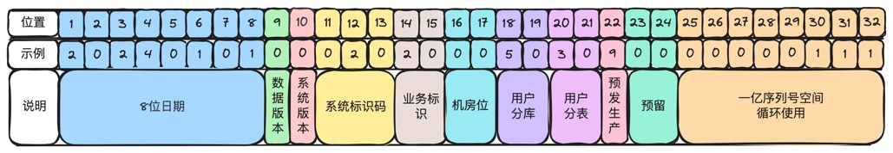
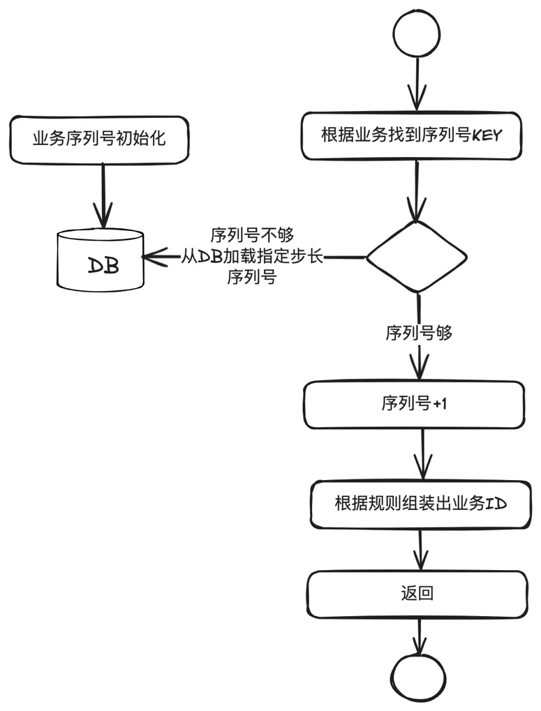

# 第13章 业务ID生成规则

> 来源：《图解支付系统设计与实现》V_0.1.0，隐墨星辰著。PDF 第 237–241 页。正文经 MinerU OCR 转换，原图保留。

<!-- PDF 第 237 页；原书第 234 页 -->

## 13.1 什么是业务ID及为什么要有统一的业务ID

数据库一般都会设计一个自增ID作为主键，同时还会设计一个能唯一标识一笔业务的ID，这就是所谓的业务ID(也称业务键）。比如收单域有收单单号，支付域有支付号，渠道网关域有渠道支付号等，这些都属于业务ID。

<!-- PDF 第 238 页；原书第 235 页 -->

为什么有了自增ID后，还需要有业务ID呢？一般来说有以下几个核心原因：

1. 分库分表的强诉求。一旦分库分表，各表之间的自增ID就一定会重复。

2. 全球化部署的强诉求。在跨境支付系统建设时，部分国家地区要求本地化部署，需要通过业务ID知道业务运行在哪个机房。

3. 标识业务语义，在处理故障时能快速定位是哪个域哪个业务。

4. 方便系统升级。通过业务ID的版本所在位判断业务应该走新系统，还是走老系统。

## 13.2 常见业务ID生成规范及应用场景

互联网支付系统基本都是微服务化部署，每个子域都是相对独立的一些同学在研发，架构实现差异非常大，但是业务ID是必须要统一的。主要有以下几个原因：

1. 减少维护成本。避免在不同服务中重复发明相似机制，也减少了沟通成本。方便做成统一的组件。

2. 加速异常处理和诊断。在分布式环境下发现和解决问题一般都比较复杂，统一的业务ID规范可以快速判断问题所在的域，以及对应的业务。

3. 避免新同学因经验不足导致设计缺陷，在后期无法满足业务诉求。

业务ID生成规则有很多种，比如知名的Snowflake算法，UUID算法，时间戳+随机数/序列号等。以下是部分规范的简要介绍。

### 1. Snowflake算法

组成：时间戳+数据中心标识 +机器节点 +序列号。

适用场景：无中心化的环境中生成大量的唯一ID，无具体业务语义，且性能要求极高。比如社交媒体的聊天消息记录。

### 2. UUID算法

高度唯一且随机。

适用场景：不想让外界感知内部系统的交易量级。比如调用外部渠道的请求号，如果使用序列号，有可能会让外部猜测出交易的规模。

### 3. 编码系统

特定组织中心化生成。

适用场景：药品或供应链管理，全球范围内标识或追踪商品。

<!-- PDF 第 239 页；原书第 236 页 -->

### 4. 业务规则编码

把一些业务语义编码到ID中。

适用场景：金融支付、电商订单等。

## 13.3 支付系统业务ID生成最佳实践

### 业务ID生成规范

下面以32位的支付系统业务ID生成为例说明。实际应用时可灵活调整。

第1-8位：日期。通过单号一眼能看出是哪天的交易。

第9位：数据版本。用于单据号的升级。

第10位：系统版本。用于内部系统版本升级，尤其是不兼容升级的时候，老业务使用老的系统处理，新业务使用新系统处理。

第11-13位：系统标识码。支付系统内部每个域分配一段，由各域自行再分配给内部系统。比如010是收单核心，012是结算核心。

第14-15位：业务标识位。由各域内部定，比如00-15代表支付类业务，01支付，02预授权，03请款等。

第16-17位：机房位。用于全球化部署。

第18-19位：用户分库位。支持百库。

第20-21位：用户分表位。支持百表。

第22位：预发生产标识位。比如0代表预发环境，1代表生产环境。

第23-24位：预留。各域根据实际情况扩展使用。

第24-32位：序列号空间。一亿规模，循环使用。一个机房一天一亿笔是很大的规模了。如果不够用，可以扩展到第24位，到十亿规模。

### 业务ID生成技术实现

序列号通常采用数据库生成，保证机房内唯一性。

<!-- PDF 第 240 页；原书第 237 页 -->

简要流程如下：

1. 数据库初始化序列号数据。KEY为业务类型，VALUE初始为0;

2. 调用业务ID生成组件。核心传参：数据版本号、系统版本号、系统名、业务类型等。

3. 业务ID生成组件查看对应业务类型是否有缓存数据。如果没有，就以指定步长（比如100）去更新数据库，然后缓存起来。

4. 在内存中加一，然后根据规则生成业务ID，返回给调用方。

<!-- PDF 第 241 页；原书第 238 页 -->

这里使用指定步长去更新数据库，主要是考虑提高性能。但是存在一定的损失，比如发布重启，缓存中的序列号就会被浪费掉。但因为是循环使用，所以基本上对业务没有影响。
