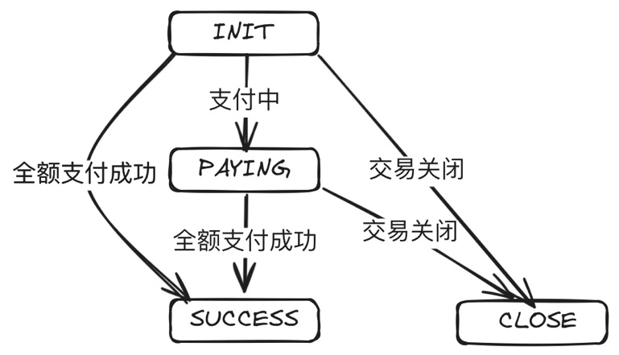
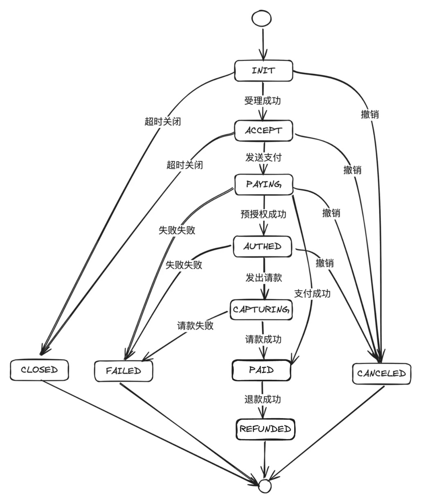
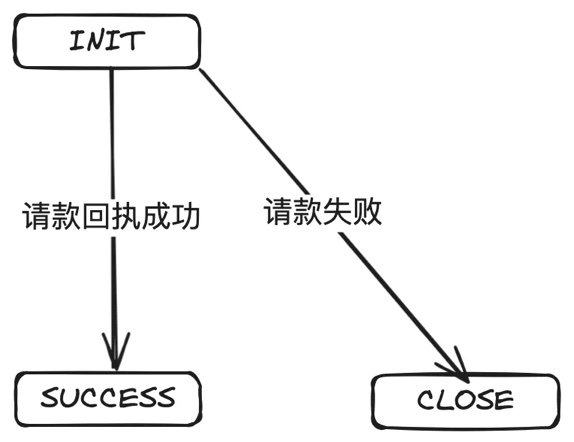
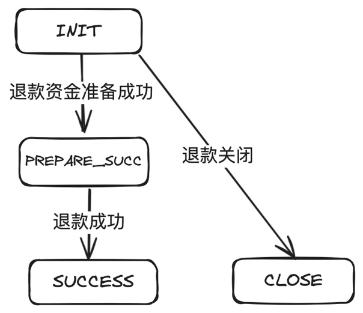
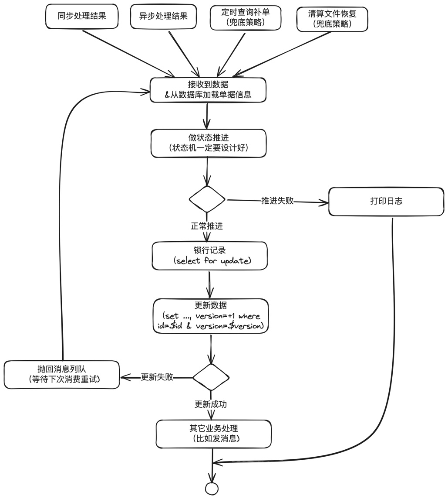

# 第14章 状态机设计思想在支付系统中的广泛应用

> 来源：《图解支付系统设计与实现》V_0.1.0，隐墨星辰著。PDF 第 241–256 页。正文经 MinerU OCR 转换，原图保留。

<!-- PDF 第 241 页；原书第 238 页 -->

状态机在支付系统中应用非常广泛，对简化代码、降低资损风险等有很大的好处。假如读者没有听过状态机，或者听过但没有写过，或者是使用if else 或switch case来写状态机的代码实现，建议多花点时间看看。

## 14.1 什么是状态机

状态机，也称为有限状态机(FSM，Finite State Machine)，是一种行为模型，由一组定义良好的状态、状态之间的转换规则和一个初始状态组成。它根据当前的状态和输入的事件，从一个状态转移到另一个状态。

下图就是收单子域设计中交易单的状态机设计。



从图中可以看到，一共4个状态，每个状态之间的转换由指定的事件触发。

## 14.2 状态机对支付系统的重要性

想像一下，如果没有状态机，支付系统如何知道你的订单已经支付成功了呢？如果你的订单已经被一个线程更新为“成功”，另一个线程又更新成“失败”，你会不会跳起来？

<!-- PDF 第 242 页；原书第 239 页 -->

在支付系统中，状态机管理着每笔交易的生命周期，从初始化到完成或失败。它确保交易在正确的时间点，以正确的顺序流转到正确的状态。这不仅提高了交易处理的效率和一致性，还增强了系统的鲁棒性，使其能够有效处理异常和错误，确保支付流程的顺畅。

## 14.3 状态机设计基本原则与常见误区

无论是设计支付类的系统，还是电商类的系统，在设计状态机时，都建议遵循以下原则：

明确性：状态和转换必须清晰定义，避免含糊不清的状态。

完备性：为所有可能的事件-状态组合定义转换逻辑。

可预测性：系统应根据当前状态和给定事件可预测地响应。

最小化：状态数应保持最小，避免不必要的复杂性。

## 14.4 状态机设计最佳实践及核心代码实现

工作多年，见过很多设计得不好的状态机，导致运维特别麻烦，还容易出故障，总结出来一共有这么几条：

过度设计：引入不必要的状态和复杂性，使系统难以理解和维护。

不完备的处理：未能处理所有可能的状态转换，导致系统行为不确定。

硬编码逻辑：过多的硬编码转换逻辑，使系统不具备灵活性和可扩展性。

举一个例子感受一下。下面是亲眼见过的一个交易单的状态机设计，而且一眼看过去，好像除了复杂一点，整体还是合理的，比如初始化，受理成功就到ACCEPT，然后到PAYING，如果直接成功就到PAID，退款成功就到REFUNDED。

<!-- PDF 第 243 页；原书第 240 页 -->



我说说这个状态机有几个不合理的地方：

1. 过于复杂。一些不必要的状态可以去掉，比如ACCEPT没有存在的必要。

2. 职责不明确。支付单就只管支付，到PAID就支付成功，就是终态不再改变。REFUNDED应该由退款单来负责处理，否则部分退款怎么办。

<!-- PDF 第 244 页；原书第 241 页 -->

我们需要的改造方案：

1. 精简掉不必要的状态，比如ACCEPT。

2. 把一些退款、请款等单据单独抽出去，这样状态机虽然多了，但是架构更加清晰合理。

主单：


普通支付单：


预授权单：

<!-- PDF 第 245 页；原书第 242 页 -->


请款单：



退款单：

<!-- PDF 第 246 页；原书第 243 页 -->



### 状态机设计的最佳实践

在代码实现层面，需要做到以下几点：

分离状态和处理逻辑：使用状态模式，将每个状态的行为封装在各自的类中。

使用事件驱动模型：通过事件来触发状态转换，而不是直接调用状态方法。

确保可追踪性：状态转换应该能被记录和追踪，以便于故障排查和审计。

具体的实现参考后面的“JAVA版本状态机核心代码实现”。

### 常见代码实现误区

经常看到工作几年的同学实现状态机时，仍然使用if else或switch case来写。这是不对的，会让实现变得复杂，且容易出现问题。

甚至直接在订单的领域模型里面使用String来定义，而不是把状态模式封装单独的类。

还有就是直接调用领域模型更新状态，而不是通过事件来驱动。

错误的代码示例：

<!-- PDF 第 247 页；原书第 244 页 -->

```java
if (status.equals("PAYING") {
    status = "SUCCESS";
} else if (...) {
    ...
}
```

### 或者：

```java
class OrderDomainService {
    public void notify(PaymentNotifyMessage message) {
        PaymentModel paymentModel = loadPaymentModel(message.getPaymentId());
        // 直接设置状态
        paymentModel.setStatus(PaymentStatus.valueOf(message.status);
        // 其它业务处理
        ... ...
    }
}
```

### 或者：

```java
public void transition(Event event) {
    switch (currentState) {
        case INIT:
            if (event == Event.PAYING) {
                currentState = State.PAYING;
            } else if (event == Event.SUCESS) {
                currentState = State.SUCESS;
            } else if (event == Event.FAIL) {
                currentState = State.FAIL;
            }
            break;
            // Add other case statements for different states and events
    }
}
```

### JAVA版本状态机核心代码实现

<!-- PDF 第 248 页；原书第 245 页 -->

使用Java实现一个简单的状态机，我们将采用枚举来定义状态和事件，以及一个状态机类来管理状态转换。

### 定义状态基类

```java
/**
 * 状态基类
 */
public interface BaseStatus {
}
```

### 定义事件基类

```java
/**
 * 事件基类
 */
public interface BaseEvent {
}
```

### 定义“状态-事件对”，指定的状态只能接受指定的事件

<!-- PDF 第 249 页；原书第 246 页 -->

```java
/**
 * 状态事件对，指定的状态只能接受指定的事件
 */
public class StatusEventPair<S extends BaseStatus, E extends BaseEvent> {
    /* …*/
    private final S status;
    /* …*/
    private final E event;

    public StatusEventPair(S status, E event) {
        this.status = status;
        this.event = event;
    }

    @Override
    public boolean equals(Object obj) {
        if (obj instanceof StatusEventPair) {
            StatusEventPair<S, E> other = (StatusEventPair<S, E>)obj;
            return this.status.equals(other.status) && this.event.equals(other.event);
        }
        return false;
    }

    @Override
    public int hashCode() {
        // 这里使用的是google的guava包。com.google.common.base.Objects
        return Objects.hash(status, event);
    }
}
```

### 定义状态机

<!-- PDF 第 250 页；原书第 247 页 -->

```java
/**
 * 状态机
 */
public class StateMachine<S extends BaseStatus, E extends BaseEvent> {
    private final Map<StatusEventPair<S, E>, S> statusEventMap = new HashMap<>();

    /**
     * 只接受指定的当前状态下，指定的事件触发，可以到达的指定目标状态
     */
    public void accept(S sourceStatus, E event, S targetStatus) {
        statusEventMap.put(new StatusEventPair<>(sourceStatus, event), targetStatus);
    }

    /**
     * 通过源状态和事件，获取目标状态
     */
    public S getTargetStatus(S sourceStatus, E event) {
        return statusEventMap.get(new StatusEventPair<>(sourceStatus, event));
    }
}
```

定义支付的状态机。注：支付、退款等不同的业务状态机是独立的。

<!-- PDF 第 251 页；原书第 248 页 -->

```java
/**
 * 支付状态机
 */
public enum PaymentStatus implements BaseStatus {

    INIT("INIT", "初始化"),
    PAYING("PAYING", "支付中"),
    PAID("PAID", "支付成功"),
    FAILED("FAILED", "支付失败"),
    ;

    // 支付状态机内容
    private static final StateMachine<PaymentStatus, PaymentEvent> STATE_MACHINE = new StateMachine<>();
    static {
        // 初始状态
        STATE_MACHINE.accept(null, PaymentEvent.PAY_CREATE, INIT);
        // 支付中
        STATE_MACHINE.accept(INIT, PaymentEvent.PAY_PROCESS, PAYING);
        // 支付成功
        STATE_MACHINE.accept(PAYING, PaymentEvent.PAY_SUCCESS, PAID);
        // 支付失败
        STATE_MACHINE.accept(PAYING, PaymentEvent.PAY_FAIL, FAILED);
    }

    // 状态
    private final String status;
    // 描述
    private final String description;

    PaymentStatus(String status, String description) {
        this.status = status;
        this.description = description;
    }

    /**
     * 通过源状态和事件类型获取目标状态
     */
    public static PaymentStatus getTargetStatus(PaymentStatus sourceStatus, PaymentEvent event) {
        return STATE_MACHINE.getTargetStatus(sourceStatus, event);
    }
}
```

<!-- PDF 第 252 页；原书第 249 页 -->

定义支付事件。注：支付、退款等不同业务的事件是不一样的。

```java
/**
 * 支付事件
 */
public enum PaymentEvent implements BaseEvent {
    // 支付创建
    PAY_CREATE("PAY_CREATE", "支付创建"),
    // 支付中
    PAY_PROCESS("PAY_PROCESS", "支付中"),
    // 支付成功
    PAY_SUCCESS("PAY_SUCCESS", "支付成功"),
    // 支付失败
    PAY_FAIL("PAY_FAIL", "支付失败");

    /**
     * 事件
     */
    private String event;
    /**
     * 事件描述
     */
    private String description;

    PaymentEvent(String event, String description) {
        this.event = event;
        this.description = description;
    }
}
```

在支付单模型中声明状态和根据事件推进状态的方法：

<!-- PDF 第 253 页；原书第 250 页 -->

```java
/**
 * 支付单模型
 */
public class PaymentModel {
    /**
     * 其它所有字段省略
     */

    // 上次状态
    private PaymentStatus lastStatus;
    // 当前状态
    private PaymentStatus currentStatus;


    /**
     * 根据事件推进状态
     */
    public void transferStatusByEvent(PaymentEvent event) {
        // 根据当前状态和事件，去获取目标状态
        PaymentStatus targetStatus = PaymentStatus.getTargetStatus(currentStatus, event);
        // 如果目标状态不为空，说明是可以推进的
        if (targetStatus != null) {
            lastStatus = currentStatus;
            currentStatus = targetStatus;
        } else {
            // 目标状态为空，说明是非法推进，进入异常处理，这里只是抛出去，由调用者去具体处理
            throw new StateMachineException(currentStatus, event, "状态转换失败");
        }
    }
}
```

代码注释已经写得很清楚，其中StateMachineException是自定义，不想定义的话，直接使用RuntimeException也是可以的。

在支付业务代码中的使用：只需要paymentModel.transferStatusByEvent(PaymentEvent.valueOf(message.getEvent()))

<!-- PDF 第 254 页；原书第 251 页 -->

```java
/**
 * 支付领域域服务
 */
public class PaymentDomainServiceImpl implements PaymentDomainService {

    /**
     * 支付结果通知
     */
    public void notify(PaymentNotifyMessage message) {
        PaymentModel paymentModel = loadPaymentModel(message.getPaymentId());
        try {

            // 状态推进
            paymentModel.transferStatusByEvent(PaymentEvent.valueOf(message.getEvent()));
            savePaymentModel(paymentModel);
            // 其它业务处理
            ... ...
        } catch (StateMachineException e) {
            // 异常处理
            ... ...
        } catch (Exception e) {
            // 异常处理
            ... ...
        }
    }
}
```

上面的代码只需要完善异常处理，优化一下注释，就可以直接用起来。

### 好处：

1. 定义了明确的状态、事件。

2. 状态机的推进，只能通过“当前状态、事件、目标状态”来推进，不能通过if else或caseswitch来直接写。比如：STATE\_MACHINE.accept(INIT，PaymentEvent.PAY\_PROCESS,PAYING);

3. 避免终态变更。比如线上碰到if else写状态机，渠道异步通知比同步返回还快，异步通知回来把订单更新为“PAID”，然后同步返回的代码把单据重新推进到PAYING。

<!-- PDF 第 255 页；原书第 252 页 -->

### 并发更新问题

曾经被问到：“状态机领域模型同时被两个线程操作怎么避免状态幂等问题？”

这是一个好问题。在分布式场景下，这种情况太过于常见。同一机器有可能多个线程处理同一笔业务，不同机器也可能处理同一笔业务。

业内通常的做法是设计良好的状态机+数据库锁+数据版本号解决。



<!-- PDF 第 256 页；原书第 253 页 -->

### 简要说明：

1. 状态机一定要设计好，只有特定的原始状态+特定的事件才可以推进到指定的状态。比如INIT + 支付成功才能推进到sucess。

2. 更新数据库之前，先使用select for update进行锁行记录，同时在更新时判断版本号是否是之前取出来的版本号，更新成功就结束，更新失败就组成消息发到消息队列，后面再消费。

3. 通过补偿机制兜底，比如查询补单。

4. 通过上述三个步骤，正常情况下，最终的数据状态一定是正确的。除非是某个系统有异常，比如外部渠道开始返回支付成功，然后又返回支付失败，说明依赖的外部系统已经异常，这样只能进人工差错处理流程。

## 14.5 小结

状态机在支付系统中扮演着不可或缺的角色。一个专业、精妙的状态机设计能够确保支付流程的稳定性和安全性。文中提供的设计原则、常见误区警示和最佳实践，旨在帮助开发者构建出更加健壮和高效的支付系统。而随附的Java代码则为实现这一关键组件提供了一个清晰、灵活的起点。
