# 第15章 渠道开关及渠道路由

> 来源：《图解支付系统设计与实现》V_0.1.0，隐墨星辰著。PDF 第 256–280 页。正文经 MinerU OCR 转换，原图保留。

<!-- PDF 第 256 页；原书第 253 页 -->

渠道开关和渠道路由在现代支付系统中扮演着至关重要的角色，前者能提高运维效率，后者能提高成功率和用户体验。

本章重点介绍一个基于滑动时间窗口算法的自动化渠道开关设计，以及一个基于规则的简洁而高效的渠道路由设计。

## 15.1 全自动化渠道开关

<!-- PDF 第 257 页；原书第 254 页 -->

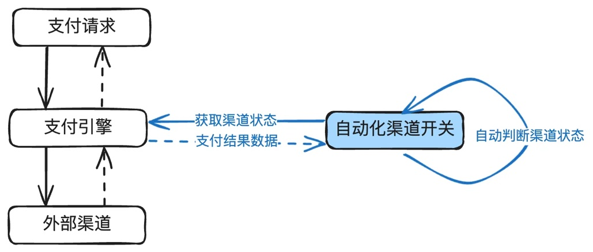

外部的渠道常常因为各种原因出现临时不可用的情况，这个时候就需要使用渠道开关来关闭渠道，否则用户持续支付失败，一方面用户体验不好，另一方面也会降低整体成功率。

手动开关和定时开关相对比较简单，这里不赘述，只重点讲解一个基于滑动时间窗口算法的自动化渠道开关设计。

在支付系统中，渠道的稳定性不仅直接影响到支付的成功率和用户体验，还特别影响研发和运维同学的幸福感。所以，当对接的渠道量大且不稳定时，建立一套全自动化的渠道开关系统就是一个非常不错的选择，不但能够有效提高系统的稳定性和支付成功率，同时降低维护成本和人工干预频率。

### 15.1.1 自动化渠道开关的核心功能

自动化渠道开关需要满足以下几个核心功能：

1. 实时监控渠道状态：一般通过监听支付引擎或渠道网关的支付结果，实时统计渠道成功率数据。

2. 自动关闭故障渠道：当检测到成功率下降到一定阈值或连续失败数达到一定的阈值，自动关闭该渠道。

3. 自动探测渠道状态：在关闭渠道后，能自动发起探测渠道状态的服务。

4. 自动灰度恢复渠道：当渠道恢复正常后，自动灰度开启该渠道。

5. 人工打标与验证：前期判断通过人工打标进行验证，确保系统的自动化判断是准确无误的。

6. 一键降级能力：在大促期间，为避免因流量变化大可能引起误判，可以一键关闭自动化开关。

### 15.1.2 核心模块设计

<!-- PDF 第 258 页；原书第 255 页 -->

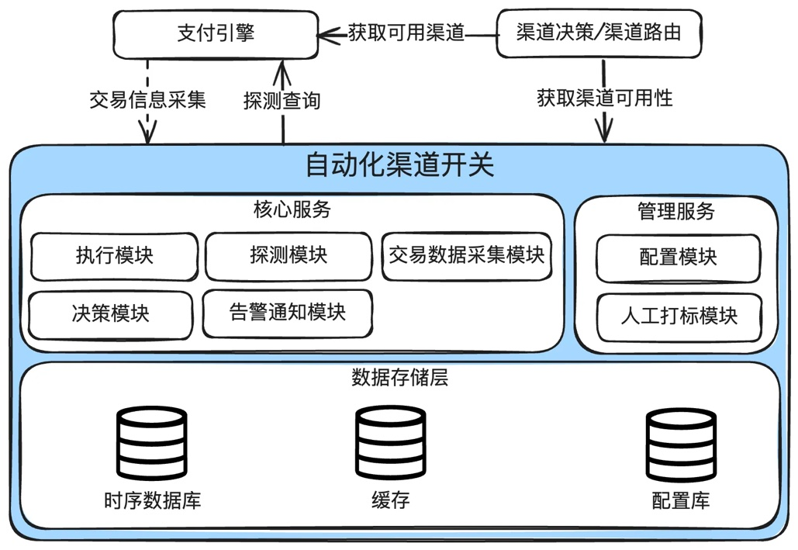

自动化渠道开关系统主要包括以下几个核心模块：

1. 交易数据采集模块：负责实时监听支付交易结果，并保存到时序数据库。

2. 决策模块：根据交易数据和预设的策略，决定渠道的开关状态。

3.执行模块：判断当前请求是否被关闭。和决策模块的区别联系：决策模块只是用于决策当前灰度应该打开多少，至于是否生效，由执行模块来决定。

4. 探测模块：在渠道关闭后，捞取最近一笔成功的交易，向渠道发起查询，查询成功后，渠道开关进入灰度打开状态。

5. 人工打标模块：在前期阶段通过人工打标验证系统判断的准确性。

6. 手动控制模块：在大促期间，一键降级自动化开关，手动控制渠道状态。

7. 告警通知模块：当渠道异动时，发出通知。

#### 交易数据采集模块

采集交易结果数据保存到时序数据库，决策模块将根据这些数据进行渠道是否关闭的判断。

<!-- PDF 第 259 页；原书第 256 页 -->

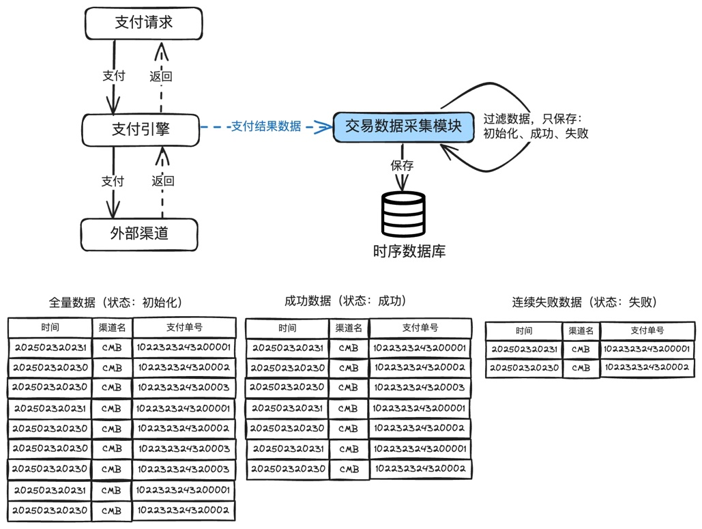

#### 说明：

1. 支付结果数据的采集，只需要保留三种数据：初始化，成功，失败。

2. 时序数据库创建三个表：全量数据（只保存初始化状态的数据），成功数据（只保存成功的数据），连续失败数据（只保存连续失败的数据，如果指定渠道有成功数据进来，就清除）。

3. 三个表用于计算：成功率=成功数据/全量数据，连续失败数据用于在成功率还没有下降到指定阈值，但是连续失败次数达到阈值，也需要关闭渠道。

#### 決策模块

用于决策当前渠道是否需要关闭，以及是否需要打开。

<!-- PDF 第 260 页；原书第 257 页 -->

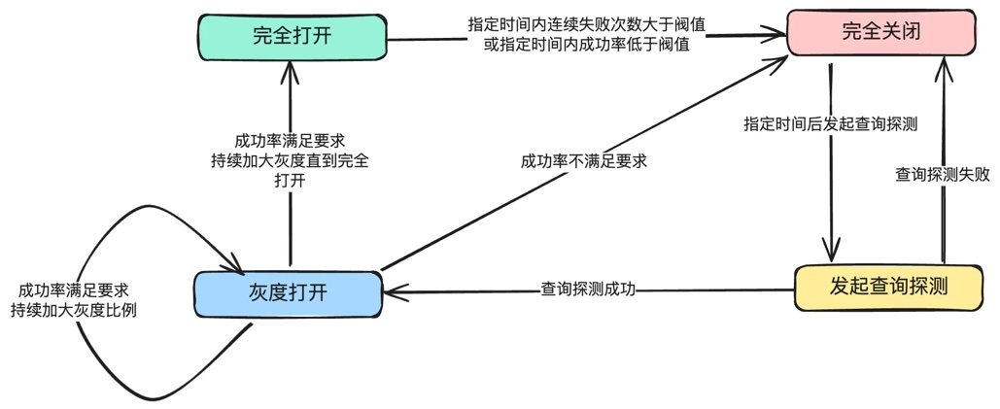

#### 说明：

1. 渠道初始为完全打开。

2. 当指定时间内成功率低于阈值或指定时间内连续失败次数大于阈值，就关闭渠道。

3. 关闭渠道后，捞取最近成功的一笔发起查询探测，如果查询失败，仍然关闭。

4. 如果查询成功，说明和渠道的通路是通的，且渠道能提供基本的服务，打开灰度25%。

5. 如果灰度25%情况下，成功率不达标，仍然关闭。

6. 如果灰度25%情况下，成功率达标，继续加大灰度比例，直到100%。

注：上述灰度打开算法还可以优化为：N\*2算法，其中N初始为1。举个例子：先打开1%，符合要求后，依次打开：2%，4%，8%，16%，32%，64%，100%。通过7次操作后，100%打开。这个算法适合一些体量大的渠道，直接开25%如果仍然失败会影响很大批量的用户。对于小流量渠道，灰度1%可能很久也没有量进来，不如直接25%见效快。

#### 执行模块

决策模块只是用于决策，至于是否生效，由执行模块来决定。在自动开关降级期间，决策模块仍然在工作，只是不会真实关闭渠道。

<!-- PDF 第 261 页；原书第 258 页 -->

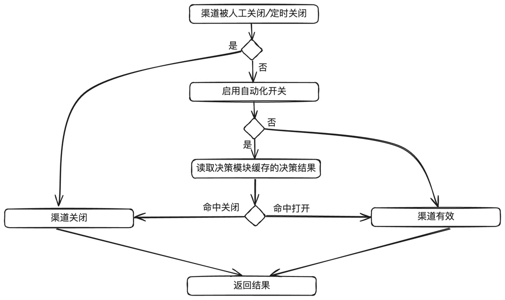

#### 说明：

1. 先判断人工关闭和定时关闭，如果命中，就直接关闭。

2. 如果没有启用自动开关，直接返回有效。

3. 否则读取决策模块缓存的结果，这里可能是灰度打开50%，所以还需要做灰度计算。

4. 返回渠道状态：有效或关闭。

#### 探测模块

渠道被自动关闭后，我们不知道渠道什么时候恢复正常，这个时候可以先启动查询探测服务，也就是捞起最近支付成功的一笔单据，向渠道发起查询，如果查询成功，说明渠道能提供基本的服务，可以打开灰度开关。

<!-- PDF 第 262 页；原书第 259 页 -->

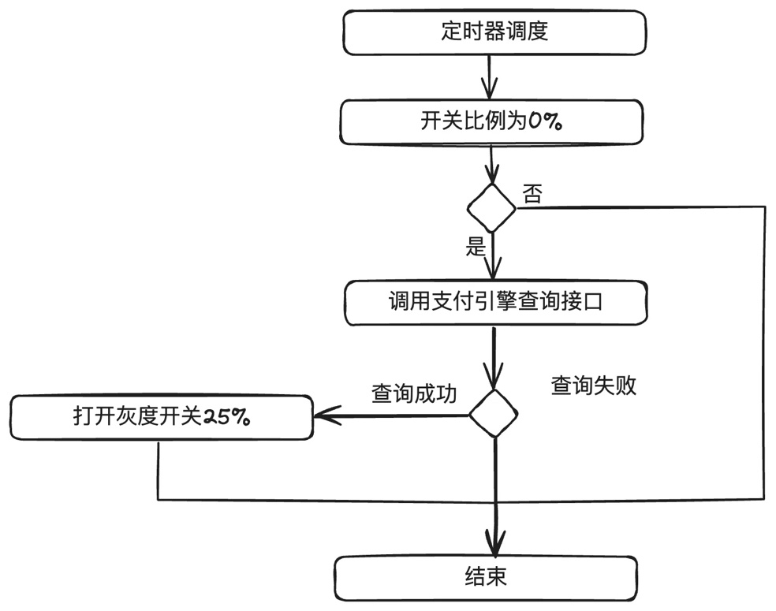

#### 说明：

1. 定时器调度，如果开着比例为0%，说明是关闭，就调用支付引擎查询接口进行查询。

2. 如果查询成功，就打开灰度25%。(也可以是N\*2算法，初始打开1%，详见决策模块的说明)

#### 人工打标与数据分析模块

主要考虑前期算法的精确度需要调优，所以先只计算，不真正执行。计算出来的结果，先由人工进行打标，如果一段时间内（比如1个月）判断的结果都被人工打标是正确的，那就可以正式开启自动化开关。

#### 一键降级模块

主要考虑大促或异常场景下，担心自动化的结果可能存在问题，就一键降级掉。

<!-- PDF 第 263 页；原书第 260 页 -->

### 15.1.3 决策模块核心算法与实现

考虑到不同的渠道的流量有高有低，同一渠道在不同时间段的流量也是有高有低，如果所有的渠道设置统一的触发阈值，必须面临有些渠道的灵敏度不够(应该关而没有关），有些渠道的噪音又太大(不应该关却被关了）。

一个常用的解决方案就是应用滑动时间窗口算法。

#### 滑动时间窗口算法原理

滑动时间窗口算法(Sliding Window Algorithm)是一种常用于限流、统计和监控的算法，能够在给定的时间范围内统计事件的发生次数。相比于固定时间窗口算法，滑动时间窗口算法能够更灵活地应对突发流量和变化的负载情况。

滑动时间窗口算法通过在时间轴上划分多个小的时间窗口(也称为桶)，并在这些窗口中统计事件的发生次数。每当一个新的事件到来时，算法会根据事件的时间戳确定它属于哪个时间窗口，并将其计入该窗口内。然后，根据所有窗口的统计数据计算出当前时间窗口内事件的总次数。

滑动时间窗口算法的应用场景主要有：

1. 限流：在API网关等场景下，滑动时间窗口算法可以用来限制单位时间内的请求次数，防止系统过载。

2. 统计和监控：在数据统计和监控场景下，滑动时间窗口算法可以实时统计一定时间范围内的事件数量，如监控支付系统的成功率。

3. 流量控制：在网络流量控制场景下，滑动时间窗口算法可以用来限制单位时间内的数据流量，确保网络稳定。

我们本次就是用到统计的功能。

#### 时序数据库应用

时序数据库(Time Series Database，TSDB)非常适合处理时间序列数据。它能够高效地存储和查询大量的时间序列数据，特别适用于滑动时间窗口的计算。

以下是几个知名的时序数据库，建议根据实际情况选用：

1. InfluxDB：InfluxDB 是一个开源的时序数据库，具有高性能的写入和查询能力，支持丰富的数据查询语言（InfluxQL）和强大的数据聚合功能。

2. Prometheus：Prometheus 是一个开源的监控系统和时序数据库，提供多维度数据模型和强

<!-- PDF 第 264 页；原书第 261 页 -->

大的查询语言(PromQL），常用于监控和告警。

3. OpenTSDB：OpenTSDB 是一个基于 HBase 构建的分布式时序数据库，具有高可扩展性和高性能，支持大规模的时间序列数据存储和查询。

4. Graphite：Graphite是一个开源的企业级监控工具，支持收集和存储时间序列数据，并提供灵活的图形化展示和查询功能。

#### 综合判断渠道是否异常

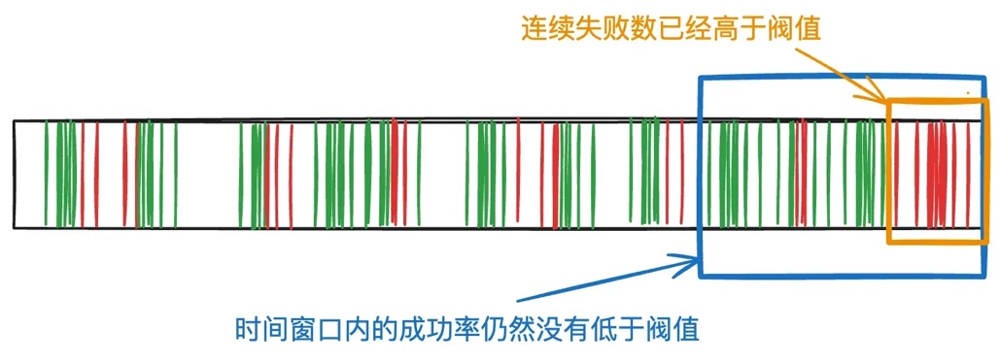

在渠道刚开始发生异常时，因为前面还有成功的数据，成功率不会立即下降到指定阈值，但是渠道实际上已经挂了。基于此，还需要综合考虑连续失败数是否达到指定阈值，如果达到，也需要关闭。

前面“交易数据采集模块”有提到，数据库一共分三个表：

1. 全量表：每创建一笔支付单，就插入一条记录。

2. 成功表：每成功一笔，就插入一条记录。

3. 连续失败表：每失败一笔，就插入一条记录，每成功一笔，就清空对应渠道的连续失败表数据(这个很重要）。

判断关闭逻辑很简单：

<!-- PDF 第 265 页；原书第 262 页 -->

```java
public int calculateRate(channel) {
    // 动态计算出当前渠道的窗口大小
    int timeWindowSize = fetchTimeWindowSize(channel);
    // 动态计算出当前渠道的连续失败窗口大小
    int failTimeWindowSize = fetchFailTimeWindowSize(channel);

    // 获取时间窗口内成功数
    int successCount = loadSuccessCount(channel, timeWindowSize);
    // 获取时间窗口内所有请求数
    int allCount = loadAllCount(channel, timeWindowSize);
    // 获取连续失败时间窗口的失败数
    int failCount = loadFailCount(channel, failTimeWindowSize);

    // 因为成功率不需要太精确，所以使用整数就行
    int successRate = successCount / allCount;

    if (successRate < thresholdSuccessRate || failCount > thresholdFailCount) {
        setRateToCache(channel, 0);

        // 返回灰度比例为0，说明被关闭
        return 0;
    }

    // 从缓存中获取当前渠道的开关比例
    int rate = fetchRateFromCache(channel);
    if (rate = 100) {
        // 全开就直接返回
        return rate;
    }

    // 上一次更新时间
    int lastChangeTime = fetchLastChangeTime(channel);
    int now = getNow();
    int changeWindowSize = fetchChangeWindowSize(channel);

    // 仍在灰度中，如果距离上一次调整阈值时间超过指定的窗口大小，就上调灰度比例
    if (now - lastChangeTime > changeWindowSize) {
        rate += 25;
        setRateToCache(channel, rate);
    }

    return rate;
}
```

<!-- PDF 第 266 页；原书第 263 页 -->

### 15.1.4 参数调优

前面有提到，不同渠道的流量大小不一样，同一渠道在不同时间段的流量也不一样，不同渠道的日常成功率也不一样，如果全部靠人工设置参数，将是一个非常繁杂的工作，而且误差还可能比较大。

下面介绍如何更准确地设置这些参数。

#### 渠道流量分类

建议按高、低分成两种类型的渠道，每种流量设置一定的阈值，只要符合这个阈值，就归属于对应的渠道分类中。下面是一个示例（实际应用时需要根据公司的业务量自行调整）：

高：最近X分钟大于Y笔。

低：最近X分钟小于等于Y笔。

在实际应用中，先根据渠道流量分类参数，去查询时序数据库里里当前各渠道的流量，把渠道进行分类（高、低），然后根据当前渠道所在分类里，去计算成功率和连续失败次数，进而判断当前渠道是否需要关闭。

#### 成功率选取

每个渠道的日常成功率是不一样的，推荐一个算法：按过去7天的成功率除以2。比如一个渠道日常成功率是95%，如果当前成功率低于47%，虽然还没有跌零，但大概率会挂。如果不放心，也可以选择除以3或4。

#### 连续失败次数设置

前面也有提到，在渠道刚开始发生异常时，因为前面还有成功的数据，成功率不会立即下降到指定阈值，但是渠道实际上已经挂了。基于此，还需要综合考虑连续失败数是否达到指定阈值，如果达到，也需要关闭。

那连续失败数应该设置多大？建议根据渠道的流量大小设置2个初始值(高、低），然后再去调优。比如：50，20，10。

#### 时间窗口大小设置

<!-- PDF 第 267 页；原书第 264 页 -->

同样的，时间窗口大于取决于流量的大小，流量越大，窗口越小，灵敏度越高，流量越小，窗口越大，噪音越小。不同公司的业务量不一样，建议根据公司业务量来设置。

也同样建议根据渠道的流量大小设置2个初始值（高、低），然后再去调优，比如X分钟，Y分钟。

### 15.1.5 最佳实践指南

1. 充分利用历史数据：分析历史数据，设置合理的成功率阈值，确保渠道开关策略的有效性。

2. 灵活调整参数：根据实际业务需求，灵活调整滑动窗口大小、成功率阈值、连续失败次数阈值等参数。文中只区分了高、低流量，如果要更准确，可以分为高、中、低三种类型，甚至四种类型。

3. 人工打标与验证：前期通过人工打标验证系统判断的准确性，确保自动化策略的可靠性。

4. 灰度打开机制：在渠道恢复时，逐步增加流量，确保渠道真正恢复正常。

5. 探测服务：使用最近成功的单据去查询，判断渠道是否恢复，减少对用户影响。

6. 综合判断：综合考虑渠道的成功率和连续失败次数，避免单一因素导致误判。

7. 定期回顾与优化：定期回顾自动化渠道开关的策略和参数，结合最新的业务需求和历史数据，不断优化和提升系统的稳定性和性能。

## 15.2 渠道路由

渠道路由在现代支付系统中扮演着至关重要的角色，一个高效、灵活的渠道路由设计能够显著提升支付成功率，优化成本，并改善用户体验。

### 15.2.1 一些背景知识

有些支付公司没有区分支付方式咨询、渠道咨询、渠道路由，而是混在一起做掉，这样的好处是简单而实用，缺点是扩展性不足。下面将以扩展性最好的拆分方式来讲解。

下面是三者之间的简单关系图：

<!-- PDF 第 268 页；原书第 265 页 -->

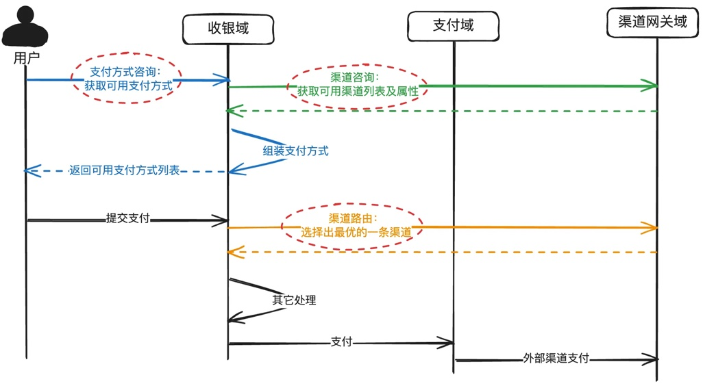

#### 说明：

1. 支付方式咨询：根据用户的请求，组装可用支付方式列表返回给用户。由收银域提供服务。

2. 渠道咨询：根据用户的请求，组装可用的渠道列表和渠道属性返回给收银域，再由收银域转换为支付方式返回给用户。由渠道网关提供服务。

3. 渠道路由：当有多个渠道可用时，选择出最优的一个渠道。由渠道网关提供服务。

<!-- PDF 第 269 页；原书第 266 页 -->

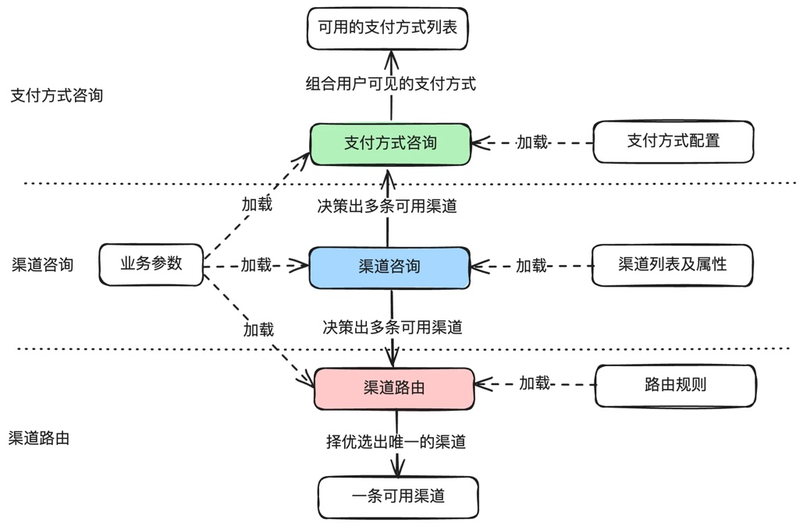

再详细一点，如下：

支付方式咨询：解决用户可以使用哪些支付方式，比如余额、招行借记卡、招行信用卡等。比如虚拟商品不能使用信用卡，这种支付方式的管理就是支付方式咨询的职责。

渠道咨询：解决是否有渠道可以支持当前的支付行为。比如用户绑定了招行借记卡，但招行当前正在维护无法提供服务，那就将渠道状态设置为不可用，收银域对应的支付方式会置灰。

渠道路由：解决最优渠道问题。需要综合支付成功率、支付成本、用户体验、渠道状态等多种因素挑选出最优的一条渠道。

### 15.2.2 渠道路由核心作用

<!-- PDF 第 270 页；原书第 267 页 -->

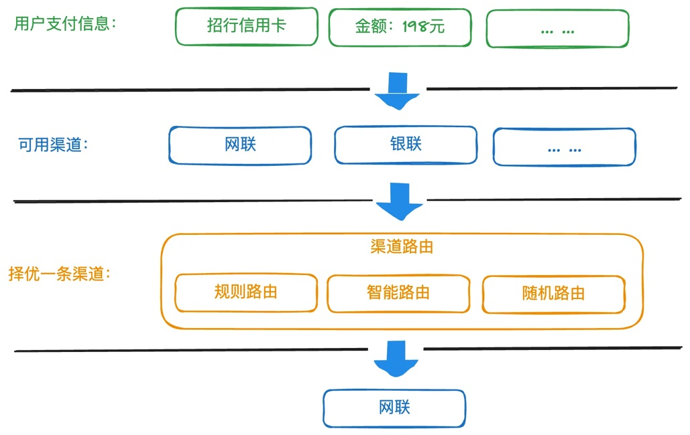

渠道路由核心作用是当有多个渠道同时满足业务诉求时，综合支付成功率、支付成本、用户体验、渠道状态等多种因素挑选出最优的一条渠道。具体如下：

1. 提高支付成功率：通过选择最合适的渠道，可以提高支付的成功率，减少支付失败带来的用户流失。原因在于不同的渠道在其内部的风险偏好是不一样的，同一个请求在A渠道会失败，但在B渠道会成功。

2. 优化成本：不同渠道的费用可能不同，通过合理的路由，可以降低支付成本。一些渠道还有阶梯收费，需要通过分流不同的渠道，保持整体成本最优。

3.提升用户体验：快速、稳定的支付体验能增强用户的满意度和忠诚度。用户如果经常在A渠道支付，新的请求过来后，仍然发给A渠道支付的成功率往往会更高。

4. 负载均衡：将支付请求合理分配到不同的渠道，避免某个渠道过载，提升整体系统的稳定性。

#### 举几个渠道路由应用的小场景：

1. 用户使用招行信用卡支付，支付平台同时对接了网联和银联，而网联和银联都支持招行信用卡，那么就需要渠道路由挑选一个渠道。

2. 做实名认证，平台对接了多个实名认证通道，通过渠道路由挑选一个认证渠道。

<!-- PDF 第 271 页；原书第 268 页 -->

由上面可以看到，除了支付路由外，还可能有信息类渠道路由，比如实名认证类。

那退款有没有路由？显示没有。在银联做的支付，只能去银联退款。特殊的渠道也没有路由比如用户选择使用支付宝支付，因为支付宝只能在支付宝做支付，所以无需路由。

### 15.2.3 渠道路由的设计原则

渠道路由作为支付系统的核心模块，需要满足以下几个设计原则：

● 灵活性：路由规则需要支持动态调整。从业务的角度出发，有些场景考虑成本，有些场景考虑成功率，都能方便支持。

●扩展性：设计时要考虑到未来可能新增的支付渠道，新增的决策因子，这些都不能在代码中写死，确保系统易于扩展。

● 高可用性：路由系统本身需要具备高可用性，确保在高并发和故障情况下仍能稳定运行，哪怕内部报错，仍然能返回一条可用的渠道。

●性能：在保证准确性的前提下，路由决策需要快速，不能成为支付流程的瓶颈。

### 15.2.4 业界常见的几种路由形态

根据业务的需要，通常有以下几种路由形态：

1. 硬编码取第一个。在项目上线初期，为了赶进度，同时渠道也不多，常常在代码中写死取第一个，先保证支付主流程能走通。

2. 基于规则的路由。通过预定义的规则提高灵活性和可扩展性。

3. 智能路由。利用机器学习和大数据分析，根据历史数据和实时状态，智能地选择最佳渠道。

### 15.2.5 一种典型的基于规则的渠道路由设计

基于规则的渠道路由是最常见的设计。简单地说，就是符合什么条件就执行什么样的分流逻辑。比如：支付平台对接了网联和银联，招行信用卡全部走网联，工行信用卡500块以内的走网联，500块以上的走银联。

#### 核心流程设计

<!-- PDF 第 272 页；原书第 269 页 -->

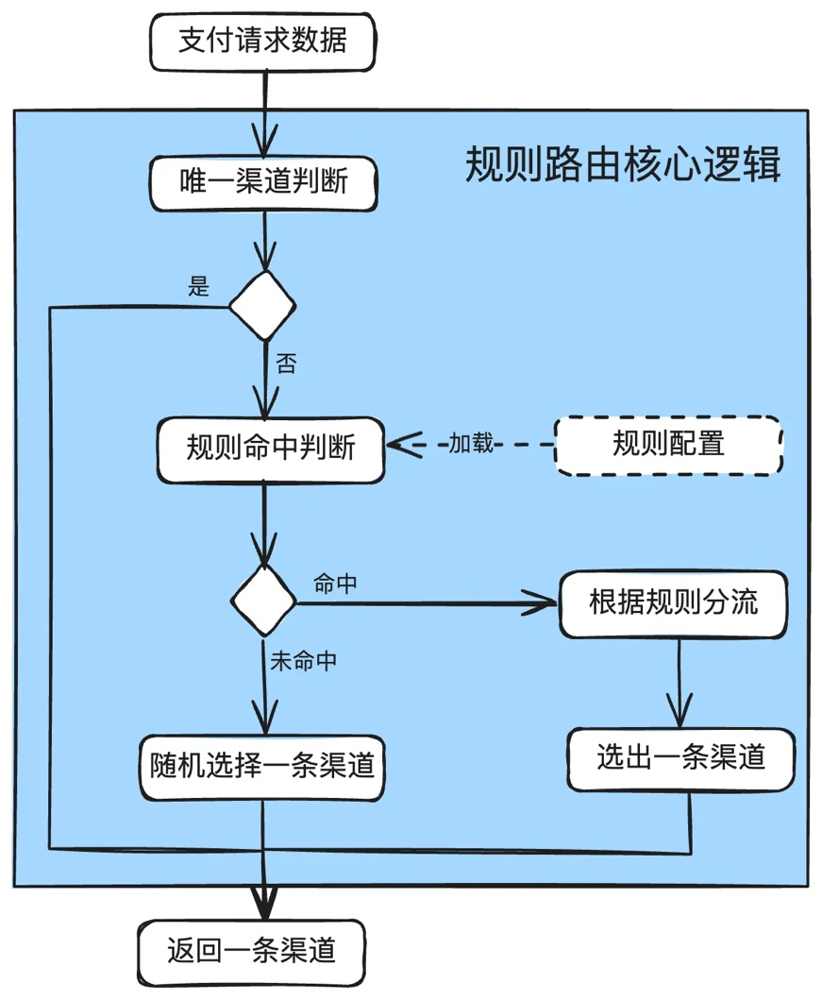

#### 说明：

1. 先进行唯一渠道判断，如果只有一条渠道，直接返回。

2. 判断规则，如果规则没有命中，那就从可用渠道中随机挑选一条。

3. 如果命中规则，再根据规则中的分流逻辑进行分流。

4. 最后返回唯一的一条渠道。

#### 分流算法设计

<!-- PDF 第 273 页；原书第 270 页 -->

如果一个请求既可以走银联，也可以走网联，还可以走直连，有以下几种情况：

1. 没有命中任何一条规则，随机选择一条渠道。

2. 有多条规则可以命中，选择优先级最高的。

3. 命中的路由规则里，银联和网联分别是40%和40%，直连20%，根据规则分流。如果当前银联挂了，把银联按比例分配到网联和直连。

常见的分流算法是先把各渠道的分流比例换算成0-100区间的数字，从大到小排序，再根据用户ID取模、请求单号取模或生成一个随机数，再看这个数落在哪个区间，对应的渠道就是命中的渠道。

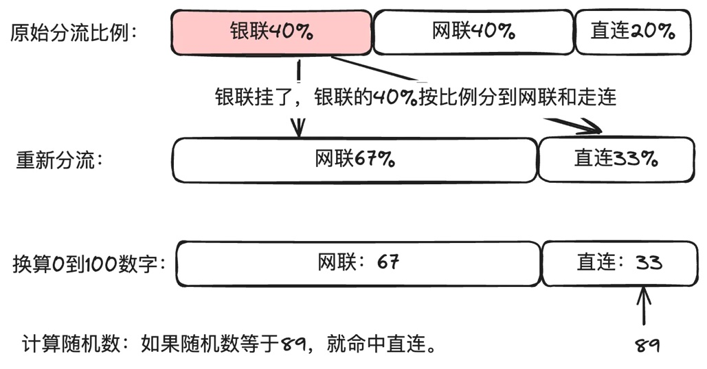

伪代码如下：

```java
int random = 用户ID取模（或请求单号取模，或生成随机数）;
for (int i = 0; i < 分流集合.size(); i++) {
    if (random -= 分流集合[i] <= 0) {
        return 命中的渠道;
    }
}
```

<!-- PDF 第 274 页；原书第 271 页 -->

#### 路由规则配置模型

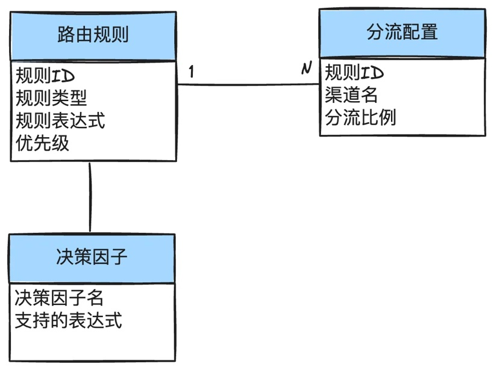

#### 说明：

1. 路由规则用于规则引擎运算是否命中。核心字段包括：规则ID、规则类型、规则表达式、优先级。实际实现时可根据各公司内部情况加字段。

a. 规则ID：用于分流配置做关联；

b. 规则类型：用于区分支付、实名认证等。

c. 规则表达式：用于规则引擎运算；

d. 优先级：用于排序，如果有多个规则都符合，以优先级最高的为准；

2. 分流配置用于规则命中后，如何进行分流。核心字段包括：规则ID、渠道名、分流比例。

a. 规则ID：用于与路由规则进行关联。

b. 渠道名：表示要分流去的渠道。

c. 分流比例：说明有多少流量要分过去。

3. 决策因子定义用于决策的条件。比如卡BIN，卡品牌，金额等。

#### 规则引擎选择

业务的规则引擎有很多，比如大名鼎鼎的Drools等，也可以选择自研，各公司可以根据自己的技术生态来选择。

<!-- PDF 第 275 页；原书第 272 页 -->

我个人推荐QIExpress。推荐理由：简单实用。因为路由规则都非常简单，没有过于复杂的运算，不需要引入一些很重的规则引擎。

关于QIExpress的资料，可参考官网介绍。

后面会有QIExpress的规则示例。

#### 决策子选择

决策因子就是路由规则匹配的条件，一般有以下几种：

1. 金额：比如小于某个金额，或大于某个金额。

2. 卡品牌：VISA、MASTER、UPAY等。

3. 发卡行：CMB、ICBC等。

4. 卡类型：借记卡、信用卡等。

5. 卡BIN：某个号段的卡。

6. 业务场景字段：各公司自定，比如线下场景，线上场景等。

#### 路由规则示例

规则的编写和规则引擎强相关。下面以QLExpress做个示例。实际落地时，需要根据自己选择的规则引擎做改造。

假设：支付平台对接了网联和银联，要求：

1)招行信用卡全部走网联。

2）工行信用卡500块以内（不包含）的40%走网联，60%走银联。

3)工行信用卡500块以上的走银联。

一些基本的变量定义：

银行名称：bankName

支付方式：paymentMethod

卡类型：cardType

金额变量：amount

网联：NUCC

<!-- PDF 第 276 页；原书第 273 页 -->

银联：UPAY

招行：CMB

工行：ICBC

#### 定义规则：

1. 规则1:paymentMethod='card'&& cardType='credit' && bankName='CMB'

分流：NUCC：100

2. 规则2: paymentMethod='card'&& cardType='credit' && bankName='ICBC' and amount < 500.00

分流：NUCC：40，UPAY：60

3. 规则3: paymentMethod='card'&& cardType='credit' && bankName='ICBC' and amount >= 500.00

分流：UPAY：100

#### 界面配置示例

下面只是示意一个简单的路由配置。如果是多层次的与和或关系，需要产品经理做一些稍微复杂一点的界面。

<!-- PDF 第 277 页；原书第 274 页 -->

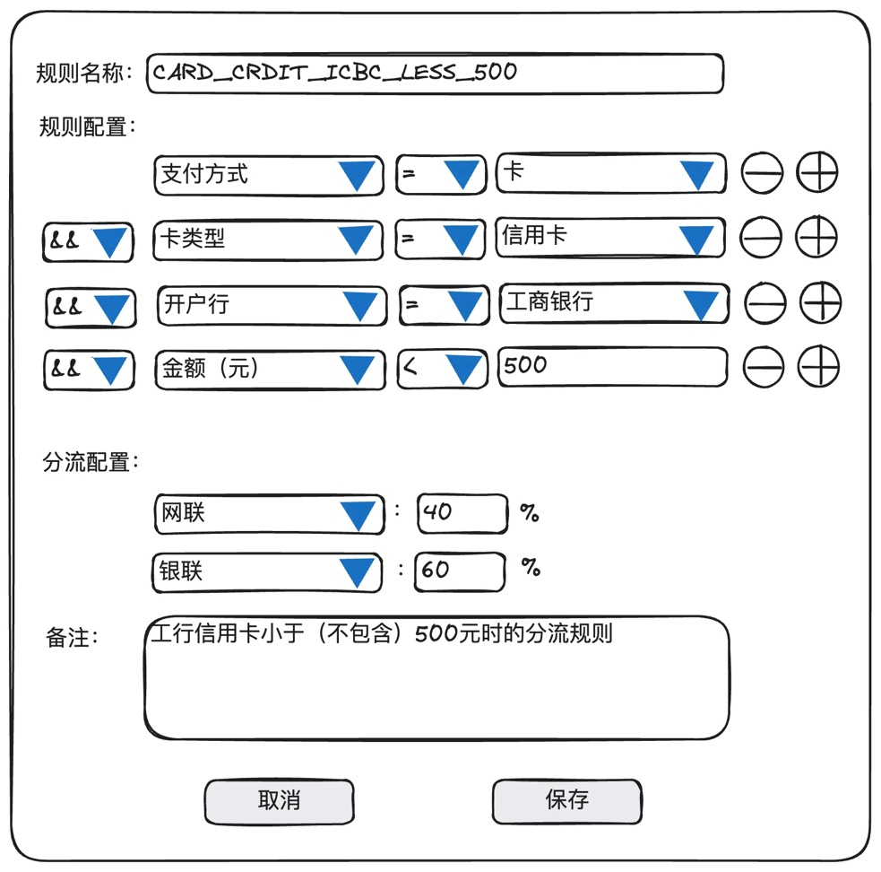

#### 说明：

1. 示例规则的业务诉求：工行信用卡500块以内(不包含）的40%走网联，60%走银联。

2. 后台保存的规则为：“paymentMethod='card'&& cardType='credit'&&bankName='ICBC'and amount < 500.00”，分流有2两条，分别是：“NUCC:40”，"∪PAY:60”。

3. 用于决策因子的元数据，需要提前定义好，包括这些字段的运算规则(比如开户行就不能使用大于、等于）。

#### 一些调优思路

<!-- PDF 第 278 页；原书第 275 页 -->

1. 用户最近支付成功记录优先，提高成功率。比如用户可以用银联，也可以使用网联，如果5天内最近一次使用了银联是成功的，那么为了成功率，可以考虑再次路由到银联去。因为从渠道风控的角度，已经成功的前提下，再次成功的可能性更大(余额不足除外）。

2. 根据用户ID做分流，而不是当前订单号做分流，或者完全随机数。也就是使用伪随机。好处是同一个用户更大概率走到同一个渠道，有利于提高成功率，进而提升用户体验。

3. 适当使用缓存，以提高运算速度。

### 15.2.6 加入自动化开关的渠道路由

外部渠道服务经常不稳定，通过自动化开关模块监听支付引擎或渠道网关的支付结果消息，实时计算渠道的状态，在渠道出现问题后自动关闭，并推送给渠道路由。

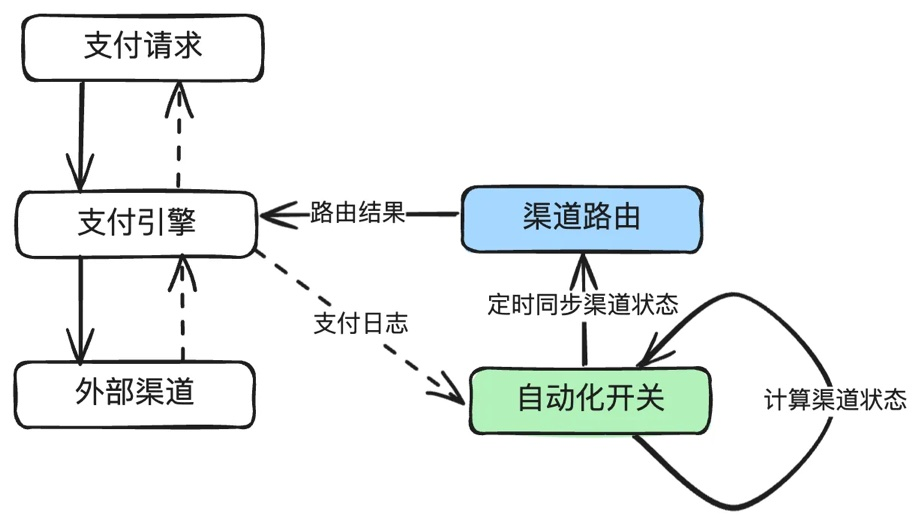

#### 说明：

1. 由自动化开关模块监听支付引擎的支付结果消息，每秒计算一次渠道的状态，在渠道出现问题后，自动关闭，并把结果推送给渠道路由。

2. 渠道关闭后，再发起探测服务，探测成功后，灰度打开渠道。

下图是渠道自动化渠道开关的示意图。有多种技术手段可以实现，基本原理就是基于滑动时间窗口算法来做，具体落地可以使用时序数据库，或者自己通过redis实现。

<!-- PDF 第 279 页；原书第 276 页 -->

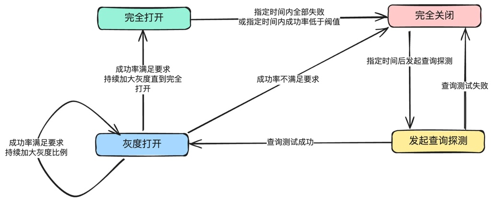

#### 说明：

1. 初始是完成打开。

2. 指定时间内全部失败或指定时间内成功率低于阈值，关闭渠道。

3. 指定时间后，发起查询，如果查询渠道失败，持续关闭。

4. 如果查询成功，就灰度打开，如果灰度打开后的成功率不满足要求，就继续关闭。

5. 如果灰度打开后的成功率满足要求，就持续加大灰度，直到完成打开。

后面会单独起一篇文章来讲自动化渠道开关的设计与实现。

### 15.2.7 高阶的智能路由

一些有实力的公司，通过算法和机器学习来做智能路由。所谓智能路由，就是不仅是根据路由规则来计算路由，而是根据当前的请求参数和渠道数据，综合成功率、成本、用户使用习惯、地域等多因子计算出最优的一条渠道。

这个方案有几个难题不好解决。

首先是公司实力足够强。有人才来做算法，且这些算法同学需要懂一点业务；

其次是经验不好总结。比如成功率提升了2%，是因为什么原因提升了？有一些不可解释性。

最后业务无法直接操作调优。比如有些场景下业务希望保成功率，有些场景下业务希望保较低的成本，智能路由如何调参？

<!-- PDF 第 280 页；原书第 277 页 -->

我个人更倾向于【规则路由+离线数据分析】的组合。其中离线数据分析平台可以引入一些算法来分析各因子对成功率的影响，供业务人员决策，并调整路由规则。

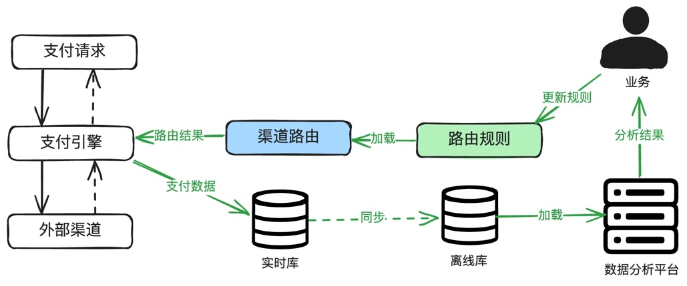

说明：

1. 通过分析数据，找到影响成功率成本的因子。

2. 更新路由规则。

3. 重复第1步。

## 15.3 小结

渠道开关和渠道路由在现代支付系统中扮演着至关重要的角色。自动化渠道开关就能发挥很大的效能，能够显著提升支付系统的稳定性和支付成功率，降低维护成本和人工于预频率。一个高效、灵活的渠道路由设计能够显著提升支付成功率，优化成本，并改善用户体验。
