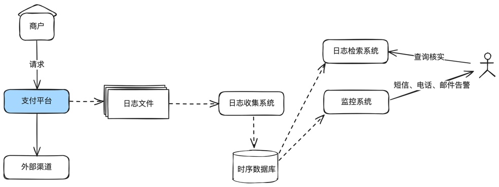
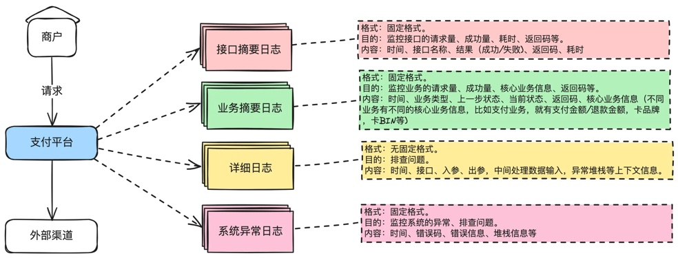

# 第16章 支付系统日志设计

> 来源：《图解支付系统设计与实现》V_0.1.0，隐墨星辰著。PDF 第 280–284 页。正文经 MinerU OCR 转换，原图保留。

<!-- PDF 第 280 页；原书第 277 页 -->

只要在公司写过代码，就一定打印过日志，但经常发现一些工作多年的工程师打印的日志也是乱七八糟的。我曾经在一家头部互联网公司接手过一个上线一年多的业务，相关日志一开始就没有设计好，导致很多监控无法实现，出了线上问题也不知道，最后只能安排工程师返工改造相关的日志。所以有必要聊聊这个话题。

## 什么是日志

<!-- PDF 第 281 页；原书第 278 页 -->

写过代码的同学一定再熟悉不过。日志本质就是一种系统记录文件，用于存储发生在操作系统、应用软件、网络和存储设备上的事件，主要用于问题诊断、审计和性能监控。

## 日志对于支付系统运行保障的重要性

日志的重要性相信不必多说，没有日志，系统上线后出问题就等于抓瞎。

在支付系统中，日志不仅用于记录交易详情和系统状态，还起到监控和安全审计的核心作用。它们帮助我们实时监控系统的健康状态，快速排查线上的问题。此外，在支付领域日志对于交易验证和法律合规性文档记录都是不可或缺的。

## 16.1 日志设计常见误区

设计日志系统时常见的误区包括：

1. 过度记录：记录大量无用信息，导致重要信息难以识别。

2. 格式混乱：不统一的日志格式给监控告警、日志分析和问题定位带来困难。

3. 忽视隐私和安全：未对敏感信息进行脱敏处理，增加数据泄露风险。比如卡号、身份证号、手机号等。

## 16.2 日志设计最佳实践

根据这么多年的实践，设计一个清晰的日志系统最少应遵循以下原则：

结构化日志：使用结构化数据格式记录，便于机器解析。这个尤其对监控系统有用。

日志分级：合理设置日志级别（如DEBUG、INFO、WARN、ERROR)，便于过滤和搜索。

标准化字段：标准化常用字段（如时间戳、日志级别、请求ID等），保持一致性。

<!-- PDF 第 282 页；原书第 279 页 -->

上下文信息：确保日志含有足够的上下文信息，方便定位问题，尤其是详细日志，一定要打印上下文信息。

脱敏处理：对于敏感数据，如手机号、卡号等，进行适当的脱敏处理。

分布式追踪ID：引入分布式追踪系统，为跨服务的请求分配唯一的追踪ID。

### 几个最佳实践

首先我们要明白日志是用来做什么的。只是先弄明白做事的目的，我们才能更好把事情做对。在我看来，日志有两个核心的作用：1)监控，诊断系统或业务是否存在问题；2）排查问题。

对于监控而言，我们需要知道几个核心的数据：业务/接口的请求量、成功量、成功率、耗时，系统返回码、业务返回码，异常信息等。对于排查问题而言，我们需要有出入参、中间处理数据的上下文、报错的上下文等。

接下来，基于上面的分析，我们就清楚我们应该有几种日志：

1.接口摘要日志。监控接口的请求量、成功量、耗时、返回码等。使用固定格式，需要打印：时间、接口名称、结果(成功/失败)、返回码、耗时等基本信息就足够。

2. 业务摘要日志。监控业务的请求量、成功量、核心业务信息、返回码等。使用固定格式，需要打印：时间、业务类型、上一步状态、当前状态、返回码、核心业务信息(不同业务有不同的核心业务信息，比如流入，就有支付金额/退款金额，卡品牌，卡BIN等)。

3. 详细日志。用于排查问题，不用于监控。格式不固定。主要包括时间、接口、入参、出参、中间处理数据输入、异常的堆栈信息等。

4. 系统异常日志。同时用于监控。格式固定。需要打印：时间、返回码、错误信息、堆栈信息等。

<!-- PDF 第 283 页；原书第 280 页 -->

补充一个典型的支付场景下的业务日志格式如下：

文件名：payment.biz.digest.log

格式规范：

[时间,分布式追踪ID,环境标,压测标,站点标,请求来源系统,上游请求ID,上游支付ID,我方系统业务ID],[交易类型,交易币种,交易金额,上一个状态,当前状态],[渠道名,收单国家,发卡行,卡品牌,风控参数],[我方标准返回码,我方标准返回码描述,渠道返回码,渠道返回码描述]

日志示例：[2024-01-04

20:02:32.239,293242318382329329232,P,0,UK,payment,2024010401203223220001,20240

10401203223220001,2024010401203223220003],[pay,USD,2392,INIT,PAYING],

[WPG,US,CMB,VISA,2D],[-,-,-,-]

说明：上面的日志使用[]进行了块分隔，第一个[]里面是基础信息，第二个[]里面是交易信息，第三个[]里面是渠道信息，第四个[]里面是返回码信息。

使用[]切割的好处是，如果后面要加字段，可以找到对应的位置增加。不影响现有监控。比如我要加个卡BIN，那就可以在风控参数后面加，不影响返回码监控位置。

### 有几点特别补充说明：

1. 正常业务和系统异常需要拆分出来。NPE就是系统异常，余额不足就是一个预期内的业务场景，不要打印到异常文件中。

2. 业务摘要信息需要根据业务不同，设计不同的业务摘要日志格式。比如支付、流出提现的交易，路由、渠道咨询等，监控诉求是不一样的，所以需要单独设计。拿路由举例，需要监控哪些渠道分流了多少，命中了哪个规则等，必然不能直接使用支付、退款的业务摘要日志格式。所以每出现一种新业务，就需要单独设计一种业务日志。

3. 接口摘要日志，不要打印出入参。因为出入参有可能包含非常多数据，而接口我们只关注请求量、结果、耗时这些就够了，如果想查出入参，就去详细日志里面查。

4. 系统异常日志一定要有单独的日志文件。因为正常的系统，绝大部分是业务上报错，比如余额不足，而不应该有很多NPE等系统异常。我们需要监控异常日志的行数或特定返回码的频率比如每分钟有X行或每分钟有Y个特定返回码就需要告警出来。

## 16.3 小结

<!-- PDF 第 284 页；原书第 281 页 -->

日志系统是支付系统关键的支撑组件，一个良好设计的日志系统可以为监控、告警和问题排查提供强有力的支持，反之，对于线上问题简直就是恶梦。

本章主要讲了日志格式规范的设计，对于log4j的配置什么的，网上已经有很多公开资料，这里不再赘述。另外，分布式环境下面还有日志转存、查询等，也是一个很庞大的体系，建议参考专业技术书籍。
