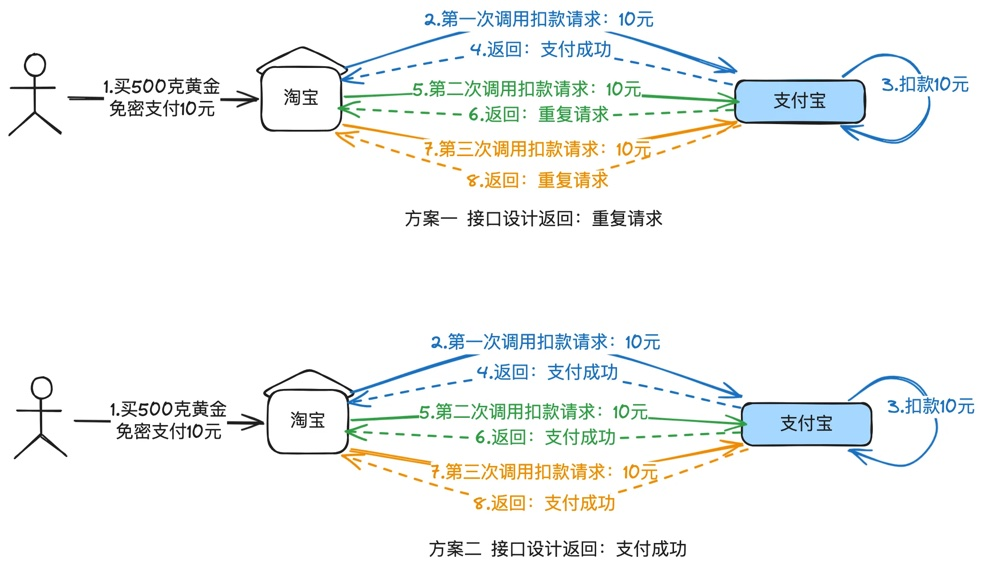
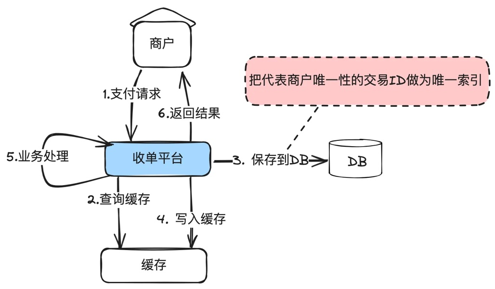
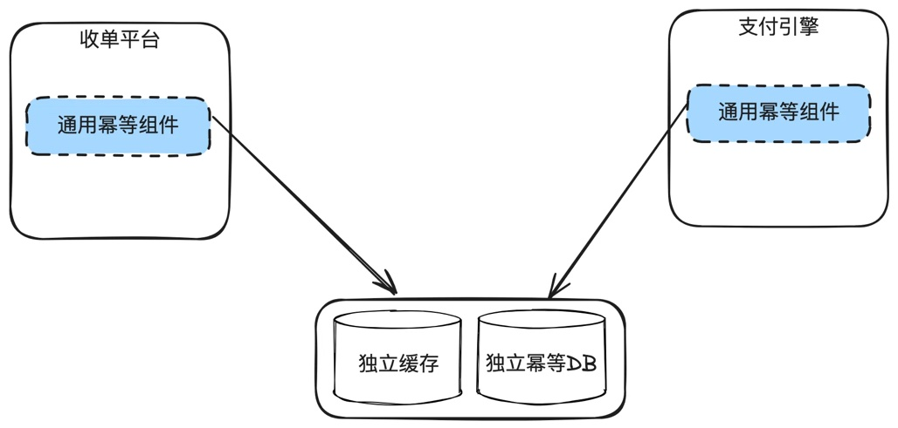
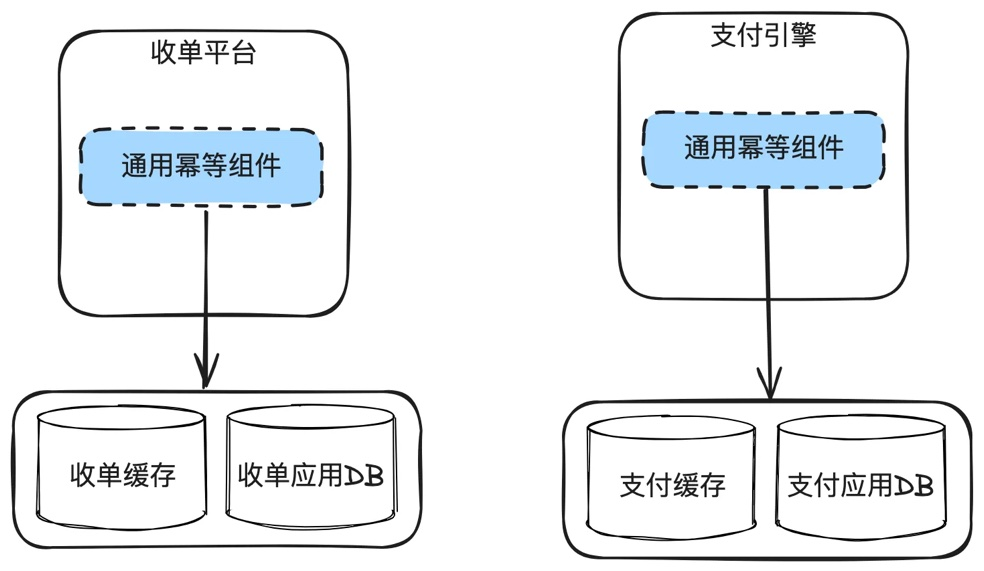
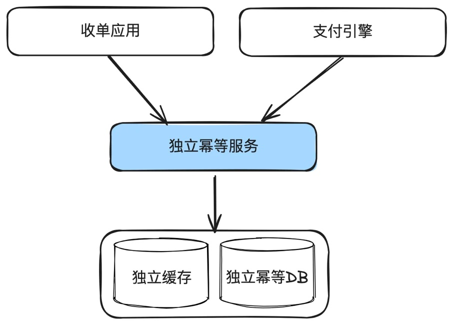
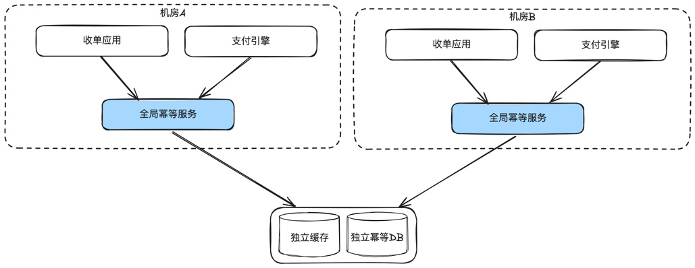

# 第17章 分布式支付系统的幂等性原理与实践

> 来源：《图解支付系统设计与实现》V_0.1.0，隐墨星辰著。PDF 第 284–290 页。正文经 MinerU OCR 转换，原图保留。

<!-- PDF 第 284 页；原书第 281 页 -->

## 17.1 什么是幂等及为什么幂等对支付系统如此重要

### 什么是幂等

幂等性是一个数学和计算机科学术语，用于描述无论操作执行多少次，都产生相同结果的属性。在软件行业，应用极其广泛，当我们说一个接口支持幂等时，无论调用多少次，对系统造成的结果是一致的。

注意这里说的“对系统造成的结果是一致的”是指系统内部数据或状态的变更，不是指返回值。不同的系统设计，返回值可能是不一样的。

举个例子，你在淘宝免密支付10元，淘宝针对这笔订单调用支付宝支付接口进行支付，无论是调用1次，还是调用100次，最终只扣了你10元。但是第二次有可能返回“重复请求”，也有可能返回“支付成功”，这个取决于接口设计。也就是支付宝内部只扣了你10元，但是接口可能返回给商户是是不同的结果。

<!-- PDF 第 285 页；原书第 282 页 -->

我个人倾向于方案一，如果被幂等，就返回：重复请求。减少误解，虽然两种方案中系统都只扣了一次钱。

### 为什么幂等性在支付系统中极其重要

支付系统必须以最高的可靠性和准确性处理交易，这对于用户信任至关重要。如果一个支付系统不能保证幂等性，可能会导致多次扣除同一笔费用，引发用户不满和法律责任，严重时就会有舆情风险，甚至会被吊销牌照。

一般情况下，支付系统的幂等性能力要求比电商系统要求更高，如果用户在电商下单多了，只要没有支付，用户还是可以忍受的，但一旦多扣了用户的钱，后果就会比较严重。

这也是为什么幂等性会是支付系统招人的面试必考题目之一。

### 支付系统中应用幂等性的场景

幂等是针对重复请求的，支付系统一般会面临以下几个重复请求的场景：

1. 用户多次点击支付按钮：在网络较差或系统过载情况下，用户由于不确定交易是否完成而重复点击。

2. 自动重试机制：系统在超时或失败时重试请求，可能导致同一支付多次尝试。

3. 网络数据包重复：数据包在网络传输过程中，复制出了多份，导致支付平台收到多次一模一样的请求。

<!-- PDF 第 286 页；原书第 283 页 -->

4. 异常恢复：在系统升级或崩溃后，未决事务需要根据已有记录恢复和完成。内部系统重发操作。

## 17.2 幂等解决方案

业务幂等

所谓业务幂等，就是由各域自己把唯一性的交易ID作为数据库唯一索引，这样可以保证不会重复处理。

在数据库前面可以加一层缓存来提高性能，但是缓存只用于查询，查到数据认为就返回幂等成功，如果查不到，需要尝试插入数据库，插入成功后再刷新数据到缓存。

为什么要使用数据库的唯一索引作为兜底，是因为缓存是可能失效的。

在面临时经常有同学只回答到“使用redis分布式锁来实现幂等”，这是不对的。因为缓存有可能失效，分布式锁只是用于防并发操作的一种手段，无法根本性解决幂等问题，幂等一定是依赖数据库′的唯一索引解决。

大部分简单的支付系统只要有业务幂等基本也够用了。

### 通用幂等组件

<!-- PDF 第 287 页；原书第 284 页 -->

每个域都要做幂等处理，那就单独出一个独立的幂等组件，各子业务系统通过引用这个公共JAR包解决。

适用场景：应用部署不太多的时候。如果应用非常多，独立幂等数据库的连接池就不够用。

这个时候，可以把幂等组件的代码共用，但是幂等数据库表使用业务系统的数据库资源。解决独立幂等数据库导致的连接数不够用的场景。

<!-- PDF 第 288 页；原书第 285 页 -->

### 通用幂等服务

解决数据库连接数不够用的第二个解决方案：幂等组件服务化。这样的坏处就是复杂度和耗时都会增加。

### 全局幂等

在多机房部署情况下，需要解决机房之间的幂等服务。这就使用到了全局幂等概念。

<!-- PDF 第 289 页；原书第 286 页 -->

所谓全局幂等，就是多个机房共用一份幂等数据，这里面涉及的技术比较复杂，后面单独开一个章节讲。除了极少数全球部署的多活支付系统都用不上。

### 通用幂等数据库表设计

核心字段：

uniqueKey：幂等主键，由各应用自定义，需要保证全局唯一性，使用这个uniqueKey做hash后分库分表。比如商户的收单ID，上游的ID等。

appName: 应用名称，比如收单，支付等。

siteld：站点ID

extInfoMap：扩展字段，由各应用自定义，比如保存我方单号。

### 方案选型建议

简单的支付系统，只需要使用业务幂等就够。

中型的支付系统，推荐使用通用幂等组件。这样方便运维。

全局幂等方案只有极少数公司会考虑。

### 分布式场景下实现幂等性的挑战及应对

分布式支付系统面临的幂等性挑战核心有两点：

1. 如何保证分布于不同地理位置数据中心的系统数据的一致性。

2. 幂等数据和业务数据跨库事务一致性。比如幂等已经入库成功，但是业务数据库入库失败。

为了解决这些挑战，可以采取以下解决方案：

1. 使用全局唯一的交易ID，跟踪每次支付请求，防止重复处理。

2. 幂等住了之后，还需要继续查询业务数据，如果查询失败，仍然执行业务操作。

3. 构建强大的状态机推进能力，严格定义事务各个状态的转换。

4. 幂等服务的高可靠性。

### 幂等被击穿场景及可能的严重后果

<!-- PDF 第 290 页；原书第 287 页 -->

尽管有了上述措施，幂等性仍然可能因为以下原因失效：

1. 在分布式系统中，由于同步延迟，导致多个节点未能即时识别重复请求。

2. 请求流量切换。原本应该路由A机房的数据路由到了B机房，但是B机房的幂等数据缺失。

3. 生成全局唯一ID的算法出现故障或人为变更，同一笔业务可能出现了2个业务ID。

在支付系统中，只要幂等被击穿，基本上都会出现资损事件。有时候是用户资损，有时候是平台资损。曾经碰到一个真实案例，上游域把某个幂等字段组成规则的取值变了，但是下游不知道，导致下游幂等失败，对同一笔业务处理了2次，直接资损数十万美金。

## 17.3 小结

幂等性是分布式支付系统的基本要求，对于确保交易的正确性和避免重复扣费至关重要。除开支付系统外，很多互联网应用基本上都需要有幂等能力。
