# 第18章 分布式流控

> 来源：《图解支付系统设计与实现》V_0.1.0，隐墨星辰著。PDF 第 290–327 页。正文经 MinerU OCR 转换，原图保留。

<!-- PDF 第 290 页；原书第 287 页 -->

市场上有很多优秀的开源流控中间件，但大部分无法做到分布式高精度极低流量，比如要求全集群1TPS，因为这些流控中间件通常把限流数字按机器平均计算后，分到各机器，最低流量等于集群机器数。但是有些境外的银行因为基础设施比较差，某些接口要求最高1TPS，那就需要自己实现一个分布式流控组件。

本章主要介绍分布式场景下常用的并发流量控制方案，包括固定时间窗口、滑动时间窗口、漏桶、令牌桶、分布式消息中间件等。

## 18.1 流控应用场景

在互联网应用里面，并发流量控制无所不在。在支付系统中，流量控制同样是一个关键的技术方面，主要用于确保系统的稳定性和可靠性，尤其在高流量的情况下。以下是一些主要使用流量控制的场景：

1. 对外API限流：对外提供的API（如支付接口）需要限流来保护后端服务不会过载。

2. 保护外部渠道：大促时，对下流渠道的支付流量要做削峰填谷，避免突发流量把渠道打挂。

3. 保护内部应用：大促时，内部各应用要根据流量模型配置限流值，避免形成雪崩。

<!-- PDF 第 291 页；原书第 288 页 -->

4. 满足外部退款限流要求：电商批量提交退款时，支付系统内部要在分布式集群环境下对某个渠 道实现低至1TPS的退款并发，避免超过渠道退款并发导致大批量失败。

特别说明的是，流量控制通常包括限流和限速。

限流：就是流量达到一定程度，超过的流量会全部立即拒绝掉，也就是快速失败。比如上面的API限流。

限速：一般是指接收流量后，先保存到队列中，然后按指定的速度发出去，如果超过队列最大值，才会拒绝。比如上面的支付流量和退款流量打到外部渠道。

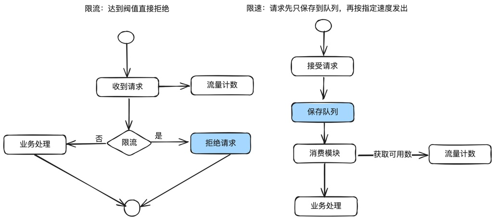

另外，支付和退款流量控制虽然都是流量控制，但有一些细小的区别：

1. 支付的限流TPS通常比较高，从十几TPS到几百TPS都有，排队时效性要求很高，秒级内就要付出去。

2. 退款的限流TPS通常比较低，在国外的基础设施建设很差，甚至部分渠道要求退款1TPS。但是排队时效性要求很低，几天内退出去就行。

## 18.2 几种方案对比

固定窗口：算法简单，对突然流量响应不够灵活。超过流量的会直接拒绝，通常用于限流。

滑动窗口：算法简单，对突然流量响应比固定窗口灵活。超过流量的会直接拒绝，通常用于限流。

<!-- PDF 第 292 页；原书第 289 页 -->

漏桶算法：在固定窗口的基础之上，使用队列缓冲流量。提供了稳定的流量输出，适用于对流量平滑性有严格要求的场景。后面会介绍如何应用到外部渠道退款场景。

令牌桶算法：在滑动窗口的基础之上，使用队列缓冲流量。能够允许一定程度的突发性流量，但实现较为复杂。

分布式消息中间件：如Kafka和RabbitMQ等，能够有效地对消息进行缓冲和管理，增加系统复杂性，且如果需要精确控制流量还需要引入额外的机制。后面会介绍如何应用到外部渠道支付场景。

Sentinel：阿里开源的流控与熔断利器，提供实时的监控、熔断、降级、限流等功能。后面会 单独介绍。

## 18.3 固定时间窗口算法

### 18.3.1 固定时间窗口算法原理

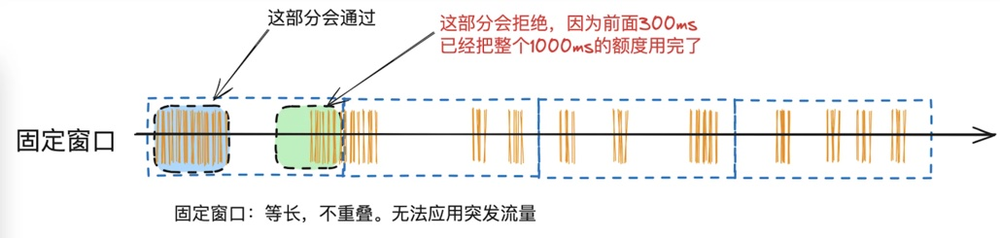

固定窗口算法，也称为时间窗口算法，是一种流量控制和速率限制策略。此算法将时间轴分割成等长、不重叠的时间段，称为“窗口”。每个窗口都有一个独立的计数器，用于跟踪窗口期间的事件数量（如API调用、数据包传输等）。

固定窗口算法的好处是简单，缺点也很明显，就是无法应对突发流量，比如每秒30并发，如果前100ms来了30个请求，那么在10ms内就会把30个请求打出去，后面的900ms的请求全部拒绝。

工作流程：ę

1. 窗口定义：首先确定窗口大小，比如1秒钟。

2. 计数：每当发生一个事件（比如一个请求到达），就在当前窗口的计数器上加一。

<!-- PDF 第 293 页；原书第 290 页 -->

3.限制检查：如果当前窗口的计数器达到预设阈值，则拒绝新的请求。直到下一个窗口开始。

4. 窗口重置：当前窗口结束时，计算数器重置为零，开始下一个窗口计数。

### 18.3.2 固定时间窗口在支付系统中的应用场景

主要用于简单的限流。比如在渠道网关做限流，发送渠道的请求最大不能超过测算出来的值避免渠道侧过载，可能会导致支付请求批量失败。

是有损服务的一种实现方式。

### 18.3.3 使用redis实现的核心代码

为什么选择redis?因为在分布式场景下，限流需要有一个集群共用的计算数来保存当前时间窗口的请求量，redis是一个比较优的方案。

场景示例：WPG渠道的支付每秒不能超过20TPS。

那么设计key=“WPG-PAY”+当前时间戳(精确到S)，数据过期时间为2S（这个过期时间主要是兼容各服务器的时间差）。

下面是流程图：

<!-- PDF 第 294 页；原书第 291 页 -->

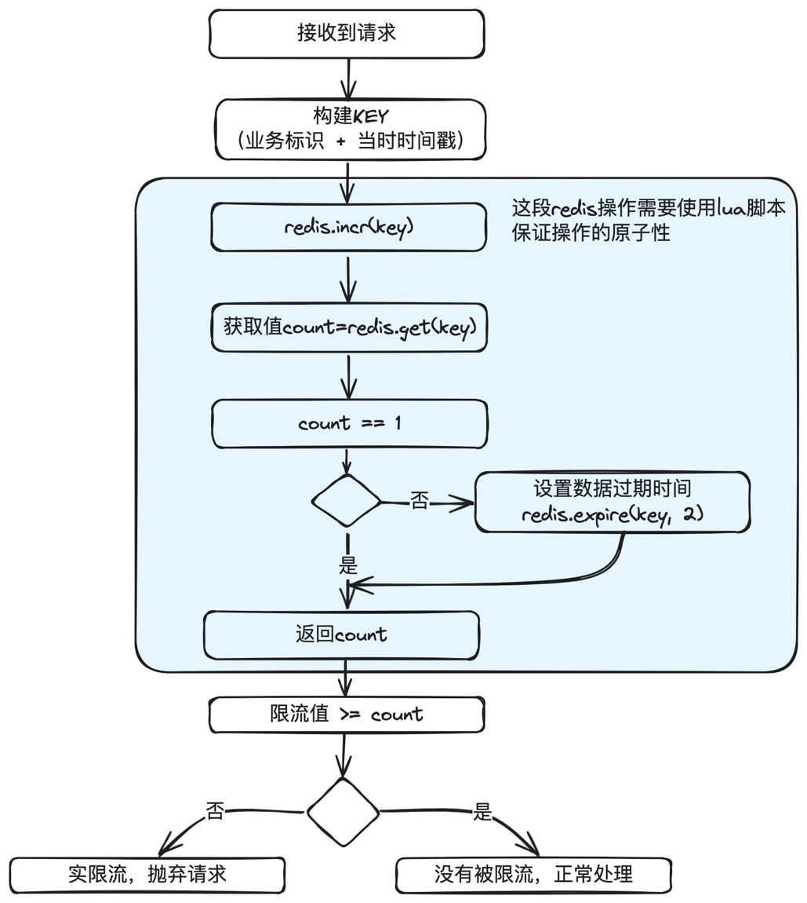

lua脚本：limit.lua

<!-- PDF 第 295 页；原书第 292 页 -->

```lua
local key = KEYS[1]
-- 默认为2S超期，精确到S级。也可以改造成由外面传进来 --
local expireTime = 2
-- 先自增，如果不存在就自动创建 --
redis.incr(key);
local count = tonumber(redis.call("get", key))
-- 如果结果为1，说明是新增的，设置超时时间 --
if count == 1 then
    redis.call("expire", key, expireTime)
end
return count;
```

redis操作类：RedisLimitUtil

<!-- PDF 第 296 页；原书第 293 页 -->

```java
/**
 * redis限流操作类
 */
@Component
public class RedisLimitUtil {
    // 限流脚本
    private static final String LIMIT_SCRIPT_LUA = "limit.lua";
    @Autowired
    private RedisTemplate<String, Object> redisTemplate;
    private DefaultRedisScript<Long> limitScript;

    /**
     * 缓存脚本
     */
    @PostConstruct
    public void cacheScript() {
        limitScript = new DefaultRedisScript();
        limitScript.setScriptSource(new ResourceScriptSource(new ClassPathResource(LIMIT_SCRIPT_LUA)));
        limitScript.setResultType(Long.class);

        List<Boolean> cachedScripts = redisTemplate.getConnectionFactory().getConnection().scriptExists(
            limitScript.getSha1());
        // 需要缓存
        if (CollectionUtils.isEmpty(cachedScripts) || !cachedScripts.get(0)) {
            redisTemplate.getConnectionFactory().getConnection().
            scriptLoad(redisTemplate.getStringSerializer().serialize(limitScript.getScriptAsString()));
        }
    }

    /**
     * 判断是否限流
     * 这里不考虑超过long最大值的情况，系统在达到long最大值前就奔溃了。
     */
    public boolean isLimited(String key, long countLimit) {
        Long count = redisTemplate.execute(limitScript, Lists.newArrayList(key));
        return countLimit >= count;
    }

}
```

<!-- PDF 第 297 页；原书第 294 页 -->

使用：PayServicelmpl

```java
/**
 * 支付服务示例
 */
public class PayServiceImpl implements PayService {
    @Autowired
    private RedisLimitUtil redisLimitUtil;

    @Override
    public PayOrder pay(PayRequest request) {
        if (isLimited(request)) {
            throw new RequestLimitedException(buildExceptionMessage(request));
        }

        // 其它业务处理
        ... ...
    }

    /*
     * 限流判断
     */
    private boolean isLimited(PayRequest request) {
        // 限流KEY，这里以[业务类型 +渠道]举例
        String key = request.getBizType() + request.getChannel();
        // 限流值
        Long countLimit = countLimitMap.get(key);

        // 如果key对应的限流值没有配置，或配置为-1，说明不限流
        if (null == countLimit || -1 == countLimit) {
            return false;
        }

        return redisLimitUtil.isLimited(key + buildTime(), countLimit);
    }
}
```

注释写得比较清楚，没有什么需要补充的。

<!-- PDF 第 298 页；原书第 295 页 -->

## 18.4 滑动时间窗口算法

### 18.4.1 滑动时间窗口原理

滑动窗口算法是一种更为灵活的流量控制方案，它比固定窗口算法能更平滑地处理突发流量。在滑动窗口中，时间窗口是重叠的，这意味着流量的计算是基于过去的一段连续时间内发生的事件。

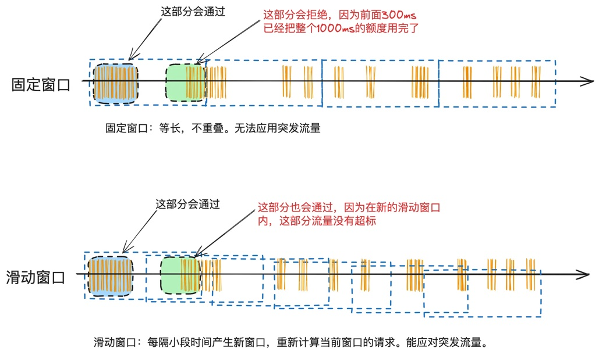

#### 工作流程：

1. 窗口定义：确定窗口的大小，例如1秒钟，并设置窗口的滑动间隔，比如100毫秒。

2. 计数与滑动：每个窗口都有自己的计数器。当一个新请求到达时，增加当前时间窗口及其前面相邻的窗口的计数。

3. 限制检查：如果任何连续时间段内的请求总数超过阈值，则拒绝新的请求。

4. 窗口更新：随着时间的推移，不断向前滑动窗口，并更新相应的计数器。

### 18.4.2 滑动时间窗口在支付系统中的应用场景

滑动时间窗口在支付系统中的应用场景主要也是各种精确限流，比如把前一篇讲的固定时间窗口算法中，我们对外部渠道请求会做限流，那么就可以升级到滑动时间窗口，以提高精度。

<!-- PDF 第 299 页；原书第 296 页 -->

只要是API限流，都可以使用。

### 18.4.3 使用redis实现的核心代码

滑动窗口可以通过队列或循环数组来实现。每个窗口对应队列中的一个元素，记录该窗口期间的请求数。当时间滑动时，更新队列头部的元素，并可能将旧的元素出队。

在Redis中，可以使用列表或有序集合来模拟这种滑动窗口。下面是一个Rdis实现的示例，使用有序集合(sorted set)来实现了滑动时间窗口算法：

```java
/**
 * redis限流操作类
 */
@Component
public class RedisLimitUtil {
    @Autowired
    private RedisTemplate<String, Object> redisTemplate;
    // 滑动时间窗口大小
    private static final long WINDOW_SIZE_IN_SECONDS = 1000;

    /**
     * 判断是否限流
     * 这里不考虑超过long最大值的情况，系统在达到long最大值前就奔溃了。
     */
    public boolean isLimited(String key, String reuqestId, long countLimit) {
        // 使用Redis的多个命令来实现滑动窗口
        redisTemplate.zremrangeByScore(key, 0, currentTimeMillis - WINDOW_SIZE_IN_SECONDS);
        long count = redisTemplate.zcard(key);

        if (countLimit >= count) {
            redisTemplate.zadd(key, currentTimeMillis, reuqestId);
            return true;
        } else {
            return false;
        }
    }
}
```

每个请求都以其发生的时间戳作为分数(SCORE)存储在集合中。通过移除旧于当前时间窗口的请求来维护滑动窗口。通过检查集合中的元素数量，以确定是否超过了设定的最大请求数。

• zremrangeByScore 用于移除窗口之外的旧请求。

<!-- PDF 第 300 页；原书第 297 页 -->

• zcard 获取当前窗口内的请求数量。

● zadd 将新请求添加到集合中。

使用：PayServicelmpl

```java
/**
 * 支付服务示例
 */
public class PayServiceImpl implements PayService {
    @Autowired
    private RedisLimitUtil redisLimitUtil;

    @Override
    public PayOrder pay(PayRequest request) {
        if (isLimited(request)) {
            throw new RequestLimitedException(buildExceptionMessage(request));
        }

        // 其它业务处理
        ... ...
    }

    /*
     * 限流判断
     */
    private boolean isLimited(PayRequest request) {
        // 限流KEY，这里以[业务类型 + 渠道]举例
        String key = request.getBizType() + request.getChannel();
        // 限流值
        Long countLimit = countLimitMap.get(key);

        // 如果key对应的限流值没有配置，或配置为-1，说明不限流
        if (null == countLimit || -1 == countLimit) {
            return false;
        }

        return redisLimitUtil.isLimited(key, request.getRequestId(), countLimit);
    }
}
```

<!-- PDF 第 301 页；原书第 298 页 -->

需要注意一点的是，这次需要传入requestld进去，用于保存这个requestld在redis有序队列里的分数，用于计数和清理。

其它的注释写得比较清楚，没什么补充的。

### 18.4.5 注意事项

一些分布式服务框架，为了更高的可靠性，他们使用的是本地计算。比如接口限流1000TPS，一共有20台应用服务器，框架就会把计算出每台机器是50个TPS，下发给所有的应用服务器，在服务器上线、下线过程中，可能会有一段时间是不准确的。

但在渠道限流应该中，因为每个渠道的流量都不太高，所以可以使用这种redis方案。且精度更高，不受应用服务器的上、下线影响。

另外，在分布式系统中，需要确保不同节点之间的时间同步，以保证流量计算的准确性。如果应用服务器之间的时间不同步，那么流量就会计算错误。

## 18.5 漏桶算法

### 18.5.1 漏桶算法原理

漏桶算法通过模拟水桶漏水的过程来控制数据的传输速率。它允许短时间的突发数据流，随后以恒定的速率排空积聚的数据。这种机制特别适合于需要平滑处理瞬时高流量冲击，但后端需要恒定速率处理的场景。比如批量接收上游商户的退款，然后根据渠道的要求以极低的TPS慢慢退出去到渠道。

最简单的理解，漏桶=队列+固定窗口算法。其中队列用于先保存数据。固定窗口算法用于获取可用计数，获取到就从队列获取一个请求进行业务处理。

<!-- PDF 第 302 页；原书第 299 页 -->

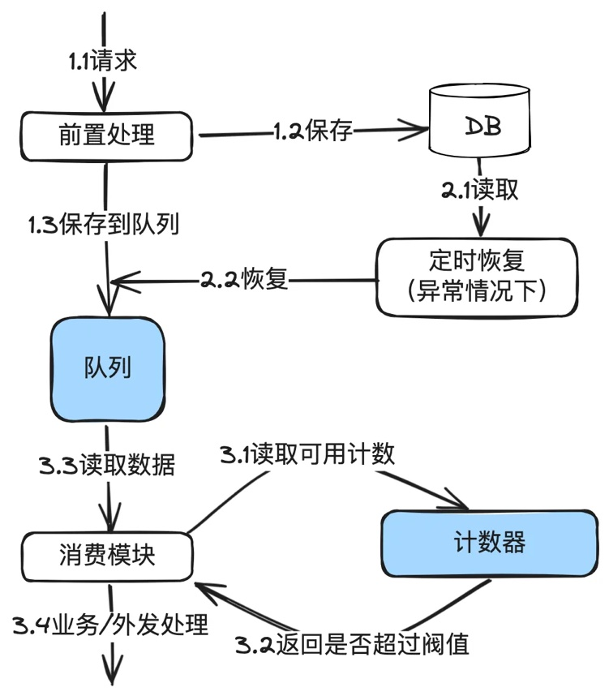

#### 工作原理：

1. 桶容量：漏桶有一个固定的容量，代表在任何时刻系统能够容纳的最大请求量。比如上面图中的队列。

2. 数据流入：数据来了后就保存到桶(队列）中，如果桶已满，则溢出的数据会被丢弃。

3.恒定速率流出：数据以固定的速率从桶中“漏出”，即被处理。这个速率是预先设定的，与请求量无关。

4. 计数器最简单的做法，就是把固定时间窗口的代码用起来。

5. 保存到数据库，是为了持久化，以及队列出现问题时，可以重新恢复。

### 18.5.1 在支付系统下的应用场景

<!-- PDF 第 303 页；原书第 300 页 -->

中国的IT基础设施领先于全球各个国家，各大银行和第三方钱包也被各电商双十一等大促场景狂虐之后进化到支持极高的TPS，但是在跨境场景下，比如东南亚或南美的国家，他们的银行IT基础设施差，系统老旧，无法支持高并发流量。甚至碰到过一些银行要求退款只能有1TPS。

在分布式场景下，要做到1TPS的高精度限流，只能依赖漏桶来做。

### 18.5.2 Redis实现漏桶的核心代码

漏桶算法通常通过队列+固定时间窗口计数法来实现。队列存储待处理的请求，而一个线程以固定速率从队列中取出并处理这些请求。

为什么又是Redis？因为前面已经实现过Redis版本的固定时间窗口算法，再加一个队列就可以搞定。当然读者也可以选择其它的方案实现，这只是一个抛砖引玉。

下面是单机版本的伪代码：

<!-- PDF 第 304 页；原书第 301 页 -->

```java
public class LeakyBucket {
    private final int capacity;
    private final long leakIntervalInMillis;
    private final LinkedBlockingQueue<Data> bucket;

    public LeakyBucket(int capacity, long leakRateInMillis) {
        this.capacity = capacity;
        this.leakIntervalInMillis = leakRateInMillis;
        this.bucket = new LinkedBlockingQueue<>(capacity);
    }

    // 尝试添加数据到桶中
    public boolean addToBucket(Data data) {
        return bucket.offer(data);
    }

    // 启动桶的漏水过程
    public void startLeaking() {
        new Thread(() -> {
            while (true) {
                try {
                    Data data = bucket.poll(leakIntervalInMillis, TimeUnit.MILLISECONDS);
                    if (data != null) {
                        process(data);
                    }
                } catch (InterruptedException e) {
                    log.debug("Leaking process interrupted");
                    continue;
                }
            }
        }).start();
    }

    // 处理桶中的数据
    private void process(Data data) {
        // 业务处理
        ... ...
    }
}
```

上面单机的代码实用性不高，因为在分布式环境下，并发请求量是根据部署机器累计起来的，1台机器限流1TPS，20台机器就到了20TPS。

<!-- PDF 第 305 页；原书第 302 页 -->

优化为分布式：

<!-- PDF 第 306 页；原书第 303 页 -->

```java
class LeakyBucketHolding {
    private final LinkedBlockingQueue<Data> bucket;
    private int limit;
    private String bizType;

    public LeakyBucketHolding(String bizType, int capacity, int limit) {
        this.bizType = bizType;
        this.bucket = new LinkedBlockingQueue<>(capacity);
        this.limit = limit;
    }

    // 其它代码略
}


class LeakyBucket {

    @Autowired
    private RedisLimitUtil redisLimitUtil;

    private Map<String, LeakyBucketHolding> leakyBucketHoldingMap = new HashMap();


    // 添加数据到桶中
    public boolean addData(Data data) {
        String key = buildKey(data);
        LeakyBucketHolding holding = leakyBucketHoldingMap.get(key);
        if (null == holding) {
            holding = buildHolding(data);
            leakyBucketHoldingMap.put(key, holding);
        }
        return holding.getLinkedBlockingQueue().offer(data);
    }

    public Data getData() {
        for(LeakyBucketHolding holding : leakyBucketHoldingMap.values()) {
            if(holding.getBucket().size() == 0) {
                return null;
            }

            /* RedisLimitUtil的实现参考
             * "精确掌控并发：固定时间窗口算法在分布式环境下并发流量控制的设计与实现"中的示例代码
             */
```

<!-- PDF 第 307 页；原书第 304 页 -->

```java
            boolean limited = RedisLimitUtil.isLimited(holding.getBizType(), holding.getLimit());
            if (limited) {
                  return null;
            }

            try {
                return holding.getBucket().poll(10, TimeUnit.MILLISECONDS);
            } catch (InterruptedException e) {
                log.log("Leaking process interrupted");
            }
            return null;
        }
    }
}
```

上面的代码只是写一个示例，也没有做方法的抽取，真实的代码会比这个写得更优雅一点，读者将就看一下，理解思路就行。

代码使用的是内存列队，也就是请求过来后，先保存到数据库，然后发到内存队列。在重启服务器时，内存列队的数据会丢失，这种情况下，依赖定时任务从数据库中恢复任务到内存列队。

还有一种做法，就不使用内存队列，而是使用redis来实现队列。代码如下：

<!-- PDF 第 308 页；原书第 305 页 -->

```java
public class LeakyBucket {
    // 其它代码略
    ... ...

    // 添加数据到队列中
    public void addData(Data data) {
        return redisTemplate.rpush(data.getBizType(), data);
    }


    // 添加数据到队列中
    public Data getData(String bizType) {
        return redisTemplate.lpop(bizType);
    }

    // 其它代码略
    ... ...
}
```

退款流量控制实例：RefundServicelmpl

<!-- PDF 第 309 页；原书第 306 页 -->

```java
/**
 * 支付服务示例
 */
public class RefundServiceImpl implements RefudnService {
    @Autowiread
    private LeakyBucket leakyBucket;

    @Override
    public RefundOrder refund(RefundRequest request) {
        // 前置业务处理
        ... ...

        Data data = buildData(request);
        leakyBucket.addData(data);

        // 其它业务处理
        ... ...
    }

    @PostConstruct
    public void init() {
        new Thread(() -> {
            while (true) {
                Data data = leakyBucket.getData();
                if (null != data) {
                    process(data);
                } else {
                    sleep(10);
                }
            }
        }).start();
    }
}
```

在代码中可以看到，退款请求来后，只需要往桶里扔就完事。然后等另外的线程按固定速度发出去。

#### 代码中还存在的问题：

1. 上述代码只是示例，真实的代码还有很多异常处理，比如队列数据丢失，需要重新处理。

2. 暂时只能用于退款，因为退款的时效要求不高。另外，单机只需要开一个线程就行，因为服务器是分布式部署，多个服务器合并起来仍然是多个线程在并发处理。对退款是足够的。

<!-- PDF 第 310 页；原书第 307 页 -->

另外，为什么不直接使用RabbitMQ或Kafaka等消息中间件来做队列？主要是因为有些公司使用自码的消息中间件，可能只有推模型而没有拉的模式。

如果只有推的模式，就会出现推下来后发现限流，又抛回来，来回做无用功。

如果消息中间件有拉的模式，同时配合redis的固定窗口实现，也是完全没有问题的。

## 18.6 令牌桶算法

### 18.6.1 令牌桶算法原理

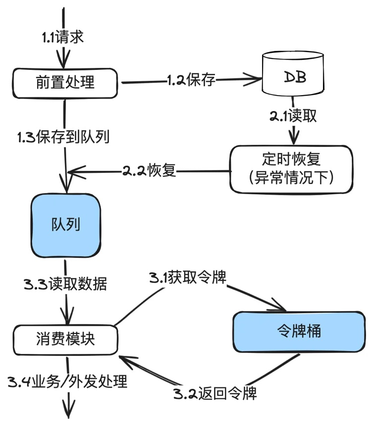

<!-- PDF 第 311 页；原书第 308 页 -->

令牌桶算法是一种流量整形和流量控制机制。它的核心思想是以固定速率放入令牌到桶中，每个传入请求需要获取一个令牌才能继续执行。如果桶中无令牌可用，则请求要么等待，要么被拒绝。这种机制允许突发流量的发生，同时通过限制令牌的放入速率控制数据的平均传输率。

1. 令牌桶：令牌桶本质上是一个存放令牌的容器，其中令牌代表着可以执行某个操作的许可或权利。这个桶以固定的速率往其中放入令牌。

2. 令牌生成速率：令牌桶算法规定了每秒往令牌桶中添加令牌的速率，通常以令牌/秒(Tokens Per Second，TPS) 或类似的单位来表示。

3. 令牌消耗：当一个请求到来时，它需要获取一个令牌才能继续执行。如果桶中有可用令牌，请求将获得一个令牌，并被允许执行。否则，请求将被阻塞或拒绝。

4. 限制速率：通过控制令牌生成速率，令牌桶算法限制了请求的速率，确保不会发生过于频繁的请求，从而避免了系统的过载。

5. 处理突发流量：令牌桶允许短时间内处理突发流量，因为它可以在桶中积累多个令牌，允许一次性处理多个请求，但仍然受到桶的容量限制。

6. 令牌桶容量：令牌桶还具有一个容量，表示桶中最多可以存放多少个令牌。如果桶已满，新的令牌将被丢弃。

从上面的图中可以看到，实际实现时和漏桶很像。只是漏桶是以固定速率流出，而令牌桶允许一定的突发流量。

### 18.6.2 支付系统应用场景

在支付系统中，令牌桶算法用于控制交易请求的并发数。比如前面漏桶那一篇中对渠道退款的流量控制。比如漏桶好一点的是平滑性更好。

### 18.6.3 基于redis实现的令牌桶核心代码实现

又回到redis代码。因为直接把滑动时间窗口算法，再加一个队列就可以了。

参考滑动时间窗口算法中的redis代码实现，使用有序集合(sorted set)来实现了令牌桶算法：

<!-- PDF 第 312 页；原书第 309 页 -->

```java
class TokenBucketHolding {
    private final LinkedBlockingQueue<Data> bucket;
    private int limit;
    private String bizType;

    public LeakyBucketHolding(String bizType, int capacity, int limit) {
        this.bizType = bizType;
        this.bucket = new LinkedBlockingQueue<>(capacity);
        this.limit = limit;
    }

    // 其它代码略
}

@Component
public class TokenBucket {
    @Autowired
    private RedisTemplate<String, Object> redisTemplate;
    private Map<String, LeakyBucketHolding> bucketHoldingMap = new HashMap();
    // 滑动时间窗口大小
    private static final long WINDOW_SIZE_IN_SECONDS = 1000;

    public boolean getToken(String key, String reuqestId, long countLimit) {
        // 使用Redis的多个命令来实现滑动窗口
        redisTemplate.zremrangeByScore(key, 0, currentTimeMillis - WINDOW_SIZE_IN_SECONDS);
        long count = redisTemplate.zcard(key);

        if (countLimit >= count) {
            redisTemplate.zadd(key, currentTimeMillis, reuqestId);
            return true;
        } else {
            return false;
        }
    }

    // 添加数据到桶中
    public boolean addData(Data data) {
        String key = buildKey(data);
        TokenBucketHolding holding = bucketHoldingMap.get(key);
        if (null == holding) {
            holding = buildHolding(data);
            bucketHoldingMap.put(key, holding);
```

<!-- PDF 第 313 页；原书第 310 页 -->

```java
        }
        return holding.getLinkedBlockingQueue().offer(data);
    }

    public Data getData() {
        for(TokenBucketHolding holding : bucketHoldingMap.values()) {
            if(holding.getBucket().size() == 0) {
                return null;
            }

            // 注意这里的uuid()是生成一个随机不重复的uuid，只是占位使用
            boolean limited = !getToken(holding.getBizType(), uuid(), holding.getLimit());
            if (limited) {
                  return null;
            }

            try {
                return holding.getBucket().poll(10, TimeUnit.MILLISECONDS);
            } catch (InterruptedException e) {
                log.log("Leaking process interrupted");
            }
            return null;
        }
    }
}
```

每个请求都以其发生的时间戳作为分数(SCORE)存储在集合中。通过移除旧于当前时间窗口的请求来维护滑动窗口。通过检查集合中的元素数量，以确定是否超过了设定的最大请求数。

• zremrangeByScore 用于移除窗口之外的旧请求。

• zcard 获取当前窗口内的请求数量。

● zadd 将新请求添加到集合中。

使用一个队列来缓存数据，可以使用本机内存队列，也可以使用消息中间件，上面示例直接使用了内存队列，下面还有一个redis作为示例。在使用时需要根据实际情况做出技术选型。

<!-- PDF 第 314 页；原书第 311 页 -->

```java
public class RedisQ {
    // 其它代码略
    ... ...

    // 添加数据到队列中
    public void addData(Data data) {
        return redisTemplate.rpush(data.getBizType(), data);
    }


    // 添加数据到队列中
    public Data getData(String bizType) {
        return redisTemplate.lpop(bizType);
    }

    // 其它代码略
    ... ...
}
```

退款流量控制实例：RefundServicelmpl

<!-- PDF 第 315 页；原书第 312 页 -->

```java
/**
 * 支付服务示例
 */
public class RefundServiceImpl implements RefudnService {
    @Autowiread
    private TokenBucket tokenBucket;

    @Override
    public RefundOrder refund(RefundRequest request) {
        // 前置业务处理
        ... ...

        Data data = buildData(request);
        tokenBucket.addData(data);

        // 其它业务处理
        ... ...
    }

    @PostConstruct
    public void init() {
        new Thread(() -> {
            while (true) {
                Data data = tokenBucket.getData();
                if (null != data) {
                    process(data);
                } else {
                    sleep(10);
                }
            }
        }).start();
    }
}
```

在代码中可以看到，退款请求来后，只需要往桶里扔就完事。然后等另外的线程按固定速度发出去。

#### 代码中还存在的问题：

1. 上述代码只是示例，真实的代码还有很多异常处理，比如队列数据丢失，需要重新处理。

2. 暂时只能用于退款，因为退款的时效要求不高。另外，单机只需要开一个线程就行，因为服务器是分布式部署，多个服务器合并起来仍然是多个线程在并发处理。对退款是足够的。

<!-- PDF 第 316 页；原书第 313 页 -->

### 18.6.4 令牌桶使用注意事项

在实际应用中，要考虑以下几点以确保令牌桶算法的有效性和高效性：

1. 合理设置参数：令牌生成的速率和桶的容量需要根据实际情况调整，以平衡响应性和限制性。

2. 系统时间同步：在分布式环境中，确保所有节点的系统时间同步非常重要，以避免时间偏差导致的算法执行错误。

3. 资源预留：在高并发场景下，令牌桶算法可能导致大量请求被暂时阻塞，需要确保系统有足够的资源来处理这些积压的请求。

4. 监控与调整：持续监控令牌桶的性能，并根据系统负载情况进行动态调整。

## 18.7 消息中间件

### 18.7.1 削峰填谷原理

<!-- PDF 第 317 页；原书第 314 页 -->

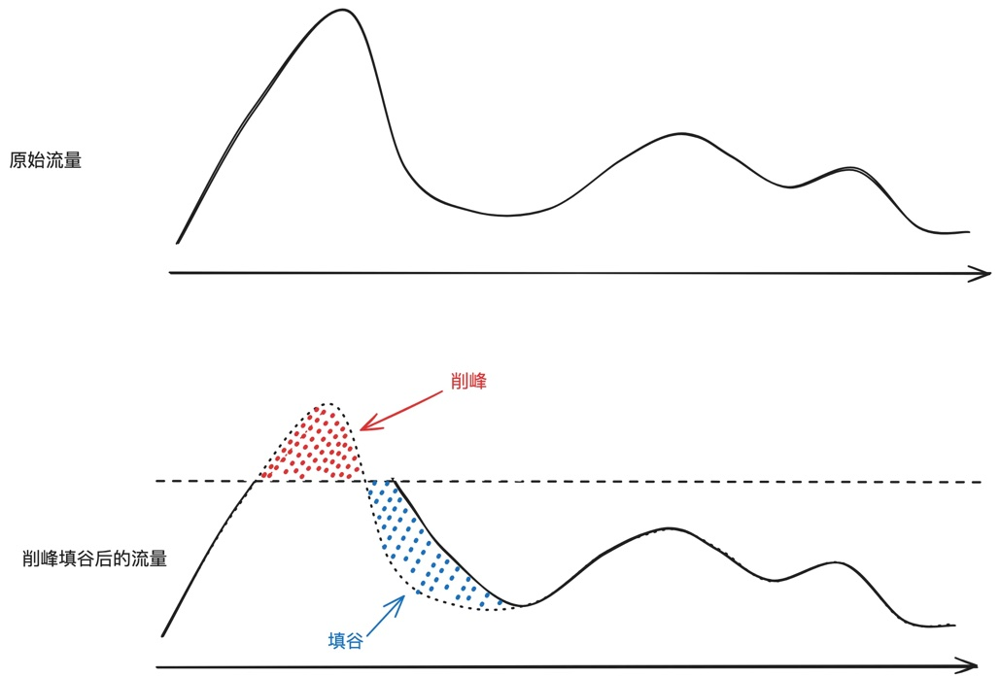

削峰：在流量高峰期，通过消息中间件暂存大量的请求，减少对后端系统的直接压力。

填谷：在低峰期，逐渐处理这些积累的请求。

这种方法能有效平衡系统负载，防止在高峰时段系统崩溃。

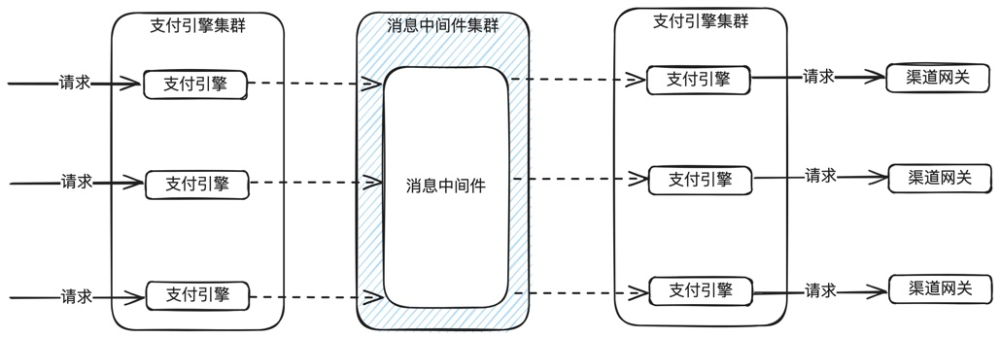

我们一般使用消息中间件实现削峰填谷。下面是一个支付引擎自产生消的示例图。收到支付请求后，先扔到消息中间件，然后启用新的监听线程去消费。通过控制消费线程数来控制流量。

<!-- PDF 第 318 页；原书第 315 页 -->

比如一下来了1000个请求，一共10台机器，每台机器消费线程只开5个，每个请求处理500ms，那么每秒就处理100个请求，共耗时10秒处理完。

消息中间件还有一个作用，就是应用间的解耦。比如支付成功后，渠道网关通过消息中间件返回给支付引擎。

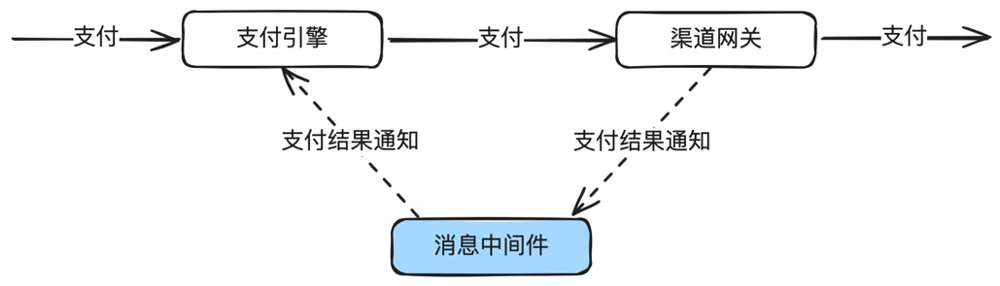

### 18.7.2 常见的分布式消息中间件介绍

消息中间件有很多，这里简单对比 RocketMQ、RabbitMQ 和 Kafka在性能、可靠性、易用性、功能特性、适用场景等方面的不同。如下：

#### 性能

● RocketMQ:提供非常高的性能和吞吐量，特别适合大规模的消息传输和处理场景。

● RabbitMQ:性能优秀，尤其在小型消息的传递上非常高效。但在处理非常大量的消息时，性能可能不如 Kafka 和 RocketMQ。

● Kafka:专为高吞吐量设计，特别适合需要处理大数据流的场景。它在持久化和分布式处理方面的性能表现尤其出色。

#### 可靠性

● RocketMQ: 提供高可靠性保证，支持分布式事务。

● RabbitMQ:通过消息持久化、交付确认等机制提供可靠的消息服务。

● Kafka:数据持久化和高容错能力，确保了高可靠性。

#### 易用性和管理

● RocketMQ: 相对复杂，需要一定的学习曲线，但提供丰富的特性和灵活性。

● RabbitMQ:用户友好，易于安装和配置，拥有直观的管理界面。

<!-- PDF 第 319 页；原书第 316 页 -->

● Kafka:配置和管理相对复杂，但社区支持强大，提供了丰富的文档资源。

#### 功能特性

● RocketMQ: 支持广泛的消息模式，包括顺序消息、定时/延时消息和事务消息。

● RabbitMQ:提供多种消息路由模式，支持灵活的消息模型和多种协议。

● Kafka:专注于高吞吐量的消息队列和流处理，支持实时数据处理。

#### 适用场景

● RocketMQ: 适用于大规模分布式系统中的消息处理，如电商平台和金融系统。

● RabbitMQ:适合需要复杂路由、多种消息协议和高效小消息处理的场景，如企业应用集成。

●Kafka:非常适合于需要高吞吐量、大数据处理和实时流处理的应用，如日志聚合和实时监控系统。

#### 结论

● 在支付系统，我个人更推荐RocketMQ，原因有两个：第一，经过阿里电商+支付各种非常高并发的大促洗礼，RocketMQ在大型分布式系统中表现出色。第二，支持事务消息，这个在支付领域还是很有用的。

另外，我也只是简单介绍，读者实际应用的时候，根据实际情况去选型，建议是做多方了解后，部署验证后才规模使用。不过话说回来，这几款分布式消息中间件的技术非常成熟了，除了几个顶流的互联网公司外，基本可以随便用，哪个手熟就使用哪个。

### 18.7.3 使用注意事项

●脑裂问题：曾经在生产环境碰到过RabbitMQ脑裂问题，交易全部中断。在分布式环境中完全避免也不现实，建议加强监控。

●消费线程数问题：消费线程要合理设置，太多可能达不到削峰填谷的效果，太少的话消息有可能会积累，影响处理时效。比如支付是有时效的，积压太久就会导致用户放弃支付。

● 消息积压应对：提前做好预估，以及监控。一旦把中间件压爆，可能整个交易系统。

● 持久化与恢复：防止系统崩溃导致的数据丢失。

● 事务消息：在需要保证数据一致性的场景中，合理使用事务消息。

● 消息确认与重试：合理设置消息确认机制和重试策略。如果本次无法处理，一定再抛回去。建议不要先确认再处理，万一确认后，本机又无法处理，消息就丢失了。

<!-- PDF 第 320 页；原书第 317 页 -->

### 18.7.4 支付系统应用案例

消息中间件在支付系统中核心有几个核心应用场景：

1. 流量的削峰填谷。尤其是支付交易。

2. 系统应用间的解耦。比如支付成功后，渠道网关发出支付成功消息，由支付引擎和账务分别监听。

3. 事务消息。

4. 离线数据同步。有些公司使用离线库来做，有些公司直接抛消息。比如实时库根据用户来分库分表，离线库要根据商户来聚合等。

基本上，消息中间件在支付系统中无所不在。

### 18.7.5 JAVA版的示例代码

先声明，以下代码纯演示，生产环境需要考虑更多因素。

比如支付场景下，接收请求后，先放到队列，然后使用单独的消费线程去消费。以下是简单示例。

#### 1. 添加依赖

首先，你需要在项目的 pom.xml 文件中添加 RocketMQ 的依赖：

```xml
<dependencies>
  <dependency>
    <groupId>org.apache.rocketmq</groupId>
    <artifactId>rocketmq-client</artifactId>
    <version>5.1.4</version>
  </dependency>
</dependencies>
```

确保使用最新版本的依赖。

#### 2. 创建生产者（Producer）

创建一个生产者以发送消息到 RocketMQ 服务器：

<!-- PDF 第 321 页；原书第 318 页 -->

```java
public class PayServiceImpl implements PayService {
    @Autowired
    private MQProducer mqProducer;

    public PayOrder pay(PayRequest request) {
        PayOrder payOrder = buildPayOrder(request);
        // 前置处理，比如校验、保存数据库等
        ... ...

        // 发送到队列
        Message msg = buildMessage(payOrder);
        mqProducer.send(msg);

        // 前置处理
        ... ...

        return payOrder;
    }

    public boolean processPay(PayOrder payOrder) {
        // 外发处理
        ... ...
    }
}
```

#### 3. 创建消费者(Consumer)

创建一个消费者来接收从 RocketMQ 发送的消息：

<!-- PDF 第 322 页；原书第 319 页 -->

```java
public class PayConsumerServiceImpl implements PayConsumerService {
    @Autowired
    private MQConsumer mqConsumer;
    @Autowired
    private PayService payService;

    @Postconstruct
    public void init() {
        mqConsumer.registerMessageListener((MessageListenerConcurrently) (msgs, context) -> {
            payService.processPay(buildPayOrder(msg);
            return ConsumeConcurrentlyStatus.CONSUME_SUCCESS;
        });
    }
}
```

再次声明，上述代码纯演示，在生产环境中，需要考虑更复杂的场景和错误处理机制。

## 18.8 流量控制与熔断利器Sentinel介绍

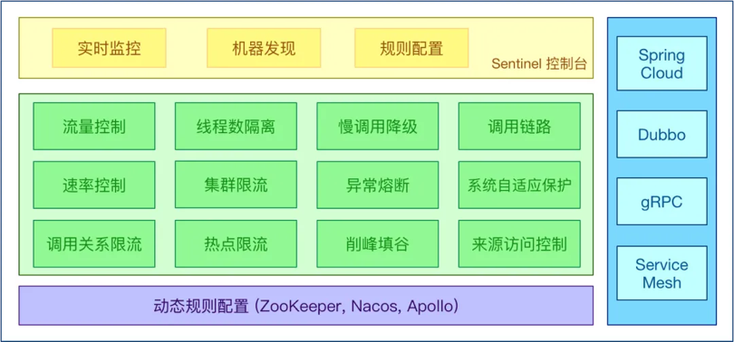

图片来自网络。

Sentinel是由阿里巴巴开源的一个轻量级的、高性能的流量控制、熔断降级的Java库。主要用于在分布式系统中保护服务的稳定性和可靠性，通过实现流量控制、熔断降级、系统负载保护等功能，来防止应用级别的故障和服务级别的雪崩效应。

### 主要特点

1. 丰富的流量控制策略：Sentinel提供了多种流量控制策略，如QPS、线程数、响应时间等。

<!-- PDF 第 323 页；原书第 320 页 -->

2. 熔断降级机制：当资源的运行指标超过阈值时，Sentinel可以自动进行熔断降级处理，防止系统过载。

3. 系统负载保护：能够根据系统的负载情况，如CPU使用率、平均负载等，来自动调整流量入口。

4. 实时监控和开放的指标：提供实时监控和丰富的指标数据，方便用户进行实时的流量监控和调整。

5. 多维度规则授权：支持多种维度的规则配置，如调用关系、调用来源、API级别等。

6. 高可用性和可扩展性：Sentinel的设计考虑了高可用性，易于扩展，支持与其他组件和服务的集成。

7. 轻量级和高性能：其对系统的性能影响很小，非常适合高并发的场景。

### 18.8.1 流量控制

Sentinel的流量控制基于资源的定义、流量控制规则的设定以及运行时的流量控制处理。在Sentinel中，流量控制主要是通过对服务调用或资源访问的限制来实现的。

#### 1. 资源的定义

在 Sentinel 中，资源通常是指需要被保护的服务调用点或关键代码段。例如，一个 HTTP 接口、一个内部定义的服务调用或一个数据库查询等都可以被定义为资源。

#### 2. 流量控制规则

Sentinel允许对每个资源设置流量控制规则。这些规则可以基于多种不同的标准，例如:

● QPS（每秒查询次数）：限制资源每秒可以处理的请求数。

●并发线程数：限制资源同时处理的最大并发请求数。

●响应时间：当资源的响应时间超过设定阈值时，可以触发流量控制措施。

#### 3. 流量控制处理

<!-- PDF 第 324 页；原书第 321 页 -->

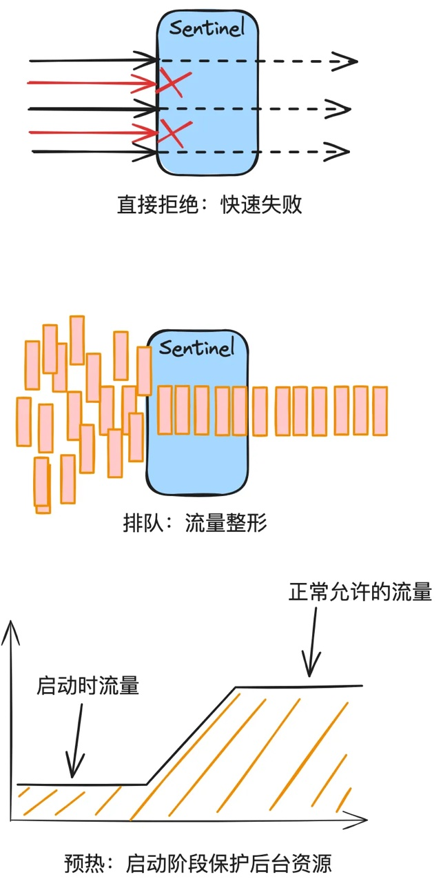

一旦流量达到设定的阈值，Sentinel会根据配置的流量控制效果来处理额外的流量。主要包括：

● 直接拒绝(Fast Fail)：立即拒绝访问请求，通常用于防止系统过载。

<!-- PDF 第 325 页；原书第 322 页 -->

● 预热(Warm Up）：通过逐渐增加流量的方式来预热服务，适用于系统刚启动时。

● 排队等待(Rate Limiter)：使请求排队并逐个处理，保证系统稳定。排队还可以设定超时时间。

#### 4.流量计算与排队

Sentinel内部也是使用滑动时间窗口算法来计算资源的实时流量。有兴趣的同学可以自己去翻一下源代码。

排队通常使用先进先出(FIFO)的队列实现。

### 18.8.2 熔断保护与自动恢复

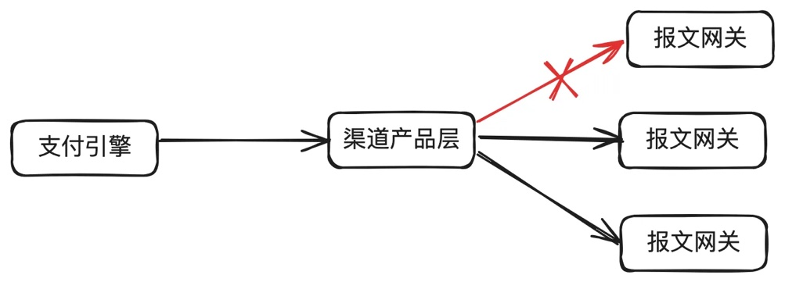

熔断是一种保护系统的策略，当检测到某个微服务不稳定或者响应时间过长时，Sentinel会自动切断对该服务的请求，防止系统雪崩。Sentinel的熔断策略是基于RT(响应时间）、异常比例和异常数等不同的指标来实现的。一旦触发熔断规则，Sentinel会暂时阻断请求，直到服务恢复正常。

#### 1. 熔断策略

Sentinel提供多种熔断策略，典型的包括：

●慢调用比例：如果资源的响应时间超过阈值的调用比例超过设定值，则触发熔断。

● 异常比例：如果资源的异常调用比例超过设定值，则触发熔断。

● 异常数：如果在一个统计窗口内，资源的异常数超过设定值，则触发熔断。

<!-- PDF 第 326 页；原书第 323 页 -->

#### 2. 统计窗口

● 滑动窗口：Sentinel通常使用滑动窗口来统计资源的性能指标（如响应时间、调用异常等）。

● 时间间隔：Sentinel允许配置统计窗口的时间间隔，以便根据应用的实际需求调整熔断的灵敏度。

#### 3. 熔断状态与自动化恢复

Sentinel的熔断机制有三种状态：

● 关闭：正常状态，请求正常处理。

● 打开：熔断状态，所有对资源的请求都会被立即拒绝。

● 半开：一段时间后，Sentinel会自动将熔断器置为半开状态，允许部分请求通过以检测资源的健康状态。如果这些请求成功，则关闭熔断器；如果失败，则再次打开熔断器。

### 18.8.3 支付系统应用场景

Sentinel广泛应用于微服务架构中，可以应对突发流量、分布式服务之间的依赖保护、系统负载过高等情况。在电商、支付、金融等行业随处可见。

我们主要用在各子域之间的限流。每年大促，就会梳理业务请求量，算出流量分布图，根据流量分布图，设置每个子应用各接口的限流值。

### 18.8.4 无法适用的场景

Sentinel的限流有两种模式：1)总量除以机器数，然后做单机限流。2)）拿出一台机器做集群结点，然后做集群限流。

但无论哪种模式都无法解决跨服务单元的限流。比如部署了两个机房，两个机房合用限流到1TPS，Sentinel是无法做到的。这个时候就需要用到我们前面几篇文章中讲到的自己实现的限流方案，比如漏桶，令牌桶等。

## 18.9 小结

本章主要是对分布式环境流控技术及使用场景做了介绍，包括：固定时间窗口算法，滑动时间窗口算法，漏桶算法，令牌桶算法，分布式消息中间件，流控与熔断利器Sentinel。需要读者根据

<!-- PDF 第 327 页；原书第 324 页 -->

自己的业务场景做技术选型。
