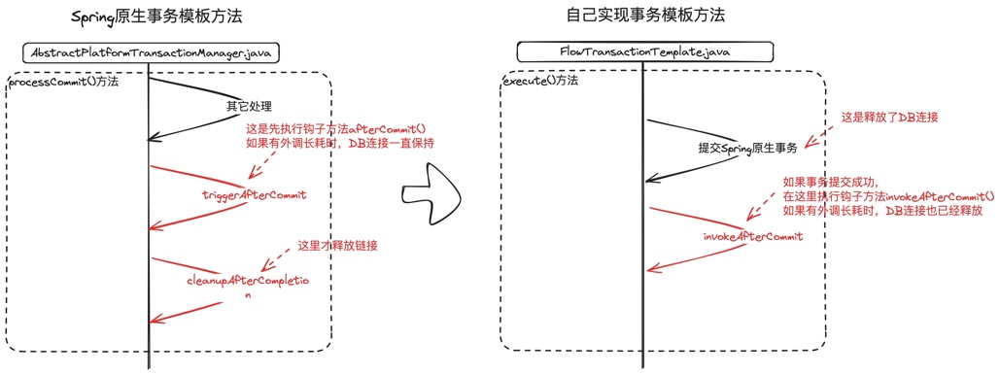
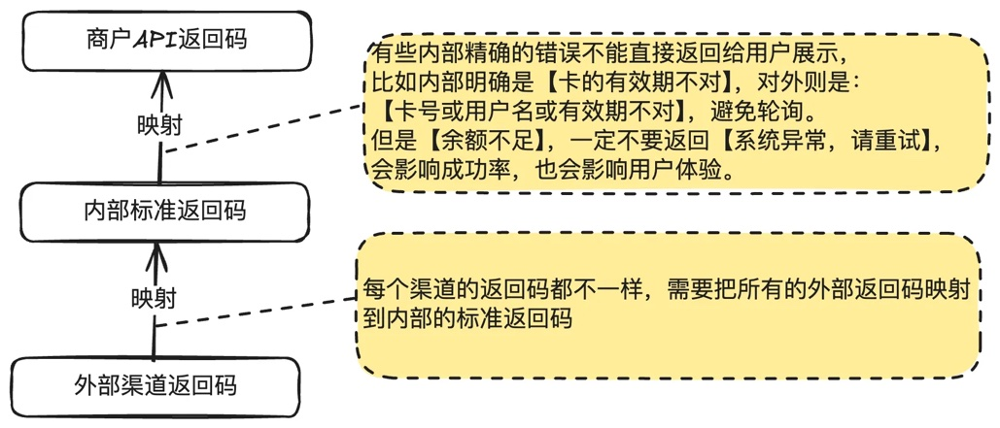
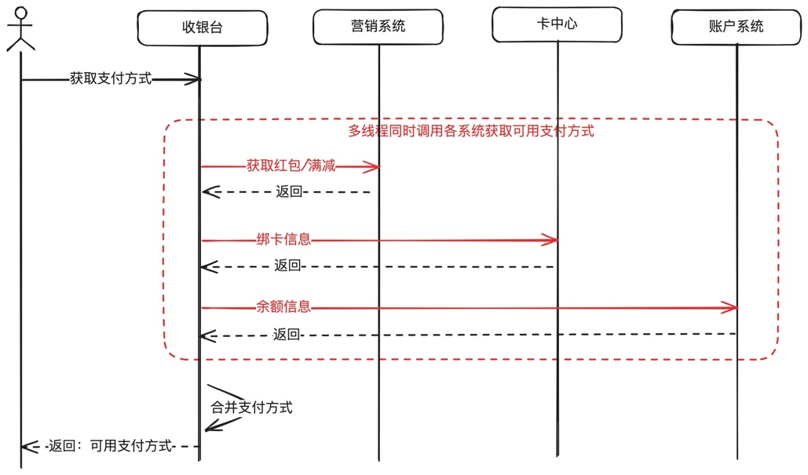
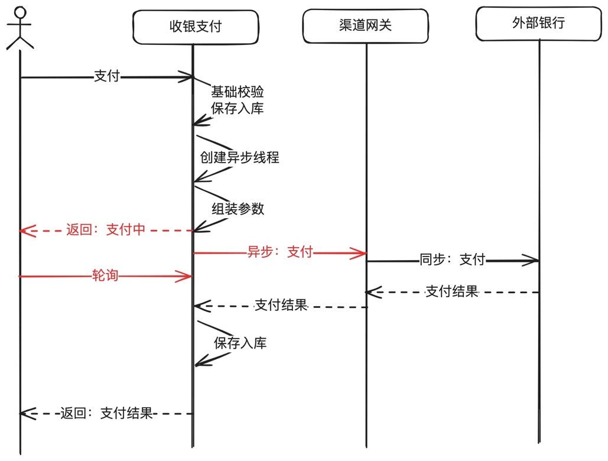
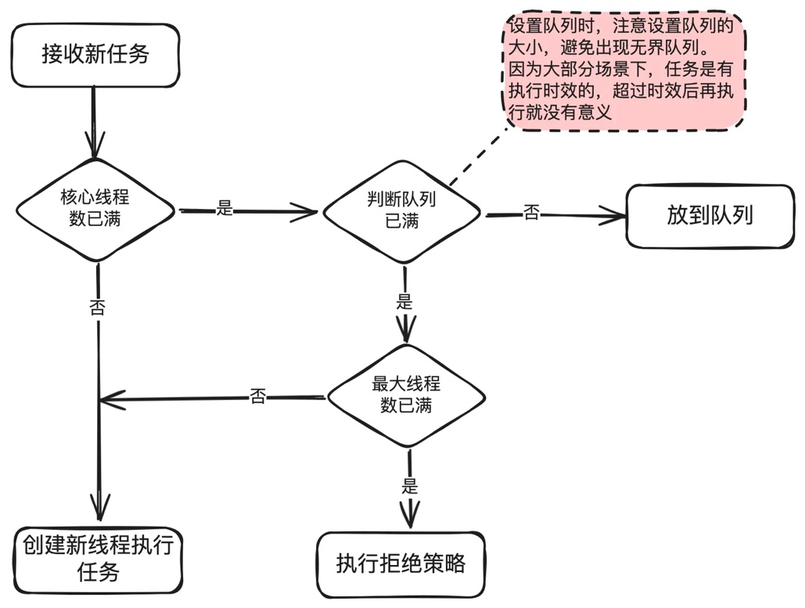
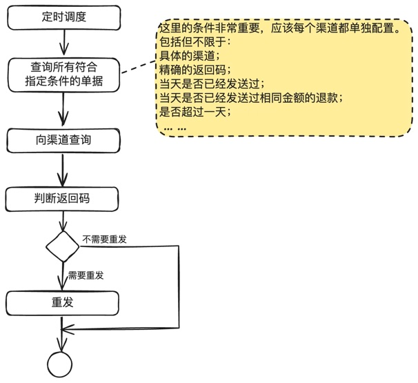
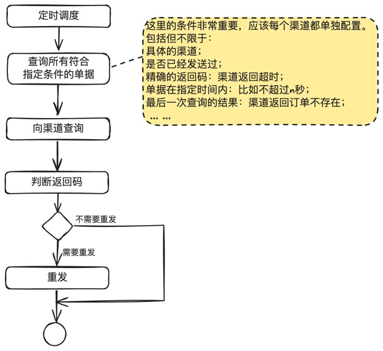

# 第19章 一些重要的小点

> 来源：《图解支付系统设计与实现》V_0.1.0，隐墨星辰著。PDF 第 327–346 页。正文经 MinerU OCR 转换，原图保留。

<!-- PDF 第 327 页；原书第 324 页 -->

## 19.1 Spring事务模板及afterCommit存在的坑

介绍为什么支付系统中基本只使用事务模板方法，而不使用声明式事务@Transaction注解，以及使用afterCommit()出现连接未按预期释放导致的性能问题。

### 为什么不使用@Transaction注解

以前写管理平台的代码时，经常使用@Transaction注解，也就是所谓的声明式事务，简单而实用，但是在做支付后，基本上没有使用@Transaction，全部使用事务模板来做。主要有两个考虑：

### 1)事务的粒度控制不够灵活，容易出现长事务

@Transactional注解通常应用于方法级别，这意味着被注解的方法将作为一个整体运行在事务上下文中。在复杂的支付流程中，需要做各种运算处理，很多前置处理是不需要放在事务里面的。

而使用事务模板的话，就可以更精细的控制事务的开始和结束，以及更细粒度的错误处理逻辑。

```java
@Transactional
public PayOrder process(PayRequest request) {
    validate(request);
    PayOrder payOrder = buildOrder(request);
    save(payOrder);
    // 其它处理
    otherProcess(payOrder);
}
```

比如上面的校验，构建订单，其它处理都不需要放在事务中。

<!-- PDF 第 328 页；原书第 325 页 -->

如果把@Transactional从process()中拿走，放到save()方法，也会面临另外的问题：otherProcess()依赖数据库保存成功后才能执行，如果保存失败，不能执行otherProcess()处理。全部考虑进来后，使用注解处理起来就很麻烦。

### 2)事务传播行为的复杂性

@Transactional注解支持不同的事务传播行为，虽然这提供了灵活性，但在实际应用中，错误的事务传播配置可能导致难以追踪的问题，如意外的事务提交或回滚。

而且经常有多层子函数调用，很容易子函数有一个耗时操作(比如RPC调用或请求外部应用），一方面可能出事长事务，另一方面还可能因为外调抛异步，导致事务回滚，数据库中都没有记录保存。

以前就在生产上碰到过类似的问题，因为在父方法使用了@Transactional注解，子函数抛出异常，去数据库找问题单据，竟然没有记录，翻代码一行行看，才发现问题。

### afterCommit存在的问题及解法

有一次参与线上压测，在流量上去后，应用持续报获取数据库连接超时，排查很久才找到原因，问题非常经典，值得和读者聊聊。

无论在支付系统，还是电商系统，还是其它各种业务系统，都存在这样的需求：在一个事务中既保存多个数据库表，又要外发请求，且这个外发请求耗时很长。

比如：方法A保存数据库表A，方法B保存数据库表B，并且要外发给其它系统且耗时长，方法C要保存数据库表C。这三个方法需要在一个事务里面。

我见过三种方案：

方案一：不管三七二十一，就直接放在一个事务中。请求量不大时，看不出长事务的影响。

方案二：知道使用Spring提供的模板方法：

TransactionSynchronizationAdapter.afterCommit()。外发请求耗时长过长时，在大并发下仍然有连接未能及时释放的问题。

方案三：自己实现事务模板方法，在Spring提交事务并释放连接后，再执行耗时长的外发。

第一种没什么好说的，下面介绍方案二和方案三，两者区别如下图所示：

<!-- PDF 第 329 页；原书第 326 页 -->



在支付系统中，经常需要做一些流程编排，这些流程操作需要放在一个事务中，比如先保存主单据，再保存流水单据，然后外发银行请求扣款，有同学写的代码类似这样：

主方法伪代码（流程引擎入口）：

```java
public void process(FlowContext context) {
    // 获取流程处理链
    List<FlowProcess> flows = fetchFlow(context);
    for (FlowProcess flow : flows) {
        // 使用事务模板
        dataSourceManager.getTransactionTemplate().execute(status -> {
            // 执行子流程
            flow.execute(context);

            // 更新主单信息
            context.getPayOrder().putJournal(context.getJournal());
            context.getPayOrder().transToNextStatus(context.getJournal().getTargetStatus());
            save(context.getPayOrder());
            return true;
        });
    }
}
```

其中一个外发银行子流程伪代码：

<!-- PDF 第 330 页；原书第 327 页 -->

```java
public void execute(FlowContext context) {
    Journal journal = buildJournal(context);
    // 子函数里面保存了3张表的数据
    save(journal);

    TransactionSynchronizationManager.registerSynchronization(new TransactionSynchronizationAdapter() {
        @Override
        public void afterCommit() {
            // 事务提交后，再发送给外部银行
            gatewayService.sendToChannel(journal);
        }
    });
}
```

预期是事务提交后再调用发给银行。

但是实际情况却是，Spring提交事务后，调用了afterCommit()，但是并没有释放连接，导致在外发银行的长达1000多毫秒的时间内，数据库连接一直在保持，而不是提交事务后马上归还了连接，加上线上服务器的连接数只分配了30个给每台应用。这就意味着最大并发也小于30。

通过查看AbstractPlatformTransactionManager.java，发现是先调用：riggerAfterCommit(status)，然后才清理并释放连接：cleanupAfterCompletion(status)。

<!-- PDF 第 331 页；原书第 328 页 -->

```java
    private void processCommit(DefaultTransactionStatus status) throws TransactionException {
        try {
            //
            ... ...

            // Trigger afterCommit callbacks, with an exception thrown there
            // propagated to callers but the transaction still consideredas committed.
            try {
                triggerAfterCommit(status);
            }

            // 其它代码省略
            ... ...

        }
        finally {
            cleanupAfterCompletion(status);
        }
    }
```

解决办法：自己创建一个事务模板，实现afterCommit()。

<!-- PDF 第 332 页；原书第 329 页 -->

```java
public class FlowTransactionTemplate {

    public static <R> R execute(FlowContext context, Supplier<R> callback) {
        TransactionTemplate template = context.getTransactionTemplate();
        Assert.notNull(template, "transactionTemplate cannot be null");

        PlatformTransactionManager transactionManager = template.getTransactionManager();
        Assert.notNull(transactionManager, "transactionManager cannot be null");

        boolean commit = false;
        try {
            TransactionStatus status = transactionManager.getTransaction(new DefaultTransactionDefinition()); // Corrected "TranscationStatus" to "TransactionStatus"
            R result = null;
            try {
                result = callback.get();
            } catch (Exception e) {
                transactionManager.rollback(status);
                throw e;
            }
            transactionManager.commit(status);
            commit = true;
            return result;
        } finally {
            if (commit) {
                invokeAfterCommit(context);
            }
        }
    }

    private static void invokeAfterCommit(FlowContext context) {
        try {
            context.invokeAfterCommit();
        } catch (Exception e) {
            // 打印日志
            ... ...
        }
    }
}
```

<!-- PDF 第 333 页；原书第 330 页 -->

FlowContext加上事务提交后的执行的钩子方法，在钩子方法中实现一些长耗时工作：

```java
public class FlowContext {
    // 其它代码不变
    ... ...

    private List<AfterCommitHook> afterCommitHooks = new ArrayList<>();

    public void registerAfterCommitHook(AfterCommitHook hook) {
        afterCommitHooks.add(hook);
    }

    public void invokeAfterCommit() {
        try {
            for(AfterCommitHook hook : afterCommitHooks) {
                hook.afterCommit();
            }
        } catch (Exception e) {
            // 异常处理
            ... ...
        } finally {
            // 钩子已执行完，清理掉
            afterCommitHooks.clear();
        }
    }

    public static abstract class AfterCommitHook {
        public abstract void afterCommit();
    }
}
```

主流程修改为直接调用：FlowTranscationTemplate.execute。

<!-- PDF 第 334 页；原书第 331 页 -->

```java
public void process(FlowContext context) {
    context.setTransactionTemplate(dataSourceManager.getTransactionTemplate());

    List<FlowProcess> flows = fetchFlow(context);

    for (FlowProcess flow : flows) {
        // 把Spring模板方法修改自己的模板方法，其它不变
        FlowTransactionTemplate.execute(context, () -> {
            flow.execute(context);

            context.getPayOrder().putJournal(context.getJournal());
            context.getPayOrder().transToNextStatus(context.getJournal().getTargetStatus());
            save(context.getPayOrder());

            return true;
        });
    }
}
```

子流程修改为把afterCommit要做的事注册到流程上下文中：

```java
public void execute(FlowContext context) {
    Journal journal = buildJournal(context);
    // 子函数里面保存了3张表的数据
    save(journal);

    // 把外发动作注册到流程上下文中的钩子方法中，
    // 而不是直接使用Spring原生的TransactionSynchronizationAdapter.afterCommit()
    // 其它保持不变
    context.registerAfterCommitHook(() -> {
        // 事务提交后发给银行
        gatewayService.sendToChannel(journal);
    });
}
```

<!-- PDF 第 335 页；原书第 332 页 -->

这样处理的优点有几个：

1. 清晰的事务边界管理：通过显式控制事务的提交和回调执行，增加了代码的可控性。

2. 资源使用优化：确保数据库连接在不需要时能够及时释放，提升了资源的使用效率。

3. 灵活的后续操作扩展：允许注册多个回调，方便地添加事务提交后需要执行的操作，增强了代的扩展性和复用性。

有个注意的点，就是确保invokeAfterCommit的稳健性，代码里是通过捕获异常打印日志，避免对其它操作有影响。

### 扩展：长事务

长事务指的是在数据库管理和应用开发中，持续时间较长的事务处理过程。一般来说，在分布式应用中，每个服务器分配的连接数是有限的，比如每个服务器20个连接，这就要求我们必要尽量减少长事务，以便处理更多请求。

典型的方案有：

1）非事务类操作，就放在事务外面。比如前置处理，先请求下游获取资源，做各种校验，全部通过后，再启动事务。还有就是使用hook的方式，等事务提交后，再请求外部耗时的服务。

2）事务拆分。把一个长事务拆分为多个短事务。

3）异步处理。有点类似hook的方案。

### 要点回顾

Spring事务管理提供了强大而灵活的机制来处理复杂的业务逻辑，但是每个特性和工具的使用都需要对其行为有深入的理解，而不能想当然。比如文中的afterCommit就是这样一个典型例子。

自定义事务模板的实践向我们展示了，虽然@Transcation注解很方便，但在一些特殊场景下，需要我们深入了解框架的工作原理并结合实际业务需求，既高效地利用Spring提供的工具，同时也规避潜在的坑点。

希望文中能够帮助读者更好地理解和应用Spring事务管理中的afterCommit钩子，以及如何在对资源或性能要求很严格的情况下，比如支付场景，如何定义自己的事务模板，帮助我们构建更健壮更高效的应用。

<!-- PDF 第 336 页；原书第 333 页 -->

## 19.2 标准返回码设计与渠道返回码映射

外部商户对接支付平台，支付平台内部有自己的业务处理，同时还对接了外部的很多渠道，所以需要管理三套返回码：

●提供给商户API使用的返回码：这块可以直接参考微信支付、支付宝等机构的门户网站。

●内部各应用使用的标准返回码：用于内部业务的处理。

● 渠道返回码：外部渠道提供的返回码，每个渠道都不一样，需要映射到内部标准返回码。



另外，返回码，返回码经常也会混着用。返回码通常会精确一些，因为不是所有返回码都是表示错误。

### 商户API返回码设计

这部分建议直接参考微信支付、支付宝或者ISO20022标准，这几家代表了行业的最高水准。

### 内部标准返回码设计

支付平台内部也分了不同域，建议使用一个共同的规范，比如：RS+子系统编号+错误级别+具体返回码。具体如下图所示：

<!-- PDF 第 337 页；原书第 334 页 -->


这样的好处在于，每个子域或子系统不用单独设计自己的返回码规范，减少沟通成本。

### 渠道返回码映射

每个渠道的返回码都是不一样的，所以需要设计外部渠道返回码映射到内部标准返回码。通过需要几个原则：

1. 只有明确成功，才能映射到成功。

2. 只有明确失败，才能映射到失败。比如渠道返回：订单不存在，或者系统异常，不能直接映射到失败，因为有可能会成功。

3. 涉及个人敏感信息或内部系统敏感信息的，需要转成模糊返回码和描述出去，不能给最终用户展示精确信息。比如内部一个系统宕机，不能直接把异常抛出去。有效期错误也需要映射成“卡号或姓名或有效期不正确”。

4. 与敏感信息无关的，越准确越好，避免用户无谓的重试。比如余额不足，就不要映射成“系统异常，请重试”。

具体的技术实现，通过使用映射表就足够，加到缓存中，增加运算速度。如果找不到映射关系，就全部转到一个默认的返回码上面，同时对这个默认返回码做监控，定期把这些没有做映射的返回码映射到正确的返回码上面去。避免应该把类似“余额不足”映射成了“系统异常请重试”的场景。

## 19.3 多线程在支付系统中的应用案例及常见误区

在支付系统中，使用多线程和线程池是一种常见且有效的方式来提升系统的处理能力和响应速度。尽管网络上关于多线程的文章很多，但很少有文章能够精准地贴合线上系统的实际需求。本章旨在结合支付系统的实际场景，探讨多线程技术的合理应用以及常见的误区。

内容聚焦在场景应用，具体参数和多线程原理，请读者参考官方文档即可。

<!-- PDF 第 338 页；原书第 335 页 -->

### 线程池的合理配置

对于线程池的配置，存在一个普遍的误解：即简单地根据任务类型(CPU密集型或IO密集型)来确定线程池的大小。比如网上有很多文章，都写了类似这样的说明：“对于CPU密集型任务，线程池大小设置为CPU核心数加1；对于IO密集型任务，则可以设置更多，比如CPU核心数的两倍”。

实际上，线程池的配置需要更加精细地考虑任务的具体特性、系统的响应时间要求以及资源的可用性。

● CPU密集型任务：对于完全在内存中运算的任务，建议将线程池大小设置为与CPU核心数相等，以最大化CPU的利用率，减少线程切换带来的损耗。

比如数据加解密服务，纯计算，不依赖外部的IO资源。

●IO密集型任务：这类任务的关键在于合理预估系统并发需求和单个任务的平均耗时，从而计算出合适的线程池大小。公式可以简化为：线程池大小=系统预期最大并发数\*单个任务平均

比如支付系统对接了很多外部银行通道，这种涉及外部银行通道的交互通常需要几百到几千毫秒，就是属于典型的IO密集型任务。如果一个支付请求平均耗时500ms，并发需要有40QPS，那么线程池大小应该是：40\*0.5 = 20。如果是一个请求平均耗时达到1000ms，同样需要有

这背后的原理也很简单：1)线程切换是需要消耗资源的。2)线程在等待IO资源时，CPU是空转的。

我们使用多线程的目的就是尽可能压榨CPU的运算能力，尽可能多的完成任务。如果是CPU密集型的，就减少线程切换，如果是IO密集型的，就在等待IO资源时，让出CPU给其它线程。

### 典型案例及核心代码实现

一个经典的支付面试题：如何在最短时间内获取尽可能多的可用支付方式？

每个用户在支付系统中绑定了很多支付方式，比如不同的银行卡，还有内部的余额，红包等。每次渲染收银台之前，都需要去获取这些支付系统，汇总后展示给用户。

<!-- PDF 第 339 页；原书第 336 页 -->

一种方式就是串行去获取，但这明显会影响用户体验。最优的方案当然是使用多线程并行获取。



下面是一个JAVA伪代码示例，真实场景需要考虑超时、异常处理等。

```java
ExecutorService executor = Executors.newFixedThreadPool(20);

List<Callable<PaymentMethodTask>> tasks = new ArrayList<>();
// 填充任务列表
for (PaymentMethod method : methods) {
    tasks.add(() -> method.queryAvailableMethod());
}
try {
    List<Future<PaymentMethodTask>> results = executor.invokeAll(tasks);
    //
} catch (InterruptedException e) {
    // 异常处理
}
```

### 同步受理异步处理

<!-- PDF 第 340 页；原书第 337 页 -->

用户提交支付请求后，如果是外部银行通道，通常耗时都需要几百到几千毫秒，如果全链路都是同步接口，那么整个系统的线程很快就被消耗完，且一旦外部银行出现响应慢的情况，极其容易出现雪崩现象。

所以我们在调用外部银行扣款时，通常都使用“同步受理异步处理”的方案。简单地说，就是先受理用户的请求，做基础校验，校验通过后，保存到数据库，发起一个异步线程请求到外部银行，



下面是一段JAVA伪代码，实际使用时需要加上各种异常处理。

<!-- PDF 第 341 页；原书第 338 页 -->

```java

public class PaymentProcessor {
    private ExecutorService executor;
    private GatewayService gatewayService;

    public PaymentProcessor() {
        // 根据要求配置线程池：核心线程数20，最大线程数50，队列长度100
        this.executor = new ThreadPoolExecutor(20, 50, 60L, TimeUnit.SECONDS, new ArrayBlockingQueue<>(100));
    }

    public void pay(PaymentRequest request) {
        validate(request);
        save(request);

        // 异步执行任务：发送支付请求给外部银行
        executor.submit(() -> {
            try {
                gatewayService.sendToChannel(request);
            } catch (Exception e) {
                // 异常处理
            }
        });
    }
}
```

### 常见误区

### 1. IO密集型任务线程池大小设置为CPU核数的2倍

前面有说到，哪怕是IO密集型，我们也不能简单设置为CPU核数的2倍，我们仍然要考虑任务执行耗时，系统设计的最大并发数是多少等因数。

建议为：系统预期最大并发任务数\*单任务平均耗时。

注意，这个耗时是指等待外部资源的耗时，不是CPU运算耗时。比如外发银行后，等待外部银行返回的过程，就是等待时间，基本不消耗CPU资源。

### 2. 为什么设置了最大线程数不生效

<!-- PDF 第 342 页；原书第 339 页 -->

曾经碰过一个线上问题：使用ThreadPoolExecutor，设置了核心线程数，最大线程数，但是线上出现很多超时未处理的任务，但是请求数没有超过最大线程数。排查很久才发现虽然设置了最大线程数，但是没有设置队列大小(LinkedBlockingQueue），那么它会默认为Integer.MAX\_VALUE，这基本上可以认为是无界队列，也就是请求全部放到了队列中。

所以读者如果使用ThreadPoolExecutor来配置线程池，最好是根据自己的诉求，把参数设置完整，包括核心线程数，最大线程数，队列大小，拒绝策略等。比如有些业务超时后已经没有意义，那就把队列放小点，拒绝策略为直接拒绝。

具体的请参考JAVA官方文档。



### 3. 直接new线程

因为简单，有些同学喜欢直接new线程。的确，这种方式在简单场景下是没有问题的，但是复杂场景下是很容易出问题，且不好排查，建议不要养成这样的习惯。如果场景真的非常简单，也建

<!-- PDF 第 343 页；原书第 340 页 -->

议使用创建固定大小线程池来做，比如ExecutorService executor =Executors.newFixedThreadPool(n)。

多线程在支付系统中的应用非常广泛，可以显著提高处理速度和系统吞吐量，但同时还需要我们合理配置线程池大小和策略，同时要从实际出发，避免直接照抄网上一些不符合实际情况的文章，避开一些常见的陷阱。

## 19.4 退款自动重试与支付自动重试

### 退款自动重试

在支付系统日常运营工作中，处理退款重发的运营工作量会随着交易量的增长而线性增长。达到一定程度就需要考虑建设退款自动重试的能力。


下面两种情况是最常见的需要做退款重发的场景：

1. 支付平台发给外部渠道超时。

2. 外部渠道内部出现BUG或临时系统异常。

当交易量足够大时，完全人工重发，工作量也是很可观的。但是我们不能简单地做系统自动重发，因为退款有可能是会有资损发生的。比如：用户支付100元，退款50元，渠道不支持幂等，渠道已经内部退款成功，但是我们系统因为逻辑有缺陷又做了重发，那就是退款2次成功，资损50元。

有些外部渠道的设计不太好，比如只能通过支付请求号去退款，又支持多次部分退，那就相当于没有幂等能力。

下面是一个简化版的重发逻辑。

<!-- PDF 第 344 页；原书第 341 页 -->



### 支付退款重试

支付自动重试是提高成功率和用户体验的一种手段。

和退款类似，在支付时也有可能网络超时，渠道没有接到支付请求，这种情况下，只需要重试一次，仍然可能是成功的。这里已经排除了渠道支付成功，只是支付平台没有接到返回的场景，因为这种情况下，支付平台会发起查询操作，外部渠道一般也会有支付结果通知。


需要注意的是，因为支付场景有可能会对用户重复扣款而导致客诉，所以需要非常谨慎。

下面是一个简化版的支付重发逻辑。

<!-- PDF 第 345 页；原书第 342 页 -->



## 19.4 小结

在线支付系统和其它很多互联应用一样，会碰到各种各样的问题，不断打怪升级，自然就成了见多识广，再外加及时总结，个人的功力也就会越来越强。
